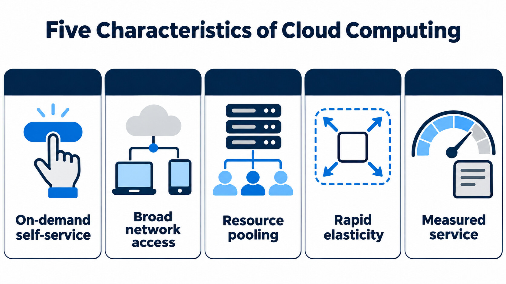

# Part 1: What is Cloud Computing?

*1.01 What is Cloud Computing?*, Part 1 of 4. [Chapter overview](README.md) | [Part 2 ➡](PART2.md)

**Cloud computing** is the on-demand delivery of IT resources over the internet, with pay-as-you-go pricing.

Instead of buying servers and running your own data center, you rent what you need from a cloud provider such as AWS: computing power, storage, databases, networking and more.

| | Your own data center | The cloud |
|---|---|---|
| **Getting a server** | Order hardware, wait weeks, install it | A few clicks or one command, ready in minutes |
| **Paying** | Up front, for the capacity you might need | As you go, for what you use |
| **Too much capacity** | You already paid for it | Delete it, and most charges stop |
| **Too little capacity** | Order more hardware and wait | Add more in minutes |
| **Who runs the buildings, power and hardware** | You | The provider |

Three ideas come back in every chapter of this course:

- **On demand:** you get a resource when you ask for it, with no purchase process.
- **Over the internet:** you reach it from anywhere, through the Console, the CLI or code.
- **Pay as you go:** you pay for what you use. For most resources, the charges stop when you delete them.

## AWS, Microsoft Azure and Google Cloud

AWS is one of three large public cloud providers, next to **Microsoft Azure** and **Google Cloud**.

- **The same building blocks, different names:**
  - Virtual servers: Amazon EC2, Azure Virtual Machines, Google Compute Engine.
  - Object storage: Amazon S3, Azure Blob Storage, Google Cloud Storage.
  - All three also offer managed databases, networking and identity.
- **Where each is strongest:**
  - **AWS** started first, in 2006, and has one of the largest catalogs of services.
  - **Azure** fits organizations that already run Microsoft products, such as Windows Server, Active Directory and Microsoft 365.
  - **Google Cloud** is known for data analytics, machine learning and Kubernetes, which Google created.
- **What carries over:** this course uses AWS, but everything in this chapter is true for all three.

## The five core characteristics

The US National Institute of Standards and Technology (NIST) defines cloud computing by five characteristics. A service that has all five is a cloud service.

| Characteristic | What it means | Example on AWS |
|---|---|---|
| **On-demand self-service** | You create resources yourself, without asking a person at the provider | Launching an EC2 instance from the Console |
| **Broad network access** | Resources are reached over the network with standard tools | The Console in a browser, the AWS CLI, the SDKs |
| **Resource pooling** | The provider serves many customers from shared hardware, and keeps them isolated from each other | Many customers' virtual servers on one physical host |
| **Rapid elasticity** | Capacity grows and shrinks quickly, following demand | Auto Scaling adds servers during a traffic peak |
| **Measured service** | Usage is metered, and you pay for what you used | The bill shows instance hours and stored gigabytes |

## Check yourself

1. Which three ideas make up the definition of cloud computing?
2. Which NIST characteristic makes pay-as-you-go pricing possible?
3. A company rents servers in a hosting center, and a salesperson has to approve every new server. Which characteristic is missing?

Answers

1. **On demand, over the internet, pay as you go.**
2. **Measured service.** Usage is metered, so the bill can follow it.
3. **On-demand self-service.** In a cloud service you create the resource yourself.

[Chapter overview](README.md) | [Part 2: Why Use the Cloud? ➡](PART2.md)
