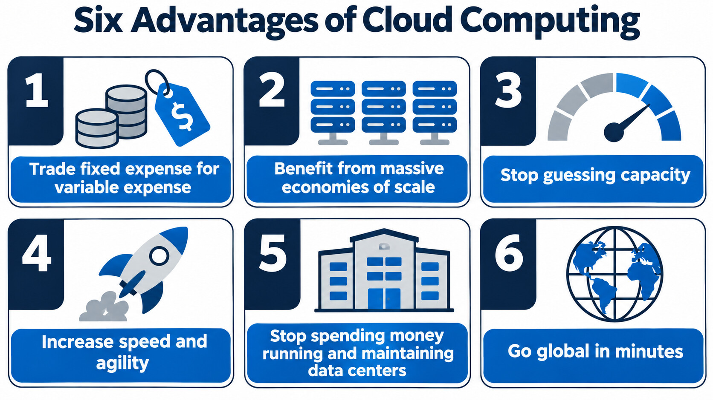
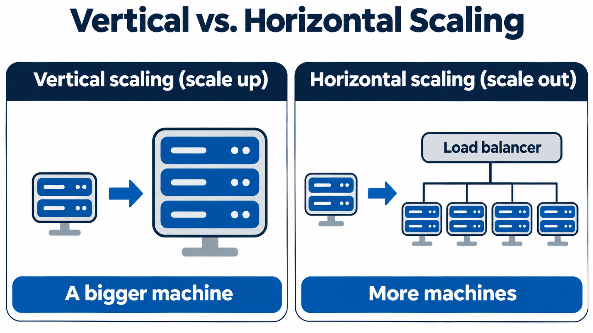
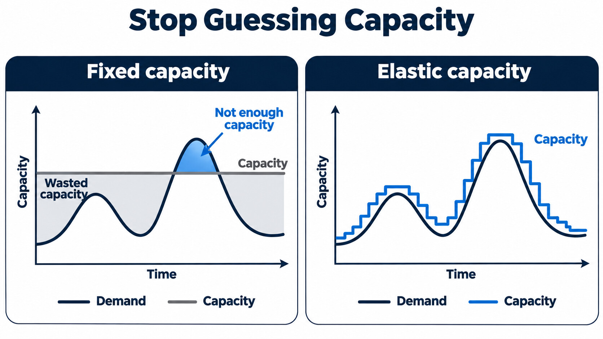

# Part 2: Why Use the Cloud?

*1.01 What is Cloud Computing?*, Part 2 of 4. [⬅ Part 1](PART1.md) | [Chapter overview](README.md) | [Part 3 ➡](PART3.md)

## The six advantages of cloud computing

AWS lists six advantages of cloud computing. Know them by name.

| # | Advantage | In plain words |
|---|---|---|
| 1 | **Trade fixed expense for variable expense** | No large purchase up front (CapEx). You pay a monthly bill for what you used (OpEx). |
| 2 | **Benefit from massive economies of scale** | The provider buys for hundreds of thousands of customers, and that can mean lower prices for you. |
| 3 | **Stop guessing capacity** | You don't have to predict next year's traffic. Start small and change the size when you know more. |
| 4 | **Increase speed and agility** | A new environment takes minutes, so trying an idea is cheap and fast. |
| 5 | **Stop spending money running and maintaining data centers** | No buildings, racks, power or cooling to manage. Your team works on the product. |
| 6 | **Go global in minutes** | Deploy the same application in several Regions around the world, close to your users. |

> **CapEx and OpEx:** *Capital expense* (CapEx) is money spent up front on things you own, such as servers. *Operational expense* (OpEx) is the ongoing cost of running the business, such as a monthly cloud bill.

## Elasticity vs. scalability

The two words are close, and people often mix them up.

| | Scalability | Elasticity |
|---|---|---|
| **The question it answers** | Can the system handle more load if I give it more resources? | Can the system add and remove resources quickly as the load changes? |
| **Direction** | Usually up or out, as the business grows | Up **and** down, following demand |
| **Time frame** | Usually planned, long term | Short term, often automatic |
| **Example** | Moving a database to a larger instance | Auto Scaling adds servers at 09:00 and removes them at night |

Scaling has two directions:

- **Vertical scaling (scale up):** a bigger machine, for example from 2 to 8 vCPUs.
- **Horizontal scaling (scale out):** more machines of the same size, behind a load balancer.

Elasticity is where the cloud differs most from a data center. Compare a fixed amount of capacity with capacity that follows the demand:

With fixed capacity you pay for hardware that sits idle most of the time, and you still run out at the peak. With elastic capacity, the capacity follows the demand. This is what "stop guessing capacity" means in practice.

## Check yourself

1. A start-up doesn't know how many users it will have next month. Which of the six advantages helps the most?
2. An online shop adds servers every evening and removes them at night, automatically. Is this scalability or elasticity?
3. You replace a server that has 2 vCPUs with one that has 8. Is this vertical or horizontal scaling?

Answers

1. **Stop guessing capacity.** It starts small and changes the size when the real numbers are known.
2. **Elasticity.** The capacity follows the demand in both directions, automatically.
3. **Vertical scaling (scale up).** Horizontal scaling adds more machines of the same size.

[⬅ Part 1](PART1.md) | [Chapter overview](README.md) | [Part 3: Who Manages What? ➡](PART3.md)
