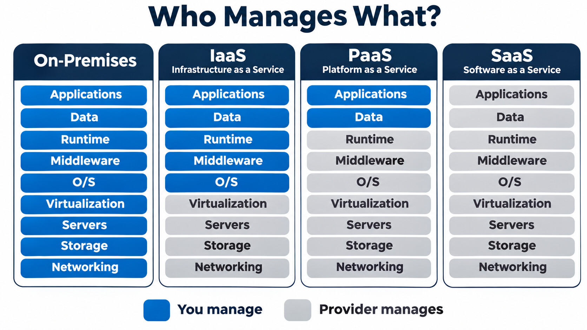

# Part 3: Who Manages What?

*1.01 What is Cloud Computing?*, Part 3 of 4. [⬅ Part 2](PART2.md) | [Chapter overview](README.md) | [Part 4 ➡](PART4.md)

A cloud service takes work away from you. How much depends on the **service model**:

- **IaaS (Infrastructure as a Service):** the provider runs the data center, the hardware and the virtualization. You manage the operating system and everything above it. Example: Amazon EC2.
- **PaaS (Platform as a Service):** the provider also runs the operating system and the runtime. You bring your code and your data. Example: AWS Elastic Beanstalk, which AWS describes as commonly categorized as PaaS. You can still reach the servers it creates.
- **SaaS (Software as a Service):** the provider runs everything. You use the finished product. Example: web-based email.

Read the picture from left to right: every step to the right gives you less to manage, and less control. The picture shows the typical split; each service has its own details.

The next chapter, [1.02 Cloud Models](../1.02-cloud-models/README.md), covers the service models and the deployment models (public, private, hybrid) in detail.

## Check yourself

1. In the IaaS model, who patches the operating system?
2. In which model do you bring only your code and your data?
3. What do you give up with every step to the right in the picture?

Answers

1. **You do.** The provider manages the hardware and the virtualization. The operating system and everything above it are yours.
2. **PaaS.** The provider also runs the operating system and the runtime.
3. **Control.** The provider manages more, so you decide less about how it runs.

[⬅ Part 2](PART2.md) | [Chapter overview](README.md) | [Part 4: Moving to the Cloud ➡](PART4.md)
