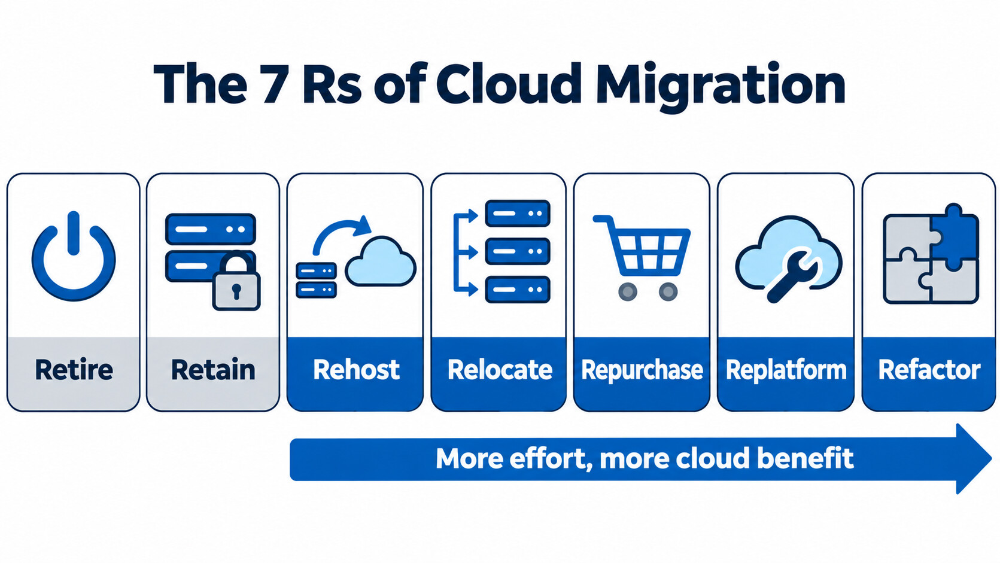
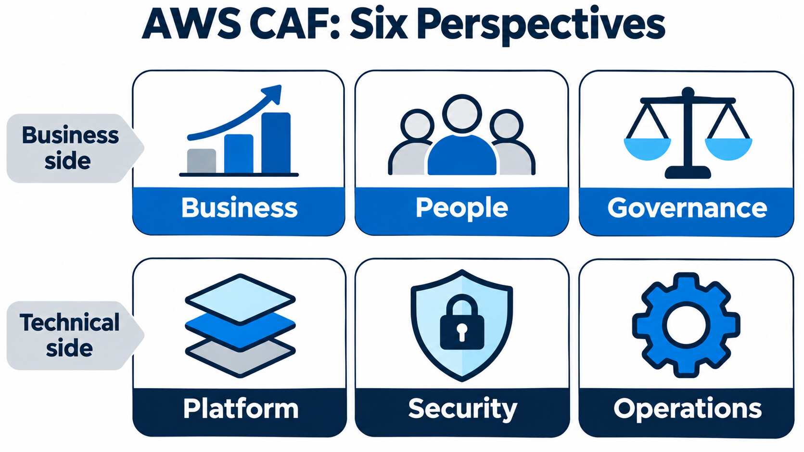

# Part 4: Moving to the Cloud

*1.01 What is Cloud Computing?*, Part 4 of 4. [⬅ Part 3](PART3.md) | [Chapter overview](README.md)

## Migration strategies: the 7 Rs

When a company moves to the cloud, each application gets its own decision. AWS describes seven migration strategies, known as the **7 Rs**.

| Strategy | What you do | Example |
|---|---|---|
| **Retire** | Turn the application off. Nobody needs it any more. | An old reporting server with no users |
| **Retain** | Leave it where it is, for now | A system that must stay on-premises for compliance |
| **Rehost** ("lift and shift") | Move it as it is, with no changes | Copying a virtual machine to an EC2 instance |
| **Relocate** | Move a whole group of servers to the cloud version of the same platform, without changing them | Moving a virtualization cluster as a unit |
| **Repurchase** ("drop and shop") | Replace it with a different product, usually SaaS | Moving from a self-hosted CRM to a SaaS CRM |
| **Replatform** ("lift, tinker and shift") | Move it, with a few changes that use managed services | Moving a self-managed database to Amazon RDS |
| **Refactor** (re-architect) | Redesign the application to use cloud-native services | Splitting a monolith into Lambda functions |

Effort and benefit grow together: **Rehost** is the fastest, and **Refactor** takes the most work and gains the most from the cloud.

## AWS Cloud Adoption Framework (AWS CAF)

Moving to the cloud changes more than the technology. The **AWS Cloud Adoption Framework (AWS CAF)** groups what an organization has to prepare into six **perspectives**.

| | Perspective | Focus | Typical owners |
|---|---|---|---|
| Business side | **Business** | Cloud investments support the business goals | CEO, CFO, CIO |
| | **People** | Culture, organization structure, skills and training | HR, team leaders |
| | **Governance** | Managing projects, risk and cost | CIO, CFO, risk and compliance managers |
| Technical side | **Platform** | Building a scalable cloud platform and modernizing workloads | CTO, architects, engineers |
| | **Security** | Confidentiality, integrity and availability of data and workloads | CISO, security engineers |
| | **Operations** | Running the services at the level the business agreed on | Operations and SRE teams |

## Check yourself

1. Your team moves a self-managed MySQL server to Amazon RDS, with no change to the application code. Which of the 7 Rs is it?
2. Which strategy is the fastest way to move an application, and which gains the most from the cloud?
3. Which AWS CAF perspective covers skills and training?

Answers

1. **Replatform.** The application moves with a small change that uses a managed service.
2. **Rehost** is the fastest. **Refactor** gains the most, and takes the most work.
3. **People.**

[⬅ Part 3](PART3.md) | [Chapter overview](README.md) | [Next chapter: 1.02 Cloud Models ➡](../1.02-cloud-models/README.md)
