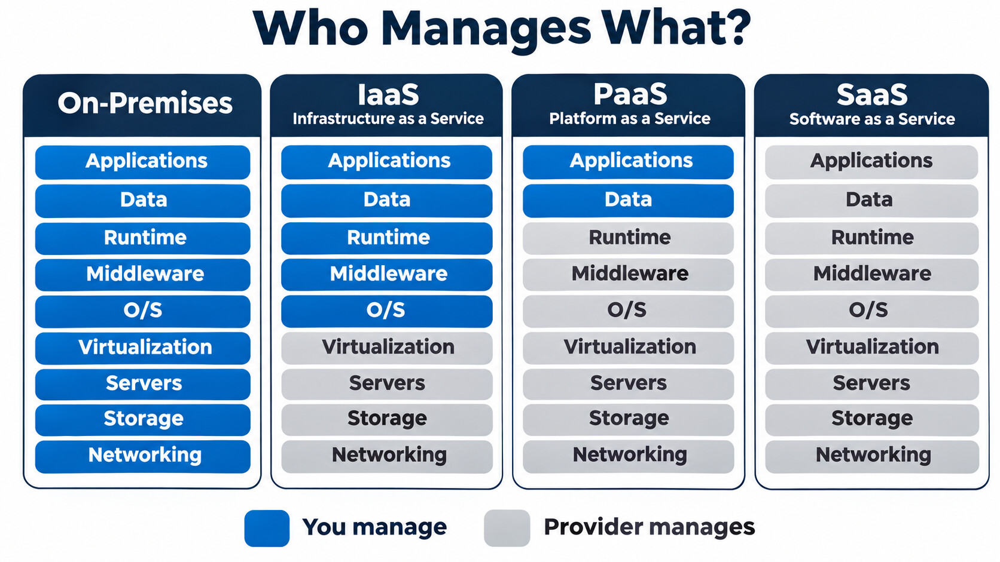

# 1.01 What is Cloud Computing?

Cloud computing is the on-demand delivery of IT resources over the internet, with pay-as-you-go pricing. This chapter explains what that means, why companies choose it, what you still manage yourself, and how an organization moves there. There is nothing to build yet: the chapter gives you the terms that every later chapter uses.

## Parts

Each part has its own page.

| # | Part | What you learn |
|---|---|---|
| 1 | [What is cloud computing?](PART1.md) | The definition, the five core characteristics, and how AWS compares with Microsoft Azure and Google Cloud |
| 2 | [Why use the cloud?](PART2.md) | The six advantages of cloud computing, CapEx and OpEx, elasticity vs. scalability |
| 3 | [Who manages what?](PART3.md) | A first look at the service models: IaaS, PaaS and SaaS |
| 4 | [Moving to the cloud](PART4.md) | The seven migration strategies (the 7 Rs) and the AWS Cloud Adoption Framework (AWS CAF) |

## Further Reading

- [What is cloud computing? (AWS)](https://aws.amazon.com/what-is-cloud-computing/)
- [Six advantages of cloud computing (Overview of Amazon Web Services)](https://docs.aws.amazon.com/whitepapers/latest/aws-overview/six-advantages-of-cloud-computing.html)
- [The NIST Definition of Cloud Computing (SP 800-145)](https://csrc.nist.gov/pubs/sp/800/145/final)
- [Migration strategies: the 7 Rs (AWS Prescriptive Guidance)](https://docs.aws.amazon.com/prescriptive-guidance/latest/large-migration-guide/migration-strategies.html)
- [AWS Cloud Adoption Framework](https://aws.amazon.com/cloud-adoption-framework/)

---

[⬅ Previous: Getting Started: AWS Console & AWS CLI](../00-getting-started/README.md) | [🏠 Home](../README.md) | [Next: 1.02 Cloud Models ➡](../1.02-cloud-models/README.md)

---
## Contact

For questions or feedback, feel free to reach out:

- **Email**: eyal@levys.co.il
- **GitHub**: [https://github.com/elevy99927](https://github.com/elevy99927)
