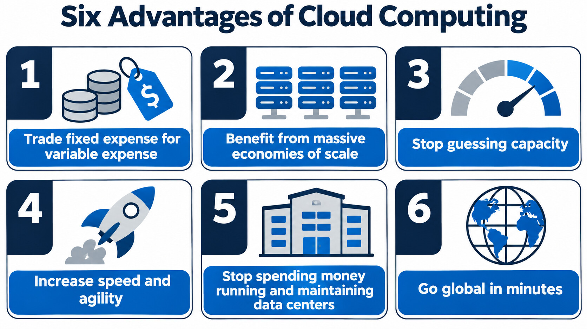
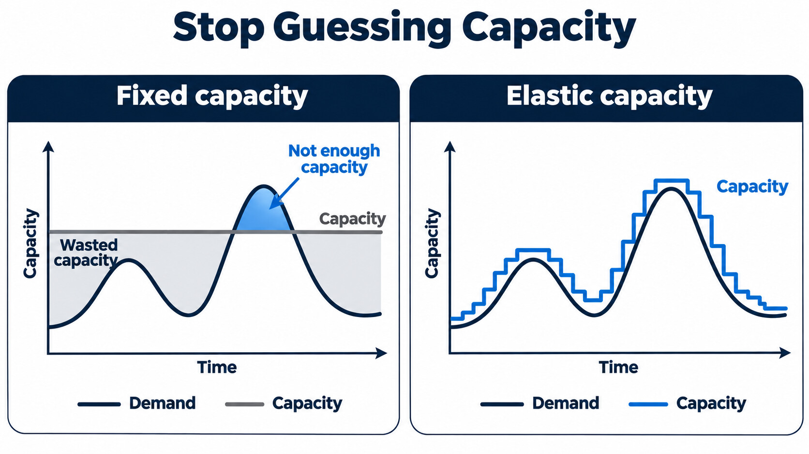

# 1.01 What is Cloud Computing?

## Topics

- [What cloud computing is](#1-what-is-cloud-computing)
- [The five core characteristics](#2-the-five-core-characteristics)
- [The six advantages of cloud computing](#3-the-six-advantages-of-cloud-computing)
- [Elasticity vs. scalability](#4-elasticity-vs-scalability)
- [Who manages what: a first look at the service models](#5-who-manages-what)
- [Migration strategies: the 7 Rs](#6-moving-to-the-cloud-the-7-rs)
- [AWS Cloud Adoption Framework (AWS CAF)](#7-aws-cloud-adoption-framework-aws-caf)
- [Check yourself](#check-yourself)

---

## 1. What is Cloud Computing?

**Cloud computing** is the on-demand delivery of IT resources over the internet, with pay-as-you-go pricing.

Instead of buying servers and running your own data center, you rent what you need from a cloud provider such as AWS: computing power, storage, databases, networking and more.

| | Your own data center | The cloud |
|---|---|---|
| **Getting a server** | Order hardware, wait weeks, install it | A few clicks or one command, ready in minutes |
| **Paying** | Up front, for the capacity you might need | As you go, for what you use |
| **Too much capacity** | You already paid for it | Turn it off and stop paying |
| **Too little capacity** | Order more hardware and wait | Add more in minutes |
| **Who runs the buildings, power and hardware** | You | The provider |

Three ideas come back in every chapter of this course:

- **On demand:** you get a resource when you ask for it, with no purchase process.
- **Over the internet:** you reach it from anywhere, through the Console, the CLI or code.
- **Pay as you go:** you pay for what you use, and you stop paying when you delete it.

---

## 2. The Five Core Characteristics

The US National Institute of Standards and Technology (NIST) defines cloud computing by five characteristics. A service that has all five is a cloud service.

| Characteristic | What it means | Example on AWS |
|---|---|---|
| **On-demand self-service** | You create resources yourself, without asking a person at the provider | Launching an EC2 instance from the Console |
| **Broad network access** | Resources are reached over the network with standard tools | The Console in a browser, the AWS CLI, the SDKs |
| **Resource pooling** | The provider serves many customers from shared hardware, and keeps them isolated from each other | Many customers' virtual servers on one physical host |
| **Rapid elasticity** | Capacity grows and shrinks quickly, following demand | Auto Scaling adds servers during a traffic peak |
| **Measured service** | Usage is metered, and you pay for what you used | The bill shows instance hours and stored gigabytes |

---

## 3. The Six Advantages of Cloud Computing

AWS lists six advantages of cloud computing. Know them by name.

| # | Advantage | In plain words |
|---|---|---|
| 1 | **Trade fixed expense for variable expense** | No large purchase up front (CapEx). You pay a monthly bill for what you used (OpEx). |
| 2 | **Benefit from massive economies of scale** | The provider buys for hundreds of thousands of customers, so its price per unit is lower than yours would be. |
| 3 | **Stop guessing capacity** | You don't have to predict next year's traffic. Start small and change the size when you know more. |
| 4 | **Increase speed and agility** | A new environment takes minutes, so trying an idea is cheap and fast. |
| 5 | **Stop spending money running and maintaining data centers** | No buildings, racks, power or cooling to manage. Your team works on the product. |
| 6 | **Go global in minutes** | Deploy the same application in several Regions around the world, close to your users. |

> **CapEx and OpEx:** *Capital expense* (CapEx) is money spent up front on things you own, such as servers. *Operational expense* (OpEx) is the ongoing cost of running the business, such as a monthly cloud bill.

---

## 4. Elasticity vs. Scalability

The two words are close, and people often mix them up.

| | Scalability | Elasticity |
|---|---|---|
| **The question it answers** | Can the system handle more load if I give it more resources? | Does the system add and remove resources by itself as the load changes? |
| **Direction** | Usually up or out, as the business grows | Up **and** down, following demand |
| **Time frame** | Planned, long term | Automatic, short term |
| **Example** | Moving a database to a larger instance | Auto Scaling adds servers at 09:00 and removes them at night |

Scaling has two directions:

- **Vertical scaling (scale up):** a bigger machine, for example from 2 to 8 vCPUs.
- **Horizontal scaling (scale out):** more machines of the same size, behind a load balancer.

With fixed capacity you pay for hardware that sits idle most of the time, and you still run out at the peak. With elastic capacity, the capacity follows the demand. This is what "stop guessing capacity" means in practice.

---

## 5. Who Manages What

A cloud service takes work away from you. How much depends on the **service model**:

- **IaaS (Infrastructure as a Service):** the provider runs the data center, the hardware and the virtualization. You manage the operating system and everything above it. Example: Amazon EC2.
- **PaaS (Platform as a Service):** the provider also runs the operating system and the runtime. You bring your code and your data. Example: AWS Elastic Beanstalk.
- **SaaS (Software as a Service):** the provider runs everything. You use the finished product. Example: web-based email.

Read the picture from left to right: every step to the right gives you less to manage, and less control.

The next chapter, [1.02 Cloud Models](../1.02-cloud-models/README.md), covers the service models and the deployment models (public, private, hybrid) in detail.

---

## 6. Moving to the Cloud: the 7 Rs

When a company moves to the cloud, each application gets its own decision. AWS describes seven migration strategies, known as the **7 Rs**.

| Strategy | What you do | Example |
|---|---|---|
| **Retire** | Turn the application off. Nobody needs it any more. | An old reporting server with no users |
| **Retain** | Leave it where it is, for now | A system that must stay on-premises for compliance |
| **Rehost** ("lift and shift") | Move it as it is, with no changes | Copying a virtual machine to an EC2 instance |
| **Relocate** | Move a whole group of servers to the cloud version of the same platform, without changing them | Moving a virtualization cluster as a unit |
| **Repurchase** ("drop and shop") | Replace it with a different product, usually SaaS | Moving from a self-hosted CRM to a SaaS CRM |
| **Replatform** ("lift, tinker and shift") | Move it, with a few changes that use managed services | Moving a self-managed database to Amazon RDS |
| **Refactor** (re-architect) | Redesign the application to use cloud-native services | Splitting a monolith into Lambda functions |

Effort and benefit grow together: **Rehost** is the fastest, and **Refactor** takes the most work and gains the most from the cloud.

---

## 7. AWS Cloud Adoption Framework (AWS CAF)

Moving to the cloud changes more than the technology. The **AWS Cloud Adoption Framework (AWS CAF)** groups what an organization has to prepare into six **perspectives**.

| | Perspective | Focus | Typical owners |
|---|---|---|---|
| Business side | **Business** | Cloud investments support the business goals | CEO, CFO, CIO |
| | **People** | Culture, organization structure, skills and training | HR, team leaders |
| | **Governance** | Managing projects, risk and cost | CIO, CFO, risk and compliance managers |
| Technical side | **Platform** | Building a scalable cloud platform and modernizing workloads | CTO, architects, engineers |
| | **Security** | Confidentiality, integrity and availability of data and workloads | CISO, security engineers |
| | **Operations** | Running the services at the level the business agreed on | Operations and SRE teams |

---

## Check Yourself

1. A start-up doesn't know how many users it will have next month. Which of the six advantages helps the most?
2. An online shop adds servers every evening and removes them at night, automatically. Is this scalability or elasticity?
3. Your team moves a self-managed MySQL server to Amazon RDS, with no change to the application code. Which of the 7 Rs is it?
4. Which NIST characteristic makes pay-as-you-go pricing possible?
5. In the IaaS model, who patches the operating system?

Answers

1. **Stop guessing capacity.** It starts small and changes the size when the real numbers are known.
2. **Elasticity.** The capacity follows the demand in both directions, automatically.
3. **Replatform.** The application moves with a small change that uses a managed service.
4. **Measured service.** Usage is metered, so the bill can follow it.
5. **You do.** The provider manages the hardware and the virtualization. The operating system and everything above it are yours.

---

## Further Reading

- [What is cloud computing? (AWS)](https://aws.amazon.com/what-is-cloud-computing/)
- [Six advantages of cloud computing (Overview of Amazon Web Services)](https://docs.aws.amazon.com/whitepapers/latest/aws-overview/six-advantages-of-cloud-computing.html)
- [The NIST Definition of Cloud Computing (SP 800-145)](https://csrc.nist.gov/pubs/sp/800/145/final)
- [Migration strategies: the 7 Rs (AWS Prescriptive Guidance)](https://docs.aws.amazon.com/prescriptive-guidance/latest/large-migration-guide/migration-strategies.html)
- [AWS Cloud Adoption Framework](https://aws.amazon.com/cloud-adoption-framework/)

---

[⬅ Previous: Getting Started: AWS Console & AWS CLI](../00-getting-started/README.md) | [🏠 Home](../README.md) | [Next: 1.02 Cloud Models ➡](../1.02-cloud-models/README.md)

---
## Contact

For questions or feedback, feel free to reach out:

- **Email**: eyal@levys.co.il
- **GitHub**: [https://github.com/elevy99927](https://github.com/elevy99927)
