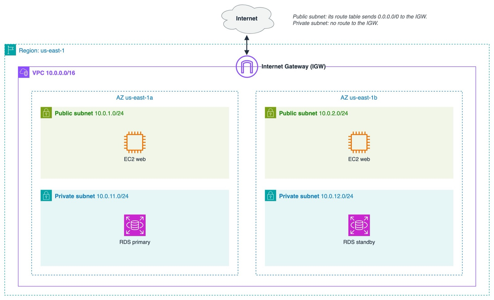

# 2.04 VPC and Networking

## Chapter Contents

| # | Lab | Steps |
|---|-----|-------|
| 1 | **Build a VPC with Public Subnets** – a VPC, two public subnets in two Availability Zones, an internet gateway and a route table, step by step in the Console. The network for the labs that follow ([Containers](../3.06-containers/README.md)) | [Lab 1](lab-1.md) |
| 2 | **Explore the Default VPC** – what AWS creates for you in every Region: default subnets, Internet Gateway and route table | [Lab 2](labs-2-4.md#-lab-2-basic-explore-the-default-vpc) |
| 3 | **Create a VPC with the "VPC and more" Wizard** – public and private subnets in two Availability Zones, in a few clicks | [Lab 3](labs-2-4.md#-lab-3-basic-create-a-vpc-with-the-vpc-and-more-wizard) |
| 4 | **Build a VPC Piece by Piece with the CLI** (advanced) – the same building blocks as Lab 1, with the AWS CLI | [Lab 4](labs-2-4.md#-lab-4-advanced-build-a-vpc-piece-by-piece-with-the-cli) |

Next: [Advanced Networking](../3.07-advanced-vpc/README.md) – private subnets, NAT gateways, VPC endpoints, peering and IP address planning.

---

## Topics

- [What is a VPC – your private, isolated network in an AWS Region](#1-what-is-a-vpc)
- [CIDR blocks and IP addressing basics](#2-cidr-basics)
- [The **default VPC** – what AWS creates for you (default subnets, Internet Gateway, route table, default security group)](#3-the-default-vpc)
- [Recreating a deleted default VPC](#3-the-default-vpc)
- [Subnets – each subnet lives in **one Availability Zone**](#4-subnets-route-tables-and-the-internet-gateway)
- [Public vs. private subnets](#what-makes-a-subnet-public)
- [Internet Gateway (IGW) and route tables](#4-subnets-route-tables-and-the-internet-gateway)
- [Creating a basic VPC with the *VPC and more* wizard](labs-2-4.md#-lab-3-basic-create-a-vpc-with-the-vpc-and-more-wizard)
- [Security Groups vs. Network ACLs](#5-security-groups-vs-network-acls)

---

## 1. What is a VPC?

An **Amazon Virtual Private Cloud (VPC)** is your own logically isolated network inside an AWS **Region**. You decide its IP address range, how it is split into subnets, how traffic is routed, and what is allowed in and out.

- A VPC belongs to **one Region** and spans **all the Availability Zones** in that Region.
- A **subnet** belongs to **one Availability Zone**.
- Resources such as EC2 instances, RDS databases and load balancers are launched **into subnets**.
- Creating a VPC, subnets, route tables and an Internet Gateway is **free**. NAT Gateways, VPC endpoints, Transit Gateway and public IPv4 addresses cost money.



<sub>Diagram source: [images/vpc-overview.drawio](images/vpc-overview.drawio) (open it in [draw.io](https://app.diagrams.net) to edit)</sub>

---

## 2. CIDR Basics

A **CIDR block** describes an IP range: `<base address>/<prefix length>`. The larger the prefix, the smaller the range.

| CIDR | Number of IPs | Typical use |
|------|---------------|-------------|
| `10.0.0.0/16` | 65,536 | A whole VPC (the largest a VPC can be is /16, the smallest is /28) |
| `10.0.1.0/24` | 256 | A subnet |
| `10.0.1.0/28` | 16 | The smallest possible subnet |

- Use **private** ranges (RFC 1918): `10.0.0.0/8`, `172.16.0.0/12`, `192.168.0.0/16`.
- AWS **reserves 5 IPs in every subnet**: the first four and the last one. A `/24` subnet gives you **251** usable addresses.
- Plan ranges that **don't overlap** with other VPCs or your office network. If you might connect them later, overlapping ranges make that impossible.

---

## 3. The Default VPC

Every AWS account has a **default VPC in every Region**, so you can launch an instance right away.

| Component | Default value |
|-----------|---------------|
| VPC CIDR | `172.31.0.0/16` |
| Subnets | One **default subnet per AZ**, each a `/20` (4,096 IPs) |
| Public IP | Instances in default subnets get a **public IP automatically** |
| Internet Gateway | Attached |
| Main route table | `172.31.0.0/16 → local` and `0.0.0.0/0 → igw-…` |
| Default Security Group | Allows all traffic from members of the same SG and all outbound traffic |
| Default Network ACL | Allows all inbound and outbound traffic |

In other words, **every default subnet is public**. That's convenient for learning, but production workloads should use a custom VPC with private subnets.

If you delete the default VPC, you can recreate it:

```bash
aws ec2 create-default-vpc
```

The command fails with `DefaultVpcAlreadyExists` if the Region already has one.


---

## 4. Subnets, Route Tables and the Internet Gateway

| Component | What it does |
|-----------|--------------|
| **Subnet** | A range of IPs in **one AZ**. Resources get their private IP from it |
| **Route table** | Rules that decide where traffic goes. Every subnet is associated with **exactly one** route table |
| **`local` route** | Added automatically. Allows traffic between all subnets in the VPC. You can't delete it |
| **Internet Gateway (IGW)** | A highly available gateway that connects the VPC to the internet. **One IGW per VPC** |
| **NAT Gateway** | Lets **private** subnets reach the internet for **outbound** traffic only, for example to download updates. It's paid. Covered in [3.07 Advanced VPC](../3.07-advanced-vpc/README.md) |

### What makes a subnet "public"?

A subnet is **public** when its route table has a route to an **Internet Gateway**:

| Destination | Target | |
|-------------|--------|---|
| `10.0.0.0/16` | `local` | always present |
| `0.0.0.0/0` | `igw-xxxx` | ← **this route makes the subnet public** |


A **private** subnet has no route to an IGW. It either has no internet access at all, or it has `0.0.0.0/0 → nat-xxxx` for outbound-only access.

For an instance to be reachable from the internet, it **also** needs a **public IP** and a **Security Group** that allows the traffic.

---

## 5. Security Groups vs. Network ACLs

| | Security Group | Network ACL |
|---|---|---|
| Applies to | An instance (its network interface) | A subnet |
| State | **Stateful**: replies are allowed automatically | **Stateless**: replies need their own rule |
| Rules | **Allow** only | **Allow** and **Deny** |
| Evaluation | All rules together | In order by rule number. The first match wins |
| Default | Inbound: none (custom SG). Outbound: all | Default NACL: allow everything |

You'll build Security Groups hands-on in [3.01 EC2](../3.01-ec2/README.md).

---

## 🧪 Labs

1. **Start here: [Lab 1: Build a VPC with Public Subnets](lab-1.md)** (with a video). Build `ecs-vpc` step by step in the Console. The Containers labs run in this network.
2. **Then: [Labs 2–4](labs-2-4.md):** explore the default VPC, create a VPC with the *VPC and more* wizard, and build a VPC with the CLI.

Solutions for Labs 2–4: **[SOLUTION.md](SOLUTION.md)**

---

[⬅ Previous: 2.03 Secrets Management](../2.03-secrets-management/README.md) | [🏠 Home](../README.md) | [Next: 3.01 Compute: Amazon EC2 ➡](../3.01-ec2/README.md)

---

## Terraform Code

The [`terraform/`](terraform/) folder builds the same VPC as [Lab 4](labs-2-4.md#-lab-4-advanced-build-a-vpc-piece-by-piece-with-the-cli) as code. The Terraform part of the course will cover it in depth. To try it now:

```bash
cd terraform
terraform init
terraform plan
terraform apply      # type "yes"
terraform destroy    # clean up
```

---

## Contact

For questions or feedback, feel free to reach out:

- **Email**: eyal@levys.co.il
- **GitHub**: [https://github.com/elevy99927](https://github.com/elevy99927)
