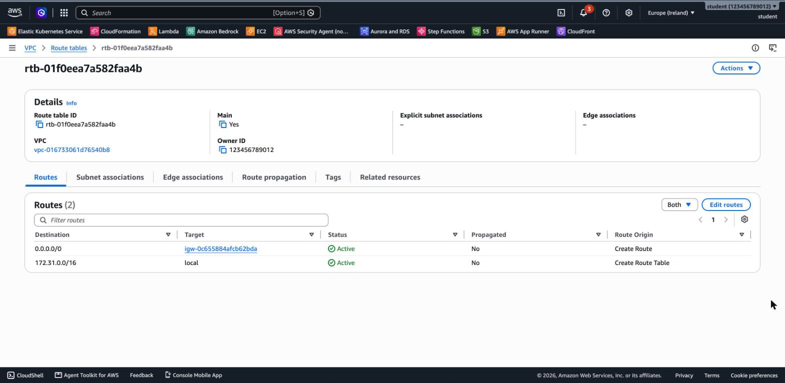
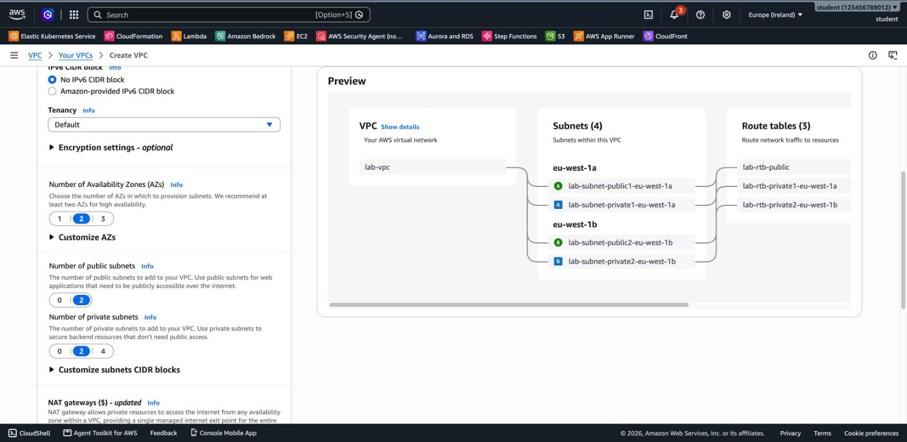
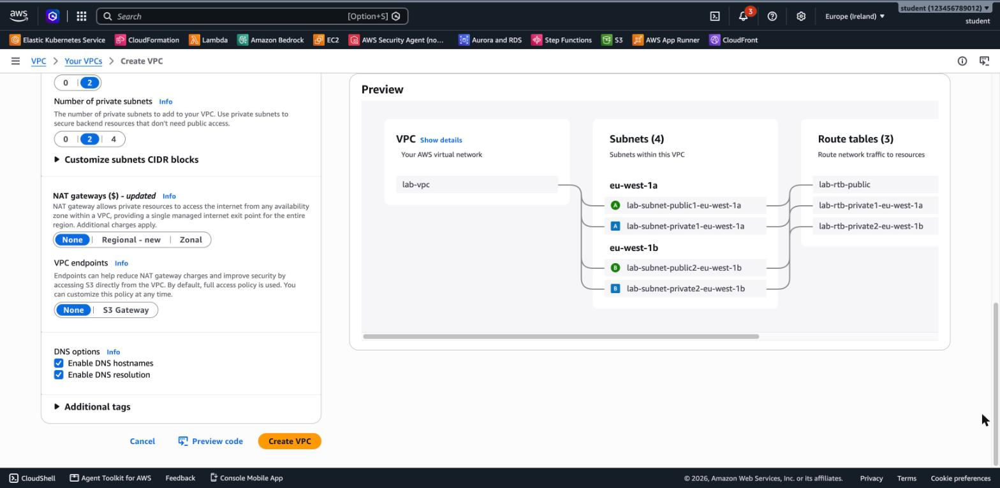
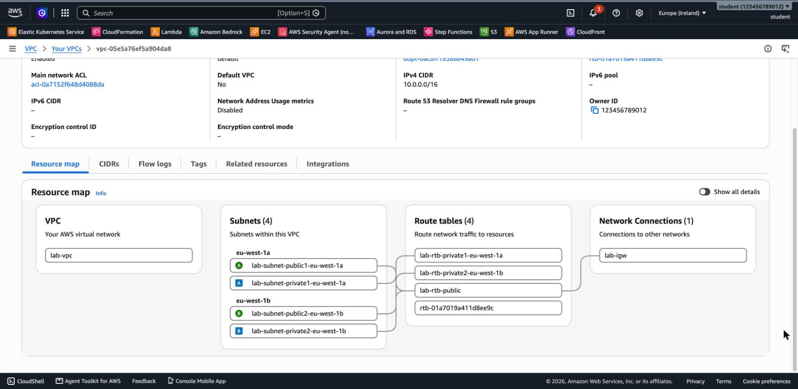
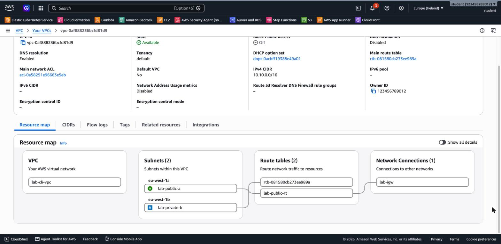

# 2.04 VPC and Networking – Lab Solutions

[⬅ Back to 2.04 VPC and Networking](README.md)

---

> 📍 **Region note:** run the labs in **`us-east-1`**. The screenshots and sample outputs on this page were captured in **`eu-west-1`** (Europe, Ireland). In `us-east-1` the Availability Zones are named `us-east-1a`–`us-east-1f`, the default VPC has **six** default subnets, and all IDs are different. The structure and the results are the same.

## LAB 2 (Basic): Explore the Default VPC

### Console

1. **VPC → Your VPCs**: the VPC with **Default VPC = Yes** has the CIDR `172.31.0.0/16`.
2. On the **Resource map** tab, you see one subnet per AZ, the main route table and the Internet Gateway (under *Network Connections*):


> Your account may show extra subnets or route tables that someone added to the default VPC. In the screenshot, `custom-private` is such an addition.

3. **Subnets**: each default subnet is a `/20` in a different AZ, with **Auto-assign public IPv4 address = Yes**.
4. Open the **main route table**. The route **`0.0.0.0/0 → igw-…`** makes the default subnets public:



### CLI

```bash
export AWS_PAGER="" AWS_REGION=us-east-1

DEFAULT_VPC=$(aws ec2 describe-vpcs --filters Name=is-default,Values=true \
  --query 'Vpcs[0].VpcId' --output text)

# 1. VPC and CIDR
aws ec2 describe-vpcs --vpc-ids $DEFAULT_VPC \
  --query 'Vpcs[0].[VpcId,CidrBlock,IsDefault]' --output table

# 3. Subnets: AZ, CIDR, free IPs, auto-assign public IP
aws ec2 describe-subnets --filters Name=vpc-id,Values=$DEFAULT_VPC \
  --query 'Subnets[].[AvailabilityZone,CidrBlock,AvailableIpAddressCount,MapPublicIpOnLaunch]' --output table

# 4. Main route table routes
aws ec2 describe-route-tables \
  --filters Name=vpc-id,Values=$DEFAULT_VPC Name=association.main,Values=true \
  --query 'RouteTables[0].Routes[].[DestinationCidrBlock,GatewayId]' --output table

# Internet Gateway
aws ec2 describe-internet-gateways --filters Name=attachment.vpc-id,Values=$DEFAULT_VPC \
  --query 'InternetGateways[].[InternetGatewayId,Attachments[0].State]' --output table
```

Sample output (captured in eu-west-1):

```
|  eu-west-1b |  172.31.16.0/20   |  4089 |  True  |
|  eu-west-1a |  172.31.0.0/20    |  4091 |  True  |
|  eu-west-1c |  172.31.32.0/20   |  4091 |  True  |

|  172.31.0.0/16 |  local          |
|  0.0.0.0/0     |  igw-0c65...    |
```

### Answers

- **Why every default subnet is public:** the main route table has `0.0.0.0/0 → IGW`, and auto-assign public IPv4 is enabled.
- **Usable IPs in a default subnet:** a `/20` has 4,096 addresses, minus the 5 that AWS reserves, which leaves **4,091**. The output above shows exactly that. A lower number means some IPs are already in use.
- **`aws ec2 create-default-vpc` when a default VPC exists:**

```
An error occurred (DefaultVpcAlreadyExists) when calling the CreateDefaultVpc operation:
A Default VPC already exists for this account in this region.
```

---

## LAB 3 (Basic): Create a VPC with the "VPC and more" Wizard

1. **VPC → Your VPCs → Create VPC → VPC and more**.
2. Set **Name tag auto-generation** to `lab` and keep `10.0.0.0/16`, **2 AZs**, **2 public** and **2 private** subnets. The **Preview** on the right updates live:



3. Set **NAT gateways** to **None** and **VPC endpoints** to **None**. The wizard selects *S3 Gateway* by default. Keep the DNS options enabled:



4. Choose **Create VPC**. The workflow page lists every resource the wizard creates: VPC, subnets, IGW, route tables, routes and associations.
5. Choose **View VPC → Resource map**:



- `lab-rtb-public` is associated with **both public subnets** and routes to `lab-igw`.
- `lab-rtb-private1-…` and `lab-rtb-private2-…` each serve one private subnet and have **only the `local` route**.
- The unnamed route table (`rtb-…`) is the VPC's **main** route table. No subnet is explicitly associated with it.

6. **Clean up:** select `lab-vpc`, then choose **Actions → Delete VPC**, type `delete` and confirm.

### Answers

- **Public vs. private route tables:** the public one has `0.0.0.0/0 → igw`. The private ones only have `10.0.0.0/16 → local`.
- **Updates from a private subnet:** not as it is, because there is no route to the internet. Add a **NAT Gateway** in a public subnet, plus a route `0.0.0.0/0 → nat-…` in the private route tables. You can choose this in the wizard, but it is a paid resource. See [3.07 Advanced VPC](../3.07-advanced-vpc/README.md).

---

## LAB 4 (Advanced): Build a VPC Piece by Piece with the CLI

> Tested with AWS CLI v2 (the sample output is from `eu-west-1`). Run everything in one terminal session, because later steps use the shell variables.

```bash
export AWS_PAGER="" AWS_REGION=us-east-1
read AZ1 AZ2 _ < <(aws ec2 describe-availability-zones \
  --query 'AvailabilityZones[].ZoneName' --output text)

# 1. VPC
VPC_ID=$(aws ec2 create-vpc --cidr-block 10.10.0.0/16 \
  --tag-specifications 'ResourceType=vpc,Tags=[{Key=Name,Value=lab-cli-vpc}]' \
  --query Vpc.VpcId --output text)
aws ec2 wait vpc-available --vpc-ids $VPC_ID

# 2. Subnets
PUB_SUBNET=$(aws ec2 create-subnet --vpc-id $VPC_ID --cidr-block 10.10.1.0/24 \
  --availability-zone $AZ1 \
  --tag-specifications 'ResourceType=subnet,Tags=[{Key=Name,Value=lab-public-a}]' \
  --query Subnet.SubnetId --output text)
PRIV_SUBNET=$(aws ec2 create-subnet --vpc-id $VPC_ID --cidr-block 10.10.11.0/24 \
  --availability-zone $AZ2 \
  --tag-specifications 'ResourceType=subnet,Tags=[{Key=Name,Value=lab-private-b}]' \
  --query Subnet.SubnetId --output text)

# 3. Auto-assign public IPv4 on the public subnet
aws ec2 modify-subnet-attribute --subnet-id $PUB_SUBNET --map-public-ip-on-launch

# 4. Internet Gateway
IGW_ID=$(aws ec2 create-internet-gateway \
  --tag-specifications 'ResourceType=internet-gateway,Tags=[{Key=Name,Value=lab-igw}]' \
  --query InternetGateway.InternetGatewayId --output text)
aws ec2 attach-internet-gateway --internet-gateway-id $IGW_ID --vpc-id $VPC_ID

# 5. Public route table: 0.0.0.0/0 -> IGW, associated with the public subnet only
RT_ID=$(aws ec2 create-route-table --vpc-id $VPC_ID \
  --tag-specifications 'ResourceType=route-table,Tags=[{Key=Name,Value=lab-public-rt}]' \
  --query RouteTable.RouteTableId --output text)
aws ec2 create-route --route-table-id $RT_ID \
  --destination-cidr-block 0.0.0.0/0 --gateway-id $IGW_ID
aws ec2 associate-route-table --route-table-id $RT_ID --subnet-id $PUB_SUBNET
```

**6. Verify:**

```bash
aws ec2 describe-subnets --filters Name=vpc-id,Values=$VPC_ID \
  --query 'Subnets[].[Tags[?Key==`Name`]|[0].Value,AvailabilityZone,CidrBlock,MapPublicIpOnLaunch]' \
  --output table

aws ec2 describe-route-tables --filters Name=vpc-id,Values=$VPC_ID \
  --query 'RouteTables[].{Name:Tags[?Key==`Name`]|[0].Value,Main:Associations[0].Main,Routes:join(`, `,Routes[].join(` -> `,[DestinationCidrBlock,GatewayId]))}' \
  --output table
```

```
|  lab-private-b |  eu-west-1b |  10.10.11.0/24  |  False |
|  lab-public-a  |  eu-west-1a |  10.10.1.0/24   |  True  |

| Main  |     Name       |  Routes                                        |
|  True |  None          |  10.10.0.0/16-> local                          |
|  False|  lab-public-rt |  10.10.0.0/16-> local, 0.0.0.0/0-> igw-0e...   |
```

**7. Resource map:**



`lab-private-b` isn't associated with any route table explicitly, so it uses the **main** route table (`rtb-…`), which has only the `local` route.

**8. Clean up (order matters):**

```bash
aws ec2 detach-internet-gateway --internet-gateway-id $IGW_ID --vpc-id $VPC_ID
aws ec2 delete-internet-gateway --internet-gateway-id $IGW_ID
aws ec2 delete-subnet --subnet-id $PUB_SUBNET
aws ec2 delete-subnet --subnet-id $PRIV_SUBNET
aws ec2 delete-route-table --route-table-id $RT_ID
aws ec2 delete-vpc --vpc-id $VPC_ID
```

### Answers

- **Why `lab-private-b` stays private:** being in the same VPC as the IGW isn't enough. A subnet is public only if **its own route table** has a route to the IGW, and `lab-private-b` uses the main route table, which has no such route.
- **Why the IGW must be detached first:** AWS doesn't delete a VPC that still has dependencies, such as an attached IGW, subnets, non-main route tables or network interfaces. The CLI fails with `DependencyViolation`. The Console's **Delete VPC** removes these dependencies for you.

---

## Terraform

The same VPC as Lab 4, as code: [`terraform/main.tf`](terraform/main.tf). Tested with Terraform 1.15 and AWS provider 6.x.

```bash
cd terraform
terraform init
terraform apply     # creates 6 resources: VPC, 2 subnets, IGW, route table, association
terraform destroy   # removes all of them
```

---

[⬅ Back to 2.04 VPC and Networking](README.md)
