# 2.04 VPC and Networking – Lab Solutions

[⬅ Labs 2–4](labs-2-4.md) | [⬅ Back to 2.04 VPC and Networking](README.md)

---

> Tested in **`us-east-1`** on 2026-10-24. The two default-VPC screenshots in Lab 2 were captured earlier in `eu-west-1`, where the default VPC has three default subnets instead of six.

## LAB 2 (Basic): Explore the Default VPC

### Console

1. **VPC → Your VPCs**: the VPC with **Default VPC = Yes** has the CIDR `172.31.0.0/16`.
2. On the **Resource map** tab, you see one subnet per AZ, the main route table and the Internet Gateway (under *Network Connections*):


> Your account may show extra subnets or route tables that someone added to the default VPC. In the screenshot, `custom-private` is such an addition.

3. **Subnets**: each default subnet is a `/20` in a different AZ, with **Auto-assign public IPv4 address = Yes**.
4. Open the **main route table**. The route **`0.0.0.0/0 → igw-…`** makes the default subnets public:


### CLI

```bash
export AWS_PAGER="" AWS_REGION=us-east-1

DEFAULT_VPC=$(aws ec2 describe-vpcs --filters Name=is-default,Values=true \
  --query 'Vpcs[0].VpcId' --output text)

# 1. VPC and CIDR
aws ec2 describe-vpcs --vpc-ids $DEFAULT_VPC \
  --query 'Vpcs[0].[VpcId,CidrBlock,IsDefault]' --output table

# 3. Subnets: AZ, CIDR, free IPs, auto-assign public IP
aws ec2 describe-subnets --filters Name=vpc-id,Values=$DEFAULT_VPC \
  --query 'Subnets[].[AvailabilityZone,CidrBlock,AvailableIpAddressCount,MapPublicIpOnLaunch]' --output table

# 4. Main route table routes
aws ec2 describe-route-tables \
  --filters Name=vpc-id,Values=$DEFAULT_VPC Name=association.main,Values=true \
  --query 'RouteTables[0].Routes[].[DestinationCidrBlock,GatewayId]' --output table

# Internet Gateway
aws ec2 describe-internet-gateways --filters Name=attachment.vpc-id,Values=$DEFAULT_VPC \
  --query 'InternetGateways[].[InternetGatewayId,Attachments[0].State]' --output table
```

Sample output (captured in eu-west-1):

```
|  eu-west-1b |  172.31.16.0/20   |  4089 |  True  |
|  eu-west-1a |  172.31.0.0/20    |  4091 |  True  |
|  eu-west-1c |  172.31.32.0/20   |  4091 |  True  |

|  172.31.0.0/16 |  local          |
|  0.0.0.0/0     |  igw-0c65...    |
```

### No default VPC in your Region?

If the Region has no default VPC (it was deleted, or the account is new to the Region and was set up without one), **Default VPC = Yes** doesn't appear anywhere, and `describe-vpcs --filters Name=is-default,Values=true` returns `[]`. Do the same exploration on **`ecs-vpc`**, the VPC you built in [Lab 1](lab-1.md). Its pieces are the same; only the values differ: your CIDR `10.0.0.0/16`, `/24` subnets, and your own route table.

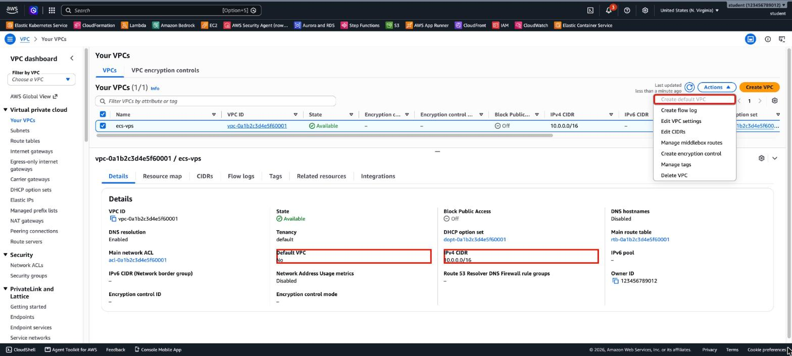

> To bring a default VPC back: **Actions → Create default VPC** (with no VPC selected), or `aws ec2 create-default-vpc`. It's free. In these screenshots the Lab 1 VPC is named `ecs-vps`.

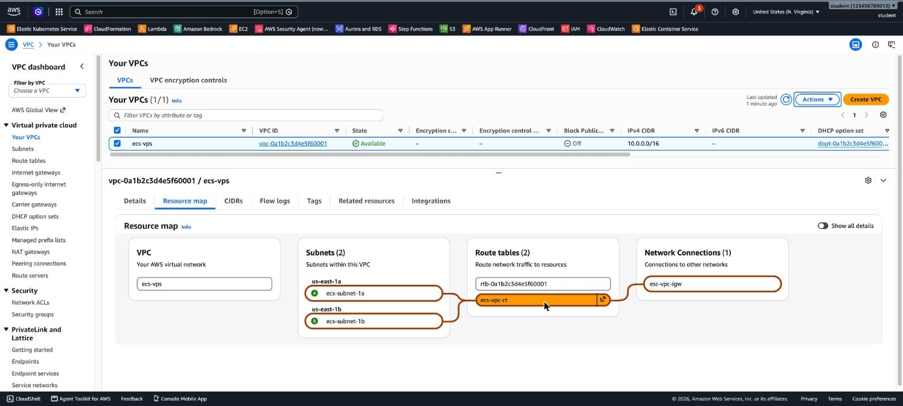

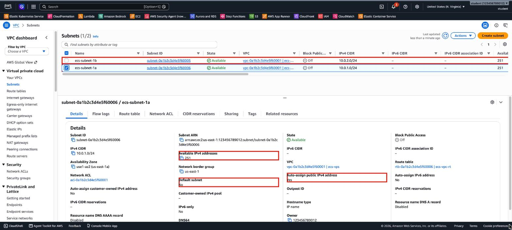

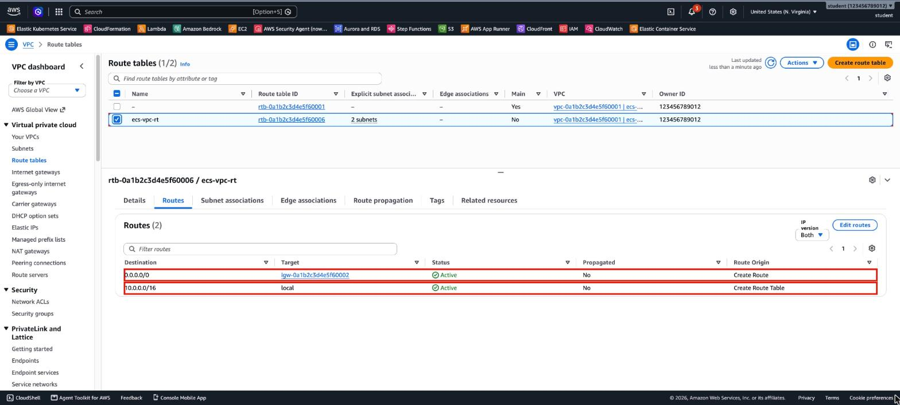

The same checks with the CLI, using the Lab 1 VPC. Find it by its name (change `ecs-vpc` if you named it differently, and check that `$VPC` isn't `None` before you continue). In the Lab 1 VPC, the only non-main route table is the public one, so the third command reads its routes:

```bash
export AWS_PAGER="" AWS_REGION=us-east-1
VPC=$(aws ec2 describe-vpcs --filters Name=tag:Name,Values=ecs-vpc \
  --query 'Vpcs[0].VpcId' --output text)
echo $VPC   # must be vpc-…, not None

aws ec2 describe-vpcs --vpc-ids $VPC --query 'Vpcs[0].[VpcId,CidrBlock,IsDefault]' --output table
aws ec2 describe-subnets --filters Name=vpc-id,Values=$VPC \
  --query 'Subnets[].[AvailabilityZone,CidrBlock,AvailableIpAddressCount,MapPublicIpOnLaunch]' --output table
aws ec2 describe-route-tables --filters Name=vpc-id,Values=$VPC Name=association.main,Values=false \
  --query 'RouteTables[0].Routes[].[DestinationCidrBlock,GatewayId]' --output table
aws ec2 describe-internet-gateways --filters Name=attachment.vpc-id,Values=$VPC \
  --query 'InternetGateways[].[InternetGatewayId,Attachments[0].State]' --output table
aws ec2 describe-vpcs --filters Name=is-default,Values=true --query Vpcs   # [] = no default VPC
```

Output from `us-east-1` (the VPC is named `ecs-vps` in this account):

```
---------------------------
|      DescribeVpcs       |
+-------------------------+
|  vpc-0a1b2c3d4e5f60001  |
|  10.0.0.0/16            |
|  False                  |
+-------------------------+
----------------------------------------------
|               DescribeSubnets              |
+-------------+---------------+------+-------+
|  us-east-1b |  10.0.2.0/24  |  251 |  True |
|  us-east-1a |  10.0.1.0/24  |  251 |  True |
+-------------+---------------+------+-------+
------------------------------------------
|           DescribeRouteTables          |
+--------------+-------------------------+
|  10.0.0.0/16 |  local                  |
|  0.0.0.0/0   |  igw-0a1b2c3d4e5f60001  |
+--------------+-------------------------+
----------------------------------------
|       DescribeInternetGateways       |
+------------------------+-------------+
|  igw-0a1b2c3d4e5f60001 |  available  |
+------------------------+-------------+
$ aws ec2 describe-vpcs --filters Name=is-default,Values=true --query Vpcs
[]
```

### Answers

- **Why every default subnet is public:** the main route table has `0.0.0.0/0 → IGW`, and auto-assign public IPv4 is enabled.
- **Usable IPs in a default subnet:** a `/20` has 4,096 addresses, minus the 5 that AWS reserves, which leaves **4,091**. The output above shows exactly that. A lower number means some IPs are already in use.
- **`aws ec2 create-default-vpc` when a default VPC exists:**

```
An error occurred (DefaultVpcAlreadyExists) when calling the CreateDefaultVpc operation:
A Default VPC already exists for this account in this region.
```

---

## LAB 3 (Basic): Create a VPC with the "VPC and more" Wizard

1. **VPC → Your VPCs → Create VPC.**

   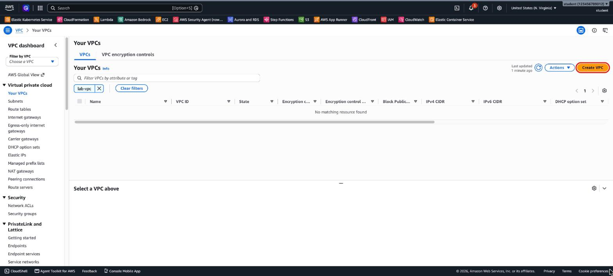

2. Choose **VPC and more**, set **Name tag auto-generation** to `lab`, and keep `10.0.0.0/16`. The **Preview** on the right updates live: `lab-vpc`, four subnets and three route tables.

   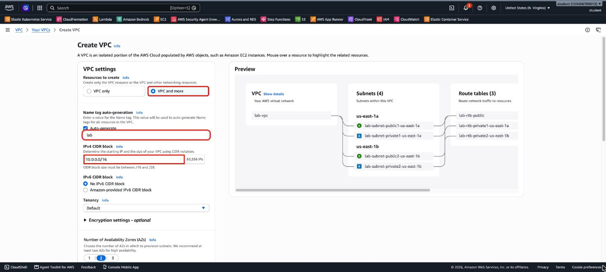

3. Keep **2** Availability Zones, **2** public and **2** private subnets, and **NAT gateways: None** (a NAT gateway is paid; the wizard now also offers a *Regional* NAT gateway). The wizard creates three route tables, in addition to the main route table that every VPC gets.

   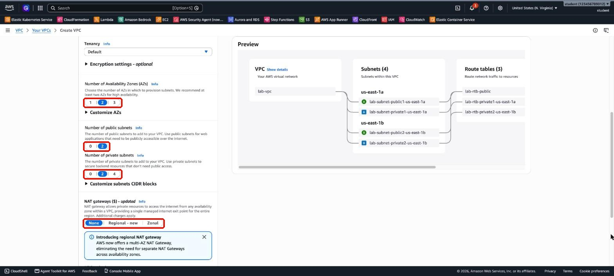

4. Set **VPC endpoints** to **None** (the wizard selects *S3 Gateway* by default), keep both **DNS options**, and choose **Create VPC**.

   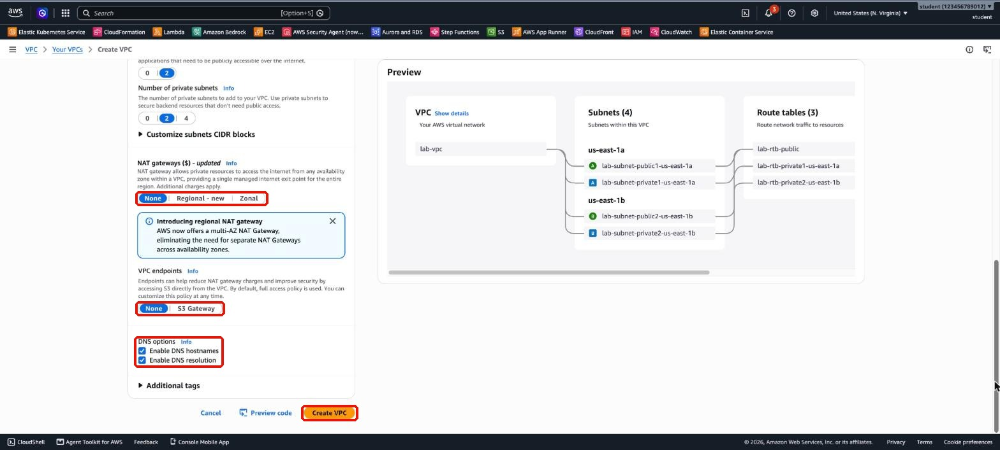

5. The workflow lists every resource the wizard creates: the VPC, four subnets, the internet gateway and its attachment, three route tables, the route and the associations.

   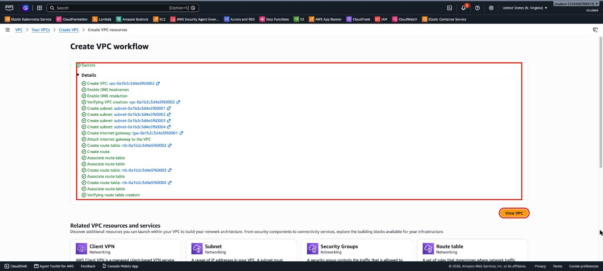

6. **View VPC → Resource map.** Hover over `lab-rtb-public`: it serves **both public subnets** and routes to `lab-igw`.

   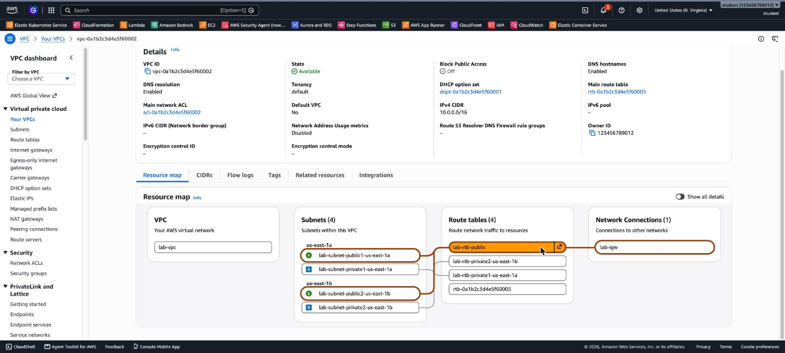

7. Hover over `lab-rtb-private1-us-east-1a`: it serves **one private subnet** and has no connection to the internet gateway. The unnamed route table (`rtb-…`) is the VPC's **main** route table; no subnet is explicitly associated with it.

   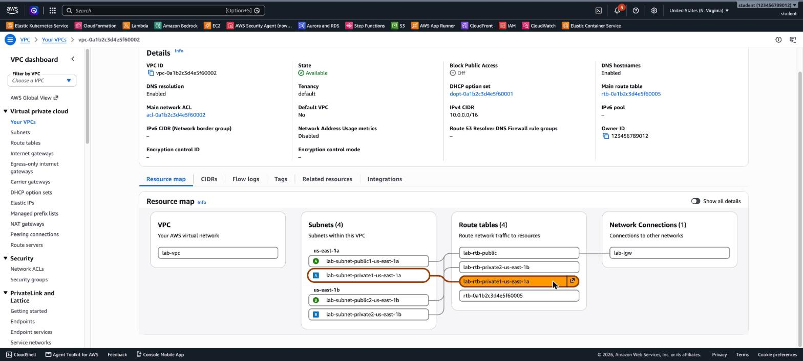

8. Compare the routes in **Route tables**. The public route table has `0.0.0.0/0 → igw-…`:

   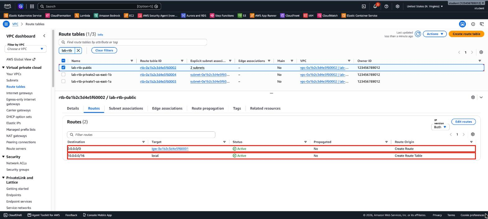

   The private one has only `10.0.0.0/16 → local`:

   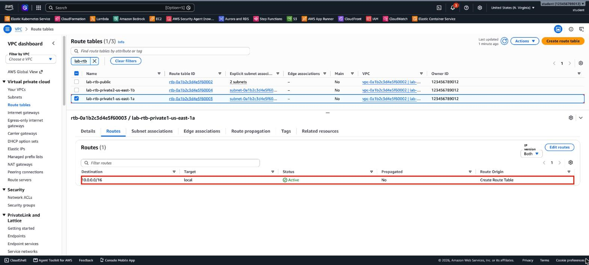

9. **Clean up:** select `lab-vpc`, then choose **Actions → Delete VPC**.

   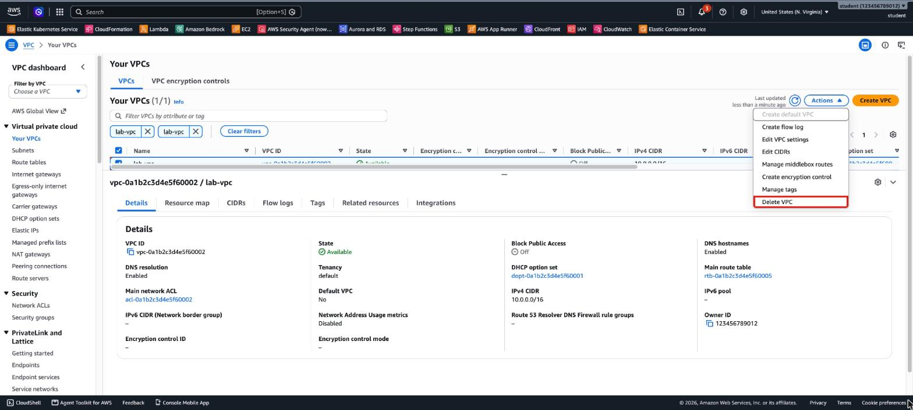

10. The dialog lists the **8 resources** that are deleted with the VPC (subnets, route tables, the internet gateway). Type `delete` and choose **Delete**. This works for the network pieces in this lab; instances or NAT gateways would have to be deleted first.

    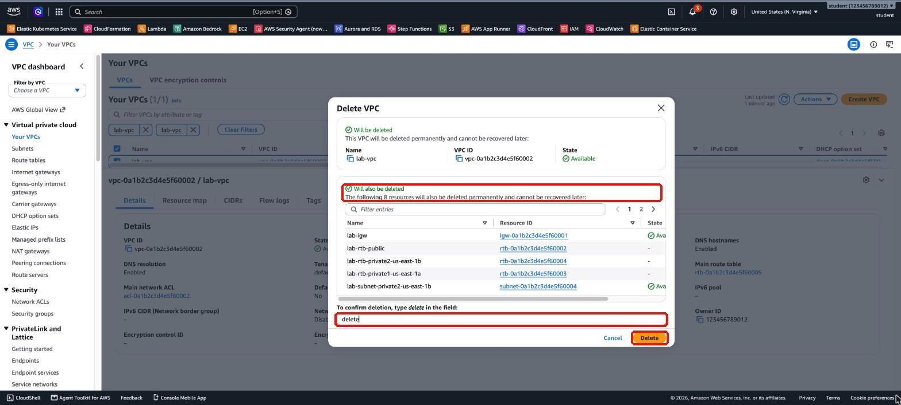

### Answers

- **Public vs. private route tables:** the public one has `0.0.0.0/0 → igw`. The private ones only have `10.0.0.0/16 → local`.
- **Updates from a private subnet:** not as it is, because there is no route to the internet. Add a **NAT Gateway** in a public subnet, plus a route `0.0.0.0/0 → nat-…` in the private route tables. You can choose this in the wizard, but it is a paid resource. See [3.07 Advanced VPC](../3.07-advanced-vpc/README.md).

---

## LAB 4 (Advanced): Build a VPC Piece by Piece with the CLI

> Tested with AWS CLI v2 in `us-east-1` (about 17 seconds). Run everything in one terminal session, because later steps use the shell variables.

```bash
export AWS_PAGER="" AWS_REGION=us-east-1
read AZ1 AZ2 _ < <(aws ec2 describe-availability-zones \
  --query 'AvailabilityZones[].ZoneName' --output text)

# 1. VPC
VPC_ID=$(aws ec2 create-vpc --cidr-block 10.10.0.0/16 \
  --tag-specifications 'ResourceType=vpc,Tags=[{Key=Name,Value=lab-cli-vpc}]' \
  --query Vpc.VpcId --output text)
aws ec2 wait vpc-available --vpc-ids $VPC_ID

# 2. Subnets
PUB_SUBNET=$(aws ec2 create-subnet --vpc-id $VPC_ID --cidr-block 10.10.1.0/24 \
  --availability-zone $AZ1 \
  --tag-specifications 'ResourceType=subnet,Tags=[{Key=Name,Value=lab-public-a}]' \
  --query Subnet.SubnetId --output text)
PRIV_SUBNET=$(aws ec2 create-subnet --vpc-id $VPC_ID --cidr-block 10.10.11.0/24 \
  --availability-zone $AZ2 \
  --tag-specifications 'ResourceType=subnet,Tags=[{Key=Name,Value=lab-private-b}]' \
  --query Subnet.SubnetId --output text)

# 3. Auto-assign public IPv4 on the public subnet
aws ec2 modify-subnet-attribute --subnet-id $PUB_SUBNET --map-public-ip-on-launch

# 4. Internet Gateway
IGW_ID=$(aws ec2 create-internet-gateway \
  --tag-specifications 'ResourceType=internet-gateway,Tags=[{Key=Name,Value=lab-igw}]' \
  --query InternetGateway.InternetGatewayId --output text)
aws ec2 attach-internet-gateway --internet-gateway-id $IGW_ID --vpc-id $VPC_ID

# 5. Public route table: 0.0.0.0/0 -> IGW, associated with the public subnet only
RT_ID=$(aws ec2 create-route-table --vpc-id $VPC_ID \
  --tag-specifications 'ResourceType=route-table,Tags=[{Key=Name,Value=lab-public-rt}]' \
  --query RouteTable.RouteTableId --output text)
aws ec2 create-route --route-table-id $RT_ID \
  --destination-cidr-block 0.0.0.0/0 --gateway-id $IGW_ID
aws ec2 associate-route-table --route-table-id $RT_ID --subnet-id $PUB_SUBNET
```

**6. Verify:**

```bash
aws ec2 describe-subnets --filters Name=vpc-id,Values=$VPC_ID \
  --query 'Subnets[].[Tags[?Key==`Name`]|[0].Value,AvailabilityZone,CidrBlock,MapPublicIpOnLaunch]' \
  --output table

aws ec2 describe-route-tables --filters Name=vpc-id,Values=$VPC_ID \
  --query 'RouteTables[].{Name:Tags[?Key==`Name`]|[0].Value,Main:Associations[0].Main,Routes:join(`, `,Routes[].join(` -> `,[DestinationCidrBlock,GatewayId]))}' \
  --output table
```

```
-----------------------------------------------------------
|                     DescribeSubnets                     |
+----------------+-------------+-----------------+--------+
|  lab-public-a  |  us-east-1a |  10.10.1.0/24   |  True  |
|  lab-private-b |  us-east-1b |  10.10.11.0/24  |  False |
+----------------+-------------+-----------------+--------+
---------------------------------------------------------------------------------------
|                                 DescribeRouteTables                                 |
+-------+----------------+------------------------------------------------------------+
| Main  |     Name       |                          Routes                            |
+-------+----------------+------------------------------------------------------------+
|  True |  None          |  10.10.0.0/16-> local                                      |
|  False|  lab-public-rt |  10.10.0.0/16-> local, 0.0.0.0/0-> igw-0a1b2c3d4e5f60001   |
+-------+----------------+------------------------------------------------------------+
```

**7. Resource map:**

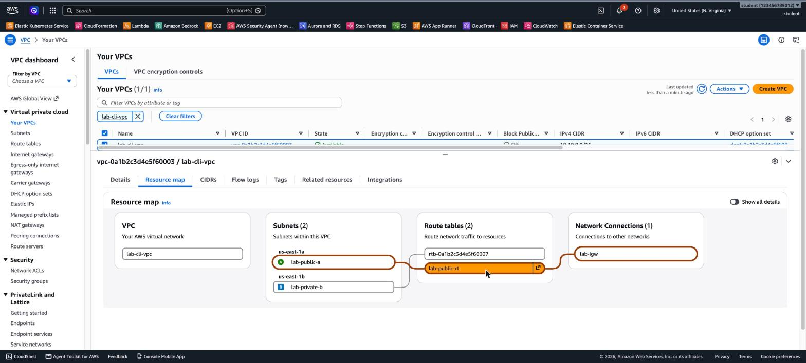

`lab-private-b` isn't associated with any route table explicitly, so it uses the **main** route table (`rtb-…`), which has only the `local` route:

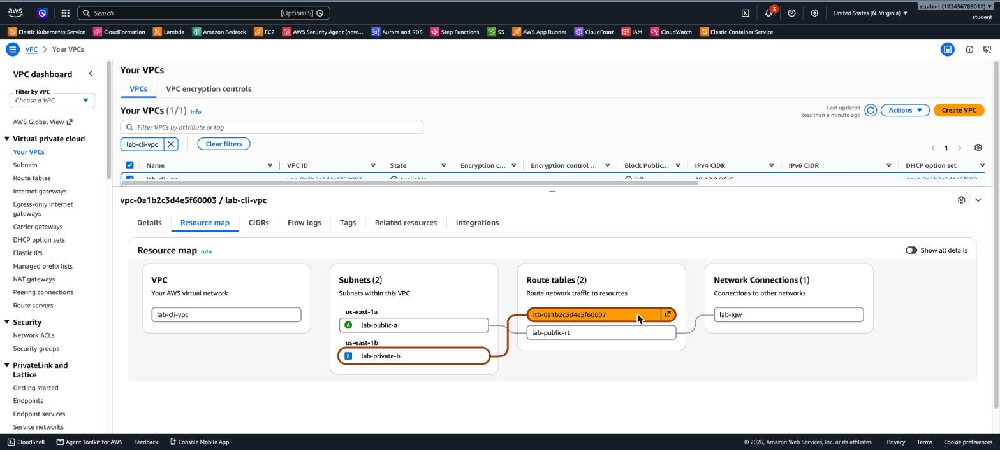

**8. Clean up (order matters).** Deleting the VPC first fails, because the subnets, the route table and the attached internet gateway still depend on it:

```
$ aws ec2 delete-vpc --vpc-id $VPC_ID
aws: [ERROR]: An error occurred (DependencyViolation) when calling the DeleteVpc operation: The vpc 'vpc-0a1b2c3d4e5f60001' has dependencies and cannot be deleted.
```

Delete the dependencies first, then the VPC:

```bash
aws ec2 detach-internet-gateway --internet-gateway-id $IGW_ID --vpc-id $VPC_ID
aws ec2 delete-internet-gateway --internet-gateway-id $IGW_ID
aws ec2 delete-subnet --subnet-id $PUB_SUBNET
aws ec2 delete-subnet --subnet-id $PRIV_SUBNET
aws ec2 delete-route-table --route-table-id $RT_ID
aws ec2 delete-vpc --vpc-id $VPC_ID
```

### Answers

- **Why `lab-private-b` stays private:** being in the same VPC as the IGW isn't enough. A subnet is public only if **its own route table** has a route to the IGW, and `lab-private-b` uses the main route table, which has no such route.
- **Why the IGW must be detached first:** AWS doesn't delete a VPC that still has dependencies, such as an attached IGW, subnets, non-main route tables or network interfaces. The CLI fails with `DependencyViolation`. For the network pieces of these labs, the Console's **Delete VPC** removes the dependencies for you. Instances, NAT gateways and interface endpoints must be deleted first.

---

## Terraform

The same VPC as Lab 4, as code: [`terraform/main.tf`](terraform/main.tf). Tested with Terraform 1.15 and AWS provider 6.x.

```bash
cd terraform
terraform init
terraform apply     # creates 6 resources: VPC, 2 subnets, IGW, route table, association
terraform destroy   # removes all of them
```

---

[⬅ Back to 2.04 VPC and Networking](README.md)
