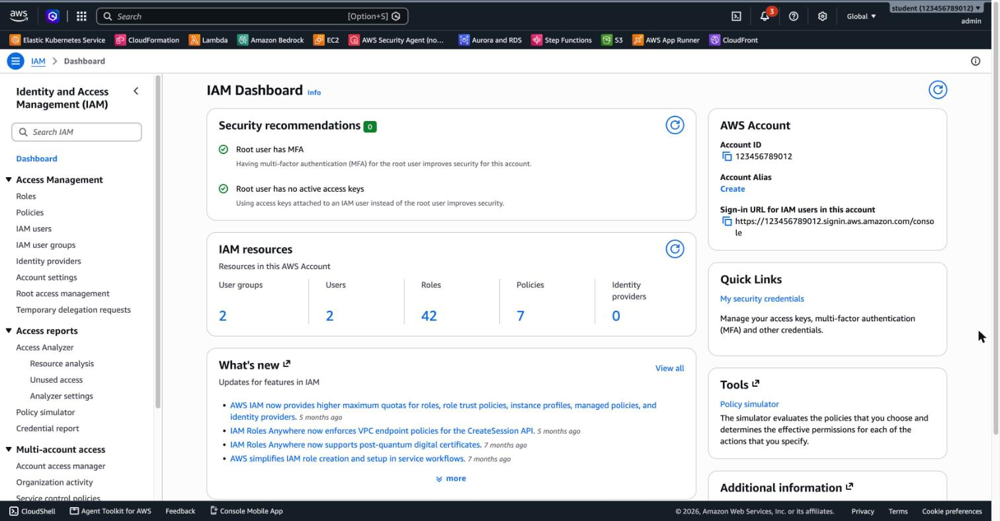

# 2.1 Identity and Access Management (AWS IAM)

## Topics

- [Root user – what it is and why to lock it away (MFA, no access keys)](#2-the-root-user)
- [IAM Users, Groups and Roles](#3-identities-users-groups-and-roles)
- [IAM Policies – JSON structure (Effect, Action, Resource, Condition)](#4-policies)
- [Principle of least privilege](#5-principle-of-least-privilege)
- [Multi-Factor Authentication (MFA)](#6-credentials--mfa)
- [Password policies and access keys](#6-credentials--mfa)
- [IAM Credentials Report and IAM Access Advisor](#7-auditing--security-tools)
- [AWS IAM Identity Center (successor to AWS SSO) and federation](#8-beyond-iam-users)
- [AWS Secrets Manager and AWS Systems Manager Parameter Store](#8-beyond-iam-users)

---

## 1. What is IAM?

**AWS Identity and Access Management (IAM)** controls **who** can sign in to your AWS account (authentication) and **what** they are allowed to do (authorization).

- IAM is a **global** service. Users, groups, roles and policies are not tied to a Region.
- IAM is **free**.
- Every request to AWS, whether it comes from the Console, the CLI or an SDK, is checked against IAM.



---

## 2. The Root User

The **root user** is the identity you create when you open the AWS account, using the email address and password you signed up with.

- It has **unrestricted access** to everything in the account, and you cannot limit it with IAM policies.
- Only a few tasks require it, such as changing the account's support plan, closing the account, or restoring IAM permissions.

**Best practices:**

| Do | Don't |
|----|-------|
| Enable **MFA** on the root user | Use the root user for daily work |
| Create an admin IAM user or an Identity Center user for daily tasks | Create access keys for the root user |
| Keep the root credentials in a safe place | Share the root password |

---

## 3. Identities: Users, Groups and Roles

| Identity | What it is | Typical use |
|----------|------------|-------------|
| **User** | A person or application with **long-term** credentials (password and/or access keys) | A developer who signs in to the Console |
| **Group** | A collection of users. Permissions attached to the group apply to every member | `Developers`, `Admins`, `Auditors` |
| **Role** | An identity with **temporary** credentials that someone or something *assumes* | An EC2 instance that reads from S3, cross-account access, federated users |

Key facts:

- A user can belong to **multiple groups**. Groups **cannot** contain other groups.
- A role has no password or access keys. When it is assumed, AWS STS (Security Token Service) issues **temporary credentials**.
- **Prefer roles over access keys** for applications running on AWS, such as EC2, Lambda and ECS.

```
            ┌───────────────┐
            │  Group: Devs  │──── Policy: AmazonS3ReadOnlyAccess
            └───────┬───────┘
          ┌─────────┴─────────┐
      ┌───┴───┐           ┌───┴───┐
      │ Alice │           │  Bob  │──── Inline policy: extra permissions for Bob only
      └───────┘           └───────┘

      ┌──────────────┐  assumes   ┌─────────────────────┐
      │ EC2 instance │ ─────────► │ Role: app-s3-reader │──── Policy: read one bucket
      └──────────────┘            └─────────────────────┘
```

---

## 4. Policies

A **policy** is a JSON document that defines permissions.

### Policy structure

```json
{
  "Version": "2012-10-17",
  "Statement": [
    {
      "Sid": "AllowListMyBucket",
      "Effect": "Allow",
      "Action": "s3:ListBucket",
      "Resource": "arn:aws:s3:::my-company-reports"
    },
    {
      "Sid": "AllowReadObjects",
      "Effect": "Allow",
      "Action": "s3:GetObject",
      "Resource": "arn:aws:s3:::my-company-reports/*"
    }
  ]
}
```

| Element | Meaning |
|---------|---------|
| `Version` | Always `2012-10-17` (the policy language version) |
| `Statement` | One or more permission rules |
| `Sid` | Optional statement ID |
| `Effect` | `Allow` or `Deny` |
| `Action` | The API actions, in the form `service:Action`, for example `s3:GetObject` or `ec2:StartInstances` |
| `Resource` | The resources the actions apply to, written as an ARN |
| `Condition` | Optional. When the statement applies, for example only from a given IP range or only with MFA |
| `Principal` | Only in **resource-based** policies and **trust** policies. *Who* the statement applies to |

### Policy types

| Type | Description |
|------|-------------|
| **AWS managed** | Created and maintained by AWS, for example `ReadOnlyAccess` or `AmazonS3ReadOnlyAccess` |
| **Customer managed** | Created by you and reusable across users, groups and roles |
| **Inline** | Embedded directly in one user, group or role, and deleted together with it |
| **Resource-based** | Attached to a resource, for example an S3 bucket policy. It contains a `Principal` |

### How AWS evaluates a request

1. By default, everything is **denied** (implicit deny).
2. An explicit **Allow** grants access...
3. ...but an explicit **Deny always wins**.

```
Request ──► Explicit Deny? ── yes ──► DENIED
                 │ no
                 ▼
            Explicit Allow? ── no ──► DENIED (implicit)
                 │ yes
                 ▼
              ALLOWED
```

### Example: requiring MFA with a condition

```json
{
  "Version": "2012-10-17",
  "Statement": [
    {
      "Effect": "Allow",
      "Action": "ec2:StopInstances",
      "Resource": "*",
      "Condition": {
        "Bool": { "aws:MultiFactorAuthPresent": "true" }
      }
    }
  ]
}
```

### Example: a role trust policy (who can assume the role)

```json
{
  "Version": "2012-10-17",
  "Statement": [
    {
      "Effect": "Allow",
      "Principal": { "Service": "ec2.amazonaws.com" },
      "Action": "sts:AssumeRole"
    }
  ]
}
```

---

## 5. Principle of Least Privilege

Grant **only** the permissions needed to perform a task, and nothing more.

- Start from zero and add permissions as needed. Don't start with `AdministratorAccess` and remove permissions later.
- Prefer specific actions and resources over `"Action": "*"` and `"Resource": "*"`.
- Use **IAM Access Advisor** to find permissions that are never used, and remove them.

---

## 6. Credentials & MFA

| Credential | Used for | Notes |
|------------|----------|-------|
| **Password** | AWS Management Console | Enforce rules with an **account password policy** (length, complexity, rotation) |
| **Access keys** (Access Key ID + Secret Access Key) | AWS CLI, SDKs, API | You see the secret **only once**. Rotate the keys regularly and never commit them to Git |
| **MFA** | An extra factor at sign-in | Virtual app (authenticator), hardware TOTP token, or FIDO2 security key / passkey |
| **Temporary credentials** | Roles, federation | Issued by AWS STS and expire automatically |

---

## 7. Auditing & Security Tools

| Tool | What it shows |
|------|---------------|
| **IAM Credentials Report** | An account-level CSV of all users and the status of their credentials: password last used, key age, MFA |
| **IAM Access Advisor** | Per identity, which services were accessed and when they were last accessed. Use it to trim permissions |
| **IAM Access Analyzer** | Resources that are shared outside your account, plus validation of your policies |
| **IAM Policy Simulator** | Tests whether a policy allows or denies a specific action |

---

## 8. Beyond IAM Users

- **AWS IAM Identity Center** (successor to AWS SSO): central sign-in for **multiple AWS accounts** and business applications. It can connect to an external identity provider (Microsoft Entra ID, Okta, Google Workspace). This is the recommended way to give people access to AWS.
- **Federation**: users from an external identity provider sign in to AWS with **SAML 2.0** or **OIDC** and receive a role.
- **Amazon Cognito**: identities for the end users of **your own** web and mobile applications.
- **AWS Secrets Manager**: stores secrets such as database passwords and API keys, with **automatic rotation**.
- **AWS Systems Manager Parameter Store**: stores configuration values and secrets. It is simpler and has a free tier, but rotation isn't built in.

---

## 9. Real-World Examples

| Scenario | IAM solution |
|----------|--------------|
| A new developer joins the team | Create an IAM user and add them to the `Developers` group. Don't attach policies directly to the user |
| An app on EC2 needs to read from S3 | Create a **role** with S3 read permissions and attach it to the instance. **No access keys on the server** |
| An auditor needs read-only access for one week | Create a user or role with `ReadOnlyAccess` and delete it afterwards. Even better, use Identity Center with a temporary assignment |
| A company has 20 AWS accounts and 300 employees | Use **IAM Identity Center** connected to the corporate directory |
| Access keys were pushed to a public GitHub repo | **Deactivate and delete the keys immediately**, review CloudTrail for activity, and issue new keys |

---

## 🧪 LAB 1 (Basic): Create an IAM User in the Console

**Goal:** Create a group with a managed policy, create a user, add the user to the group, and verify the permissions.

**Tools:** AWS Management Console. Sign in as described in [00 Getting Started](../00-getting-started/README.md#00-a-sign-in-to-the-aws-management-console) with an IAM user that has admin permissions, **not the root user**.

### Tasks

1. Open the **IAM** console.
2. Create a **user group** named `lab-s3-readers` and attach the AWS managed policy **`AmazonS3ReadOnlyAccess`**.
3. Create an **IAM user** named `lab-user-1`:
   - Enable **console access**.
   - Set an **autogenerated** or **custom** password.
   - Require the user to **create a new password at next sign-in**.
   - Add the user to the `lab-s3-readers` group.
   - Add permissions by adding user to `AmazonS3ReadOnlyAccess` policies
4. Copy the **console sign-in URL** from the final screen.
5. Open a **private/incognito** browser window and sign in as `lab-user-1`.
6. Verify the permissions:
   - Open the **S3** console. ✅ You can **list** buckets.
   - Try to **create** a bucket. ❌ The request should be **denied**.
   - Open the **EC2** console. ❌ You should see authorization errors.
7. Back in your admin session, open `lab-user-1` and look at the **Permissions** tab. Where does the permission come from?

### Questions

- Why did we attach the policy to the **group** and not directly to the user?
- Which policy *type* is `AmazonS3ReadOnlyAccess`?
- Why does `lab-user-1` fail to create a bucket even though no policy explicitly denies it?

---

## 🧪 LAB 2 (Advanced): Least Privilege with the AWS CLI

> ### Note!
> **Before you start:** this lab uses **Amazon S3** (buckets, objects, bucket vs. object ARNs). If you haven't worked with S3 yet, first complete **[3.5 Amazon S3](../3.5-s3/README.md)**, at least the background, the permissions section and Lab 1. Then come back here and do this lab.

---

**Goal:** Use the CLI to build a least-privilege user with a customer managed policy, see an explicit deny win over an allow, and use a role to get temporary credentials.

**Tools:** AWS CLI v2, configured as described in [00 Getting Started](../00-getting-started/README.md) with admin permissions (`aws sts get-caller-identity` should work).

### Tasks

**Part A: Preparation**

1. Save your account ID and a unique bucket name in shell variables.
2. Create an S3 bucket named `iam-lab-<something-unique>` and upload a test file to it.

**Part B: A user with a customer managed policy**

3. Create an IAM user named `lab-dev-user`.
4. Create a **customer managed policy** named `lab-s3-bucket-access` that allows **only**:
   - `s3:ListBucket` on **your lab bucket**
   - `s3:GetObject`, `s3:PutObject` and `s3:DeleteObject` on **objects in your lab bucket**
5. Attach the policy to `lab-dev-user`.
6. Create **access keys** for `lab-dev-user` and configure a CLI profile named `lab-dev`.
7. Using the `lab-dev` profile, verify:
   - ✅ Listing, downloading and uploading objects in the lab bucket work.
   - ❌ `aws s3 ls`, which lists **all** buckets, is denied.

**Part C: Explicit deny wins**

8. Add an **inline policy** named `deny-delete` to `lab-dev-user` that **denies** `s3:DeleteObject`.
9. Try to delete an object with the `lab-dev` profile. ❌ It should be denied, even though `lab-s3-bucket-access` allows it.
10. Confirm the result with the **IAM Policy Simulator** (`aws iam simulate-principal-policy`).

**Part D: Roles and temporary credentials**

11. Create a role named `lab-s3-reader-role`:
    - Its **trust policy** allows **only `lab-dev-user`** to assume it.
    - Attach the AWS managed policy `AmazonS3ReadOnlyAccess`.
12. Allow `lab-dev-user` to call `sts:AssumeRole` on that role.
13. Using the `lab-dev` profile, assume the role and use the temporary credentials to run `aws s3 ls`. ✅ It works now. Notice the credentials' **expiration time**.

**Part E: Audit and clean up**

14. Generate and download the **IAM credentials report**. Find `lab-dev-user`. Which columns show the access key?
15. **Delete everything** you created: the role, the policies, the access keys, the user, the bucket and the CLI profile.

### Questions

- Why is a role safer than access keys for an application?
- What's the difference between `lab-s3-bucket-access` and `deny-delete` in terms of policy type?
- In Part B, why does `aws s3 ls` fail while `aws s3 ls s3://<bucket>` works?

---

## ✅ Solutions

Step-by-step solutions for both labs: **[SOLUTION.md](SOLUTION.md)**

---

[⬅ Previous: 1.4 Shared Responsibility Model](../1.4-shared-responsibility-model/README.md) | [🏠 Home](../README.md) | [Next: 2.2 Secrets Management ➡](../2.2-secrets-management/README.md)

---
## Contact

For questions or feedback, feel free to reach out:

- **Email**: eyal@levys.co.il
- **GitHub**: [https://github.com/elevy99927](https://github.com/elevy99927)
