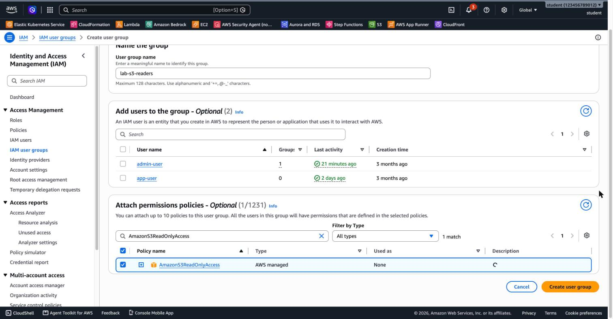
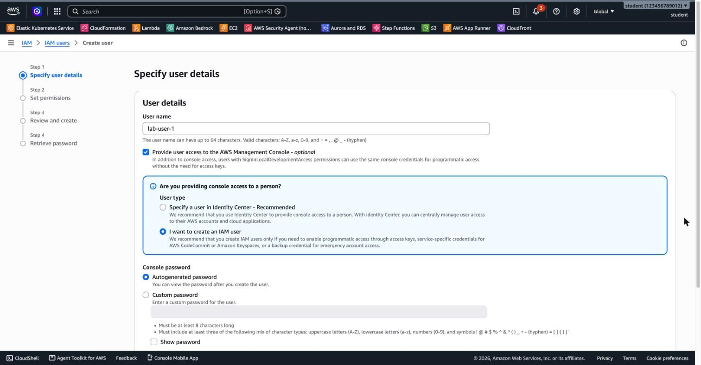
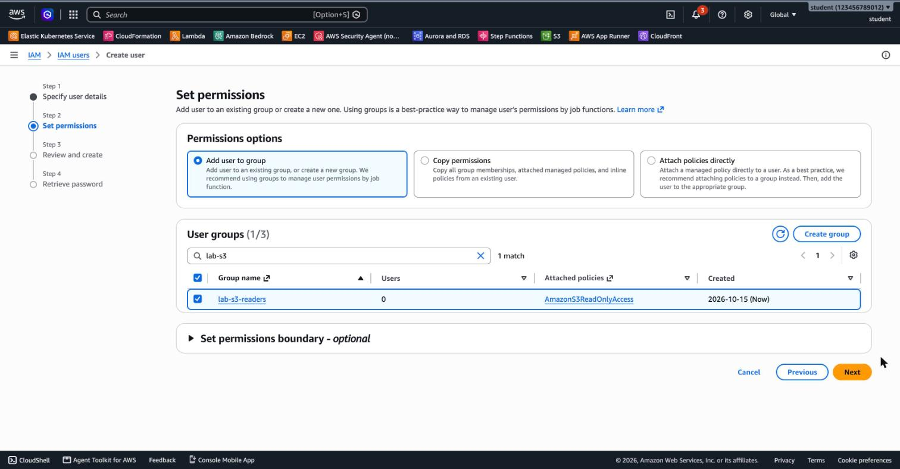
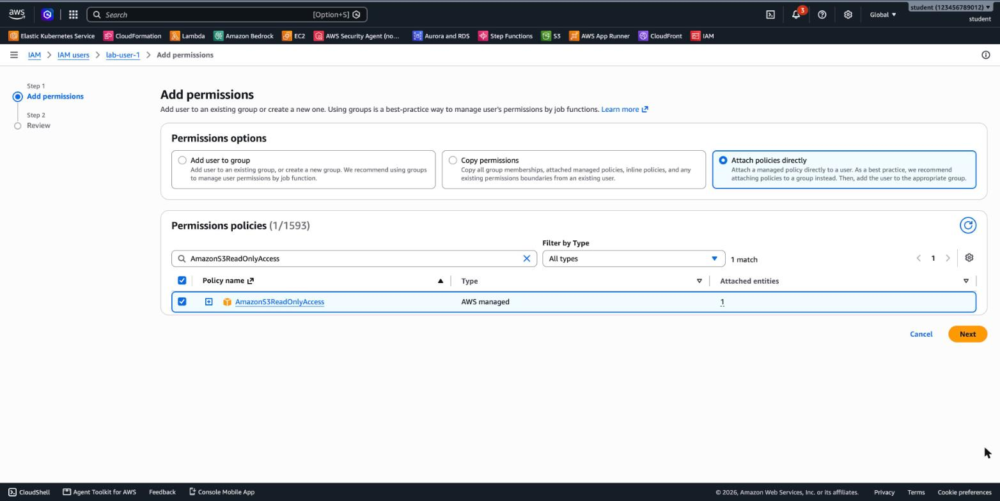
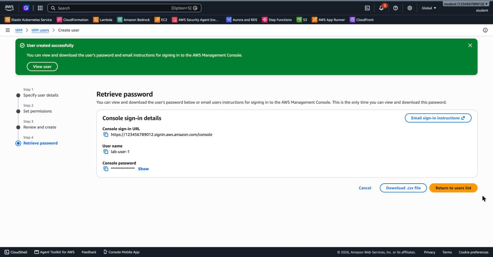
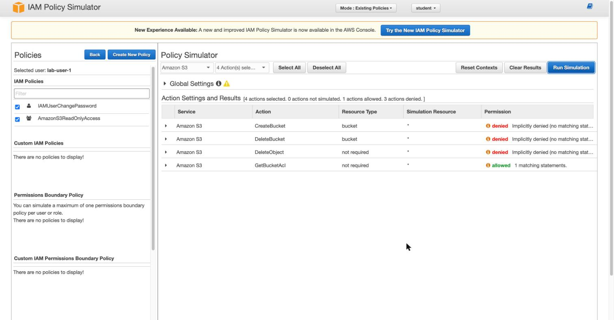
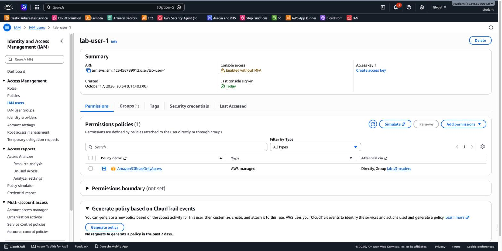

# 2.1 IAM – Lab Solutions

[⬅ Back to 2.1 Identity and Access Management](README.md)

---

## LAB 1 (Basic): Create an IAM User in the Console

### Step 1–2: Create the group

1. Open the **IAM** console and choose **User groups → Create group**.
2. **User group name:** `lab-s3-readers`
3. Under **Attach permissions policies**, search for and select **`AmazonS3ReadOnlyAccess`**.
4. Choose **Create user group**.



### Step 3: Create the user

1. Choose **Users → Create user**.
2. **User name:** `lab-user-1`
3. Select **Provide user access to the AWS Management Console**, then select **I want to create an IAM user**.
4. Select **Autogenerated password** (as in the screenshot), or select **Custom password** and enter one.
5. Keep **Users must create a new password at next sign-in** selected.
6. Choose **Next**.



7. Select **Add user to group**, then select `lab-s3-readers`.



8. Choose **Next → Create user**.

### Step 3 (continued): Attach the policy directly to the user

In the *Create user* wizard, **Add user to group** and **Attach policies directly** are **mutually exclusive** options, so you add the direct policy **after** the user is created:

1. Open **Users → `lab-user-1`**. On the **Permissions** tab, choose **Add permissions → Add permissions**.
2. Select **Attach policies directly**, search for `AmazonS3ReadOnlyAccess`, select it and choose **Next → Add permissions**.



### Step 4: Sign-in URL

The final screen shows the **Console sign-in URL**, in the form `https://<account-id>.signin.aws.amazon.com/console`. Copy it, or choose **Download .csv file**.



### Step 5–6: Sign in and test

1. In a private window, open the sign-in URL and sign in as `lab-user-1`. Then set a new password.
2. **S3 → Buckets**: the bucket list loads. ✅
3. **Create bucket**: the request fails with an error similar to *"... is not authorized to perform: s3:CreateBucket ..."*. ❌

You can confirm the same result without signing in by using the **IAM Policy Simulator**. Choose the user `lab-user-1`, select the service **Amazon S3**, select a few actions, and choose **Run Simulation**. `CreateBucket`, `DeleteBucket` and `DeleteObject` show **denied – Implicitly denied**, while `GetBucketAcl` shows **allowed**:



### Step 7: Where do the permissions come from?

On the user's **Permissions** tab, `AmazonS3ReadOnlyAccess` appears **once**, with **Attached via: Directly, Group `lab-s3-readers`**. The user gets the same permission from **two sources**.

If you selected *Users must create a new password at next sign-in*, you'll also see `IAMUserChangePassword` attached **directly**. AWS adds it automatically so the user can set a new password.



### Answers

- **Group vs. user:** Groups make permissions easy to manage at scale. When a new person joins, you add them to the group. When they move teams, you remove them. You never edit per-user policies.
  The direct attachment in step 3 shows the problem. If you now remove `lab-user-1` from the group, it **still** has S3 read access through the direct policy. Permissions attached directly to users are easy to forget, and they "leak" past group changes. In real accounts, avoid them and use groups or roles.
- **Policy type:** `AmazonS3ReadOnlyAccess` is an **AWS managed** policy.
- **Why the bucket creation fails:** Because of the **implicit deny**. Nothing allows `s3:CreateBucket`, and anything that isn't explicitly allowed is denied.

### Cleanup

Delete the user `lab-user-1` (**Users → select → Delete**), then delete the group `lab-s3-readers`.

---

## LAB 2 (Advanced): Least Privilege with the AWS CLI

> Prerequisite: [3.5 Amazon S3](../3.5-s3/README.md). This lab assumes you know how to create a bucket and how bucket and object ARNs differ.

> Tested with AWS CLI v2. Run the commands in one terminal session, because later steps use the shell variables from Part A.
> IAM changes are **eventually consistent**. If a command fails with `InvalidClientTokenId` or `AccessDenied` right after a change, wait 10–15 seconds and try again.

### Part A: Preparation

```bash
export AWS_PAGER=""
ACCOUNT_ID=$(aws sts get-caller-identity --query Account --output text)
BUCKET=iam-lab-$RANDOM$RANDOM          # must be globally unique
REGION=eu-west-1

aws s3 mb s3://$BUCKET --region $REGION
echo "hello from IAM lab" > hello.txt
aws s3 cp hello.txt s3://$BUCKET/hello.txt
```

### Part B: A user with a customer managed policy

```bash
# 3. Create the user
aws iam create-user --user-name lab-dev-user

# 4. Create the customer managed policy (least privilege: one bucket only)
cat > s3-bucket-access.json <<JSON
{
  "Version": "2012-10-17",
  "Statement": [
    {
      "Sid": "ListLabBucket",
      "Effect": "Allow",
      "Action": "s3:ListBucket",
      "Resource": "arn:aws:s3:::$BUCKET"
    },
    {
      "Sid": "ReadWriteLabObjects",
      "Effect": "Allow",
      "Action": ["s3:GetObject", "s3:PutObject", "s3:DeleteObject"],
      "Resource": "arn:aws:s3:::$BUCKET/*"
    }
  ]
}
JSON
aws iam create-policy --policy-name lab-s3-bucket-access \
  --policy-document file://s3-bucket-access.json

# 5. Attach it to the user
aws iam attach-user-policy --user-name lab-dev-user \
  --policy-arn arn:aws:iam::$ACCOUNT_ID:policy/lab-s3-bucket-access

# 6. Create access keys and a CLI profile
read KEY_ID SECRET < <(aws iam create-access-key --user-name lab-dev-user \
  --query 'AccessKey.[AccessKeyId,SecretAccessKey]' --output text)
aws configure set aws_access_key_id "$KEY_ID"     --profile lab-dev
aws configure set aws_secret_access_key "$SECRET" --profile lab-dev
aws configure set region $REGION                  --profile lab-dev
```

> Note: `ListBucket` applies to the **bucket** ARN (`arn:aws:s3:::bucket`). `GetObject`, `PutObject` and `DeleteObject` apply to the **objects** ARN (`arn:aws:s3:::bucket/*`).

**7. Verify:**

```bash
aws sts get-caller-identity --profile lab-dev          # ...:user/lab-dev-user
aws s3 ls s3://$BUCKET --profile lab-dev               # ✅ hello.txt
aws s3 cp s3://$BUCKET/hello.txt downloaded.txt --profile lab-dev   # ✅
echo second > second.txt
aws s3 cp second.txt s3://$BUCKET/second.txt --profile lab-dev      # ✅
aws s3 ls --profile lab-dev                            # ❌ AccessDenied
```

Expected error for the last command:

```
An error occurred (AccessDenied) when calling the ListBuckets operation:
User: arn:aws:iam::<account-id>:user/lab-dev-user is not authorized to perform:
s3:ListAllMyBuckets because no identity-based policy allows the s3:ListAllMyBuckets action
```

### Part C: Explicit deny wins

```bash
# 8. Inline deny policy
cat > deny-delete.json <<JSON
{
  "Version": "2012-10-17",
  "Statement": [
    { "Effect": "Deny", "Action": "s3:DeleteObject", "Resource": "*" }
  ]
}
JSON
aws iam put-user-policy --user-name lab-dev-user --policy-name deny-delete \
  --policy-document file://deny-delete.json

# 9. Try to delete (wait ~10 seconds first)
aws s3 rm s3://$BUCKET/second.txt --profile lab-dev    # ❌ AccessDenied

# 10. Confirm with the Policy Simulator
aws iam simulate-principal-policy \
  --policy-source-arn arn:aws:iam::$ACCOUNT_ID:user/lab-dev-user \
  --action-names s3:GetObject s3:DeleteObject \
  --resource-arns "arn:aws:s3:::$BUCKET/second.txt" \
  --query 'EvaluationResults[].[EvalActionName,EvalDecision]' --output table
```

Output:

```
-------------------------------------
|      SimulatePrincipalPolicy      |
+------------------+----------------+
|  s3:GetObject    |  allowed       |
|  s3:DeleteObject |  explicitDeny  |
+------------------+----------------+
```

### Part D: Roles and temporary credentials

```bash
# 11. Trust policy: only lab-dev-user can assume the role
cat > trust-policy.json <<JSON
{
  "Version": "2012-10-17",
  "Statement": [
    {
      "Effect": "Allow",
      "Principal": { "AWS": "arn:aws:iam::$ACCOUNT_ID:user/lab-dev-user" },
      "Action": "sts:AssumeRole"
    }
  ]
}
JSON
aws iam create-role --role-name lab-s3-reader-role \
  --assume-role-policy-document file://trust-policy.json
aws iam attach-role-policy --role-name lab-s3-reader-role \
  --policy-arn arn:aws:iam::aws:policy/AmazonS3ReadOnlyAccess

# 12. Allow the user to assume the role
cat > allow-assume.json <<JSON
{
  "Version": "2012-10-17",
  "Statement": [
    {
      "Effect": "Allow",
      "Action": "sts:AssumeRole",
      "Resource": "arn:aws:iam::$ACCOUNT_ID:role/lab-s3-reader-role"
    }
  ]
}
JSON
aws iam put-user-policy --user-name lab-dev-user \
  --policy-name allow-assume-reader-role --policy-document file://allow-assume.json

# 13. Assume the role (wait ~15 seconds first)
read AK SK ST EXP < <(aws sts assume-role --profile lab-dev \
  --role-arn arn:aws:iam::$ACCOUNT_ID:role/lab-s3-reader-role \
  --role-session-name lab-session \
  --query 'Credentials.[AccessKeyId,SecretAccessKey,SessionToken,Expiration]' --output text)
echo "Credentials expire at: $EXP"      # 1 hour by default

export AWS_ACCESS_KEY_ID=$AK AWS_SECRET_ACCESS_KEY=$SK AWS_SESSION_TOKEN=$ST
aws sts get-caller-identity             # ...:assumed-role/lab-s3-reader-role/lab-session
aws s3 ls                               # ✅ works now
unset AWS_ACCESS_KEY_ID AWS_SECRET_ACCESS_KEY AWS_SESSION_TOKEN
```

> Both sides are required. The role's **trust policy** must allow the user, **and** the user's own policy must allow `sts:AssumeRole`.

### Part E: Audit and clean up

```bash
# 14. Credentials report
aws iam generate-credential-report
aws iam get-credential-report --query Content --output text | base64 --decode > credential-report.csv
grep -E '^user,|lab-dev-user' credential-report.csv
```

The relevant columns are `access_key_1_active`, `access_key_1_last_rotated` and `access_key_1_last_used_date`. The report is cached for up to 4 hours, so "last used" may still show `N/A`.

```bash
# 15. Cleanup (order matters: detach before delete)
aws iam detach-role-policy --role-name lab-s3-reader-role \
  --policy-arn arn:aws:iam::aws:policy/AmazonS3ReadOnlyAccess
aws iam delete-role --role-name lab-s3-reader-role

aws iam delete-user-policy --user-name lab-dev-user --policy-name deny-delete
aws iam delete-user-policy --user-name lab-dev-user --policy-name allow-assume-reader-role
aws iam detach-user-policy --user-name lab-dev-user \
  --policy-arn arn:aws:iam::$ACCOUNT_ID:policy/lab-s3-bucket-access
aws iam delete-policy --policy-arn arn:aws:iam::$ACCOUNT_ID:policy/lab-s3-bucket-access
aws iam delete-access-key --user-name lab-dev-user --access-key-id $KEY_ID
aws iam delete-user --user-name lab-dev-user

aws s3 rb s3://$BUCKET --force
rm -f hello.txt downloaded.txt second.txt *.json credential-report.csv
```

Finally, remove the `[lab-dev]` section from `~/.aws/credentials` and the `[profile lab-dev]` section from `~/.aws/config`.

### Answers

- **Role vs. access keys:** A role issues **temporary** credentials that expire automatically, and you don't store or rotate them. Access keys are **long-term**. If they leak, for example in Git, they work until someone deletes them.
- **Policy types:** `lab-s3-bucket-access` is a **customer managed** policy, which is reusable and can be attached to many identities. `deny-delete` is an **inline** policy, which belongs to one user and is deleted together with it.
- **`aws s3 ls` vs. `aws s3 ls s3://<bucket>`:** Listing **all** buckets calls `s3:ListAllMyBuckets`, which our policy doesn't allow. Listing one bucket calls `s3:ListBucket` on that bucket's ARN, which is allowed.

---

[⬅ Back to 2.1 Identity and Access Management](README.md)
