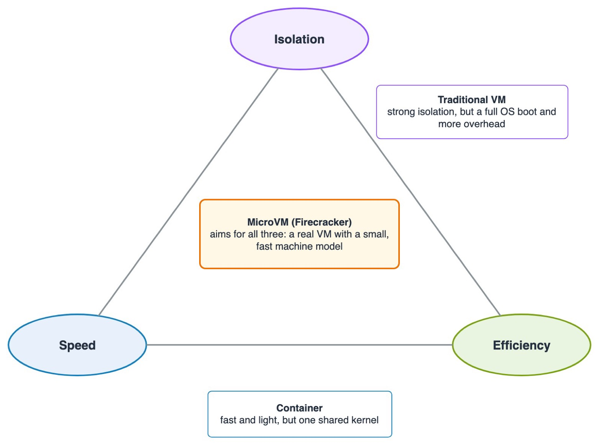

# 3.01 Compute: Amazon EC2 – EC2 or Containers? From Virtual Machines to Firecracker MicroVMs

[⬅ Back to 3.01 EC2](README.md) | [Firecracker lab ➡](firecracker-lab-walkthrough.md)

You already know two ways to run an application in the cloud: on a **virtual machine** (an EC2 instance) and in a **container** (ECS, Fargate). This page explains why AWS built a third option, the **microVM**, and how **Firecracker**, the open-source technology behind it, works.

It's theory only: no commands and no installations. The story goes: the world we have → the problem → the requirements → the solution → the architecture → how it boots. In the [Firecracker lab](firecracker-lab-walkthrough.md) you build a microVM yourself.

Diagram source: [images/vm-container-microvm.drawio](images/vm-container-microvm.drawio) 

**Contents**

- [Part A – The world we have: virtual machines and containers](#part-a--the-world-we-have-virtual-machines-and-containers)
- [Part B – The new problem: serverless and isolation](#part-b--the-new-problem-serverless-and-isolation)
- [Part C – The solution: microVMs and Firecracker](#part-c--the-solution-microvms-and-firecracker)
- [Part D – Under the hood](#part-d--under-the-hood)
- [Part E – How a microVM boots so fast, and where AWS uses it](#part-e--how-a-microvm-boots-so-fast-and-where-aws-uses-it)
- [Summary](#summary)

---

## Part A – The world we have: virtual machines and containers

### 1. Why do we need microVMs?

- We have **virtual machines**, and we have **containers**. Both run applications in the cloud.
- So why do we need yet another technology? Which problem is still unsolved?

Firecracker wasn't created because VMs or containers are bad. It answers a **combination** of requirements that is hard to meet with either one: strong isolation, fast startup and low overhead, all at once, for many customers on shared servers (**multi-tenant**) and for short-lived serverless workloads.

### 2. The virtual machine revolution

- **Before virtualization:** one physical server, one operating system. The CPU and memory were often only partly used, and a new server meant buying hardware and waiting for it.
- **Virtualization** (popularized on x86 servers by VMware) changed that. A **hypervisor** runs several virtual machines on one physical server.
- Each VM runs **its own operating system with its own kernel**, as if it had a computer of its own.

Diagram source: [images/virtualization-before-after.drawio](images/virtualization-before-after.drawio)

>**Where EC2 fits:** 
 Every EC2 instance you launched in [Lab 1](lab-1.md) is a virtual machine. Modern instance types are built on the **AWS Nitro System**: the **Nitro Hypervisor**, a lightweight hypervisor that manages CPU and memory, plus dedicated Nitro cards for networking and storage. EC2 also offers older Xen-based types and **bare-metal** instances, which give you the physical server with no hypervisor at all.

### 3. Virtual machines: the benefits

- Operating systems are separated: each VM has **its own kernel**.
- Isolation is enforced by the **virtualization boundary**, backed by the CPU's hardware support.
- CPU and memory are allocated per VM.
- Any operating system and any traditional application can run.
- Workloads of **different customers** can share the same physical infrastructure safely.

Virtualization solved real problems: resource utilization, flexibility and isolation.

### 4. Virtual machines: the cost

- A traditional VM presents the guest OS with a **virtual hardware environment** that looks like a real PC.
- Booting often goes through **BIOS/UEFI firmware** and a **bootloader**.
- The OS initializes hardware devices and drivers.
- System services and background processes use CPU and memory.
- Every VM has its own kernel and its own user space, so the start time includes a full **OS boot**.
- A small service doesn't need most of this.

**Important:** a VM doesn't *have* to be heavy or slow. The overhead depends on how the VM is built and configured, and that's exactly the opening Firecracker uses.

### 5. Containers changed everything

- A container does **not** have its own kernel: all containers on a host **share the host's kernel**.
- **Linux namespaces** isolate what a container *sees* (processes, network, mounts, users).
- **cgroups** limit what a container *uses* (CPU, memory).
- There's no OS to boot, so an application process starts in moments.
- **Container images** package the app with its libraries, which makes it easy to ship and run anywhere.
> More about containers in the [docker tutorial](https://github.com/elevy99927/docker)
---

## Part B – The new problem: serverless and isolation

### 6. Containers are fast, but what about isolation?

- Standard containers isolate at the **operating-system level**, and many of them share one kernel.
- A **kernel vulnerability** can therefore affect every container on that host.
- A **container escape** can give an attacker access outside the container.
- Namespace isolation is not the same as a hypervisor boundary.

Diagram source: [images/isolation-boundaries.drawio](images/isolation-boundaries.drawio)

Containers aren't insecure. Their isolation model is different from a VM's, and the real question is **what level of isolation the workload needs**.

### 7. The serverless challenge

Imagine you are AWS:

- Thousands of customers run code on **shared infrastructure**.
- Every customer runs a different application, and much of that code is **unknown** to the cloud provider.
- Some workloads run for a few seconds; others run for hours.
- New environments must start **quickly and in large numbers**.
- Customers must be **separated** from each other.
- The hardware must be used **efficiently**.

Does it make sense to boot a full, traditional VM for every short function?

### 8. Three requirements

| Requirement | What it means |
|---|---|
| **Isolation** | Strong separation between execution environments: an attack must not spread, and the attack surface must be small |
| **Speed** | Environments start fast, so the platform can scale with demand |
| **Efficiency** | Low memory and CPU overhead per environment, so many of them fit on one server |

The challenge is getting **all three at once**.

Diagram source: [images/three-requirements.drawio](images/three-requirements.drawio)

### 9. The trade-off: VMs vs. containers

| | Traditional VM | Container |
|---|---|---|
| Kernel | Its own | Shared with the host |
| Isolation | Virtualization boundary | Operating-system level |
| Start time | Depends on the boot and configuration | Usually shorter |
| Resource overhead | Usually higher | Usually lower |
| Operating systems | Almost any | Must work with the host kernel |
| Hardware model | Flexible | Depends on the host |

Neither is better in every case. Serverless needs a solution built for its specific combination of requirements.

---

## Part C – The solution: microVMs and Firecracker

### 10. Introducing the microVM

- A **microVM** is a lightweight virtual machine.
- It still uses **hardware virtualization**, and it has **its own kernel**.
- Its virtual hardware is **minimal**: devices that aren't needed aren't emulated.
- It can run a minimal operating system.
- The goal: less memory overhead and a shorter boot.

A microVM is a **real VM**, not a container with a new name.

### 11. What makes a VM a microVM?

- It isn't a new CPU architecture, and it doesn't require a special kernel.
- The difference is in **how the virtual machine is implemented**:
  - fewer virtual devices and fewer legacy-compatibility components;
  - less code to manage the machine;
  - the kernel can be booted **directly**;
  - a focus on running a defined workload, not on emulating a general-purpose PC.

The key change is a smaller **virtual machine model**.

### 12. Introducing Firecracker

- Developed at **AWS**, and open source (Apache 2.0) since 2018: [github.com/firecracker-microvm/firecracker](https://github.com/firecracker-microvm/firecracker).
- Written in **Rust**, a memory-safe language.
- It's a **VMM**, a *virtual machine monitor*: the program that creates and runs VMs, on top of **Linux KVM**.
- Built to run lightweight, isolated microVMs for **multi-tenant** and **serverless** workloads.
- AWS developed it to accelerate services like **AWS Lambda** and **AWS Fargate**.

Firecracker is the technology that makes it efficient to create and manage microVMs.

### 13. Firecracker: what did it remove?

Compared with a general-purpose VM:

- No emulated **BIOS/UEFI** firmware for booting.
- No bootloader such as **GRUB**.
- No emulated graphics card and no USB controllers.
- No broad support for legacy PC hardware.
- What stays: virtual **CPUs**, **memory**, **network** and **storage**, plus a few small devices: a serial console, and a partial keyboard controller that's used only to signal a reboot.
- A small device model means less complexity and a **smaller attack surface**.

![Left, a typical general-purpose VM: BIOS/UEFI firmware, GRUB, a VGA graphics card, USB controllers, a sound card, IDE/SATA controllers, emulated network cards and a PCI bus full of devices are crossed out; VirtIO network and disk, a serial console, a keyboard controller, vCPUs and memory remain. Right, a Firecracker microVM: vCPUs and memory, virtio-net, virtio-block, vsock, a serial console, a partial keyboard controller used only to signal a reboot, interrupt controllers and a timer through KVM, VirtIO over MMIO by default with optional PCI.](images/firecracker-removed.jpg)

Diagram source: [images/firecracker-removed.drawio](images/firecracker-removed.drawio)

**A caveat:** Firecracker still exposes a minimal set of legacy pieces that KVM provides, such as interrupt controllers and a timer. It doesn't remove every traditional hardware component.

---

## Part D – Under the hood

### 14. Understanding the hypervisor

- A **hypervisor** lets several VMs share one physical machine without giving any of them unlimited control of it.
- **Hardware-assisted virtualization** (Intel **VT-x**, AMD **AMD-V**) lets the CPU run guest code directly, at nearly full speed.
- **Host** = the real machine and its OS. **Guest** = the OS inside the VM.
- **Memory isolation:** the CPU translates the guest's "physical" addresses to real host addresses (Intel **EPT** / AMD **NPT**), so a guest can only reach the memory the hypervisor gave it. That's one central mechanism, not the whole story.
- When the guest needs a **privileged operation** (for example, accessing a device), the CPU stops it and hands control to the hypervisor: a **VM exit**. The hypervisor handles the request and resumes the guest.

### 15. What is KVM?

- **KVM** (*Kernel-based Virtual Machine*) is the virtualization component inside the **Linux kernel**. Official downloads: [linux-kvm.org/page/Downloads](https://linux-kvm.org/page/Downloads).
- It uses the CPU's virtualization features to run **virtual CPUs (vCPUs)**, so guest instructions execute directly on the hardware.
- It handles **VM exits**.
- It's the foundation for building VMs, but on its own it doesn't provide a full device model. A user-space VMM, such as QEMU or Firecracker, does that.

The stack: **physical hardware → Linux with KVM → guest**.

Diagram source: [images/kvm-vm-exit.drawio](images/kvm-vm-exit.drawio)

### 16. QEMU vs. Firecracker

| QEMU | Firecracker |
|---|---|
| A general emulator and virtualizer | A purpose-built VMM for microVMs |
| Supports many CPU architectures | Runs on x86_64 and Arm (aarch64) hosts |
| Can use KVM | Uses KVM |
| A very wide range of virtual devices | A minimal device model |
| Many operating systems and use cases | Linux guests |
| Also has a minimal `microvm` machine type | Built for creating isolated environments quickly |
| | Focused on low overhead and a small attack surface |

Diagram source: [images/qemu-vs-firecracker.drawio](images/qemu-vs-firecracker.drawio)

QEMU and Firecracker can use the **same KVM**. The difference is in the VMM: how much it implements and emulates.

### 17. Firecracker's internal architecture

![A Linux host with KVM in its kernel. Inside a jailer sandbox (chroot, cgroups, namespaces, unprivileged user) runs one Firecracker process with seccomp filters on every thread: the API thread receives HTTP API calls on a Unix socket; the VMM thread runs the device models (virtio-net to a host TAP device, virtio-block to files on the host, vsock, serial console, MMDS, rate limiters); the vCPU threads run the KVM_RUN loop. The guest microVM has its own Linux kernel, a root filesystem and init with the application.](images/firecracker-architecture.jpg)

Diagram source: [images/firecracker-architecture.drawio](images/firecracker-architecture.drawio)

- A **Linux host** with the **KVM** module.
- One **Firecracker process** per microVM: one process, one microVM.
- Inside the process, three kinds of threads:
  - the **API thread** serves Firecracker's HTTP API on a Unix socket (configure, start, stop). It's never on the guest's fast path;
  - the **VMM thread** runs the machine model and the device models: virtio-net, virtio-block, vsock, the serial console, the metadata service (MMDS) and I/O rate limiters;
  - one **vCPU thread** per guest CPU runs KVM's `KVM_RUN` loop, which executes the guest's code.
- Inside the microVM: the **guest kernel**, its root filesystem, init and the application.

Firecracker creates and manages the machine; KVM runs the guest's code on the CPU.

**Defense in depth.** Firecracker treats the guest as potentially malicious from the moment it starts. The first barrier is **KVM plus Firecracker's virtualization boundary**. A second layer restricts the Firecracker process itself on the host:

- Firecracker installs **seccomp filters** by default, on every thread, so it can only make the few system calls it needs.
- In production it's started through the **jailer**, which sets up a **chroot**, **cgroups** and **namespaces**, drops privileges, and then starts Firecracker as an unprivileged process.

### 18. How does VirtIO work?

- **Emulating** a real hardware device means the VMM pretends to be a specific network card or disk controller, register by register. Real devices are complex, so this is slow and needs a lot of code.
- **VirtIO** is an open standard for **virtual** devices: the guest knows it's virtualized and uses simple VirtIO drivers, which are built into Linux.
- **virtio-block** is a virtual disk; **virtio-net** is a virtual network card.
- Guest and host exchange data through shared memory queues, with far less emulation overhead.
- VirtIO isn't unique to Firecracker: KVM/QEMU and many other platforms use it. Firecracker exposes its VirtIO devices over **MMIO** by default, or over **PCI** when that option is enabled (since Firecracker 1.13).

Diagram source: [images/virtio.drawio](images/virtio.drawio)

There's no need to pretend that a virtual device is a particular physical card.

---

## Part E – How a microVM boots so fast, and where AWS uses it

![Two boot flows. Traditional VM: hypervisor creates the VM, virtual hardware set up, BIOS or UEFI firmware, bootloader (GRUB) loads the kernel, kernel starts and loads drivers, root filesystem mounted, init (systemd), system services, application. Firecracker microVM: Firecracker and KVM create the microVM, a few VirtIO devices configured, no firmware stage, no bootloader because the kernel is loaded straight into guest memory, a small kernel starts, root filesystem mounted, minimal init, application.](images/boot-flow.jpg)

Diagram source: [images/boot-flow.drawio](images/boot-flow.drawio)

### 19. The traditional VM boot

1. The hypervisor creates the VM and allocates CPU and memory.
2. **BIOS or UEFI firmware** starts, and the virtual devices are initialized and detected.
3. The firmware starts a **bootloader**, for example GRUB.
4. The bootloader loads the **Linux kernel** into memory.
5. The kernel initializes the OS and its drivers.
6. The **root filesystem** is mounted.
7. **init** starts, for example systemd.
8. System services start.
9. Finally, the application starts.

This process was designed to support general-purpose operating systems on a wide range of hardware, not to start one application as fast as possible.

### 20. The Firecracker boot

1. Firecracker creates the microVM through KVM, and allocates vCPUs and memory.
2. A minimal set of virtual devices is configured.
3. Firecracker loads the **Linux kernel straight into guest memory**: no BIOS/UEFI and no GRUB.
4. The kernel starts and initializes only what it needs.
5. The kernel mounts the root filesystem.
6. A **minimal init** starts.
7. init starts the application.

Firecracker doesn't skip the Linux boot. It removes the steps that aren't needed, and keeps the virtual hardware small.

### 21. Why is Firecracker so fast?

1. **Minimal virtual hardware:** fewer devices to emulate and initialize, and less complexity to manage.
2. **Direct kernel boot:** no firmware or bootloader stage.
3. **A minimal guest OS:** a tuned kernel, a small root filesystem, few system services, and no need for systemd.
4. **A lightweight VMM:** a small machine model, with KVM doing the heavy lifting.

![Where the startup time goes, illustrative and not to scale. A traditional VM goes through VM setup with many virtual devices, BIOS/UEFI, a bootloader, a kernel with many drivers, init with systemd and services, then the app. A Firecracker microVM goes through VMM setup with few devices, a small kernel, a minimal init, then the app, skipping the firmware and bootloader. Numbered badges map the stages to the four factors: minimal virtual hardware, direct kernel boot, a minimal guest OS and a lightweight VMM. Spec numbers: the VMM is ready for API calls in about 12 ms typically, and InstanceStart to /sbin/init takes at most 125 ms; the app's start depends on the application.](images/why-fast.jpg)

Diagram source: [images/why-fast.drawio](images/why-fast.drawio)

**The published numbers, and their conditions.** Firecracker's [specification](https://github.com/firecracker-microvm/firecracker/blob/main/SPECIFICATION.md) states, for tests on `m5d.metal` (hyperthreading disabled) and `m6g.metal` hosts with free resources:

- The Firecracker process itself starts, up to the point where its API socket is ready, within **8 CPU ms**. The wall-clock time varies, typically around **12 ms**.
- **≤ 125 ms** from the `InstanceStart` API call to the start of the guest's `/sbin/init`, with a minimal kernel and root filesystem and the serial console disabled. That's to init, not to your application being ready.
- **≤ 5 MiB** memory overhead for Firecracker's own threads, for a microVM with 1 vCPU and 128 MiB of RAM. The guest's memory isn't included, and some workloads and configurations use more.

The [design document](https://github.com/firecracker-microvm/firecracker/blob/main/docs/design.md) adds a creation rate: about **5 microVMs per host CPU core per second** (1 vCPU, 128 MiB, minimal kernel). That's how fast new microVMs can be created, not how many can run at once.

The total startup also depends on the kernel, the root filesystem, the init process and the application itself. Firecracker doesn't promise that every application is ready within milliseconds.

The speed doesn't come from one trick: it comes from doing less work at every stage of creating and starting the machine.

### 22. From Firecracker to AWS Lambda and Fargate

- **AWS Lambda** runs functions in Firecracker microVMs. According to AWS's [Lambda security whitepaper](https://docs.aws.amazon.com/whitepapers/latest/security-overview-aws-lambda/lambda-executions.html):
  - Lambda's **Workers** are bare-metal EC2 Nitro instances in AWS-managed accounts, and each runs Firecracker microVMs;
  - a function's **execution environment** is never shared across function versions, functions or AWS accounts;
  - inside the microVM, Lambda adds more layers: cgroups, namespaces, seccomp-bpf, chroot and network rules;
  - **SnapStart** uses Firecracker snapshots to resume a pre-initialized environment instead of booting a new one.
- **AWS Fargate:** AWS built Firecracker with services like Fargate in mind, and a 2020 AWS post described Fargate running containers in Firecracker microVMs. AWS has since added a note to that post: *"the AWS Fargate data plane has evolved and some details, including references to the Firecracker VMM, are no longer accurate"* ([source](https://aws.amazon.com/blogs/containers/under-the-hood-fargate-data-plane/)). So don't assume that Fargate runs on Firecracker today.
- In both services, AWS manages the infrastructure and doesn't expose how the isolation is implemented. Their lifecycle and isolation models are different.
- **Running Firecracker yourself** needs KVM, so it runs on a Linux host with hardware virtualization: a physical server or a suitable EC2 instance. The lab explains which one.

Diagram source: [images/lambda-isolation.drawio](images/lambda-isolation.drawio). Based on the isolation model in AWS's [Security Overview of AWS Lambda](https://docs.aws.amazon.com/whitepapers/latest/security-overview-aws-lambda/security-overview-aws-lambda.html).

---

## Summary

| Technology | Main strength |
|---|---|
| **Virtual machine** | Virtualization-based isolation and flexibility |
| **Container** | Fast, efficient startup without a separate kernel |
| **MicroVM** | Virtualization-based isolation with small overhead |
| **Firecracker** | A lightweight VMM that creates and runs microVMs on KVM |

**A question for the next lab:** can you create a microVM yourself, boot a Linux kernel in it and run an HTTP application, without Docker and without a full operating system? Yes. That's exactly what you do in the **[Firecracker lab](firecracker-lab-walkthrough.md)**.

## Sources

- Firecracker: [README](https://github.com/firecracker-microvm/firecracker), [design document](https://github.com/firecracker-microvm/firecracker/blob/main/docs/design.md), [specification](https://github.com/firecracker-microvm/firecracker/blob/main/SPECIFICATION.md), [firecracker-microvm.github.io](https://firecracker-microvm.github.io)
- AWS: [Security Overview of AWS Lambda](https://docs.aws.amazon.com/whitepapers/latest/security-overview-aws-lambda/security-overview-aws-lambda.html), [Under the hood: AWS Fargate data plane](https://aws.amazon.com/blogs/containers/under-the-hood-fargate-data-plane/) (see the note at the top), [Instances built on the AWS Nitro System](https://docs.aws.amazon.com/ec2/latest/instancetypes/ec2-nitro-instances.html)
- Sandboxed containers: [gVisor](https://gvisor.dev), [Kata Containers](https://katacontainers.io)

---

## Contact

For questions or feedback, feel free to reach out:

- **Email**: eyal@levys.co.il
- **GitHub**: [https://github.com/elevy99927](https://github.com/elevy99927)
