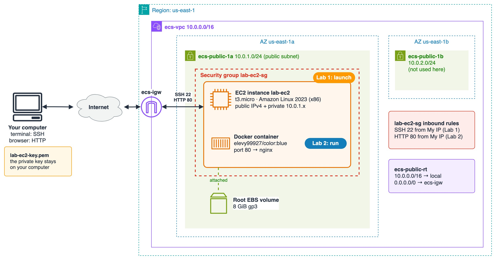

# 3.01 Compute: Amazon EC2

## Chapter Contents

| # | Lab | Steps |
|---|-----|-------|
| 1 | **Launch Your First EC2 Instance** – the *Launch an instance* page, step by step: AMI, instance type and the Free Tier, a key pair, network settings and storage | [Lab 1](lab-1.md) · [Solution](lab-1-solution.md) · [▶ Video](https://youtu.be/guJMkW6rb7g) |
| 2 | **Connect with SSH, Run a Container, and Clean Up** – SSH with your key, open port 80, install Docker, run `elevy99927/color:blue`, browse to it, then stop and terminate the instance | [Lab 2](lab-2.md) · [Solution](lab-2-solution.md) · [▶ Video](https://youtu.be/paAiY6g03wQ) |

Before you start: the network from [2.04 VPC and Networking – Lab 1](../2.04-vpc-and-networking/lab-1.md) (`ecs-vpc`), or a default VPC.

Diagram source: [images/ec2-labs.drawio](images/ec2-labs.drawio) (open it in [draw.io](https://app.diagrams.net) to edit)

---

## Topics

- EC2 basics – instances, instance types and families, AMIs, key pairs
- Launching and managing an instance – start, stop, reboot, terminate, instance states
- Security Groups – basic SSH rule (allow SSH from **your IP** only)
- User data – bootstrap an instance: install Docker and run NGINX
- Advanced Security Group – allow HTTP from `0.0.0.0/0`
- AMIs – create an AMI from an instance, launch a new instance from the AMI
- EBS snapshots – manual snapshots, scheduled snapshots (Amazon Data Lifecycle Manager), cleanup

---

[⬅ Previous: 2.04 VPC and Networking](../2.04-vpc-and-networking/README.md) | [🏠 Home](../README.md) | [Next: 3.02 Storage: EBS & EFS ➡](../3.02-storage/README.md)

---
## Contact

For questions or feedback, feel free to reach out:

- **Email**: eyal@levys.co.il
- **GitHub**: [https://github.com/elevy99927](https://github.com/elevy99927)
