# 3.01 Compute: Amazon EC2 – Firecracker Lab: Run Your Own MicroVM

[⬅ EC2 or Containers?](EC2-or-Containers.md) | [⬅ Back to 3.01 EC2](README.md)

In this walkthrough you build a **microVM** by hand with **Firecracker**, the open-source VMM behind AWS Lambda. You start it on an EC2 instance, give it a Linux kernel and a tiny root filesystem, configure and start it through Firecracker's API, and reach a web server running inside it. No Docker, and no full operating system inside the guest.

The theory is in [EC2 or Containers?](EC2-or-Containers.md) and its video. Region: **`us-east-1`**.

![The Firecracker lab: your computer connects with SSH to the EC2 instance fc-lab (L1: m7i-flex.large, Ubuntu 24.04, nested virtualization) running on the AWS Nitro hypervisor (L0). On the host: terminal 1 runs Firecracker with an API socket and shows the serial console; terminal 2 sends API calls over the Unix socket and curls the guest; ~/fc holds firecracker v1.17.0, the guest kernel and rootfs.ext4; tap0 has 172.16.0.1/30. The Firecracker process runs one microVM (L2: 1 vCPU, 256 MiB) with guest kernel 6.18.54, a rootfs with BusyBox and /init, and BusyBox httpd on port 80 at 172.16.0.2. Firecracker runs the guest through KVM in the host kernel.](images/firecracker-lab.jpg)

<sub>Diagram source: [images/firecracker-lab.drawio](images/firecracker-lab.drawio) (open it in [draw.io](https://app.diagrams.net) to edit)</sub>

**Three layers of virtualization:** AWS's Nitro hypervisor runs your EC2 instance (L1). With **nested virtualization**, the instance gets the CPU's virtualization features, so its own KVM can run the microVM (L2).

> **Prerequisites:**
> - [Lab 1](lab-1.md) and [Lab 2](lab-2.md): launching an instance, SSH, security groups
> - The network `ecs-vpc` from [2.04 VPC and Networking – Lab 1](../2.04-vpc-and-networking/lab-1.md), or a default VPC

> 💰 **Cost:** `m7i-flex.large` is **Free Tier eligible**, but outside the Free Tier it costs about **$0.096 an hour** in `us-east-1` (Linux, on-demand), plus **$0.005 an hour** for its public IPv4 address. The walkthrough takes about 30–45 minutes. Nested virtualization itself has no extra charge. Terminate the instance at the end ([step 8](#8-clean-up)).

> Tested in `us-east-1` on 25 October 2026: `m7i-flex.large` with nested virtualization, Ubuntu 24.04 (host kernel 7.0.0-1014-aws), Firecracker v1.17.0, guest kernel 6.18.54, a 32 MB BusyBox rootfs. IDs, the account number and IP addresses in the screenshots are masked. The terminal images show the real output of this run; long output is trimmed (`…`).

**Jump to:** [Decisions](#the-decisions-in-this-lab) · [1. Launch](#1-launch-the-host) · [2. KVM](#2-check-kvm-on-the-host) · [3. Firecracker](#3-get-firecracker) · [4. Kernel and rootfs](#4-the-guest-kernel-and-root-filesystem) · [5. TAP](#5-host-networking-a-tap-device) · [6. API and start](#6-configure-and-start-the-microvm-through-the-api) · [7. curl, pause, snapshot](#7-reach-the-app-then-pause-and-resume) · [8. Clean up](#8-clean-up) · [Check yourself](#check-yourself)

---

## The decisions in this lab

| Choice | What and why |
|---|---|
| Host | **`m7i-flex.large`** (2 vCPUs, 8 GiB) with **nested virtualization**. AWS added nested virtualization in February 2026 for several Intel families (C7i, C8i, M7i, M8i, R7i, R8i, I7i and others, [AWS docs](https://docs.aws.amazon.com/AWSEC2/latest/UserGuide/amazon-ec2-nested-virtualization.html)). On 2026-10-25 in `us-east-1`, `m7i-flex.large` and `c7i-flex.large` were the only Free Tier eligible types with it. Firecracker's own guide still says to use `.metal` instances; nested virtualization is fine for a lab, and AWS recommends bare metal for performance-sensitive workloads |
| Host OS | **Ubuntu Server 24.04**, x86_64, the OS Firecracker's getting-started guide uses |
| Firecracker | The official release **v1.17.0**, checksum verified |
| Guest kernel | **6.18.54** from Firecracker's CI. 6.18 is a supported guest kernel until 2028 ([kernel policy](https://github.com/firecracker-microvm/firecracker/blob/main/docs/kernel-policy.md)) |
| Guest root filesystem | A **32 MB** ext4 image you build: Ubuntu's static **BusyBox** plus a small **`/init`** script |
| The app | **BusyBox `httpd`**, started by `/init` at boot |
| Access | The **serial console** (to watch the boot) and `curl` from the host. No SSH into the guest, and no HTTP port in the security group |

---

## 1. Launch the host

Open **EC2 → Instances → Launch instances**, as in [Lab 1](lab-1.md). Name the instance **`fc-lab`**.

1. AMI: **Ubuntu** → **Ubuntu Server 24.04 LTS**, **64-bit (x86)**. The username is `ubuntu`. The Quick Start may preselect a newer Ubuntu (26.04 in this run): open the AMI list and choose 24.04.

   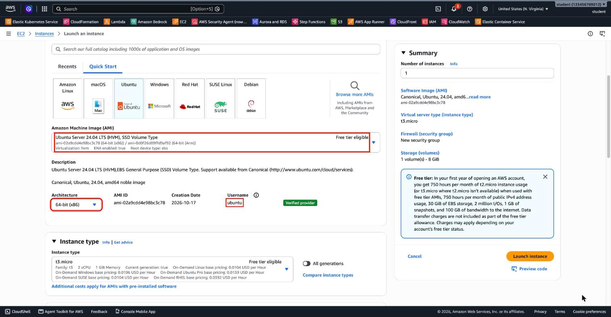

2. Instance type: **`m7i-flex.large`** (type it in the search box): 2 vCPUs, 8 GiB, *Free tier eligible*, 0.09576 USD per hour on-demand for Linux.

   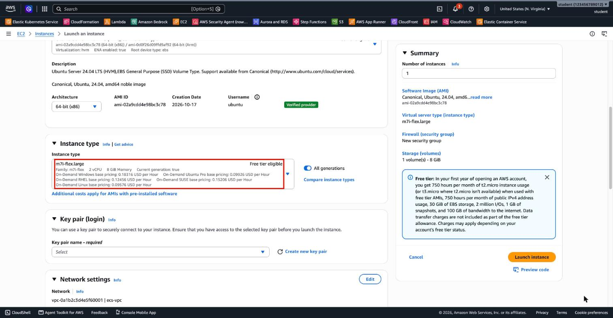

3. Key pair: **Create new key pair** → **`fc-lab-key`**, RSA, `.pem` (as in [Lab 1](lab-1-solution.md#5-key-pair)). Move it to `~/.ssh` and `chmod 400` it.

4. Network settings → **Edit**: VPC **`ecs-vpc`**, subnet **`ecs-public-1a`**, Auto-assign public IP **Enable**. Create security group **`fc-lab-sg`** with **SSH from My IP** only. No other rules: the HTTP test runs on the host itself.

   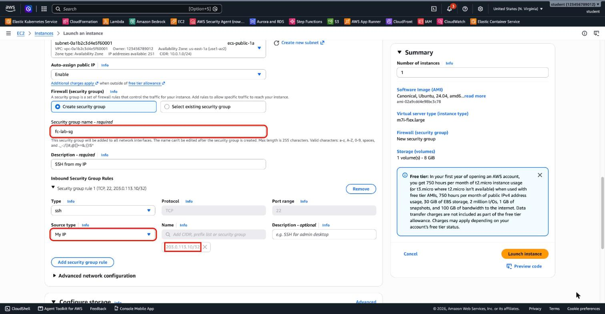

5. Storage: keep **8 GiB gp3**.

6. **Advanced details → Nested virtualization → Enabled.** It sits under *CPU options*. This is the important one: without it, the instance has no `/dev/kvm`.

   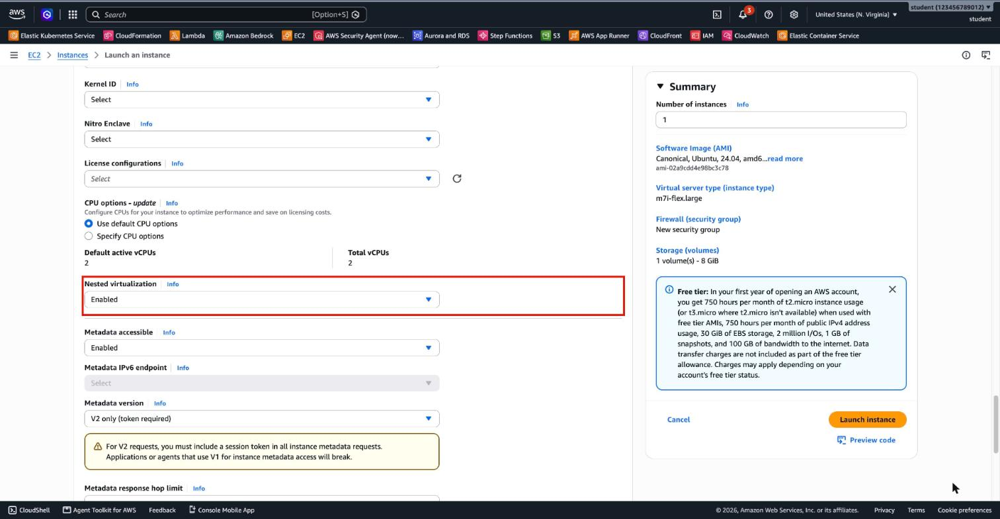

7. **Launch instance**, and wait for **Running** with **3/3 checks passed**. Note the public IPv4 address.

   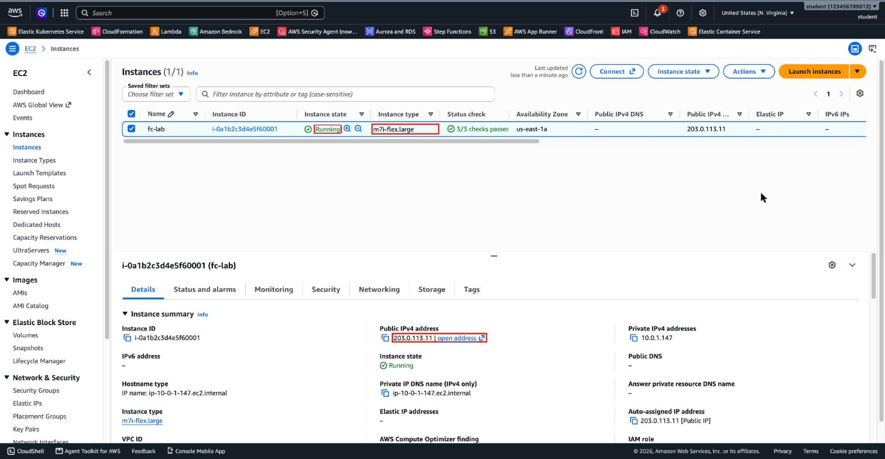

> With the AWS CLI, nested virtualization is `--cpu-options "NestedVirtualization=enabled"`. To check an instance type: `aws ec2 describe-instance-types --instance-types m7i-flex.large --query "InstanceTypes[].[FreeTierEligible,ProcessorInfo.SupportedFeatures]"`.

## 2. Check KVM on the host

SSH in (`ssh -i ~/.ssh/fc-lab-key.pem ubuntu@<public-ip>`) and check that KVM is there:

```bash
ls -l /dev/kvm                         # the KVM device: crw-rw---- root kvm
grep -c -E "vmx|svm" /proc/cpuinfo      # > 0: the CPU's virtualization flags are visible
lsmod | grep kvm                        # kvm_intel and kvm are loaded
```

`/dev/kvm` exists, the CPU shows its `vmx` flags, and the `kvm_intel` module is loaded: nested virtualization works.

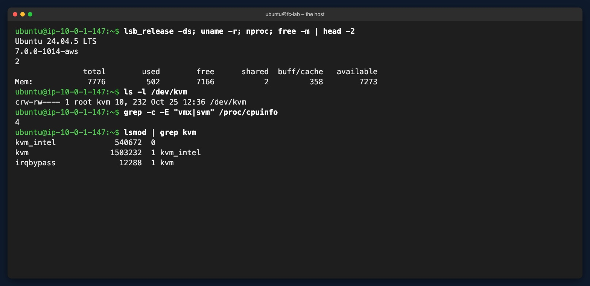

Then install the tools and give your user access to KVM:

```bash
sudo apt-get update
sudo apt-get install -y jq busybox-static
sudo usermod -aG kvm ubuntu
exit                                    # log out and SSH in again, so the new group applies
```

## 3. Get Firecracker

Firecracker is open source on GitHub: [github.com/firecracker-microvm/firecracker](https://github.com/firecracker-microvm/firecracker). Its official builds are on the [releases page](https://github.com/firecracker-microvm/firecracker/releases).

Download the release and **verify its checksum** before you run it:

```bash
mkdir -p ~/fc && cd ~/fc
ARCH=$(uname -m)
VER=v1.17.0
URL=https://github.com/firecracker-microvm/firecracker/releases/download/$VER
curl -fsSLO $URL/firecracker-$VER-$ARCH.tgz
curl -fsSLO $URL/firecracker-$VER-$ARCH.tgz.sha256.txt
sha256sum -c firecracker-$VER-$ARCH.tgz.sha256.txt     # must print: OK
tar -xzf firecracker-$VER-$ARCH.tgz
cp release-$VER-$ARCH/firecracker-$VER-$ARCH firecracker
./firecracker --version
```

`sha256sum -c` prints **OK**: the file matches the checksum published with the release.

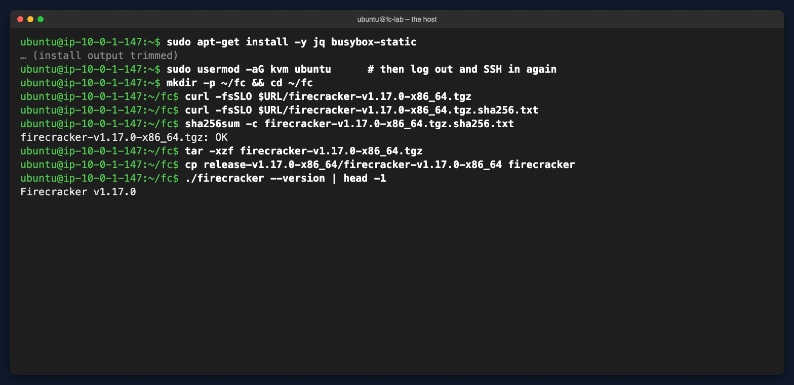

> The release also contains the **jailer**, which production systems use to sandbox Firecracker. This walkthrough runs Firecracker directly, to keep it simple.

## 4. The guest kernel and root filesystem

**The guest kernel is not the host kernel.** The host runs Ubuntu's kernel; the microVM boots its own kernel, which you download from Firecracker's CI. It must have the VirtIO drivers for its disk and network built in.

```bash
S3=https://s3.amazonaws.com/spec.ccfc.min
KEY=firecracker-ci/20261023-dd7c24b0d165-0/x86_64/vmlinux-6.18.54
curl -fsSLO $S3/$KEY
curl -fsSLO $S3/$KEY.config
grep -E "^CONFIG_(VIRTIO_BLK|VIRTIO_NET|VIRTIO_MMIO|EXT4_FS|SERIAL_8250_CONSOLE)=" vmlinux-6.18.54.config
```

All five lines should end in `=y`: built into the kernel.

> The CI folder name changes with each build. To find the newest kernels, list the bucket the way Firecracker's [getting-started guide](https://github.com/firecracker-microvm/firecracker/blob/main/docs/getting-started.md) does.

**The root filesystem (rootfs)** is the guest's disk: an ext4 image file on the host. Firecracker doesn't provide a Linux distribution, so you build a minimal one:

- **`/bin/busybox`**: one static binary with `sh`, `mount`, `ip` and `httpd`.
- **`/init`**: the first process the kernel starts (PID 1). Here it mounts `/proc` and `/sys`, configures `eth0`, writes a web page and **becomes the web server** with `exec`.

```bash
mkdir -p rootfs/bin rootfs/dev rootfs/proc rootfs/sys rootfs/www
cp /bin/busybox rootfs/bin/busybox
ln -s busybox rootfs/bin/sh

cat > rootfs/init <<'EOF'
#!/bin/sh
# The first process the guest kernel starts (PID 1)
echo "init: mounting /proc and /sys"
/bin/busybox mount -t proc proc /proc
/bin/busybox mount -t sysfs sysfs /sys
echo "init: eth0 = 172.16.0.2/30"
/bin/busybox ip link set lo up
/bin/busybox ip addr add 172.16.0.2/30 dev eth0
/bin/busybox ip link set eth0 up
echo "<h1>Hello from Firecracker</h1><p>Guest kernel: $(/bin/busybox uname -r)</p>" > /www/index.html
echo "init: starting httpd on port 80"
exec /bin/busybox httpd -f -p 80 -h /www
EOF
chmod +x rootfs/init

sudo chown -R root:root rootfs
truncate -s 32M rootfs.ext4
sudo mkfs.ext4 -q -d rootfs -F rootfs.ext4
sudo chown ubuntu:ubuntu rootfs.ext4
```

> **Why `exec`?** PID 1 must never exit: if it does, the kernel panics. `exec` replaces the script with `httpd`, so the web server becomes PID 1 and keeps running.

The whole rootfs is BusyBox, a `sh` link, `/init` and four empty directories, in a 32 MB image:

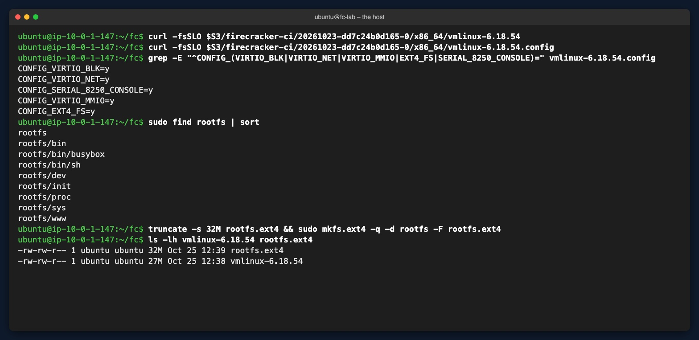

## 5. Host networking: a TAP device

The guest's virtual network card (virtio-net) is connected to a **TAP device**: a virtual network interface on the host. The host gets `172.16.0.1`, the guest `172.16.0.2`, in a tiny `/30` subnet. No NAT here: the guest only talks to the host.

```bash
sudo ip tuntap add dev tap0 mode tap user ubuntu      # owned by ubuntu, so Firecracker can run without sudo
sudo ip addr add 172.16.0.1/30 dev tap0
sudo ip link set dev tap0 up
```

## 6. Configure and start the microVM through the API

Firecracker is configured through an **HTTP API on a Unix socket**: a local file, not a network port. Use two SSH sessions to the host.

**Terminal 1:** start Firecracker. It waits for API calls, and later shows the guest's **serial console**.

```bash
cd ~/fc
rm -f /tmp/firecracker.socket
./firecracker --api-sock /tmp/firecracker.socket
```

`tap0` shows DOWN until Firecracker attaches to it:

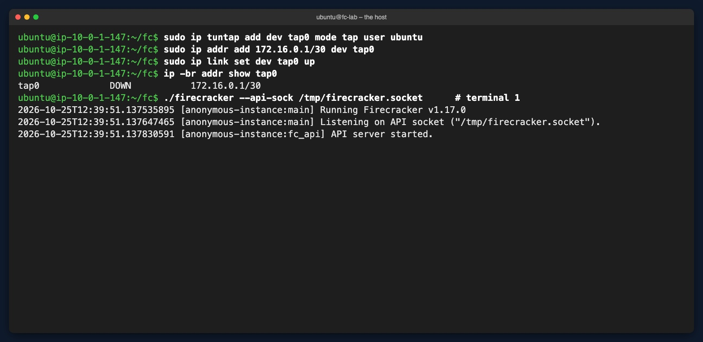

**Terminal 2:** define a small helper, check the state, then configure the microVM. **All the configuration comes before the start.**

```bash
cd ~/fc
api() { curl -s -w "HTTP %{http_code}\n" -X "$1" --unix-socket /tmp/firecracker.socket \
          -H "Content-Type: application/json" -d "$3" "http://localhost/$2"; }

curl -s --unix-socket /tmp/firecracker.socket http://localhost/ | jq .     # "state": "Not started"

api PUT boot-source '{"kernel_image_path": "./vmlinux-6.18.54", "boot_args": "console=ttyS0 reboot=k panic=1 init=/init"}'
api PUT drives/rootfs '{"drive_id": "rootfs", "path_on_host": "./rootfs.ext4", "is_root_device": true, "is_read_only": false}'
api PUT machine-config '{"vcpu_count": 1, "mem_size_mib": 256}'
api PUT network-interfaces/eth0 '{"iface_id": "eth0", "host_dev_name": "tap0"}'
```

The boot arguments: `console=ttyS0` sends the kernel's output to the serial console, `init=/init` runs your script, and `reboot=k panic=1` make a crash end the microVM instead of hanging. Each call returns **HTTP 204** (success, no content):

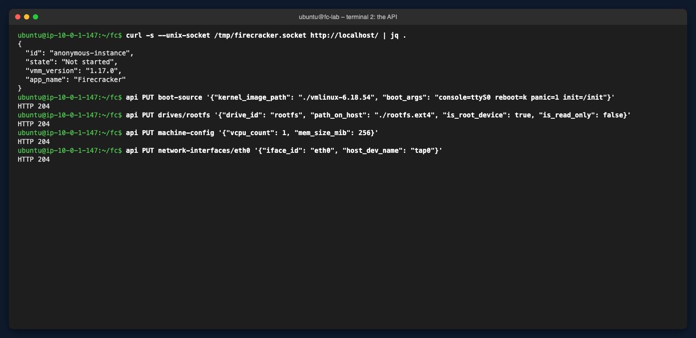

**Start it:**

```bash
api PUT actions '{"action_type": "InstanceStart"}'
```

Watch **terminal 1**: `Hypervisor detected: KVM`, the virtio disk (`vda`) and network card, the ext4 mount, `Run /init as init process`, then your three `init:` lines. Firecracker added `root=/dev/vda` and the `virtio_mmio.device=` entries to the kernel command line itself. In this run `/init` started about **0.97 s** after the kernel started, and the first HTTP answer came **1,222 ms** after `InstanceStart`.

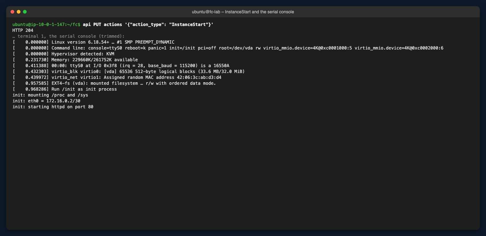

## 7. Reach the app, then pause and resume

From terminal 2:

```bash
curl http://172.16.0.2/            # Hello from Firecracker · Guest kernel: 6.18.54+
uname -r                           # the host's kernel: a different version
curl -s --unix-socket /tmp/firecracker.socket http://localhost/ | jq -r .state     # Running
```

The guest kernel is **6.18.54**, while the host runs **7.0.0-1014-aws**: two different kernels on the same machine. The Firecracker process used about **58 MB** of resident memory, although the guest has 256 MiB: the host only allocates memory when the guest touches it.

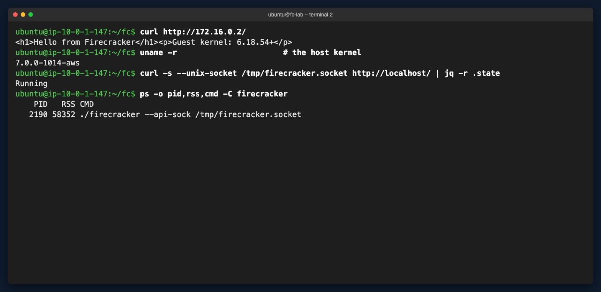

### Pause and resume (advanced exercise)

```bash
api PATCH vm '{"state": "Paused"}'
curl -s -m 3 http://172.16.0.2/ || echo "no answer within 3 s (exit $?)"
api PATCH vm '{"state": "Resumed"}'
curl http://172.16.0.2/
```

While paused, `curl` gets no answer (exit code 28, a timeout). After Resume, the same page comes back from the same IP.

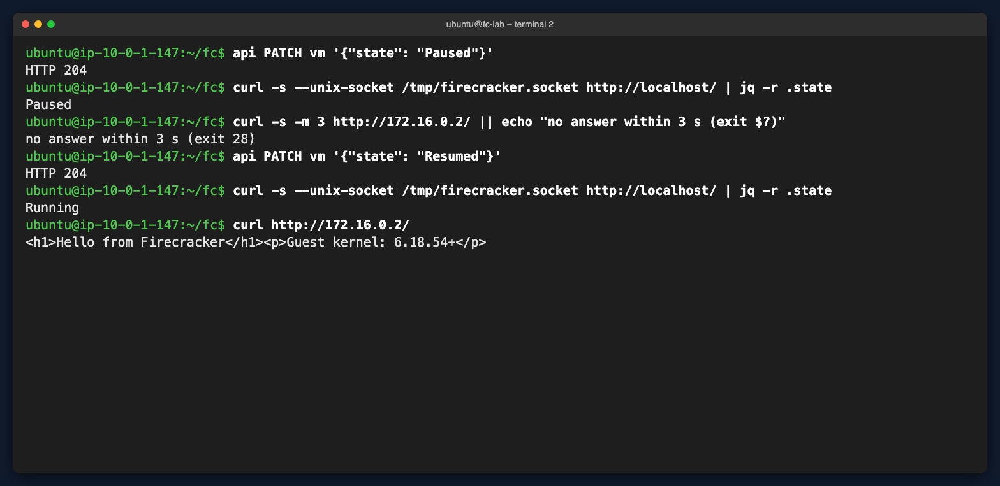

Answer these:
- What happens to HTTP requests while the microVM is paused?
- Does the guest keep its IP address after Resume?
- What's the difference between Pause, Stop and Snapshot?

### Bonus: a snapshot

A snapshot saves the paused microVM's state and memory to files, so a new Firecracker process can resume it without booting:

```bash
api PATCH vm '{"state": "Paused"}'
api PUT snapshot/create '{"snapshot_type": "Full", "snapshot_path": "./vm.snap", "mem_file_path": "./vm.mem"}'
ls -lh vm.snap vm.mem              # the memory file is as large as the guest's RAM
pkill -x firecracker               # the microVM is gone (terminal 1 returns to the prompt)
```

In terminal 1, start Firecracker again (`rm -f /tmp/firecracker.socket; ./firecracker --api-sock /tmp/firecracker.socket`). Then, in terminal 2:

```bash
api PUT snapshot/load '{"snapshot_path": "./vm.snap", "mem_backend": {"backend_type": "File", "backend_path": "./vm.mem"}, "resume_vm": true}'
curl http://172.16.0.2/
```

A 15 KB state file and a 256 MB memory file. In this run, from `snapshot/load` to the HTTP answer took **45 ms**, compared with about 1.1 s for a cold boot. This is the idea behind **Lambda SnapStart**: restore an initialized environment instead of booting a new one.

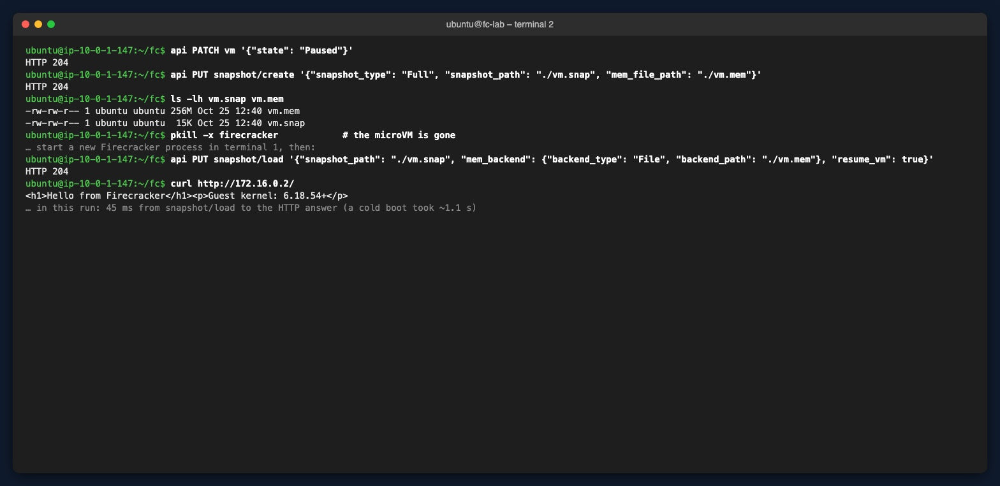

### Advanced: make it boot faster

Measure how long it takes from `InstanceStart` to the first HTTP answer, then add `quiet` to the boot arguments (less console output), and then also `i8042.noaux i8042.nomux i8042.nopnp i8042.dumbkbd` (skip probing the keyboard controller, as Firecracker's own boot-time tests do). Stop Firecracker and start a fresh process before each run.

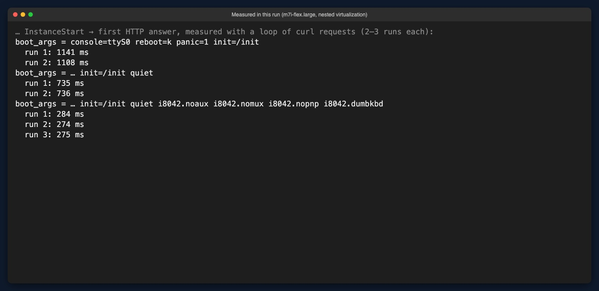

- **`quiet`** saved about 0.4 s: printing hundreds of kernel lines to the emulated serial port is slow.
- **The `i8042` options** saved about another 0.45 s: the kernel no longer probes the keyboard controller.
- The published **≤ 125 ms** (to `/sbin/init`) is measured on bare-metal hosts with the serial console fully disabled (`8250.nr_uarts=0`). This run used nested virtualization, and measured up to the first HTTP answer.

## 8. Clean up

- Stop the microVM: `pkill -x firecracker`.
- Remove the TAP device: `sudo ip link del tap0`.
- **Terminate** the `fc-lab` instance (see [Lab 2, step 6](lab-2.md#6-stop-and-terminate-the-instance)).
- Delete the security group **`fc-lab-sg`**, the key pair **`fc-lab-key`**, and `fc-lab-key.pem` on your computer.
- Keep `ecs-vpc`.

With the AWS CLI (for example in CloudShell):

```bash
ID=$(aws ec2 describe-instances --filters Name=tag:Name,Values=fc-lab Name=instance-state-name,Values=running,stopped \
  --query 'Reservations[0].Instances[0].InstanceId' --output text)
aws ec2 terminate-instances --instance-ids $ID
aws ec2 wait instance-terminated --instance-ids $ID
aws ec2 delete-security-group --group-id $(aws ec2 describe-security-groups \
  --filters Name=group-name,Values=fc-lab-sg --query 'SecurityGroups[0].GroupId' --output text)
aws ec2 delete-key-pair --key-name fc-lab-key
```

---

## Troubleshooting

| Symptom | Likely cause | Fix |
|---|---|---|
| No `/dev/kvm` | Nested virtualization isn't enabled, or the instance type doesn't support it | Stop the instance → **Actions → Instance settings → Change CPU options → Nested virtualization: Enable**, or relaunch on a supported type |
| `Permission denied` on `/dev/kvm` | Your user isn't in the `kvm` group yet | `sudo usermod -aG kvm ubuntu`, then log out and in |
| Firecracker can't open `tap0` | The TAP device belongs to root | Recreate it with `user ubuntu` |
| `Kernel panic` during boot | The rootfs, `root=` or `/init` is wrong (not executable, no `/bin/sh`) | Check the boot arguments, `chmod +x rootfs/init`, and rebuild the image |
| `curl` to `172.16.0.2` fails | TAP, IP addresses or the HTTP server | Check each layer: `ip -br addr show tap0` on the host, and the `init:` lines on the serial console |
| `Address in use` when starting Firecracker | An old socket file | `rm -f /tmp/firecracker.socket` |

> **Host kernel:** this Ubuntu AMI runs host kernel **7.0**, which isn't in Firecracker's validated host list (5.10, 6.1, 6.18). It worked in this run. For a validated host kernel, Amazon Linux 2023 offers kernel 6.18.

## Check yourself

1. Why does Firecracker need access to KVM?
2. What's the difference between the guest kernel and the root filesystem?
3. What does the TAP interface do?
4. What's the difference between Pause and Snapshot?

<details>
<summary><b>Answers</b></summary>

1. **Why KVM?** Firecracker is only the VMM: it sets up the machine and its devices. **KVM**, in the host kernel, runs the guest's code directly on the CPU with hardware virtualization (Intel VT-x / AMD-V) and handles VM exits. Without `/dev/kvm` there's nothing to run the guest on. That's why this walkthrough needs nested virtualization (or bare metal).
2. **Guest kernel vs. root filesystem:** the **guest kernel** (`vmlinux-6.18.54`) is the core of the guest OS: it manages the vCPU, memory and the virtio devices. The **root filesystem** (`rootfs.ext4`) is the guest's disk: the files and programs (`/init`, BusyBox, the web page). Firecracker loads the kernel straight into guest memory and attaches the rootfs as the virtio-block device `vda`.
3. **The TAP interface** is a virtual network card on the host. Firecracker connects the guest's virtio-net `eth0` to it, so packets the guest sends appear on `tap0` (`172.16.0.1`), and the other way round.
4. **Pause vs. snapshot:** **Pause** stops the vCPUs and device emulation, but the microVM stays in the same process and memory: Resume continues at once. A **snapshot** writes the paused microVM's state and memory to files, so a different Firecracker process, even later or on a compatible host, can load it and continue without a cold boot. Neither is a shutdown.

</details>

---

## What's next?

Back to the [3.01 EC2 chapter](README.md), or on to [3.02 Storage](../3.02-storage/README.md).

---

## Contact

For questions or feedback, feel free to reach out:

- **Email**: eyal@levys.co.il
- **GitHub**: [https://github.com/elevy99927](https://github.com/elevy99927)
