# 3.01 Compute: Amazon EC2 – Lab 1 Solution

[⬅ Lab 1](lab-1.md) | [⬅ Back to 3.01 EC2](README.md) | [Lab 2 ➡](lab-2.md)

> Tested in `us-east-1` on 25 October 2026: `t3.micro`, Amazon Linux 2023 (AMI `2023.12.20261026.1`, kernel 6.18), in `ecs-vpc` / `ecs-public-1a`. IDs, the account number and IP addresses in the screenshots are masked.

**Jump to:** [Solution 1: Console](#solution-1-console-ui) · [Solution 2: AWS CLI](#solution-2-aws-cli) · [Answers](#answers)

---

## Solution 1: Console (UI)

### 1. Open the launch page

1. Open **EC2 → Instances** in `us-east-1` and choose **Launch instances**.

   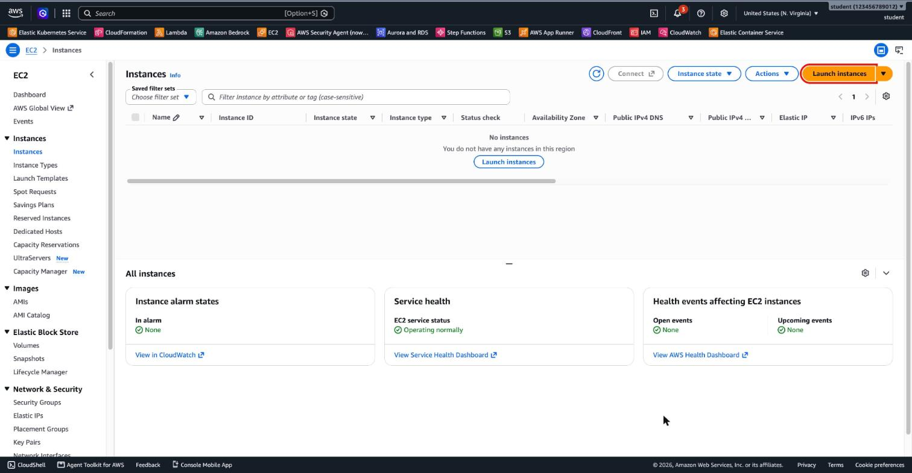

### 2. Name

2. Under **Name and tags**, type **`lab-ec2`**.

   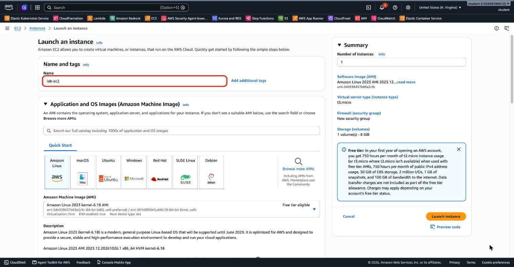

### 3. AMI

3. **Quick Start → Amazon Linux**. The AMI is **Amazon Linux 2023** (*Free tier eligible*), and the Architecture is **64-bit (x86)**. Note the username **`ec2-user`** next to the AMI ID.

   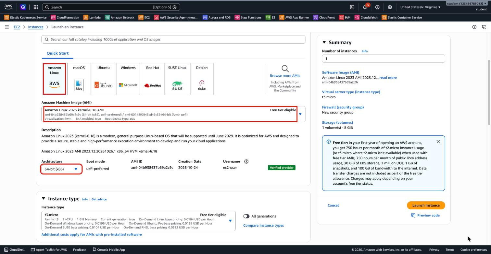

### 4. Instance type

4. The instance type is already **`t3.micro`** (*Free tier eligible*). The box shows the on-demand price: **0.0104 USD per hour** for Linux. The **Free tier** panel on the right says what this account gets, and ends with *"Charges may apply depending on your account's free tier status."*

   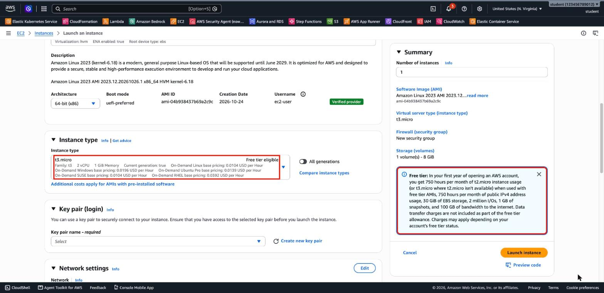

### 5. Key pair

5. Under **Key pair (login)**, choose **Create new key pair**.

   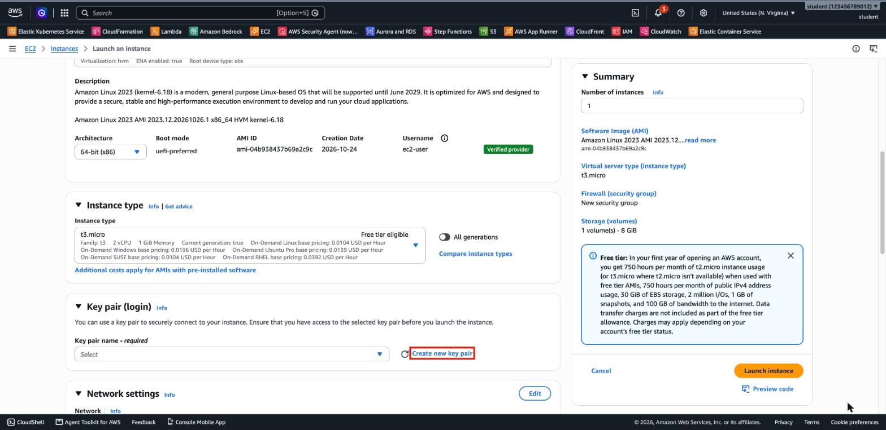

6. Name **`lab-ec2-key`**, type **RSA**, format **`.pem`** → **Create key pair**. The browser downloads `lab-ec2-key.pem`, and the key pair is selected on the launch page.

   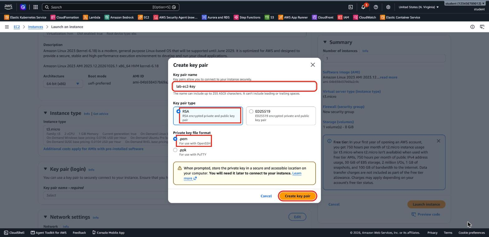

   Move the file to a safe place and make it readable only by you. On macOS or Linux:

   ```bash
   mkdir -p ~/.ssh
   mv ~/Downloads/lab-ec2-key.pem ~/.ssh/
   chmod 400 ~/.ssh/lab-ec2-key.pem
   ```

### 6. Network settings

7. Under **Network settings**, choose **Edit**. VPC **`ecs-vpc`**, Subnet **`ecs-public-1a`**, Auto-assign public IP **Enable**.

   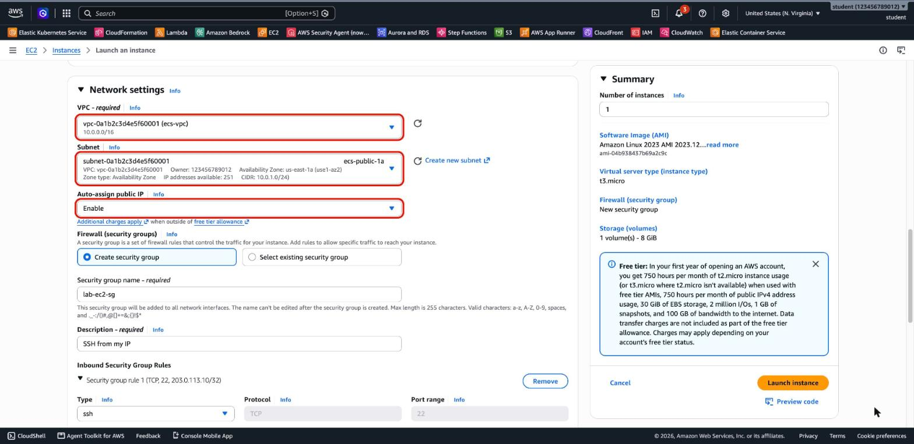

   > Here the subnet already has *auto-assign public IPv4* turned on (from the 2.04 lab), so *Enable* is preselected. If you just created the VPC and the list is empty, choose the refresh button next to **VPC** and **Subnet**.

8. **Create security group**: name **`lab-ec2-sg`**, description **`SSH from my IP`**. In **Security group rule 1**, keep Type **ssh** and set Source type **My IP**. The source becomes your public address with `/32`.

   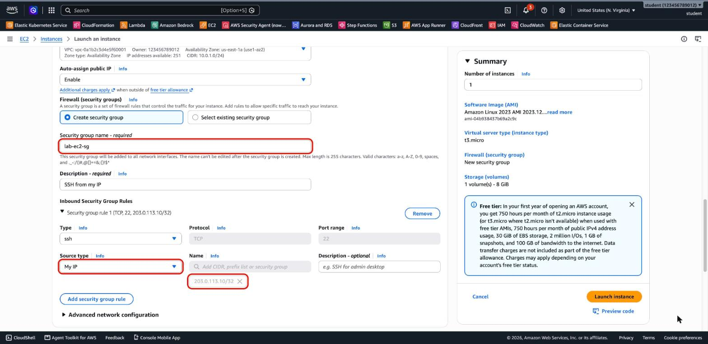

### 7. Storage

9. **Configure storage:** keep **1x 8 GiB gp3**, *Root volume*. The note under it is the Free Tier limit for EBS: up to 30 GB.

   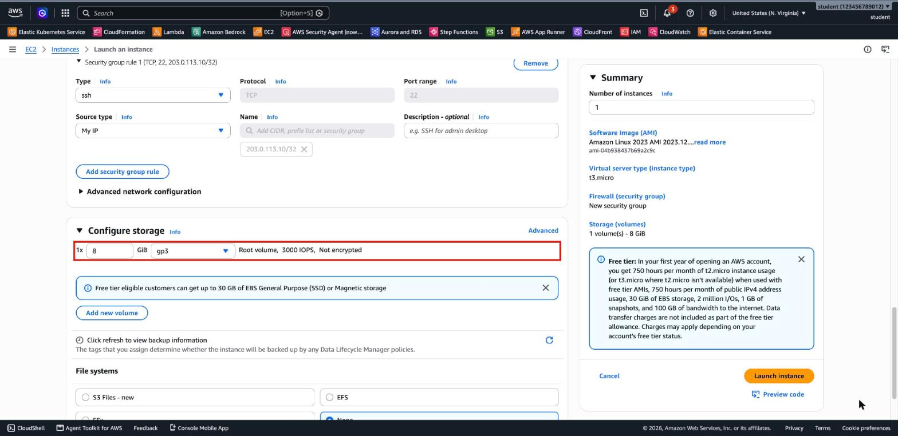

### 8. Launch and check

10. Check the **Summary**: Amazon Linux 2023, `t3.micro`, *New security group*, *1 volume(s) – 8 GiB*. Choose **Launch instance**.

    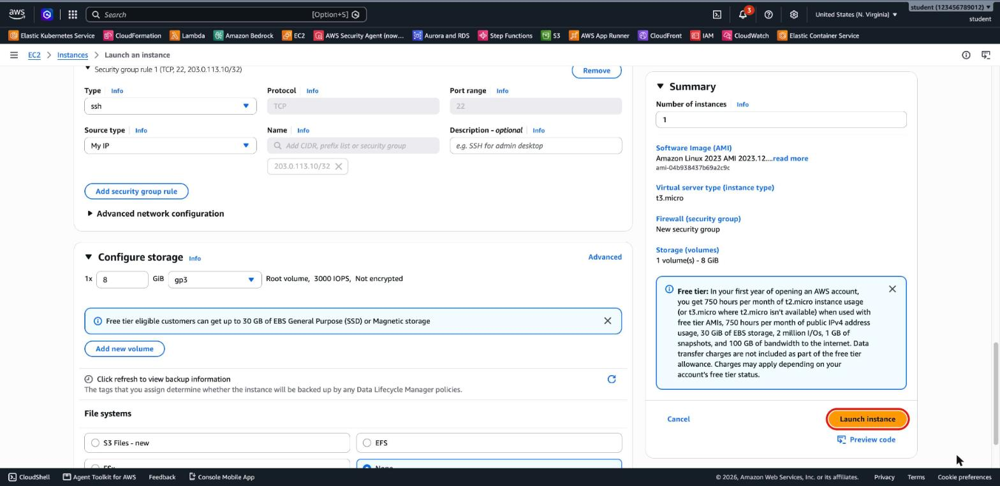

11. *Success: Successfully initiated launch of instance*. Choose the instance ID, or open **Instances**.

    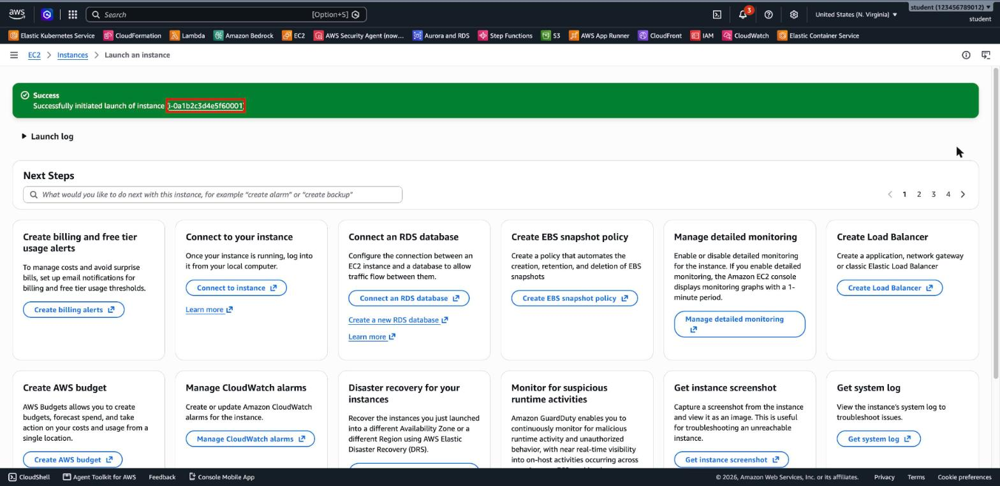

12. After about a minute, `lab-ec2` is **Running** with **3/3 checks passed**. Select it: the **Details** tab shows its **Public IPv4 address** (you use it in Lab 2) and its private address in `10.0.1.0/24`.

    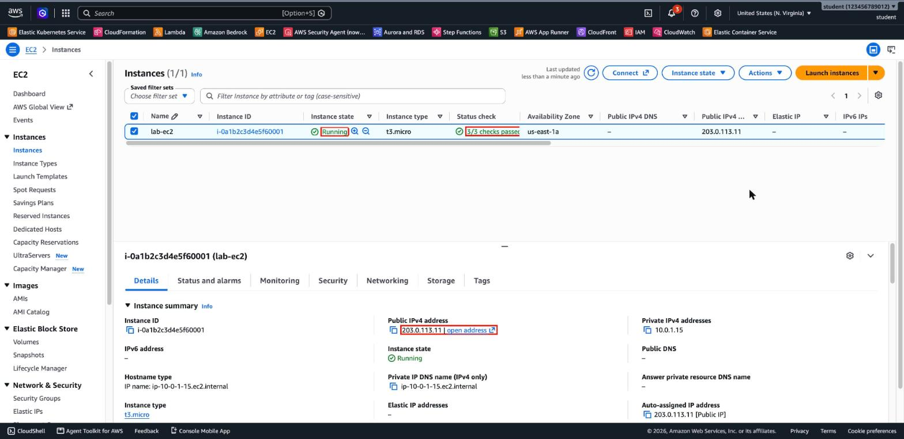

---

## Solution 2: AWS CLI

The same instance with the AWS CLI. Run it in **CloudShell** (already signed in) or in a terminal after `aws login`. It looks up `ecs-vpc` and `ecs-public-1a` by name, and the latest Amazon Linux 2023 AMI from its public SSM parameter.

```bash
export AWS_REGION=us-east-1
MYIP=$(curl -s https://checkip.amazonaws.com)
VPC=$(aws ec2 describe-vpcs --filters Name=tag:Name,Values=ecs-vpc --query 'Vpcs[0].VpcId' --output text)
SUBNET=$(aws ec2 describe-subnets --filters Name=vpc-id,Values=$VPC Name=tag:Name,Values=ecs-public-1a \
  --query 'Subnets[0].SubnetId' --output text)
AMI=$(aws ssm get-parameter --name /aws/service/ami-amazon-linux-latest/al2023-ami-kernel-default-x86_64 \
  --query Parameter.Value --output text)

# Key pair: AWS keeps the public key, the private key is saved once, here
mkdir -p ~/.ssh
aws ec2 create-key-pair --key-name lab-ec2-key --key-type rsa --key-format pem \
  --query KeyMaterial --output text > ~/.ssh/lab-ec2-key.pem
chmod 400 ~/.ssh/lab-ec2-key.pem

# Security group: SSH from my IP only
SG=$(aws ec2 create-security-group --group-name lab-ec2-sg --description "SSH from my IP" \
  --vpc-id $VPC --query GroupId --output text)
aws ec2 authorize-security-group-ingress --group-id $SG --protocol tcp --port 22 --cidr $MYIP/32

# The instance: t3.micro, public IP, 8 GiB gp3 root volume, Name tag
ID=$(aws ec2 run-instances --image-id $AMI --instance-type t3.micro --key-name lab-ec2-key \
  --subnet-id $SUBNET --security-group-ids $SG --associate-public-ip-address \
  --block-device-mappings 'DeviceName=/dev/xvda,Ebs={VolumeSize=8,VolumeType=gp3}' \
  --tag-specifications 'ResourceType=instance,Tags=[{Key=Name,Value=lab-ec2}]' \
  --query 'Instances[0].InstanceId' --output text)
aws ec2 wait instance-running --instance-ids $ID
IP=$(aws ec2 describe-instances --instance-ids $ID \
  --query 'Reservations[0].Instances[0].PublicIpAddress' --output text)
aws ec2 describe-instances --instance-ids $ID --query \
  'Reservations[0].Instances[0].[State.Name,InstanceType,Placement.AvailabilityZone,BlockDeviceMappings[0].DeviceName]' --output text
echo "Public IP: $IP"
```

Output of the tested run:

```
running t3.micro        us-east-1a      /dev/xvda
```

> `MYIP` is the public address of the machine that runs the commands. In CloudShell that's CloudShell's address, not your computer's, so SSH from CloudShell works but SSH from your laptop doesn't. Run the commands on your own computer, or set `MYIP` to the address that `curl https://checkip.amazonaws.com` prints there.

---

## Answers

1. **Why 64-bit (x86)?** The AMI's architecture must match the instance type: x86 AMIs run on x86 types such as `t3.micro`, and Arm AMIs on Graviton types such as `t4g.micro`. The container image in Lab 2 (`elevy99927/color`) is built for `amd64` only, so it needs an x86 instance.
2. **`/32`** means exactly **one** IP address: all 32 bits are fixed. *My IP* allows SSH from your current public address only.
3. **The root volume is deleted** with the instance, because *Delete on termination* is **Yes** by default for the root volume. A volume you create and attach later is **not** deleted with the instance by default: it stays, and keeps costing money, until you delete it.

---

## Contact

For questions or feedback, feel free to reach out:

- **Email**: eyal@levys.co.il
- **GitHub**: [https://github.com/elevy99927](https://github.com/elevy99927)
