# 3.01 Compute: Amazon EC2 – Lab 2 Solution

[⬅ Lab 2](lab-2.md) | [⬅ Back to 3.01 EC2](README.md)

> Tested in `us-east-1` on 25 October 2026: `t3.micro`, Amazon Linux 2023, Docker 25.0.14, `elevy99927/color:blue`. IDs, the account number and IP addresses are masked. The terminal screenshots show the real output of the tested run, with long download output trimmed (`…`).

**Jump to:** [Solution 1: Console and terminal](#solution-1-console-and-terminal) · [Solution 2: AWS CLI](#solution-2-aws-cli) · [Answers](#answers)

---

## Solution 1: Console and terminal

### 1. Connect with SSH

1. Select `lab-ec2` → **Connect** → **SSH client**. The page shows the key pair (`lab-ec2-key`), the public IP, the username (`ec2-user`), and the two commands: `chmod 400` and `ssh -i`.

   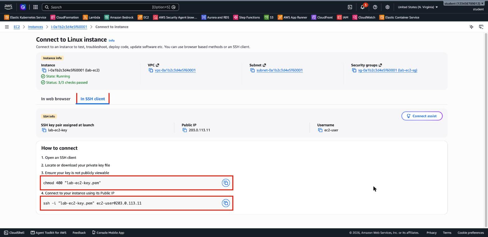

2. In a terminal on your computer, run the two commands with the key's path. Answer **`yes`** to the host key question. You're in when you see the Amazon Linux banner and the `ec2-user` prompt. `uname -m` confirms the architecture: `x86_64`.

   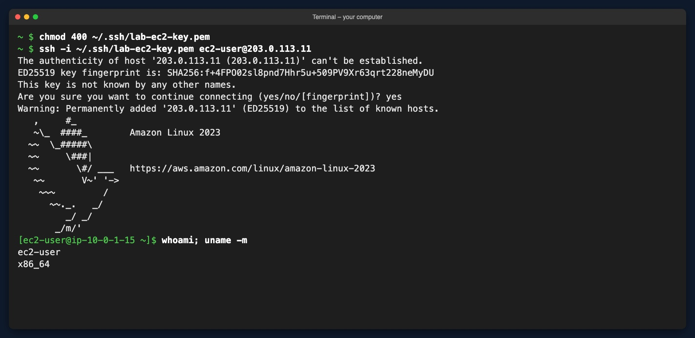

   > Newer OpenSSH clients may also print a warning about a *post-quantum key exchange*. It's a note about the server's SSH version, and you can ignore it for this lab.

### 2. Open port 80

3. Back in the Console: select the instance → **Security** tab → choose the security group **`lab-ec2-sg`**.

   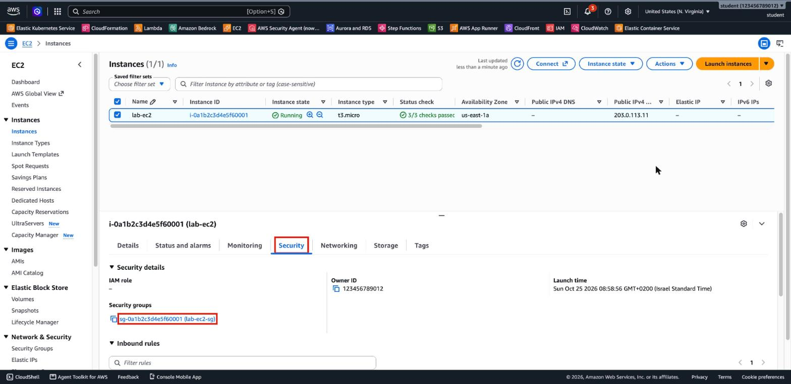

4. **Inbound rules** has one rule: SSH, port 22, from your IP. Choose **Edit inbound rules**.

   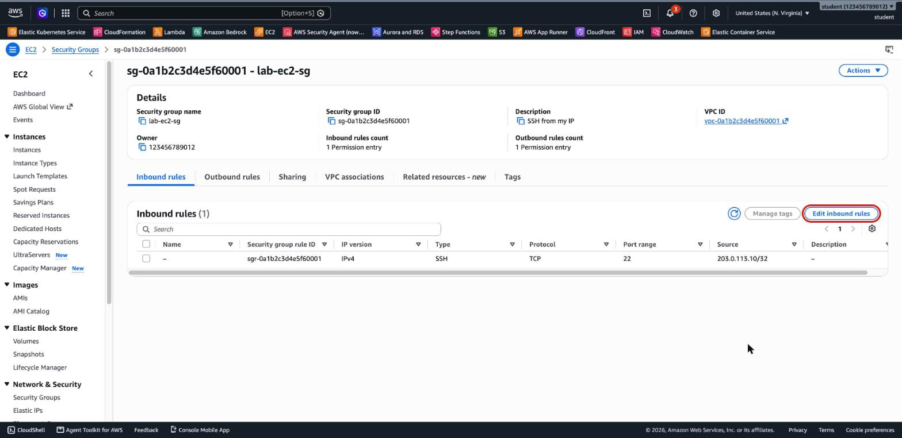

5. **Add rule:** Type **HTTP** (port 80 is filled in), Source type **My IP**. Choose **Save rules**.

   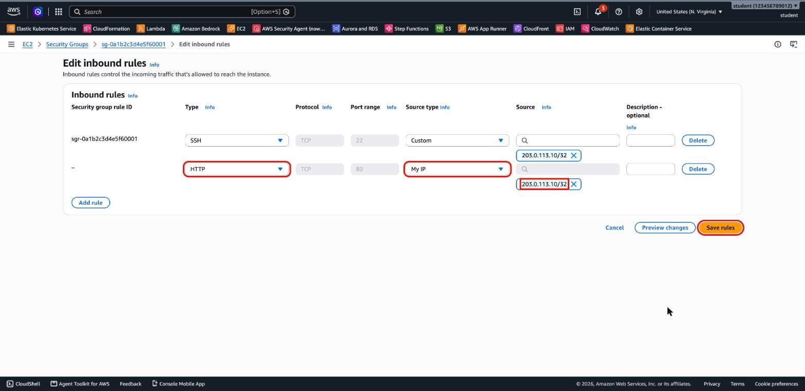

6. The security group now has two inbound rules: **SSH 22** and **HTTP 80**, both from your IP only.

   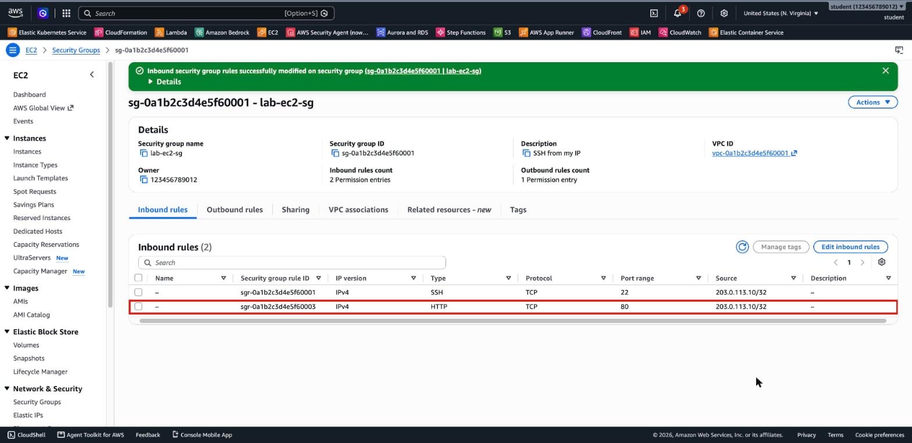

### 3. Install Docker

7. In the SSH session, install Docker with `dnf`, then start it now and at boot:

   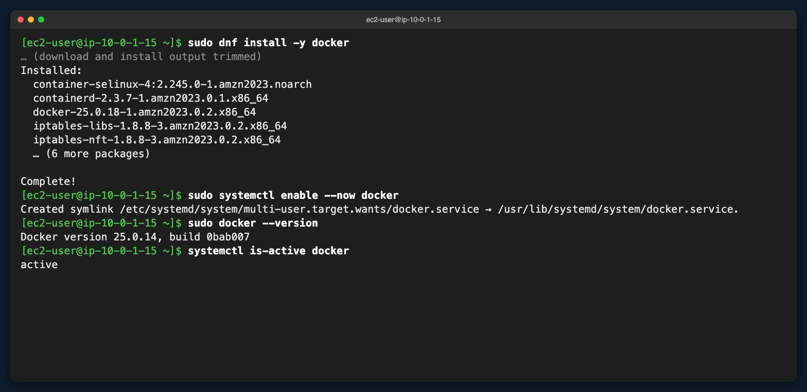

### 4. Run the container

8. Run `elevy99927/color:blue` in the background, with port 80 on the instance mapped to port 80 in the container. Docker pulls the image the first time. `docker ps` shows it **Up** with `0.0.0.0:80->80/tcp`, and `curl localhost` returns **Hello blue**.

   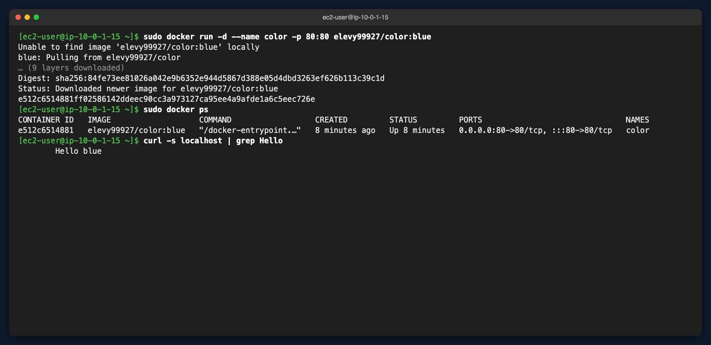

### 5. Browse to the site

9. On your computer, open `http://<public-ip>`. The page is blue and says **Hello blue**.

   

   > The browser tab says *Color Red*: that's the `<title>` inside the image's HTML. The page itself is the blue one.
   >
   > **In this run** SSH from the lab computer first timed out: its network has **two public IP addresses**, and the address the Console detected as *My IP* was not the one the terminal used. Adding the second address (`curl https://checkip.amazonaws.com` shows it) to the rules fixed it. See [Troubleshooting](lab-2.md#troubleshooting).

### 6. Stop and terminate

10. Select the instance → **Instance state → Stop instance**.

    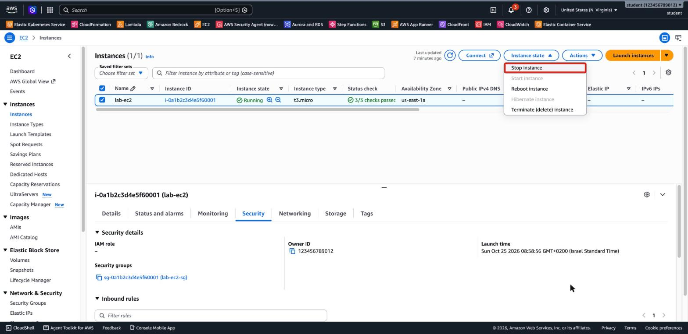

11. The dialog warns that a stopped instance has no compute charges, but you're **still billed for its EBS volumes** (and Elastic IPs, if any). Choose **Stop**.

    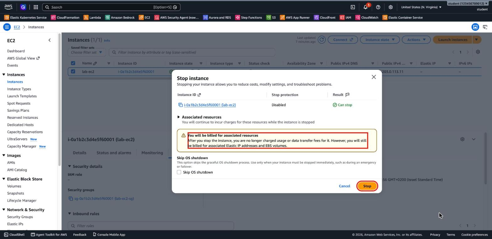

12. After about half a minute the instance is **Stopped**, and its **Public IPv4 address is gone**: the auto-assigned address is released when the instance stops.

    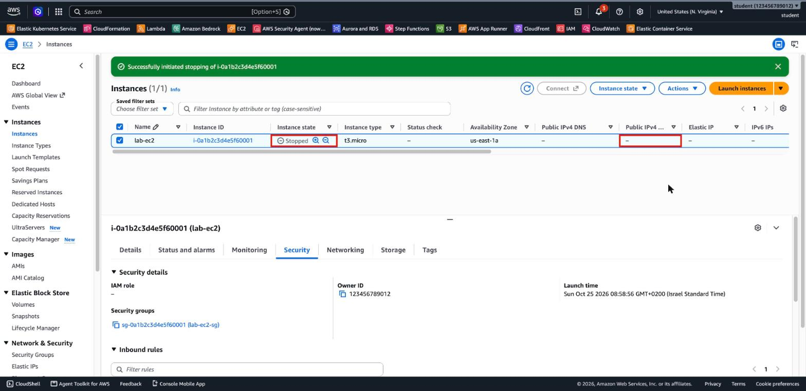

13. **Instance state → Terminate (delete) instance.**

    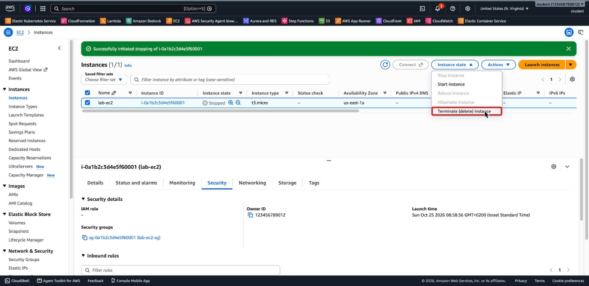

14. The dialog explains that the **root EBS volume is deleted** with the instance, and that terminating **can't be undone**. Choose **Terminate (delete)**.

    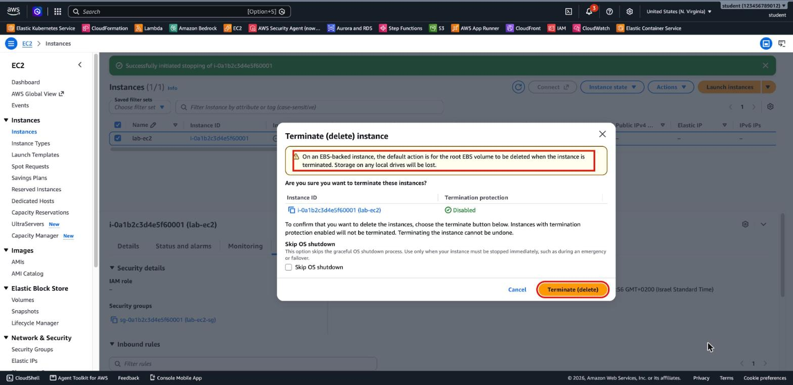

15. The instance is **Terminated**. It stays in the list for a while (about an hour), then disappears.

    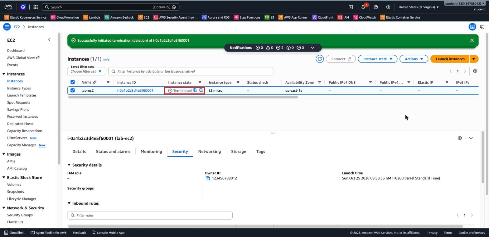

16. **Clean up the rest:**
    - **EC2 → Security Groups** → select `lab-ec2-sg` → **Actions → Delete security groups → Delete**. It can be deleted only after the instance is terminated.
    - **EC2 → Key Pairs** → select `lab-ec2-key` → **Actions → Delete**, type `Delete`, and delete `lab-ec2-key.pem` on your computer.
    - Keep **`ecs-vpc`**: later labs use it.

---

## Solution 2: AWS CLI

The whole lab with the AWS CLI, after [Lab 1, Solution 2](lab-1-solution.md#solution-2-aws-cli). Run it on the computer that has the key (or in CloudShell, if you created the key and the instance there). It finds the instance and the security group by name.

```bash
export AWS_REGION=us-east-1
MYIP=$(curl -s https://checkip.amazonaws.com)
ID=$(aws ec2 describe-instances --filters Name=tag:Name,Values=lab-ec2 Name=instance-state-name,Values=running \
  --query 'Reservations[0].Instances[0].InstanceId' --output text)
IP=$(aws ec2 describe-instances --instance-ids $ID --query 'Reservations[0].Instances[0].PublicIpAddress' --output text)
SG=$(aws ec2 describe-security-groups --filters Name=group-name,Values=lab-ec2-sg \
  --query 'SecurityGroups[0].GroupId' --output text)

# 2. Open port 80 from my IP
aws ec2 authorize-security-group-ingress --group-id $SG --protocol tcp --port 80 --cidr $MYIP/32

# 1, 3, 4. SSH in, install Docker and run the container (one command over SSH)
ssh -i ~/.ssh/lab-ec2-key.pem -o StrictHostKeyChecking=accept-new ec2-user@$IP \
  'sudo dnf install -y -q docker && sudo systemctl enable --now docker &&
   sudo docker run -d -q --name color -p 80:80 elevy99927/color:blue &&
   sudo docker ps --format "{{.Image}} {{.Status}} {{.Ports}}"'

# 5. The site, from your computer
curl -s http://$IP | grep Hello

# 6. Stop, terminate and clean up
aws ec2 stop-instances --instance-ids $ID --query 'StoppingInstances[0].CurrentState.Name' --output text
aws ec2 wait instance-stopped --instance-ids $ID
aws ec2 terminate-instances --instance-ids $ID --query 'TerminatingInstances[0].CurrentState.Name' --output text
aws ec2 wait instance-terminated --instance-ids $ID
aws ec2 delete-security-group --group-id $SG
aws ec2 delete-key-pair --key-name lab-ec2-key
rm -f ~/.ssh/lab-ec2-key.pem
```

Output of the tested run (in CloudShell, shortened):

```
Created symlink /etc/systemd/system/multi-user.target.wants/docker.service → /usr/lib/systemd/system/docker.service.
c801204ae951dbe90b25a9ed8f2e62760b29763c01261d369696df4b48455200
elevy99927/color:blue Up Less than a second 0.0.0.0:80->80/tcp, :::80->80/tcp
        Hello blue
stopping
terminated
```

> `-o StrictHostKeyChecking=accept-new` answers the first-connection question with *yes*, so the script doesn't stop to ask. Type `ssh -i ~/.ssh/lab-ec2-key.pem ec2-user@$IP` alone to get an interactive session instead.

---

## Answers

1. **No public IPv4 after stop:** an **auto-assigned** public IPv4 address belongs to the running instance. AWS releases it when the instance stops and gives a **new** one at the next start. For an address that never changes, attach an **Elastic IP**, which is billed while it exists.
2. **What a stopped instance still costs:** its **EBS volumes** (here, 8 GiB gp3), any **Elastic IP** addresses, and snapshots. The compute is free while it's stopped. Terminating deletes the instance and, by default, its root volume.
3. **`-p 80:80`** connects **port 80 on the instance** (the host) to **port 80 inside the container**, where nginx listens. The security group filters traffic to the **instance**, so it needs the **host** port. With `-p 8080:80`, for example, the rule would need port 8080.

---

## Contact

For questions or feedback, feel free to reach out:

- **Email**: eyal@levys.co.il
- **GitHub**: [https://github.com/elevy99927](https://github.com/elevy99927)
