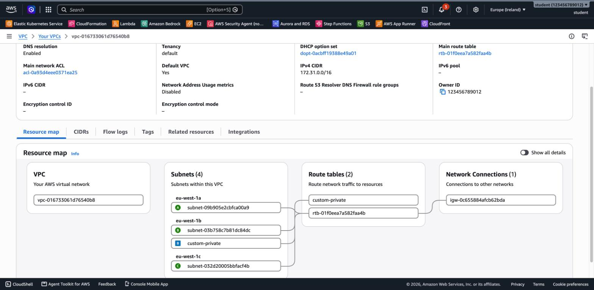

# 3.02 VPC Basics

## Topics

- [What is a VPC – your private, isolated network in an AWS Region](#1-what-is-a-vpc)
- [CIDR blocks and IP addressing basics](#2-cidr-basics)
- [The **default VPC** – what AWS creates for you (default subnets, Internet Gateway, route table, default security group)](#3-the-default-vpc)
- [Recreating a deleted default VPC](#3-the-default-vpc)
- [Subnets – each subnet lives in **one Availability Zone**](#4-subnets-route-tables-and-the-internet-gateway)
- [Public vs. private subnets](#what-makes-a-subnet-public)
- [Internet Gateway (IGW) and route tables](#4-subnets-route-tables-and-the-internet-gateway)
- [Creating a basic VPC with the *VPC and more* wizard](#-lab-2-basic-create-a-vpc-with-the-vpc-and-more-wizard)
- [Security Groups vs. Network ACLs (recap from 2.03)](#5-security-groups-vs-network-acls-recap)

---

## 1. What is a VPC?

An **Amazon Virtual Private Cloud (VPC)** is your own logically isolated network inside an AWS **Region**. You decide its IP address range, how it is split into subnets, how traffic is routed, and what is allowed in and out.

- A VPC belongs to **one Region** and spans **all the Availability Zones** in that Region.
- A **subnet** belongs to **one Availability Zone**.
- Resources such as EC2 instances, RDS databases and load balancers are launched **into subnets**.
- Creating a VPC, subnets, route tables and an Internet Gateway is **free**. NAT Gateways, VPC endpoints, Transit Gateway and public IPv4 addresses cost money.

```
Region: eu-west-1
┌────────────────────────── VPC 10.0.0.0/16 ──────────────────────────┐
│                                                                     │
│   AZ eu-west-1a                      AZ eu-west-1b                  │
│   ┌──────────────────────────┐       ┌──────────────────────────┐   │
│   │ Public   10.0.1.0/24     │       │ Public   10.0.2.0/24     │   │
│   │   [EC2 web]              │       │   [EC2 web]              │   │
│   └──────────────────────────┘       └──────────────────────────┘   │
│   ┌──────────────────────────┐       ┌──────────────────────────┐   │
│   │ Private  10.0.11.0/24    │       │ Private  10.0.12.0/24    │   │
│   │   [RDS primary]          │       │   [RDS standby]          │   │
│   └──────────────────────────┘       └──────────────────────────┘   │
│                                                                     │
└──────────────────────────────────┬──────────────────────────────────┘
                                   │
                         Internet Gateway (IGW)
                                   │
                               Internet
```

---

## 2. CIDR Basics

A **CIDR block** describes an IP range: `<base address>/<prefix length>`. The larger the prefix, the smaller the range.

| CIDR | Number of IPs | Typical use |
|------|---------------|-------------|
| `10.0.0.0/16` | 65,536 | A whole VPC (the largest a VPC can be is /16, the smallest is /28) |
| `10.0.1.0/24` | 256 | A subnet |
| `10.0.1.0/28` | 16 | The smallest possible subnet |

- Use **private** ranges (RFC 1918): `10.0.0.0/8`, `172.16.0.0/12`, `192.168.0.0/16`.
- AWS **reserves 5 IPs in every subnet**: the first four and the last one. A `/24` subnet gives you **251** usable addresses.
- Plan ranges that **don't overlap** with other VPCs or your office network. If you might connect them later, overlapping ranges make that impossible.

---

## 3. The Default VPC

Every AWS account has a **default VPC in every Region**, so you can launch an instance right away.

| Component | Default value |
|-----------|---------------|
| VPC CIDR | `172.31.0.0/16` |
| Subnets | One **default subnet per AZ**, each a `/20` (4,096 IPs) |
| Public IP | Instances in default subnets get a **public IP automatically** |
| Internet Gateway | Attached |
| Main route table | `172.31.0.0/16 → local` and `0.0.0.0/0 → igw-…` |
| Default Security Group | Allows all traffic from members of the same SG and all outbound traffic |
| Default Network ACL | Allows all inbound and outbound traffic |

In other words, **every default subnet is public**. That's convenient for learning, but production workloads should use a custom VPC with private subnets.

If you delete the default VPC, you can recreate it:

```bash
aws ec2 create-default-vpc
```

The command fails with `DefaultVpcAlreadyExists` if the Region already has one.



---

## 4. Subnets, Route Tables and the Internet Gateway

| Component | What it does |
|-----------|--------------|
| **Subnet** | A range of IPs in **one AZ**. Resources get their private IP from it |
| **Route table** | Rules that decide where traffic goes. Every subnet is associated with **exactly one** route table |
| **`local` route** | Added automatically. Allows traffic between all subnets in the VPC. You can't delete it |
| **Internet Gateway (IGW)** | A highly available gateway that connects the VPC to the internet. **One IGW per VPC** |
| **NAT Gateway** | Lets **private** subnets reach the internet for **outbound** traffic only, for example to download updates. It's paid. Covered in [3.08 Advanced VPC](../3.08-advanced-vpc/README.md) |

### What makes a subnet "public"?

A subnet is **public** when its route table has a route to an **Internet Gateway**:

| Destination | Target | |
|-------------|--------|---|
| `10.0.0.0/16` | `local` | always present |
| `0.0.0.0/0` | `igw-xxxx` | ← **this route makes the subnet public** |


A **private** subnet has no route to an IGW. It either has no internet access at all, or it has `0.0.0.0/0 → nat-xxxx` for outbound-only access.

For an instance to be reachable from the internet, it **also** needs a **public IP** and a **Security Group** that allows the traffic.

---

## 5. Security Groups vs. Network ACLs (Recap)

| | Security Group | Network ACL |
|---|---|---|
| Applies to | An instance (its network interface) | A subnet |
| State | **Stateful**: replies are allowed automatically | **Stateless**: replies need their own rule |
| Rules | **Allow** only | **Allow** and **Deny** |
| Evaluation | All rules together | In order by rule number. The first match wins |
| Default | Inbound: none (custom SG). Outbound: all | Default NACL: allow everything |

You'll build Security Groups hands-on in [3.03 EC2](../3.03-ec2/README.md).

---

## 🧪 LAB 1 (Basic): Explore the Default VPC

**Goal:** Understand what AWS creates for you in every Region.

**Tools:** Console + AWS CLI. Complete [00 Getting Started](../00-getting-started/README.md) first. The examples use `eu-west-1`, but you can use any Region.

### Tasks

1. Open the **VPC** console and choose **Your VPCs**. Find the VPC where **Default VPC = Yes**. What is its CIDR?
2. Select it and open the **Resource map** tab. How many subnets are there? How many route tables? Is there an Internet Gateway?
3. Choose **Subnets** and filter by the default VPC:
   - Which AZ is each subnet in?
   - What is the size (prefix) of each subnet?
   - Is **Auto-assign public IPv4 address** enabled?
4. Open the **main route table**. Which route makes the default subnets public?
5. Repeat steps 1–4 with the AWS CLI.

### Questions

- Why is every default subnet public?
- How many usable IPs does a default subnet have?
- What happens if you run `aws ec2 create-default-vpc` in a Region that already has a default VPC?

---

## 🧪 LAB 2 (Basic): Create a VPC with the "VPC and more" Wizard

**Goal:** Create a production-style VPC with public and private subnets in two AZs, in a few clicks.

**Tools:** Console.

### Tasks

1. In the **VPC** console, choose **Create VPC → VPC and more**.
2. Configure:
   - **Name tag auto-generation:** `lab`
   - **IPv4 CIDR block:** `10.0.0.0/16`
   - **Number of Availability Zones:** `2`
   - **Number of public subnets:** `2`
   - **Number of private subnets:** `2`
   - **NAT gateways:** `None` (to avoid charges)
   - **VPC endpoints:** `None`
3. Look at the **Preview** on the right side **before** you create it. Which subnet is associated with which route table?
4. Choose **Create VPC** and wait for all the steps to finish.
5. Open the new VPC's **Resource map**. Compare the public and private route tables.
6. **Clean up:** select the VPC, then choose **Actions → Delete VPC**. This also deletes its subnets, route tables and IGW.

### Questions

- What is the difference between the public and the private route tables?
- Could an instance in a private subnet download updates from the internet? What would you add?

---

## 🧪 LAB 3 (Advanced): Build a VPC Piece by Piece with the CLI

**Goal:** Understand every building block by creating a VPC manually. You'll create a VPC, a public and a private subnet, an Internet Gateway and a public route table.

**Tools:** AWS CLI.

### Tasks

1. Create a VPC `lab-cli-vpc` with CIDR `10.10.0.0/16`.
2. Create two subnets:
   - `lab-public-a`: `10.10.1.0/24` in the **first** AZ
   - `lab-private-b`: `10.10.11.0/24` in the **second** AZ
3. Enable **auto-assign public IPv4** on `lab-public-a`.
4. Create an **Internet Gateway** `lab-igw` and **attach** it to the VPC.
5. Create a route table `lab-public-rt`. Add the route `0.0.0.0/0 → IGW` and **associate** it with `lab-public-a` only.
6. Verify the setup:
   - The route table of `lab-public-a` has a route to the IGW.
   - `lab-private-b` uses the **main** route table, which has only the `local` route.
7. Open the VPC's **Resource map** in the Console and compare it with what you built.
8. **Clean up** in the correct order. Detach and delete the IGW, then delete the subnets, the route table and the VPC.

### Questions

- Why does `lab-private-b` stay private even though it is in the same VPC as the IGW?
- Why must you detach the IGW before you can delete the VPC?

---

## 🏗️ Terraform

The [`terraform/`](terraform/) folder builds the same VPC as Lab 3 as code. The Terraform part of the course will cover it in depth. To try it now:

```bash
cd terraform
terraform init
terraform plan
terraform apply      # type "yes"
terraform destroy    # clean up
```

---

## ✅ Solutions

Step-by-step solutions for all labs: **[SOLUTION.md](SOLUTION.md)**

---

[⬅ Previous: 3.01 AWS Global Infrastructure](../3.01-global-infrastructure/README.md) | [🏠 Home](../README.md) | [Next: 3.03 Compute: Amazon EC2 ➡](../3.03-ec2/README.md)

---
## Contact

For questions or feedback, feel free to reach out:

- **Email**: eyal@levys.co.il
- **GitHub**: [https://github.com/elevy99927](https://github.com/elevy99927)
