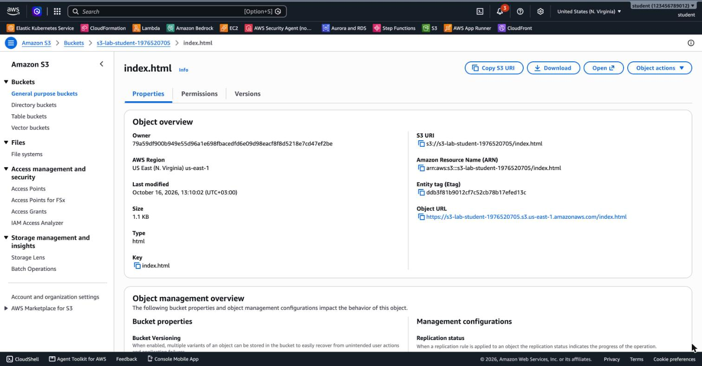
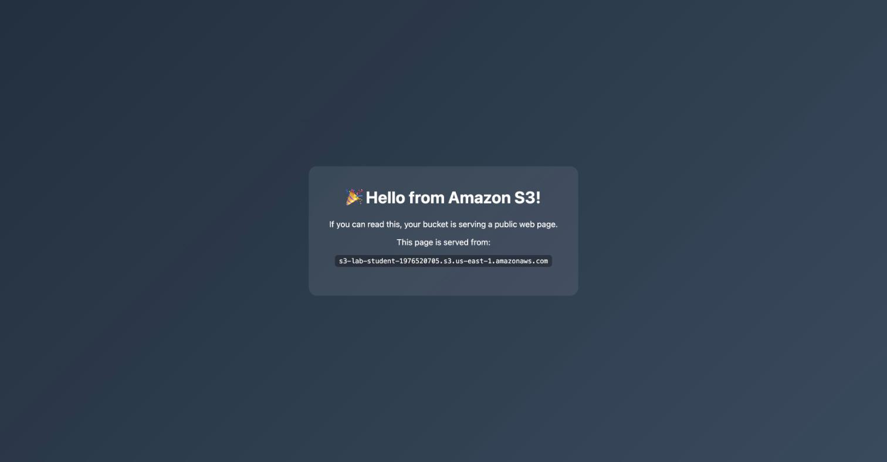
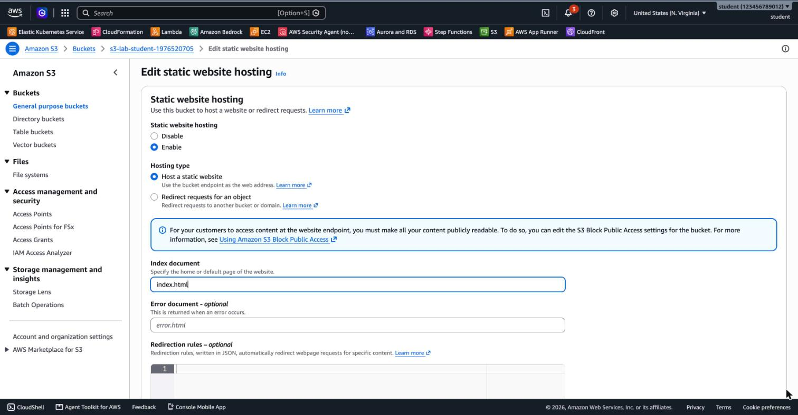
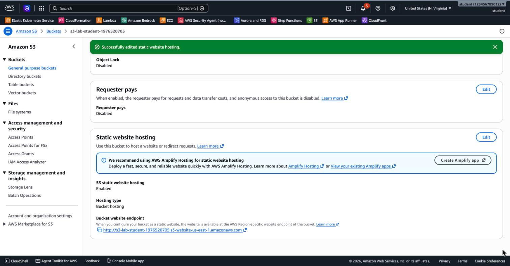

# 3.03 Amazon S3 – Lab 2 Solution

[⬅ Lab 1 Solution](SOLUTION-LAB1.md) | [⬅ Back to 3.03 Amazon S3](README.md)

> Tested with AWS CLI v2 in `us-east-1`. Continue in the same terminal session as Lab 1, because the steps use the `$BUCKET` variable. In a new session, set it again: `BUCKET=<your-bucket-name>`.

> Your bucket name starts with **`jblabs-`**. Some screenshots and sample outputs on this page show an older lab bucket name, `s3-lab-student-…`. The steps and results are the same.

---

## LAB 2 (Basic): Host a Static Website on S3

**Jump to:**
- [Part A: Upload the web page](#part-a-upload-the-web-page)
- [Part B: Try the Object URL](#part-b-try-the-object-url)
- [Part C: Share the page with a pre-signed URL](#part-c-share-the-page-with-a-pre-signed-url)
- [Part D (Advanced): Make the bucket public](#part-d-advanced-make-the-bucket-public)
- [Part E (Advanced): Static website hosting](#part-e-advanced-static-website-hosting)
- [Part F: Clean up](#part-f-clean-up)
- [Answers](#answers)
- [Terraform](#terraform)

### Part A: Upload the web page

Run this from the module folder (`3.03-s3/`):

```bash
aws s3 cp artifacts/index.html s3://$BUCKET/index.html
aws s3 ls s3://$BUCKET/
```

```
upload: artifacts/index.html to s3://s3-lab-student-1976520705/index.html
2026-10-16 13:10:02       1141 index.html
```

The CLI sets the content type from the file extension (`text/html`), so the browser renders the page instead of downloading it. Refresh the **Objects** tab:


### Part B: Try the Object URL

Select `index.html`. The **Object URL** is on the right:



Open it in a browser, or with `curl`:

```bash
curl -s https://$BUCKET.s3.us-east-1.amazonaws.com/index.html
```

```xml
<?xml version="1.0" encoding="UTF-8"?>
<Error><Code>AccessDenied</Code><Message>Access Denied</Message><RequestId>231Z4XRFDZRE1T99</RequestId>...</Error>
```

The bucket is **private**. The Object URL is a plain, **unsigned** request, so S3 treats it as **anonymous**, and nothing allows anonymous access.

### Part C: Share the page with a pre-signed URL

```bash
aws s3 presign s3://$BUCKET/index.html --expires-in 300
```

```
https://jblabs-student-5005743.s3.us-east-1.amazonaws.com/index.html?X-Amz-Algorithm=AWS4-HMAC-SHA256
  &X-Amz-Credential=ASIA...EXAMPLE%2F20261020%2Fus-east-1%2Fs3%2Faws4_request
  &X-Amz-Date=20261020T140854Z&X-Amz-Expires=300&X-Amz-SignedHeaders=host
  &X-Amz-Security-Token=IQoJb3JpZ2...truncated&X-Amz-Signature=abc123...def
```

(The URL is printed on one line. It's split here for readability, and the credential, token and signature are shortened. `X-Amz-Security-Token` appears when you sign with temporary credentials, for example after `aws login`.)

Open the printed URL in a browser. The page loads, **"Hello from Amazon S3!"**, while the bucket stays private and Block Public Access stays on.

After 5 minutes the same URL returns an error:

```xml
<Error><Code>AccessDenied</Code><Message>Request has expired</Message><X-Amz-Expires>5</X-Amz-Expires>
<Expires>2026-10-20T14:09:02Z</Expires><ServerTime>2026-10-20T14:09:06Z</ServerTime>...</Error>
```

(To capture this without waiting 5 minutes, the sample above used a test URL created with `--expires-in 5`.)

### Part D (Advanced): Make the bucket public

1. Open the bucket's **Permissions** tab. Under **Block public access (bucket settings)**, choose **Edit**.
2. Clear **Block all public access**. All four sub-settings are cleared with it.


3. Choose **Save changes**, type `confirm` and choose **Confirm**. The Permissions tab now shows **Block all public access: Off**.
4. Under **Bucket policy**, choose **Edit** and paste the public read policy. Replace the bucket name with yours:

```json
{
  "Version": "2012-10-17",
  "Statement": [
    {
      "Sid": "PublicReadGetObject",
      "Effect": "Allow",
      "Principal": "*",
      "Action": "s3:GetObject",
      "Resource": "arn:aws:s3:::s3-lab-student-1976520705/*"
    }
  ]
}
```


5. Choose **Save changes**. The Console shows *"Successfully edited bucket policy."*

> If you try to save the policy while Block Public Access is still on, S3 rejects it with an *Access denied* error. That's Block Public Access doing its job.

<details>
<summary>CLI alternative for Part A</summary>

```bash
aws s3api put-public-access-block --bucket $BUCKET \
  --public-access-block-configuration \
  BlockPublicAcls=false,IgnorePublicAcls=false,BlockPublicPolicy=false,RestrictPublicBuckets=false

cat > public-read.json <<JSON
{
  "Version": "2012-10-17",
  "Statement": [{
    "Sid": "PublicReadGetObject",
    "Effect": "Allow",
    "Principal": "*",
    "Action": "s3:GetObject",
    "Resource": "arn:aws:s3:::$BUCKET/*"
  }]
}
JSON
aws s3api put-bucket-policy --bucket $BUCKET --policy file://public-read.json
```

</details>

6. Open the plain **Object URL** from Part B again. Now it works without a signature:



### Part E (Advanced): Static website hosting

On the **Properties** tab, under **Static website hosting**, choose **Edit**. Select **Enable**, keep **Host a static website**, set the **Index document** to `index.html` and save:



The **Bucket website endpoint** appears at the bottom of the Properties tab:



Open `http://<bucket>.s3-website-us-east-1.amazonaws.com`. There is no `/index.html` at the end, because the website endpoint serves the index document automatically:


| | Object URL | Website endpoint |
|---|---|---|
| Format | `https://<bucket>.s3.<region>.amazonaws.com/<key>` | `http://<bucket>.s3-website-<region>.amazonaws.com` |
| Protocol | HTTPS | **HTTP only** |
| `/` (root) | *Access Denied* (no list permission) | Serves `index.html` |
| Missing page | *Access Denied* | `404 Not Found` (or a custom error document) |

### Part F: Clean up

Because **versioning is enabled**, `aws s3 rb --force` is **not enough**. It only adds a **delete marker**, and then it fails:

```
delete: s3://s3-lab-student-1976520705/index.html
remove_bucket failed: s3://s3-lab-student-1976520705 An error occurred (BucketNotEmpty) when calling
the DeleteBucket operation: The bucket you tried to delete is not empty. You must delete all versions in the bucket.
```

Delete **all versions and delete markers**, then the bucket:

```bash
aws s3api delete-objects --bucket $BUCKET \
  --delete "$(aws s3api list-object-versions --bucket $BUCKET \
  --query '{Objects: [Versions, DeleteMarkers][][].{Key: Key, VersionId: VersionId}}' --output json)"

aws s3 rb s3://$BUCKET
```

**Console alternative:** select the bucket, choose **Empty** (this deletes all versions), type `permanently delete`, then choose **Delete** and type the bucket name.

### Answers

- **Object URL vs. pre-signed URL:** the Object URL is an **anonymous** request, and the bucket is private, so S3 returns *Access Denied*. The pre-signed URL carries **your signature** in its query string (`X-Amz-Signature`, `X-Amz-Credential`, `X-Amz-Expires`). S3 treats it as a request from **you**, and you're allowed to read the object.
- **After expiry:** S3 rejects the URL with *Request has expired*. Until then, **anyone who has the URL** can download the object, so share pre-signed URLs carefully and keep the expiry short.
- **(Part D) Why Block Public Access had to be off:** BPA overrides policies. With *Block public access … through new public bucket policies* turned on, S3 refuses to save any policy that grants access to `"Principal": "*"`.
- **(Part D) Why `/` returns *Access Denied*:** opening the bucket root is a **list** request (`s3:ListBucket`), and the policy allows only `s3:GetObject`. That's intentional, because visitors shouldn't be able to list all your files.
- **(Part E) HTTPS:** the S3 website endpoint supports HTTP only. Put **Amazon CloudFront** in front of the bucket. CloudFront serves the site over HTTPS with a certificate from AWS Certificate Manager, and the bucket can stay **private** with Origin Access Control (OAC).

---

## Terraform


The result of both labs as code: [`terraform/main.tf`](terraform/main.tf). Tested with Terraform 1.15 and AWS provider 6.x in `us-east-1`.

```bash
cd terraform
terraform init
terraform apply
```

```
Outputs:   (captured with the older bucket prefix s3-lab-; the code now uses jblabs-)

bucket_name = "s3-lab-6491c66c50d3f0d691fe447a75"
object_url = "https://s3-lab-6491c66c50d3f0d691fe447a75.s3.us-east-1.amazonaws.com/index.html"
website_endpoint = "http://s3-lab-6491c66c50d3f0d691fe447a75.s3-website-us-east-1.amazonaws.com"
```

```bash
terraform destroy   # Destroy complete! Resources: 6 destroyed.
```

`force_destroy = true` lets Terraform delete the bucket even though it still contains objects and versions.

---

[⬅ Lab 1 Solution](SOLUTION-LAB1.md) | [⬅ Back to 3.03 Amazon S3](README.md)
