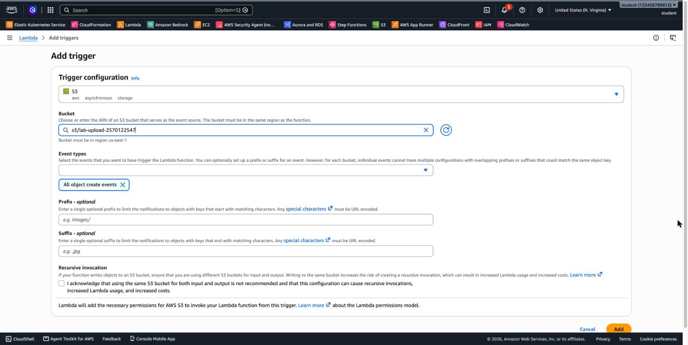
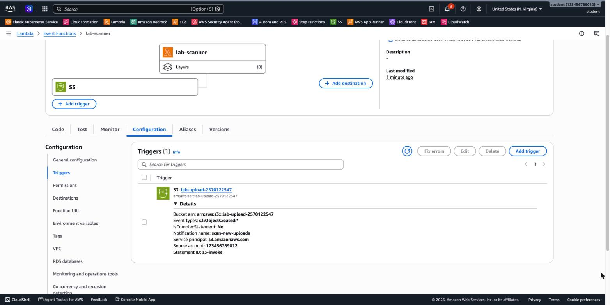
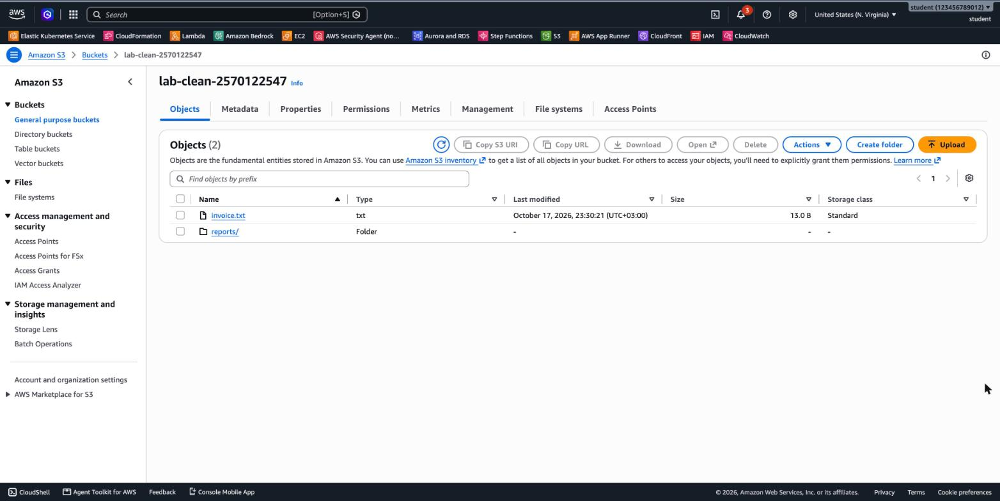
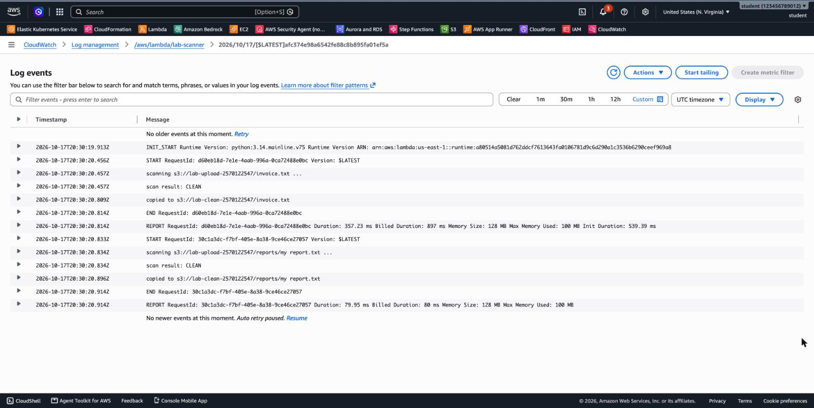

# 3.05 Serverless: AWS Lambda – Lab 2 Solution

[⬅ Lab 2](LAB2.md) | [⬅ Back to 3.05 AWS Lambda](README.md)

> Tested with AWS CLI v2 in `us-east-1` with the **Python 3.14** runtime. Run the commands **from the module folder** (`3.05-lambda/`) in one terminal session.

---

## LAB 2 (Advanced): S3 Upload → Lambda "Scanner" → Clean Bucket

**Jump to:**
- [Part A: Two buckets](#part-a-two-buckets)
- [Part B: Execution role (least privilege)](#part-b-execution-role-least-privilege)
- [Part C: The function](#part-c-the-function)
- [Part D: The trigger](#part-d-the-trigger)
- [Part E: Test](#part-e-test)
- [Part F: Clean up](#part-f-clean-up)
- [Answers](#answers)

### Part A: Two buckets

```bash
export AWS_PAGER="" AWS_REGION=us-east-1
ACCOUNT_ID=$(aws sts get-caller-identity --query Account --output text)

SUFFIX=$RANDOM$RANDOM
UPLOAD_BUCKET=lab-upload-$SUFFIX
CLEAN_BUCKET=lab-clean-$SUFFIX

aws s3 mb s3://$UPLOAD_BUCKET
aws s3 mb s3://$CLEAN_BUCKET
```

```
make_bucket: lab-upload-2570122547
make_bucket: lab-clean-2570122547
```

### Part B: Execution role (least privilege)

```bash
cat > lambda-trust.json <<'JSON'
{ "Version": "2012-10-17",
  "Statement": [{ "Effect": "Allow",
                  "Principal": { "Service": "lambda.amazonaws.com" },
                  "Action": "sts:AssumeRole" }] }
JSON
ROLE_ARN=$(aws iam create-role --role-name lab-scanner-role \
  --assume-role-policy-document file://lambda-trust.json --query Role.Arn --output text)

# 1. Permission to write CloudWatch Logs
aws iam attach-role-policy --role-name lab-scanner-role \
  --policy-arn arn:aws:iam::aws:policy/service-role/AWSLambdaBasicExecutionRole

# 2. Read only from "upload", write only to "clean"
cat > scanner-s3-policy.json <<JSON
{
  "Version": "2012-10-17",
  "Statement": [
    { "Sid": "ReadUploads",  "Effect": "Allow", "Action": "s3:GetObject",
      "Resource": "arn:aws:s3:::$UPLOAD_BUCKET/*" },
    { "Sid": "WriteCleaned", "Effect": "Allow", "Action": "s3:PutObject",
      "Resource": "arn:aws:s3:::$CLEAN_BUCKET/*" }
  ]
}
JSON
aws iam put-role-policy --role-name lab-scanner-role \
  --policy-name lab-scanner-s3 --policy-document file://scanner-s3-policy.json
```

**Console:** IAM → Roles → Create role → *AWS service* → **Lambda** → attach `AWSLambdaBasicExecutionRole` → name `lab-scanner-role` → Create. Then open the role and choose **Add permissions → Create inline policy → JSON**, paste the policy above with your bucket names, and name it `lab-scanner-s3`.

> `copy_object` needs **`s3:GetObject` on the source** and **`s3:PutObject` on the destination**. The function can't list, delete or touch any other bucket.

### Part C: The function

```bash
sleep 10   # give the new IAM role a few seconds to become usable

(cd artifacts/scanner && zip -q ../../scanner.zip lambda_function.py)

FUNC_ARN=$(aws lambda create-function --function-name lab-scanner \
  --runtime python3.14 --handler lambda_function.lambda_handler \
  --role $ROLE_ARN --zip-file fileb://scanner.zip \
  --timeout 30 \
  --environment "Variables={CLEAN_BUCKET=$CLEAN_BUCKET}" \
  --query FunctionArn --output text)
aws lambda wait function-active-v2 --function-name lab-scanner
```

**Console:** Create function → `lab-scanner`, Python 3.14 → *Change default execution role* → **Use an existing role** → `lab-scanner-role`. Paste the code and choose **Deploy**. Then set **Configuration → Environment variables**: `CLEAN_BUCKET` = your clean bucket, and **Configuration → General configuration → Timeout**: 30 seconds.

### Part D: The trigger

The Console's **Add trigger** does two things for you. With the CLI, you do them yourself:

```bash
# 1. Resource-based policy: allow S3 (only from this bucket and account) to invoke the function
aws lambda add-permission --function-name lab-scanner \
  --statement-id s3-invoke --action lambda:InvokeFunction \
  --principal s3.amazonaws.com \
  --source-arn arn:aws:s3:::$UPLOAD_BUCKET --source-account $ACCOUNT_ID

# 2. Event notification on the upload bucket
cat > notification.json <<JSON
{
  "LambdaFunctionConfigurations": [{
    "Id": "scan-new-uploads",
    "LambdaFunctionArn": "$FUNC_ARN",
    "Events": ["s3:ObjectCreated:*"]
  }]
}
JSON
aws s3api put-bucket-notification-configuration --bucket $UPLOAD_BUCKET \
  --notification-configuration file://notification.json
```

**Console:** in the function overview, choose **Add trigger** → source **S3** → your **upload** bucket → **All object create events**. The **Recursive invocation** section warns about using the same bucket for input and output. We use two buckets, so this setup is safe:



After the trigger is added, the function diagram shows **S3 → lab-scanner**. Under **Configuration → Triggers**, the details show the bucket, the event type `s3:ObjectCreated:*`, and the permission statement `s3-invoke` that allows `s3.amazonaws.com` to invoke the function:



### Part E: Test

```bash
echo "invoice 2026"   > invoice.txt
echo "monthly report" > "my report.txt"
aws s3 cp invoice.txt     s3://$UPLOAD_BUCKET/invoice.txt
aws s3 cp "my report.txt" "s3://$UPLOAD_BUCKET/reports/my report.txt"

sleep 5
aws s3 ls s3://$CLEAN_BUCKET --recursive
```

```
2026-10-17 23:30:21         13 invoice.txt
2026-10-17 23:30:21         15 reports/my report.txt
```

Both files arrived in the **clean** bucket within about a second, including the file with a space in its name inside `reports/`:



**Logs:**

```bash
aws logs filter-log-events --log-group-name /aws/lambda/lab-scanner \
  --query 'events[].message' --output text
```



```
INIT_START Runtime Version: python:3.14.mainline.v75 ...
START RequestId: d60eb18d-... Version: $LATEST
scanning s3://lab-upload-2570122547/invoice.txt ...
scan result: CLEAN
copied to s3://lab-clean-2570122547/invoice.txt
END RequestId: d60eb18d-...
REPORT RequestId: d60eb18d-...  Duration: 357.23 ms  Billed Duration: 897 ms  Memory Size: 128 MB  Max Memory Used: 100 MB  Init Duration: 539.39 ms
START RequestId: 30c1a3dc-... Version: $LATEST
scanning s3://lab-upload-2570122547/reports/my report.txt ...
scan result: CLEAN
copied to s3://lab-clean-2570122547/reports/my report.txt
END RequestId: 30c1a3dc-...
REPORT RequestId: 30c1a3dc-...  Duration: 79.95 ms  Billed Duration: 80 ms  Memory Size: 128 MB  Max Memory Used: 100 MB
```

Each upload produced **its own invocation**. The first one was a **cold start**, and its Init Duration of 539 ms includes importing `boto3`. The second reused the warm environment.

### Part F: Clean up

```bash
# Remove the trigger first, so emptying the bucket doesn't matter
aws s3api put-bucket-notification-configuration --bucket $UPLOAD_BUCKET \
  --notification-configuration '{}'

aws s3 rb s3://$UPLOAD_BUCKET --force
aws s3 rb s3://$CLEAN_BUCKET --force

aws lambda delete-function --function-name lab-scanner
aws logs delete-log-group --log-group-name /aws/lambda/lab-scanner

aws iam delete-role-policy --role-name lab-scanner-role --policy-name lab-scanner-s3
aws iam detach-role-policy --role-name lab-scanner-role \
  --policy-arn arn:aws:iam::aws:policy/service-role/AWSLambdaBasicExecutionRole
aws iam delete-role --role-name lab-scanner-role

rm -f invoice.txt "my report.txt" scanner.zip lambda-trust.json scanner-s3-policy.json notification.json
```

### Answers

- **`CLEAN_BUCKET` = the upload bucket:** an **infinite loop**. Every copy is a new object in the upload bucket, which triggers the function again, which copies again, and so on. With this lab's role the first copy would fail anyway, because the role has no `s3:PutObject` on the upload bucket. That's least privilege acting as a safety net. Lambda can also detect some recursive loops and stop them, but the real fix is to **never write to the triggering bucket**, or to filter with a prefix.
- **`unquote_plus()`:** S3 sends object keys **URL-encoded** in the event. `reports/my report.txt` arrives as `reports/my+report.txt`. Without decoding, `copy_object` looks for a key that doesn't exist and fails with `NoSuchKey`.
- **Two kinds of permissions:**
  - The **resource-based policy** on the function (statement `s3-invoke`) lets **S3 call the function**.
  - The **execution role** (`lab-scanner-role`) lets **the function's code** read from `upload` and write to `clean`.
  - You need both. The first controls *who may invoke*, and the second controls *what the code may do*.
- **Failure in an asynchronous invocation:** S3 doesn't see the error, because it doesn't wait. Lambda **retries twice**, with delays, and each attempt logs the `AccessDenied` error to CloudWatch. After that the event is dropped, unless you configure an **on-failure destination** (SQS, SNS, EventBridge, another Lambda) or a **dead-letter queue** to keep failed events.
- **Move instead of copy:** after `copy_object`, call `s3.delete_object(Bucket=source_bucket, Key=key)`, and add **`s3:DeleteObject` on `arn:aws:s3:::<upload-bucket>/*`** to the role.

---

[⬅ Lab 2](LAB2.md) | [⬅ Back to 3.05 AWS Lambda](README.md)
