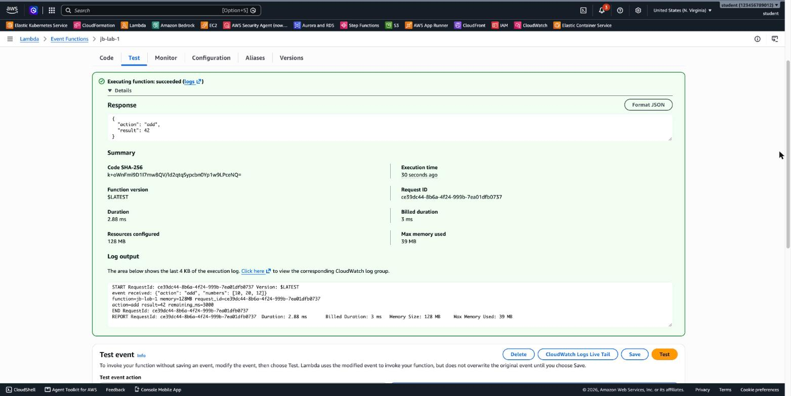
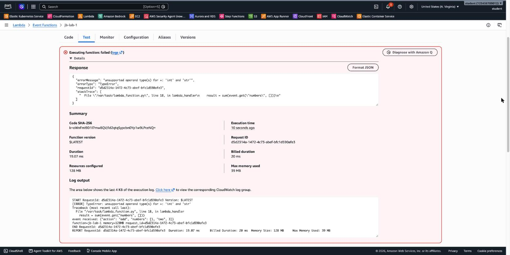
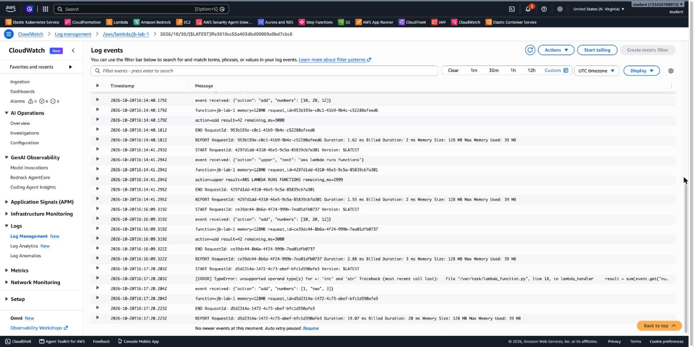

# 3.05 AWS Lambda – Lab 1 Solution

[⬅ Lab 1](jb-lab-1.md) | [⬅ Back to 3.05 AWS Lambda](README.md) | [Lab 2 ➡](jb-lab-2.md)

> Tested in `us-east-1` with Python 3.14, 128 MB (the default) and a 3-second timeout (the default).

**Jump to:** [Part A](#part-a-create-the-function) · [Part B](#part-b-one-function-many-events) · [Part C](#part-c-when-the-function-fails) · [Part D](#part-d-synchronous-vs-asynchronous-invocation) · [Part E](#part-e-logs) · [Part F](#part-f-clean-up) · [Answers](#answers) · [Terraform Code](#terraform-code)

---

## Part A: Create the function

**Console:**

1. **IAM → Roles → Create role** → *AWS service*, use case **Lambda** → **Next** → select **`AWSLambdaBasicExecutionRole`** → **Next** → name **`lab-1-role`** → **Create role**.
2. **Lambda → Create function** → *Author from scratch*: name **`lab-1`**, runtime **Python 3.14**, architecture x86_64. Expand **Change default execution role** → **Use an existing role** → `lab-1-role` → **Create function**.
3. **Code** tab: replace `lambda_function.py` with the lab code → **Deploy**.

**CLI:**

```bash
export AWS_PAGER="" AWS_REGION=us-east-1
cat > trust.json <<'JSON'
{ "Version": "2012-10-17", "Statement": [{ "Effect": "Allow", "Principal": { "Service": "lambda.amazonaws.com" }, "Action": "sts:AssumeRole" }] }
JSON
ROLE_ARN=$(aws iam create-role --role-name lab-1-role --assume-role-policy-document file://trust.json \
  --query Role.Arn --output text)
aws iam attach-role-policy --role-name lab-1-role \
  --policy-arn arn:aws:iam::aws:policy/service-role/AWSLambdaBasicExecutionRole
sleep 10   # give IAM a few seconds before Lambda uses the new role

cd artifacts/jb-lab-1 && zip function.zip lambda_function.py
aws lambda create-function --function-name lab-1 --runtime python3.14 --role $ROLE_ARN \
  --handler lambda_function.lambda_handler --zip-file fileb://function.zip
aws lambda wait function-active-v2 --function-name lab-1
```

> **The handler** `lambda_function.lambda_handler` means *file* `lambda_function.py`, *function* `lambda_handler`. If you rename either one, update the handler too.

---

## Part B: One function, many events

**Console:** **Test** tab → *Create new event* → name `add`, paste the JSON from `add.json` → **Save** → **Test**. Repeat for `upper` and `empty`.



**CLI:** `--log-type Tail` returns the last 4 KB of the log with the response (base64-encoded):

```bash
for E in add upper empty; do
  aws lambda invoke --function-name lab-1 --cli-binary-format raw-in-base64-out \
    --payload file://events/$E.json --log-type Tail out-$E.json \
    --query 'LogResult' --output text | base64 --decode
  cat out-$E.json; echo
done
```

| Event | Response |
|-------|----------|
| `add` | `{"action": "add", "result": 42}` |
| `upper` | `{"action": "upper", "result": "AWS LAMBDA RUNS FUNCTIONS"}` |
| `empty` | `{"action": "hello", "result": "Hello from Lambda!"}` |

The log of the **first** invocation (`add`):

```
START RequestId: aab5e4bf-74a9-4bf6-90b2-231e43b8d636 Version: $LATEST
event received: {"action": "add", "numbers": [10, 20, 12]}
function=lab-1 memory=128MB request_id=aab5e4bf-74a9-4bf6-90b2-231e43b8d636
action=add result=42 remaining_ms=2999
END RequestId: aab5e4bf-74a9-4bf6-90b2-231e43b8d636
REPORT RequestId: aab5e4bf-...  Duration: 2.05 ms  Billed Duration: 103 ms  Memory Size: 128 MB  Max Memory Used: 39 MB  Init Duration: 100.44 ms
```

- `event received:` is the **event**, exactly as it was sent. The `empty` event `{}` has no `action`, so the code used the default `hello`.
- `function=`, `memory=`, `request_id=` and `remaining_ms=` come from the **context**. `remaining_ms=2999` is the time left until the 3-second timeout.
- **`Init Duration: 100.44 ms`** appears only on the first invocation. Lambda created a new execution environment (a **cold start**) and loaded the code. The invocations after it reused the same environment (a **warm start**) and had no `Init Duration`. Notice that **`Billed Duration: 103 ms`** includes the init time: 2 ms of code + 100 ms of init.

---

## Part C: When the function fails

**Console:** create the test event `bad-add` and run it. The result is red: **Executing function: failed**.



**CLI:**

```bash
aws lambda invoke --function-name lab-1 --cli-binary-format raw-in-base64-out \
  --payload file://events/bad-add.json out-bad.json
cat out-bad.json
```

```
{
    "StatusCode": 200,
    "FunctionError": "Unhandled",
    "ExecutedVersion": "$LATEST"
}
{"errorMessage": "unsupported operand type(s) for +: 'int' and 'str'", "errorType": "TypeError",
 "requestId": "5ac78789-...", "stackTrace": ["  File \"/var/task/lambda_function.py\", line 18, in lambda_handler\n    result = sum(event.get(\"numbers\", []))\n"]}
```

**7.** The **status code is 200**: Lambda itself worked and ran the code. The `FunctionError: Unhandled` field says that **your code** raised an exception. The response is the error (type, message and stack trace) instead of a result. The log contains the same error:

```
[ERROR] TypeError: unsupported operand type(s) for +: 'int' and 'str'
Traceback (most recent call last):
  File "/var/task/lambda_function.py", line 18, in lambda_handler
    result = sum(event.get("numbers", []))
```

The `event received:` line is there too, so you can see exactly which input broke the code: `"two"` is a string, not a number.

---

## Part D: Synchronous vs. asynchronous invocation

**8. Synchronous** (the default, `RequestResponse`): the CLI waits for the function and gets its return value:

```bash
aws lambda invoke --function-name lab-1 --cli-binary-format raw-in-base64-out \
  --payload file://events/add.json response.json
cat response.json
```

```
{
    "StatusCode": 200,
    "ExecutedVersion": "$LATEST"
}
{"action": "add", "result": 42}
```

**9. Asynchronous** (`Event`): Lambda puts the event in a queue and answers right away:

```bash
aws lambda invoke --function-name lab-1 --invocation-type Event --cli-binary-format raw-in-base64-out \
  --payload file://events/upper.json async.json
cat async.json
```

```
{
    "StatusCode": 202
}
```

`async.json` is **empty**. **202 Accepted** means "the event was received", not "the function succeeded". The function ran a moment later, and its result is only in the **logs**:

```bash
aws logs tail /aws/lambda/lab-1 --since 5m --format short
```

```
2026-10-20T16:14:41 START RequestId: 4297d1dd-4310-46e5-9c5a-85839cb7a301 Version: $LATEST
2026-10-20T16:14:41 event received: {"action": "upper", "text": "aws lambda runs functions"}
2026-10-20T16:14:41 action=upper result=AWS LAMBDA RUNS FUNCTIONS remaining_ms=2999
2026-10-20T16:14:41 END RequestId: 4297d1dd-4310-46e5-9c5a-85839cb7a301
```

---

## Part E: Logs

**Console:** in the function, **Monitor → View CloudWatch logs**. The log group is **`/aws/lambda/lab-1`**. Each **log stream** belongs to one execution environment. In this test, all the invocations (CLI, asynchronous and Console) reused the **same warm environment**, so they're all in **one stream**:



Every invocation has the same frame: `START` → your `print` lines → `END` → `REPORT` (duration, billed duration, memory). The failed invocation also has the `[ERROR]` line.

**CLI:** search all streams for one phrase:

```bash
aws logs filter-log-events --log-group-name /aws/lambda/lab-1 \
  --filter-pattern '"event received"' --query 'events[].message' --output text
```

---

## Part F: Clean up

**Console:** **Lambda → Functions → `lab-1` → Actions → Delete**. Then **CloudWatch → Log groups → `/aws/lambda/lab-1` → Delete**, and **IAM → Roles → `lab-1-role` → Delete**.

**CLI:**

```bash
aws lambda delete-function --function-name lab-1
aws logs delete-log-group --log-group-name /aws/lambda/lab-1
aws iam detach-role-policy --role-name lab-1-role \
  --policy-arn arn:aws:iam::aws:policy/service-role/AWSLambdaBasicExecutionRole
aws iam delete-role --role-name lab-1-role
```

> Deleting the function does **not** delete its log group. Log groups have no retention by default (*Never expire*), so delete them yourself.

---

## Answers

- **Event source:** the service or client that **invokes** the function and **sends it the event**: S3, API Gateway, SQS, EventBridge, DynamoDB Streams and more. In this lab, you invoked the function **directly**, from the **Console's Test button** and from the **AWS CLI** (`aws lambda invoke`). The event was the JSON that you wrote.
- **Event vs. context:** the **event** is the **input data**, "what happened". Its shape depends on the source (an S3 event looks different from an API Gateway event). The **context** is **information about this invocation** that Lambda adds: the function name, memory, request ID and the time remaining before the timeout.
- **Function failure vs. Lambda failure:** when the **function** fails, Lambda still answers **200**, adds **`FunctionError: Unhandled`**, and the response contains your code's `errorType` and `stackTrace`. When **Lambda itself** can't run the function, you get an **error status code** instead (for example `404 ResourceNotFoundException`, `429 TooManyRequestsException`, or a `5xx`), and your code never runs.
- **No result from the asynchronous invocation:** with `--invocation-type Event`, Lambda **queues** the event and returns **202** at once. It doesn't wait for the function, so there's no return value to give back. To get the results of asynchronous invocations, use the logs or configure a **destination** (on success / on failure: SQS, SNS, EventBridge or another function). On errors, Lambda **retries** an asynchronous event up to 2 more times.
- **Python `lambda` vs. AWS Lambda:** a Python `lambda` is a **one-line anonymous function inside your program** (`lambda x: x * 2`), and it runs in your process. An **AWS Lambda function** is a **named cloud resource**: deployed code with a runtime, an IAM role, memory and timeout settings, its own logs and its own price per millisecond, and it runs when an **event** invokes it. What they share is the idea of a small, single-purpose function. AWS Lambda adds "and you don't manage the server it runs on".

---

[⬅ Lab 1](jb-lab-1.md) | [⬅ Back to 3.05 AWS Lambda](README.md) | [Lab 2 ➡](jb-lab-2.md)

---

## Terraform Code

[`terraform/jb-lab-1/main.tf`](terraform/jb-lab-1/main.tf) creates the role `lab-jb1-role` with `AWSLambdaBasicExecutionRole`, the log group `/aws/lambda/jb-lab-1` (7-day retention), and the function from [`artifacts/jb-lab-1/lambda_function.py`](artifacts/jb-lab-1/lambda_function.py), zipped by the `archive` provider.

```bash
cd terraform/jb-lab-1
terraform init
terraform apply       # 4 resources
aws lambda invoke --function-name jb-lab-1 --cli-binary-format raw-in-base64-out \
  --payload file://../../artifacts/jb-lab-1/events/add.json out.json && cat out.json
# {"action": "add", "result": 42}
terraform destroy     # also deletes the log group, because Terraform created it
```

---

## Contact

For questions or feedback, feel free to reach out:

- **Email**: eyal@levys.co.il
- **GitHub**: [https://github.com/elevy99927](https://github.com/elevy99927)
