# 3.05 AWS Lambda – Lab 4 Walkthrough: An S3 Upload Triggers a Node.js Function

[⬅ Lab 4](jb-lab-4.md) | [⬅ Back to 3.05 AWS Lambda](README.md)

**▶ Video walkthrough** (9 min):

[](https://youtu.be/q6A6g63uLgQ)

The full solution of [Lab 4](jb-lab-4.md), step by step: first in the **Console** with screenshots, then the same with the **AWS CLI**.


> Tested in `us-east-1` on 25 October 2026 with Node.js 24.x, 128 MB (the default) and the Console of that day. The account ID and user name in the screenshots are masked. The terminal images show the real output of this run.

**Jump to:** [Where you work](#where-you-work) · [Part A](#part-a-the-bucket) · [Part B](#part-b-the-function) · [Part C](#part-c-the-s3-trigger) · [Part D](#part-d-the-code) · [Part E](#part-e-test) · [Part F](#part-f-home-lab) · [Part G](#part-g-clean-up) · [With the AWS CLI](#solution-2-the-aws-cli) · [Answers](#answers)

---

## Where you work

| Where | What |
|---|---|
| **The AWS Console** | Parts A–D: the bucket, the function, the trigger and the code. Part E: the logs |
| **AWS CloudShell** (the terminal icon at the top of the Console) | The `aws` commands: uploads, `aws s3 ls`, `aws logs tail`. The CLI is already installed and signed in |

Region: **`us-east-1`** for everything. A bucket and its trigger must be in the same Region as the function.

---

## Part A: The bucket

**S3 → Create bucket.** Keep *General purpose* and *Global namespace*, type the name **`labs-<your-name>-lab4-uploads`** (in this run: `labs-student-lab4-uploads`), keep the defaults below (Block Public Access on, SSE-S3 encryption), and **Create bucket**.

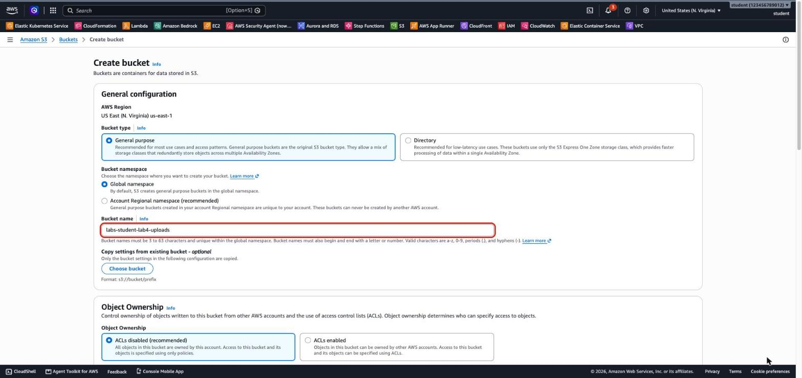

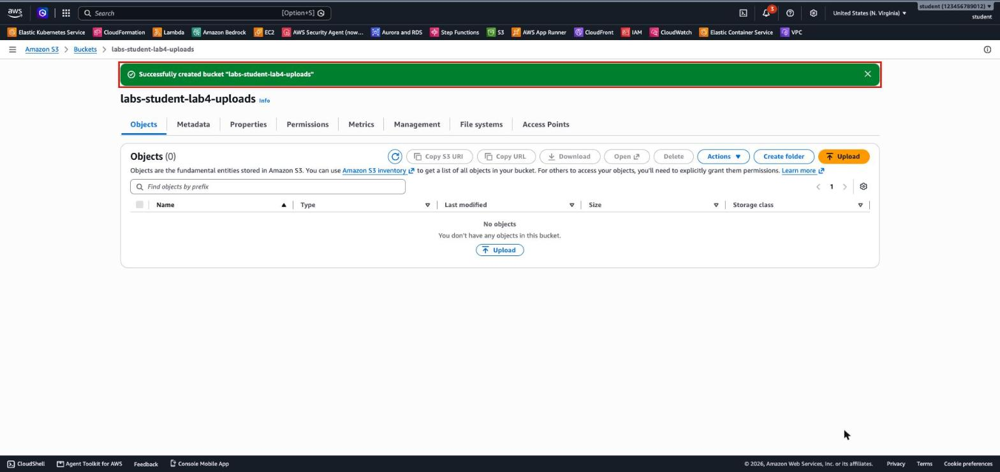

---

## Part B: The function

1. **Lambda → Create function.** The page is now called **Create Event Function**. Choose **Author from scratch**, name **`lab-4-object-logger`**, runtime **Node.js 24.x** (the default in this run). Under *Permissions*, keep the default: Lambda creates an execution role that can write logs to CloudWatch Logs. Click **Create Event Function**.

   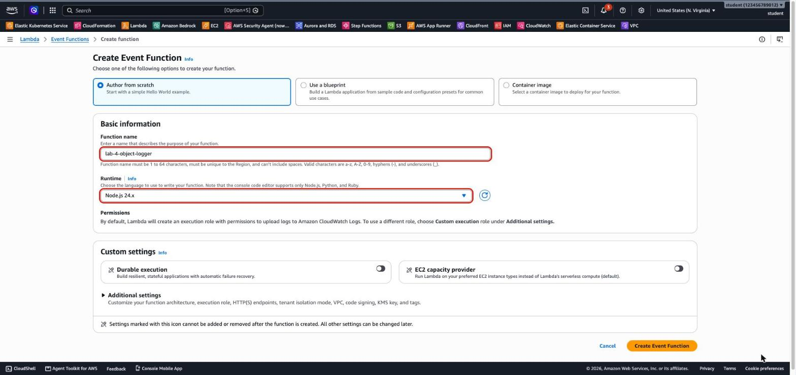

2. The function opens with a sample **`index.mjs`** that returns *Hello from Lambda!*. (A *Getting started* dialog may appear first: **Dismiss** it.)

   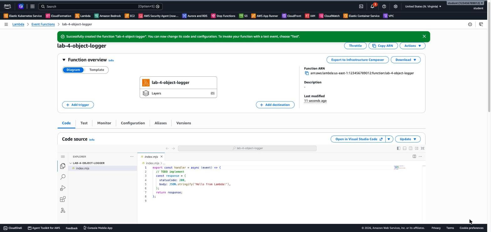

3. **Configuration → Permissions.** The execution role **`lab-4-object-logger-role-<random>`** has one policy, `AWSLambdaBasicExecutionRole-<id>`, with three CloudWatch Logs actions: `logs:CreateLogGroup`, `logs:CreateLogStream` and `logs:PutLogEvents`. Nothing for S3.

   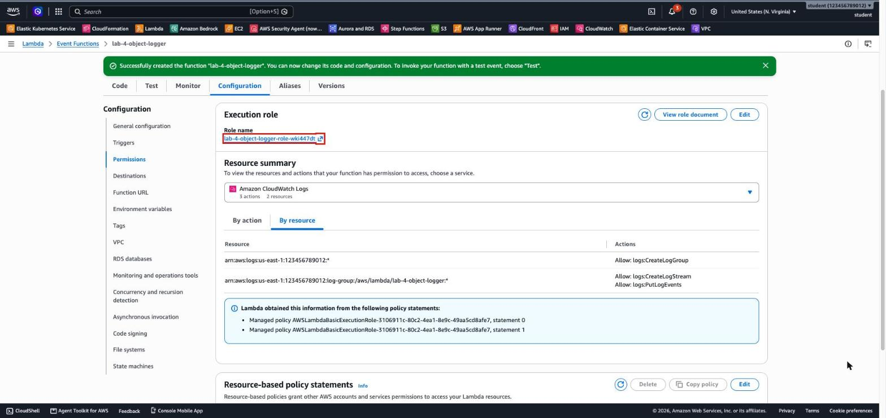

> **`.mjs`** means an ES module: the handler is `export const handler = …`, and the function's handler setting is `index.handler` (file `index.mjs`, export `handler`). Old Node.js examples use `exports.handler` in `index.js`.

---

## Part C: The S3 trigger

1. **Function overview → Add trigger.** Source **S3**. Note its tags: *aws · **asynchronous** · storage*.
2. **Bucket:** type `labs-` to filter the list, and choose your bucket.
3. **Event types:** keep **All object create events**. Leave *Prefix* and *Suffix* empty for now.
4. **Recursive invocation:** check the acknowledgment. This function only writes logs, so it can't trigger itself. A function that **writes to the same bucket** could trigger itself in a loop, if what it writes matches the trigger.
5. **Add.**

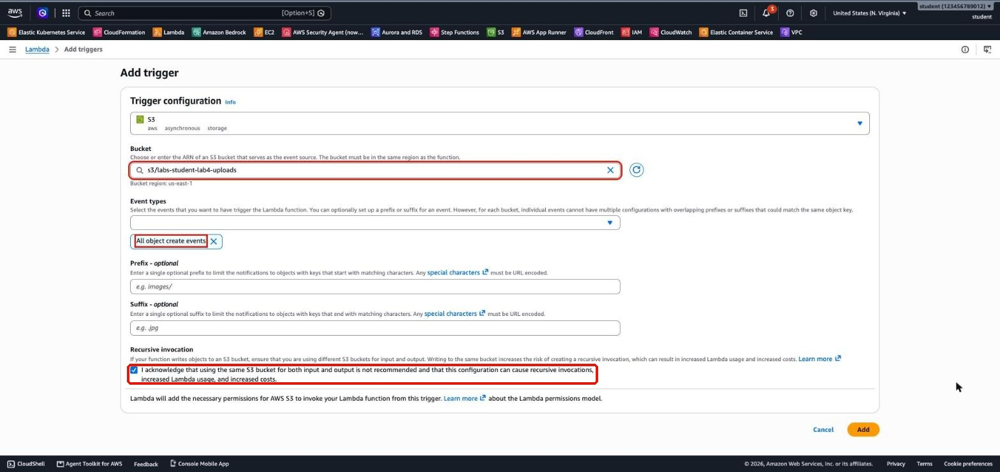

**Configuration → Triggers → Details** shows what the trigger set up: the bucket's event notification (`s3:ObjectCreated:*`) and a permission for the service principal **`s3.amazonaws.com`**.

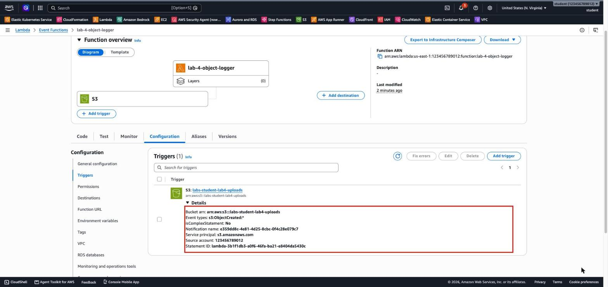

**Configuration → Permissions → Resource-based policy statements:** S3 may call `lambda:InvokeFunction` on this function, but only for **this bucket** (`AWS:SourceArn`) in **this account** (`AWS:SourceAccount`).

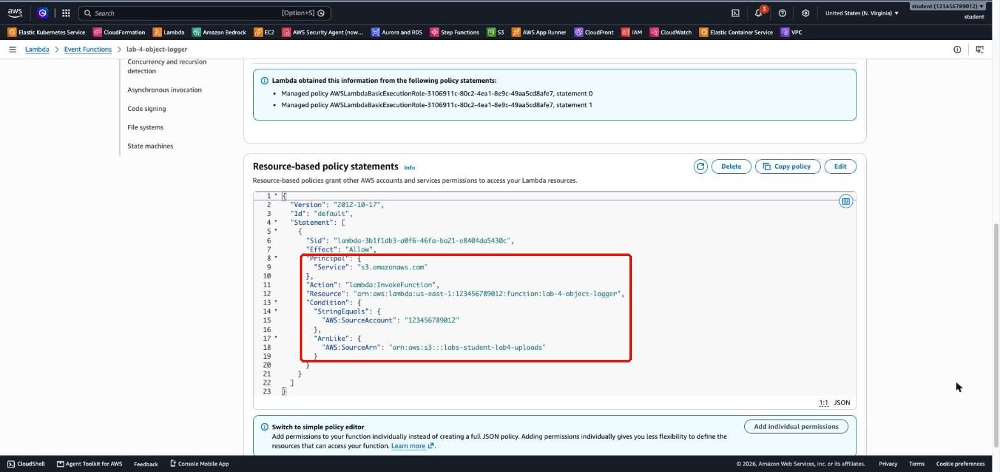

> **Two kinds of permissions:** the **execution role** says what the *code* may do (here: write logs). The **resource-based policy** says *who may call* the function (here: S3, from your bucket).

> ⏳ A new or changed event notification can take a few minutes to take effect. If your first upload doesn't show up in the log, wait a few minutes and upload again.

---

## Part D: The code

**Code** tab: replace everything in `index.mjs` with the lab code, then **Deploy** (or ⇧⌘U). The *DEPLOY* panel changes from *Undeployed* to **✓ Current**.

```js
// Runs every time S3 sends an "object created" event
export const handler = async (event) => {
  console.log('An object was added');
};
```

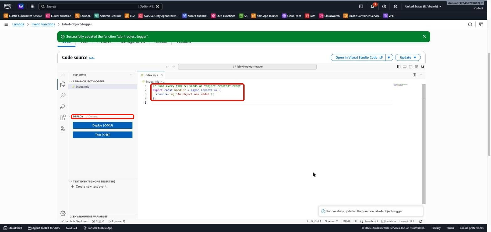

---

## Part E: Test

**CloudShell:** create a small file, upload it, and list the bucket. Replace `<your-name>` with your bucket's name part:

```bash
echo "hello from lab 4" > hello.txt
aws s3 cp hello.txt s3://labs-<your-name>-lab4-uploads/
aws s3 ls s3://labs-<your-name>-lab4-uploads/
```

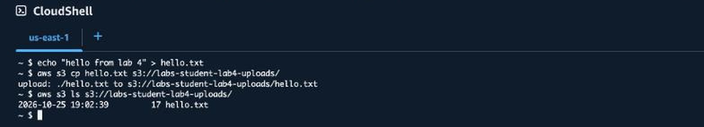

**The logs:** in the function, **Monitor → View CloudWatch logs**. (The metric charts can show *No data available* for a minute or two.)

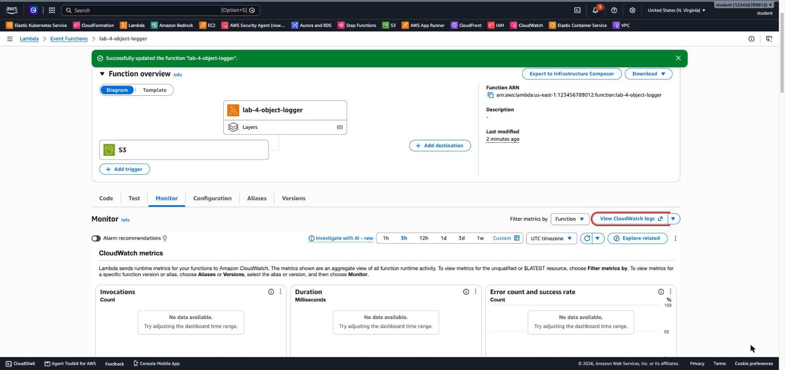

By default, Lambda writes to the log group **`/aws/lambda/<function-name>`**: here **`/aws/lambda/lab-4-object-logger`**. In this run it had one log stream, with the same time as the upload. Open it. (No line yet? Logs can take a little while: refresh after a minute.)

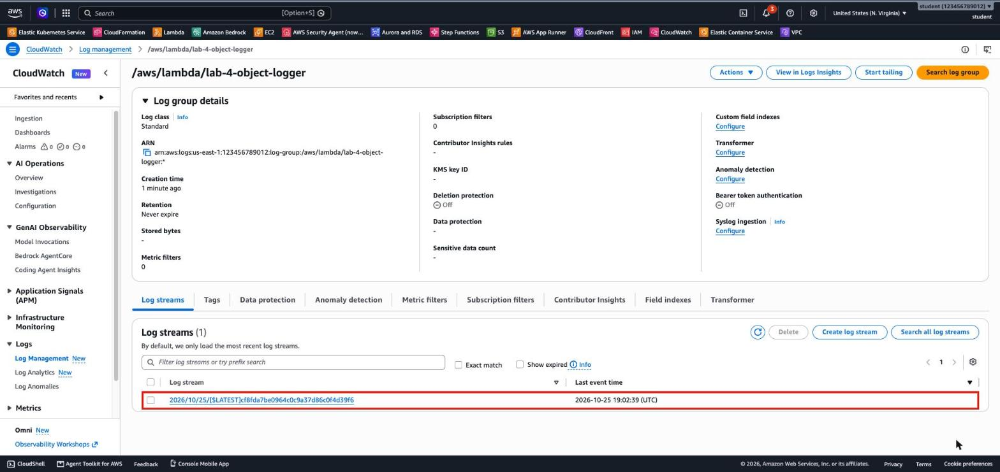

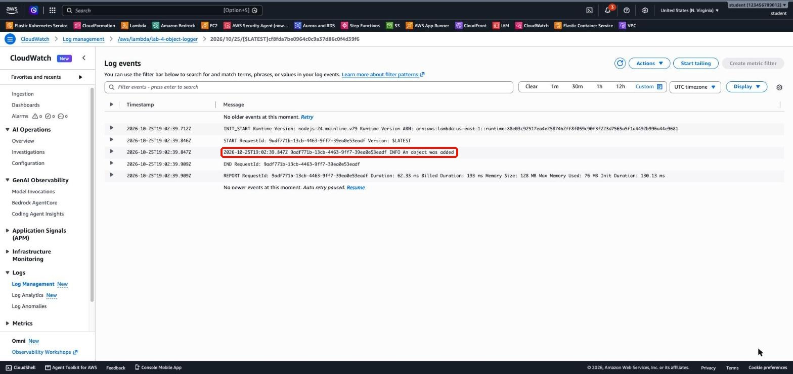

| Line | What it means |
|---|---|
| `INIT_START Runtime Version: nodejs:24…` | A **cold start**: Lambda created a new execution environment |
| `START RequestId: …` | One invocation begins |
| `INFO An object was added` | Your `console.log` |
| `REPORT … Duration: 62.33 ms Billed Duration: 193 ms … Max Memory Used: 76 MB Init Duration: 130.13 ms` | In this run: 62 ms of work plus 130 ms of initialization (the cold start), 76 MB of the 128 MB |

From CloudShell, the same lines: `aws logs tail /aws/lambda/lab-4-object-logger --since 10m`.

---

## Part F: Home lab

### Only `.jpg` files trigger the function

**Configuration → Triggers →** select the S3 trigger → **Edit** → **Suffix: `.jpg`** → **Save**. (The Console can now edit an S3 trigger in place.)

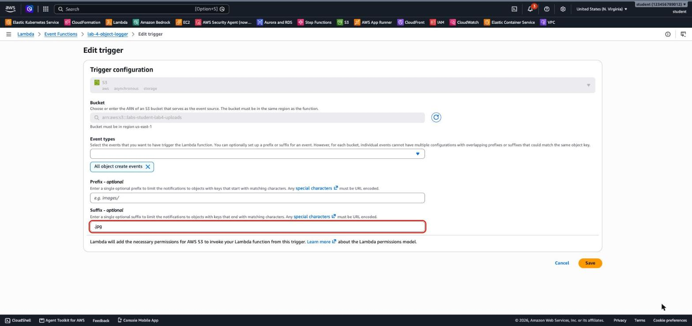

> ⏳ **The filter needs a few minutes to take effect.** The bucket's configuration showed the filter at once (`aws s3api get-bucket-notification-configuration --bucket <bucket>`), but in this run `.txt` uploads up to about three minutes after the change still invoked the function. About five minutes after it, they didn't. The CLI run behaved the same. Wait about five minutes before you test.

> 🔤 **Suffix filters are case-sensitive:** `PHOTO.JPG` doesn't match `.jpg`.

### Log the file name

The event that S3 sends contains the bucket and the object: `event.Records[].s3.object.key`. The **key** is the object's full name in the bucket, including any prefix (`uploads/my photo.jpg`). S3 **URL-encodes** it: `my photo.jpg` arrives as `my+photo.jpg`. The code loops over `Records`. S3 delivers each event **at least once**, so in rare cases the same upload can be logged twice. [`artifacts/jb-lab-4/homework/index.mjs`](artifacts/jb-lab-4/homework/index.mjs):

```js
// Home lab: write the name of each uploaded file to the log
export const handler = async (event) => {
  for (const record of event.Records) {
    // S3 URL-encodes the key in the event: "my photo.jpg" arrives as "my+photo.jpg"
    const key = decodeURIComponent(record.s3.object.key.replace(/\+/g, ' '));
    console.log(`An object was added: ${key} (${record.s3.object.size} bytes, bucket ${record.s3.bucket.name})`);
  }
};
```

Replace the code in `index.mjs`, and **Deploy**.

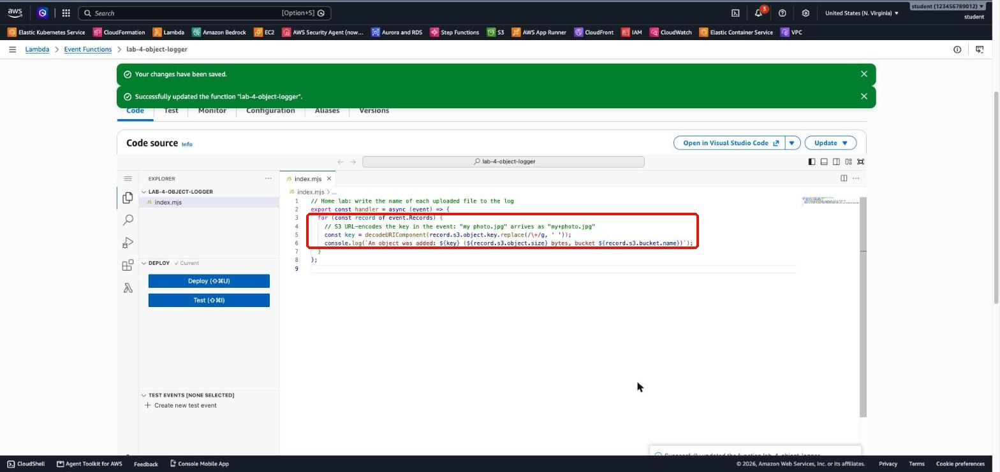

### Test

```bash
echo "just a note" > notes.txt
echo "not really an image" > "my photo.jpg"
aws s3 cp notes.txt s3://labs-<your-name>-lab4-uploads/
aws s3 cp "my photo.jpg" s3://labs-<your-name>-lab4-uploads/
aws s3 ls s3://labs-<your-name>-lab4-uploads/
aws logs tail /aws/lambda/lab-4-object-logger --since 1m --format short | grep INFO
```

Both files are in the bucket, but in this run only **`my photo.jpg`** appeared in the log, with its name decoded, space included:

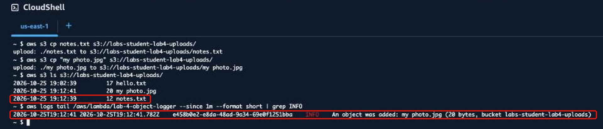

### Going further: really accept only `.jpg`

The trigger filter decides which uploads **invoke the function**. It doesn't stop other files: `notes.txt` is still stored. To **reject** them, add a **bucket policy** that denies `s3:PutObject` for every key that doesn't end in `.jpg`. Save it as `only-jpg.json`:

```json
{
  "Version": "2012-10-17",
  "Statement": [{
    "Sid": "OnlyJpg",
    "Effect": "Deny",
    "Principal": "*",
    "Action": "s3:PutObject",
    "NotResource": "arn:aws:s3:::labs-<your-name>-lab4-uploads/*.jpg"
  }]
}
```

```bash
aws s3api put-bucket-policy --bucket labs-<your-name>-lab4-uploads --policy file://only-jpg.json
```

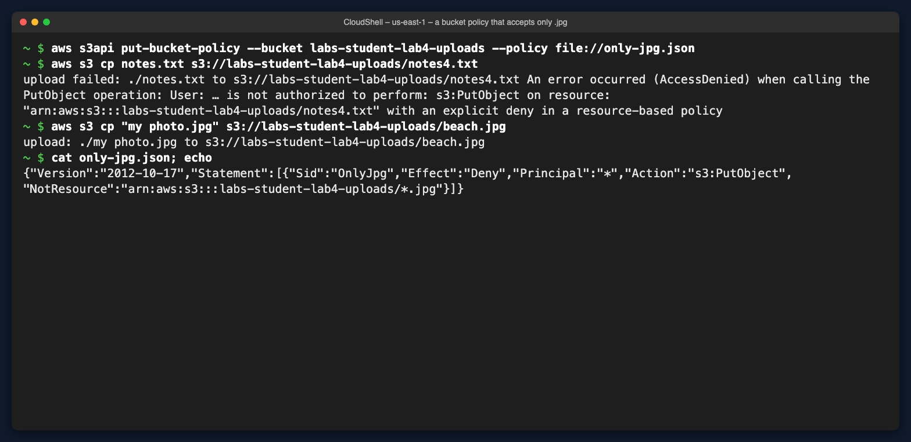

An explicit **Deny** wins over any Allow, even for the account's administrators. `NotResource` only takes the `.jpg` keys **out of the Deny**: it doesn't grant anything. The policy doesn't delete files that are already in the bucket. And it checks the **name**, not the content: the "photo" in this test is a text file named `.jpg`. Like the suffix filter, `*.jpg` is case-sensitive.

---

## Part G: Clean up

**Console:**

1. **Lambda** → `lab-4-object-logger` → **Actions → Delete function** → type `confirm` → **Delete**. As the dialog says, the function's **logs, roles and triggers stay** in your account: delete them in the next steps.

   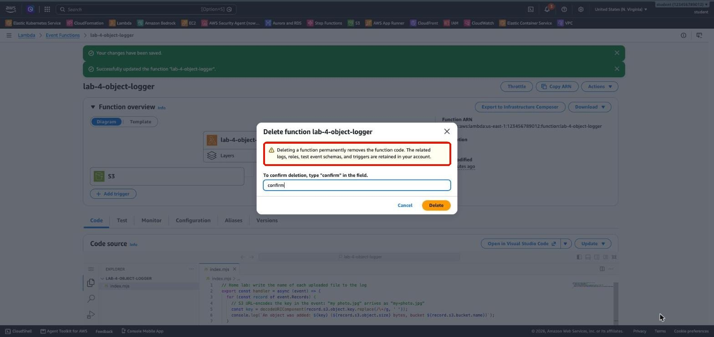

2. **IAM → Roles** → `lab-4-object-logger-role-<random>` → **Delete**. Then **IAM → Policies** → `AWSLambdaBasicExecutionRole-<id>` (the policy the Console created for this role) → **Delete**.
3. **CloudWatch → Log groups** → `/aws/lambda/lab-4-object-logger` → **Actions → Delete**.
4. **S3** → your bucket → **Empty** → **Delete**. A bucket policy, if you added one, is deleted with the bucket.

The CLI commands are at the end of [Solution 2](#cli-part-g-clean-up).

---

## Solution 2: The AWS CLI

The same lab from CloudShell, tested in this run with its own names. Copy `index.mjs` and `homework/index.mjs` from [`artifacts/jb-lab-4/`](artifacts/jb-lab-4/) to your CloudShell folder (for example with `git clone https://github.com/elevy99927/aws.git`).

```bash
export AWS_PAGER="" AWS_REGION=us-east-1
BUCKET=labs-<your-name>-lab4-uploads
FN=lab-4-object-logger
```

**Part A: the bucket**

```bash
aws s3 mb s3://$BUCKET
```

**Part B: the role and the function.** The CLI doesn't create a role for you: create one that Lambda can assume, with the AWS managed policy `AWSLambdaBasicExecutionRole` (logs only).

```bash
cat > trust.json <<'JSON'
{ "Version": "2012-10-17", "Statement": [{ "Effect": "Allow", "Principal": { "Service": "lambda.amazonaws.com" }, "Action": "sts:AssumeRole" }] }
JSON
ROLE_ARN=$(aws iam create-role --role-name $FN-role --assume-role-policy-document file://trust.json \
  --query Role.Arn --output text)
aws iam attach-role-policy --role-name $FN-role \
  --policy-arn arn:aws:iam::aws:policy/service-role/AWSLambdaBasicExecutionRole
sleep 10   # give IAM a few seconds before Lambda uses the new role

zip function.zip index.mjs
aws lambda create-function --function-name $FN --runtime nodejs24.x --handler index.handler \
  --role $ROLE_ARN --zip-file fileb://function.zip
aws lambda wait function-active-v2 --function-name $FN
```

**Part C: the trigger** is two things: a **permission** for S3 to invoke the function, and the bucket's **event notification**. In the Console, *Add trigger* did both.

```bash
ACCOUNT=$(aws sts get-caller-identity --query Account --output text)
FN_ARN=$(aws lambda get-function --function-name $FN --query Configuration.FunctionArn --output text)

aws lambda add-permission --function-name $FN --statement-id s3-invoke \
  --action lambda:InvokeFunction --principal s3.amazonaws.com \
  --source-arn arn:aws:s3:::$BUCKET --source-account $ACCOUNT

aws s3api put-bucket-notification-configuration --bucket $BUCKET --notification-configuration \
  '{"LambdaFunctionConfigurations":[{"LambdaFunctionArn":"'$FN_ARN'","Events":["s3:ObjectCreated:*"]}]}'
```

**Part E: test**

```bash
echo "hello from lab 4" > hello.txt
aws s3 cp hello.txt s3://$BUCKET/
sleep 20
aws logs tail /aws/lambda/$FN --since 5m --format short | grep INFO
```

```text
2026-10-25T19:16:29 2026-10-25T19:16:29.571Z    b5ea964b-…    INFO    An object was added
```

**Part F: home lab.** `put-bucket-notification-configuration` **replaces** the whole configuration, so send the trigger again, with the filter:

```bash
aws s3api put-bucket-notification-configuration --bucket $BUCKET --notification-configuration \
  '{"LambdaFunctionConfigurations":[{"LambdaFunctionArn":"'$FN_ARN'","Events":["s3:ObjectCreated:*"],
    "Filter":{"Key":{"FilterRules":[{"Name":"suffix","Value":".jpg"}]}}}]}'

cp homework/index.mjs index.mjs
rm -f function.zip && zip function.zip index.mjs
aws lambda update-function-code --function-name $FN --zip-file fileb://function.zip
aws lambda wait function-updated-v2 --function-name $FN
```

<a id="cli-part-g-clean-up"></a>**Part G: clean up**

```bash
aws lambda delete-function --function-name $FN
aws iam detach-role-policy --role-name $FN-role \
  --policy-arn arn:aws:iam::aws:policy/service-role/AWSLambdaBasicExecutionRole
aws iam delete-role --role-name $FN-role
aws logs delete-log-group --log-group-name /aws/lambda/$FN
aws s3 rb s3://$BUCKET --force    # deletes the objects, then the bucket
```

---

## Answers

1. **Who invokes the function, and how does Lambda know that S3 is allowed to?** **S3** invokes it, when an object is created in the bucket. The S3 trigger added a statement to the function's **resource-based policy**: the service principal `s3.amazonaws.com` may call `lambda:InvokeFunction`, only when the source is your bucket (`AWS:SourceArn`) in your account (`AWS:SourceAccount`).
2. **Why does the execution role need no S3 permissions?** The role is what the **code** may do. The code only writes to the log, and the file's name and size arrive **inside the event**. Invoking the function is S3's permission (question 1), not the role's. A function that **reads** the file would need `s3:GetObject` on the bucket.
3. **Does the upload wait for the function to finish?** No. S3 invokes the function **asynchronously**: `aws s3 cp` returns as soon as the object is stored, and the event goes into Lambda's queue for the function, which processes it afterwards. If the function returns an error, Lambda retries it, by default up to two more times. Throttling and service errors follow a different retry policy. Either way, the uploader never knows.
4. **Why doesn't `notes.txt` appear in the log, and was it uploaded?** Its key doesn't end in `.jpg`, so the trigger's suffix filter didn't send an event to Lambda. It **was** uploaded: `aws s3 ls` lists it. A filter decides what invokes the function; to reject other keys, use a bucket policy (see [Going further](#going-further-really-accept-only-jpg)).

---

## Troubleshooting

| Symptom | Likely cause | Fix |
|---|---|---|
| No log group, or no new log stream | The trigger isn't set, or points at another bucket | **Configuration → Triggers**: check the bucket and the event types |
| A file that doesn't match the filter still invokes the function | The filter change hasn't taken effect yet | Wait about five minutes, and upload again |
| `PHOTO.JPG` doesn't invoke the function | Suffix filters are case-sensitive | Use lowercase extensions, or add a second filtered trigger |
| The log shows `my+photo.jpg` | The key in the event is URL-encoded | Decode it, as in the home lab code |
| `aws s3 cp` fails with `AccessDenied … explicit deny` | The only-`.jpg` bucket policy | Upload a `.jpg`, or delete the bucket policy |
| `create-function` fails: *The role defined for the function cannot be assumed by Lambda* | The new IAM role isn't ready yet | Wait 10 seconds, and run it again |

---

## Contact

For questions or feedback, feel free to reach out:

- **Email**: eyal@levys.co.il
- **GitHub**: [https://github.com/elevy99927](https://github.com/elevy99927)
