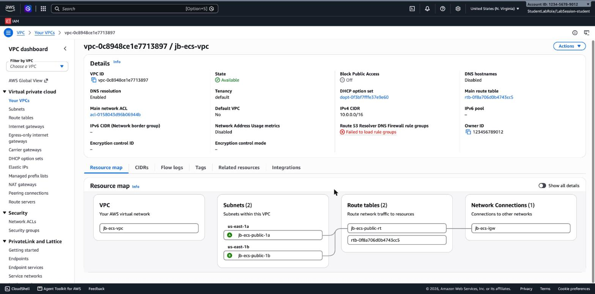

# 3.06 Containers – Prerequisites: The Network

[⬅ jb-lab-1](jb-lab-1.md) | [⬅ Back to 3.06 Containers](README.md)

> 🏫 Do this **once, before jb-lab-1**, if you work in the John Bryce class account. In a private account you can skip it: the labs use the **default VPC**, which every account has.

The class account has **no VPC in `us-east-1`**, not even a default one. The 3.06 labs need a VPC with **public subnets in two Availability Zones** (the ALB in jb-lab-2 needs two AZs). You build it yourself, one piece at a time:

```
 1. VPC  ──►  2. Subnets  ──►  3. Internet gateway  ──►  4. Route table  ──►  jb-lab-1
 jb-ecs-vpc   jb-ecs-public-1a     jb-ecs-igw              jb-ecs-public-rt
              jb-ecs-public-1b                             0.0.0.0/0 → jb-ecs-igw
```

> 💰 This network costs nothing: no NAT gateway, no endpoints.

---

## 1. VPC

**VPC → Your VPCs → Create VPC**:

- Resources to create: **VPC only**.
- Name tag: **`jb-ecs-vpc`**.
- IPv4 CIDR: **`10.0.0.0/16`**. No IPv6 CIDR block. Tenancy: *Default*.

Choose **Create VPC**. The new VPC is empty: no subnets, and no way to the internet.

## 2. Subnets

**VPC → Subnets → Create subnet**, VPC ID: `jb-ecs-vpc`. Add two subnets (**Add new subnet** for the second one):

| Subnet name | Availability Zone | IPv4 subnet CIDR block |
|-------------|-------------------|------------------------|
| **`jb-ecs-public-1a`** | `us-east-1a` | **`10.0.1.0/24`** |
| **`jb-ecs-public-1b`** | `us-east-1b` | **`10.0.2.0/24`** |

Choose **Create subnet**. Then, for **each** subnet: select it → **Actions → Edit subnet settings** → check **Enable auto-assign public IPv4 address** → **Save**. Instances launched in these subnets now get a public IP.

## 3. Internet gateway

**VPC → Internet gateways → Create internet gateway**, name **`jb-ecs-igw`** → **Create internet gateway**. Its state is **Detached**: choose **Attach to a VPC** (or *Actions → Attach to VPC*), select `jb-ecs-vpc`, and choose **Attach internet gateway**. The state changes to **Attached**.

## 4. Route table

The subnets use the VPC's **main route table**, which has only the `local` route (`10.0.0.0/16`). Traffic can't leave the VPC yet.

1. **VPC → Route tables → Create route table**: name **`jb-ecs-public-rt`**, VPC `jb-ecs-vpc` → **Create route table**.
2. **Routes → Edit routes → Add route**: destination **`0.0.0.0/0`**, target **Internet Gateway → `jb-ecs-igw`** → **Save changes**.
3. **Subnet associations → Edit subnet associations**: select **both** subnets → **Save associations**.

A subnet whose route table sends `0.0.0.0/0` to an internet gateway is a **public subnet**. Both subnets are public now.

## 5. Check

Open `jb-ecs-vpc` → **Resource map**. You should see the whole chain: the VPC → the two subnets → `jb-ecs-public-rt` → `jb-ecs-igw`. The second, unnamed route table is the main route table, which no subnet uses now.



**In all the 3.06 labs, wherever a step says "the default VPC", use `jb-ecs-vpc` and the subnets `jb-ecs-public-1a` and `jb-ecs-public-1b`.**

---

## Task definitions: no execution role, no logs

The class account doesn't let students create IAM roles, and CloudWatch Logs is blocked. In **every** task definition you create in 3.06:

- **Task execution role:** choose **None**. The Console default, *Create default role*, tries to create `ecsTaskExecutionRole`.
- **Logging:** clear **Use log collection**. It sends logs to CloudWatch Logs and needs an execution role.

`traefik/whoami` is a public image, so the tasks don't need an execution role to pull it.

---

## Clean up at the end of the chapter

After jb-lab-5 (or whenever you stop), delete the load balancer first: its network interfaces keep the VPC in use. Then **VPC → Your VPCs →** select `jb-ecs-vpc` **→ Actions → Delete VPC**, type `delete`, and choose **Delete**. This also deletes the subnets, the route table, the internet gateway and the security groups.

---

[⬅ jb-lab-1](jb-lab-1.md) | [⬅ Back to 3.06 Containers](README.md)

---

## Contact

For questions or feedback, feel free to reach out:

- **Email**: eyal@levys.co.il
- **GitHub**: [https://github.com/elevy99927](https://github.com/elevy99927)
