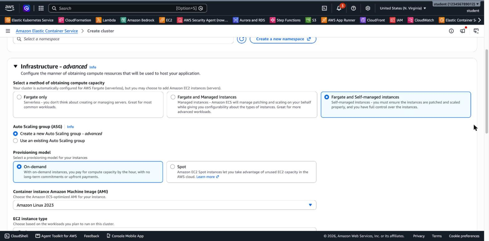
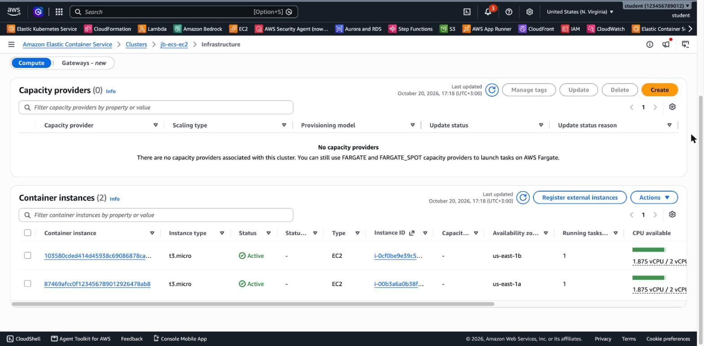
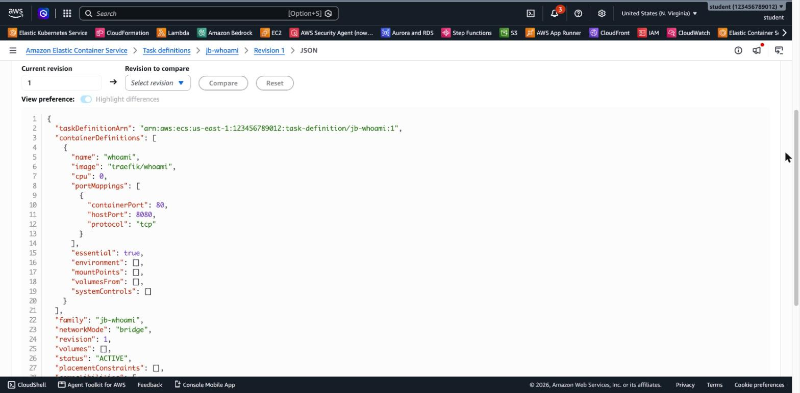
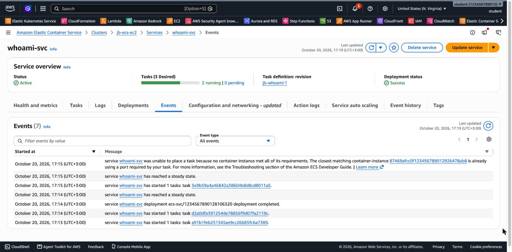

# 3.06 Containers – jb-lab-1 Solution

[⬅ jb-lab-1](jb-lab-1.md) | [⬅ Back to 3.06 Containers](README.md) | [jb-lab-2 ➡](jb-lab-2.md)

> Tested in `us-east-1` with the ECS-optimized Amazon Linux 2023 AMI (ECS agent 1.108.0, Docker 25.0.16) and `traefik/whoami`.

**Jump to:** [Solution 1: Console](#solution-1-console-ui) · [Solution 2: AWS CLI](#solution-2-aws-cli) · [Answers](#answers) · [Solution 3: Terraform](#solution-3-terraform)

---

## Solution 1: Console (UI)

### Part A: Security group

**EC2 → Security groups → Create security group**: name `jb-ecs-instances-sg`, the default VPC, inbound rule **Custom TCP 8080**, source **My IP**.

### Part B: Cluster with EC2 instances

**ECS → Clusters → Create cluster**, name `jb-ecs-ec2`. Under **Infrastructure**, choose **Fargate and Self-managed instances**:



- Auto Scaling group: **Create a new Auto Scaling group**, On-demand, **Amazon Linux 2023**, instance type **t3.micro**.
- EC2 instance role: **Create default role**. The Console creates `ecsInstanceRole`.
- Desired capacity: **Minimum 2, Maximum 2**. SSH key pair: none.
- Network settings: the default VPC, the subnets in **us-east-1a** and **us-east-1b**, security group `jb-ecs-instances-sg`, auto-assign public IP **Turn on**.

Choose **Create**. The Console uses CloudFormation to create the Auto Scaling Group and a **capacity provider** that connects it to the cluster. After 2–3 minutes, the **Infrastructure** tab shows **2 container instances**:



> The screenshot comes from the CLI run (Solution 2), which registers the instances without a capacity provider, so *Capacity providers (0)* is shown. When you create the cluster in the Console, you'll see one capacity provider here.

**Step 3:** open a container instance. *Agent version* and *Docker version* show the versions of the ECS agent and Docker on the instance, for example **1.108.0** and **25.0.16**.

### Part C: Task definition

**ECS → Task definitions → Create new task definition**:

- Family: `jb-whoami`. Launch type: **Amazon EC2 instances**. Network mode: **bridge**.
- Task size: CPU **.125 vCPU**, memory **.125 GB**.
- Task execution role: **None**. The image is public and we don't send logs.
- Container: name `whoami`, image `traefik/whoami`, port mapping **container port 80**, **host port 8080**.
- Log collection: clear **Use log collection** (it needs CloudWatch Logs and an execution role).

The **JSON** tab shows exactly the fields from the background section:



### Part D: Service

Open the cluster → **Services → Create**:

- Compute options: **Launch type → EC2**.
- Task definition family: `jb-whoami`, revision **LATEST**. Service name: `whoami-svc`. Desired tasks: **2**.

Choose **Create**. After about a minute, **2 tasks** are *Running*, **one on each instance**. With a static host port, there can't be two on the same instance.

### Part E: Test

Open `http://<public-ip-of-instance>:8080` for each instance (find the public IPs in **EC2 → Instances**):

```
Hostname: eab05d01e7a9
IP: 127.0.0.1
IP: 172.17.0.2
...
```

```
Hostname: 17dd4924c2a3
IP: 127.0.0.1
IP: 172.17.0.2
...
```

- **`Hostname`** is the **container ID**, which is different on each instance.
- **`IP: 172.17.0.2`** is the container's address on the Docker **bridge** network inside the instance, which is why the network mode is called `bridge`.

### Part F: Self-healing and the static port limit

**8. Stop a task:** in **Tasks**, select one → **Stop**. Within seconds, the service starts a replacement (*"has started 1 tasks"*), because desired = 2.

**9. Desired tasks = 3:** **Update service** → desired tasks **3**. The service stays at **2 running**, and the **Events** tab explains why:



> *service whoami-svc was unable to place a task because no container instance met all of its requirements. The closest matching container-instance … is already using a port required by your task.*

Both instances already use host port **8080**, so there's nowhere to put a third task. **10.** Set desired tasks back to **2**.

### Part G: Clean up or continue

Continuing to jb-lab-2? Keep the cluster. Otherwise:

1. **Services → whoami-svc → Delete service** (force).
2. **Clusters → jb-ecs-ec2 → Delete cluster**. This also deletes the CloudFormation stack, the Auto Scaling Group and its instances.
3. **Task definitions → jb-whoami →** select the revisions → **Deregister**, then **Delete**.
4. **EC2 → Security groups →** delete `jb-ecs-instances-sg`, after the instances have terminated.

---

## Solution 2: AWS CLI

The CLI builds the same thing piece by piece: an instance role, an empty cluster, a launch template with the ECS-optimized AMI, and an Auto Scaling Group. The ECS agent on each instance registers it to the cluster, using the **user data** line `ECS_CLUSTER=jb-ecs-ec2`.

```bash
export AWS_PAGER="" AWS_REGION=us-east-1
MY_IP=$(curl -s https://checkip.amazonaws.com)
VPC_ID=$(aws ec2 describe-vpcs --filters Name=is-default,Values=true --query 'Vpcs[0].VpcId' --output text)
SUBNET_A=$(aws ec2 describe-subnets --filters Name=default-for-az,Values=true Name=availability-zone,Values=us-east-1a --query 'Subnets[0].SubnetId' --output text)
SUBNET_B=$(aws ec2 describe-subnets --filters Name=default-for-az,Values=true Name=availability-zone,Values=us-east-1b --query 'Subnets[0].SubnetId' --output text)

# Part A: security group
INST_SG=$(aws ec2 create-security-group --group-name jb-ecs-instances-sg \
  --description "ECS container instances" --vpc-id $VPC_ID --query GroupId --output text)
aws ec2 authorize-security-group-ingress --group-id $INST_SG --protocol tcp --port 8080 --cidr $MY_IP/32

# Part B: instance role (the ECS agent uses it to register the instance)
cat > ec2-trust.json <<'JSON'
{ "Version": "2012-10-17", "Statement": [{ "Effect": "Allow", "Principal": { "Service": "ec2.amazonaws.com" }, "Action": "sts:AssumeRole" }] }
JSON
aws iam create-role --role-name ecsInstanceRole --assume-role-policy-document file://ec2-trust.json
aws iam attach-role-policy --role-name ecsInstanceRole \
  --policy-arn arn:aws:iam::aws:policy/service-role/AmazonEC2ContainerServiceforEC2Role
aws iam create-instance-profile --instance-profile-name ecsInstanceRole
aws iam add-role-to-instance-profile --instance-profile-name ecsInstanceRole --role-name ecsInstanceRole

# Part B: cluster + launch template (ECS-optimized AMI) + Auto Scaling Group
aws ecs create-cluster --cluster-name jb-ecs-ec2
AMI_ID=$(aws ssm get-parameter --name /aws/service/ecs/optimized-ami/amazon-linux-2023/recommended/image_id \
  --query Parameter.Value --output text)
UD=$(printf '#!/bin/bash\necho ECS_CLUSTER=jb-ecs-ec2 >> /etc/ecs/ecs.config\n' | base64 | tr -d '\n')
cat > lt.json <<JSON
{ "ImageId": "$AMI_ID", "InstanceType": "t3.micro",
  "IamInstanceProfile": { "Name": "ecsInstanceRole" },
  "NetworkInterfaces": [{ "DeviceIndex": 0, "AssociatePublicIpAddress": true, "Groups": ["$INST_SG"] }],
  "UserData": "$UD",
  "TagSpecifications": [{ "ResourceType": "instance", "Tags": [{ "Key": "Name", "Value": "jb-ecs-instance" }] }] }
JSON
sleep 10   # let the new instance profile propagate
aws ec2 create-launch-template --launch-template-name jb-ecs-lt --launch-template-data file://lt.json
aws autoscaling create-auto-scaling-group --auto-scaling-group-name jb-ecs-asg \
  --launch-template LaunchTemplateName=jb-ecs-lt,Version='$Latest' \
  --min-size 2 --max-size 2 --desired-capacity 2 --vpc-zone-identifier "$SUBNET_A,$SUBNET_B"
```

**Step 3: wait for the instances to register:**

```bash
aws ecs describe-container-instances --cluster jb-ecs-ec2 \
  --container-instances $(aws ecs list-container-instances --cluster jb-ecs-ec2 --query containerInstanceArns --output text) \
  --query 'containerInstances[].[ec2InstanceId,status,versionInfo.agentVersion,versionInfo.dockerVersion]' --output table
```

```
|  i-0cf0be9e39c519bc6 |  ACTIVE |  1.108.0 |  DockerVersion: 25.0.16  |
|  i-00b3a6a0b38f19c41 |  ACTIVE |  1.108.0 |  DockerVersion: 25.0.16  |
```

**Parts C–D: task definition and service:**

```bash
cat > td-whoami.json <<'JSON'
{
  "family": "jb-whoami",
  "networkMode": "bridge",
  "requiresCompatibilities": ["EC2"],
  "cpu": "128",
  "memory": "128",
  "containerDefinitions": [{
    "name": "whoami",
    "image": "traefik/whoami",
    "essential": true,
    "portMappings": [{ "containerPort": 80, "hostPort": 8080, "protocol": "tcp" }]
  }]
}
JSON
aws ecs register-task-definition --cli-input-json file://td-whoami.json

aws ecs create-service --cluster jb-ecs-ec2 --service-name whoami-svc \
  --task-definition jb-whoami --desired-count 2 --launch-type EC2
aws ecs wait services-stable --cluster jb-ecs-ec2 --services whoami-svc
```

**Part E: test:**

```bash
for IP in $(aws ec2 describe-instances --filters Name=tag:Name,Values=jb-ecs-instance \
    Name=instance-state-name,Values=running --query 'Reservations[].Instances[].PublicIpAddress' --output text); do
  curl -s http://$IP:8080 | head -3; echo ---
done
```

**Part F: self-healing and the placement failure:**

```bash
T=$(aws ecs list-tasks --cluster jb-ecs-ec2 --service-name whoami-svc --query 'taskArns[0]' --output text)
aws ecs stop-task --cluster jb-ecs-ec2 --task $T --reason "testing self-healing"

aws ecs update-service --cluster jb-ecs-ec2 --service whoami-svc --desired-count 3
sleep 60
aws ecs describe-services --cluster jb-ecs-ec2 --services whoami-svc \
  --query 'services[0].[desiredCount,runningCount]' --output text          # 3   2
aws ecs describe-services --cluster jb-ecs-ec2 --services whoami-svc \
  --query 'services[0].events[0].message' --output text
aws ecs update-service --cluster jb-ecs-ec2 --service whoami-svc --desired-count 2
```

**Part G: clean up** (if you're not continuing to jb-lab-2):

```bash
aws ecs delete-service --cluster jb-ecs-ec2 --service whoami-svc --force
aws autoscaling delete-auto-scaling-group --auto-scaling-group-name jb-ecs-asg --force-delete
aws ecs delete-cluster --cluster jb-ecs-ec2
aws ec2 delete-launch-template --launch-template-name jb-ecs-lt
until aws ec2 delete-security-group --group-id $INST_SG 2>/dev/null; do sleep 10; done   # waits for the instances
aws ecs deregister-task-definition --task-definition jb-whoami:1
aws ecs delete-task-definitions --task-definitions jb-whoami:1
aws iam remove-role-from-instance-profile --instance-profile-name ecsInstanceRole --role-name ecsInstanceRole
aws iam delete-instance-profile --instance-profile-name ecsInstanceRole
aws iam detach-role-policy --role-name ecsInstanceRole \
  --policy-arn arn:aws:iam::aws:policy/service-role/AmazonEC2ContainerServiceforEC2Role
aws iam delete-role --role-name ecsInstanceRole
```

---

## Answers

- **Task definition vs. task vs. service:** the **task definition** is the blueprint (JSON, versioned). A **task** is a running copy of it. A **service** keeps a desired number of tasks running, replaces failed ones, and can connect them to a load balancer.
- **Who registered the instances:** the **ECS agent** on each instance. It reads the cluster name from `/etc/ecs/ecs.config` (written by the user data) and calls ECS with the permissions of the **instance role** (`AmazonEC2ContainerServiceforEC2Role`).
- **Why the third task couldn't start:** both instances already use **host port 8080**, and a port can be bound only once per instance. You could add instances, or better, use **dynamic host ports** behind a load balancer, which is jb-lab-2.
- **S3 access for the container:** the **task role** (`taskRoleArn`). Not the instance role, which every task on the instance would share, and not the execution role, which ECS uses only to pull images and send logs.

---

[⬅ jb-lab-1](jb-lab-1.md) | [⬅ Back to 3.06 Containers](README.md) | [jb-lab-2 ➡](jb-lab-2.md)

---

## Solution 3: Terraform

[`terraform/jb-lab-1/main.tf`](terraform/jb-lab-1/main.tf) builds the whole lab: the security group, the instance role, the cluster, a launch template with the ECS-optimized AMI (from the public SSM parameter), the Auto Scaling Group, the task definition and the service.

```bash
cd terraform/jb-lab-1
terraform init
terraform apply -var my_ip_cidr="$(curl -s https://checkip.amazonaws.com)/32"   # about 1 minute
for IP in $(eval "$(terraform output -raw find_instance_ips)"); do curl -s http://$IP:8080 | grep Hostname; done
terraform destroy -var my_ip_cidr="0.0.0.0/32"                                   # about 3 minutes
```

The tested run: `apply` took 55 s, and both tasks answered about 40 s later:

```
Hostname: 91028b07a14d
Hostname: c3d8dacdf188
```

> The Terraform code names the instance role `jb-ecs-instance-role`, so it doesn't collide with the `ecsInstanceRole` that the Console creates.
>
> The service has `depends_on = [..., aws_iam_role_policy_attachment.instance]`, so `destroy` deletes the service **before** it removes the instance role's policy. Without it, Terraform can remove the policy first. The ECS agent on the instances then loses its permissions (`agentConnected: false`), the tasks can never report that they stopped, and the service hangs in **DRAINING**.

---

## Contact

For questions or feedback, feel free to reach out:

- **Email**: eyal@levys.co.il
- **GitHub**: [https://github.com/elevy99927](https://github.com/elevy99927)
