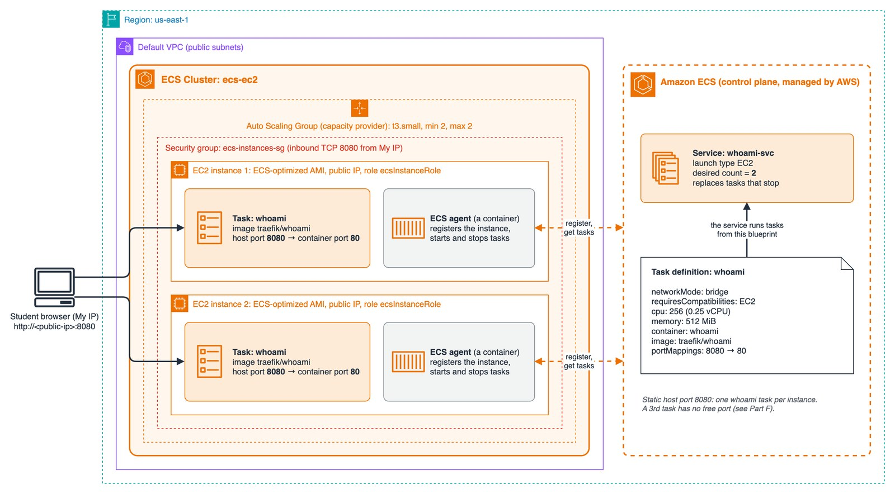

# 3.06 Containers – Lab 1: ECS on EC2 – Cluster, Task Definition and Service

[⬅ Back to 3.06 Containers](README.md) | [Lab 2 ➡](jb-lab-2.md)

> 📚 Based on the course slides *ECS – What it's all about*: clusters overview, ECS task definitions, ECS service, and the first follow-through (*Let's create an ECS cluster, a task and a service*).

**▶ Video walkthrough** (11 min):

[](https://youtu.be/-m9j2xG_DoM)

---

## 1. What is Amazon ECS?

**Amazon Elastic Container Service (ECS)** is AWS's **container orchestrator**. You tell it *which* containers to run and *how many*, and ECS decides *where* to run them, restarts them when they fail, and connects them to load balancers.

### The building blocks

| Component | What it is |
|-----------|------------|
| **Cluster** | A logical grouping of the compute that runs your containers: EC2 instances, Fargate, or both |
| **Container instance** | An **EC2 instance** registered to a cluster. It runs a special **ECS-optimized AMI** with Docker and the **ECS agent** |
| **ECS agent** | Runs on each container instance (itself as a container). It **registers** the instance to the cluster and starts and stops containers on ECS's instructions |
| **Capacity provider** | Connects the cluster to an **Auto Scaling Group** of EC2 instances (or to Fargate), and can scale the instances |
| **Task definition** | A JSON **blueprint** for one or more containers: image, CPU, memory, ports, environment variables, IAM role, logging. It's versioned (`family:revision`) |
| **Task** | A **running instance** of a task definition: one or more containers running together |
| **Service** | Keeps a **desired count** of tasks running, replaces failed tasks, and can register them with a **load balancer** |



<sub>Diagram source: [images/jb-ecs-ec2.drawio](images/jb-ecs-ec2.drawio) (open it in [draw.io](https://app.diagrams.net) to edit)</sub>

### What's in a task definition?

These are the fields from the slides, as they appear in the task definition JSON:

| Slide item | Task definition field |
|------------|-----------------------|
| Image name | `containerDefinitions[].image`, for example `traefik/whoami` |
| Port binding for container and host | `portMappings`: `containerPort` (inside the container) and `hostPort` (on the EC2 instance) |
| Memory and CPU required | `cpu` (1024 units = 1 vCPU) and `memory` (MiB) |
| Environment variables | `environment` |
| Networking information | `networkMode`: `bridge`, `awsvpc`, `host` |
| IAM role | `taskRoleArn` and `executionRoleArn` (see below) |
| Logging configuration | `logConfiguration`, for example the `awslogs` driver for CloudWatch Logs |

```json
{
  "family": "whoami",
  "networkMode": "bridge",
  "requiresCompatibilities": ["EC2"],
  "containerDefinitions": [{
    "name": "whoami",
    "image": "traefik/whoami",
    "cpu": 256,
    "memory": 512,
    "portMappings": [{ "containerPort": 80, "hostPort": 8080, "protocol": "tcp" }]
  }]
}
```

### Port mapping: host port vs. container port

```
   browser ──► EC2 instance :8080  ──(port mapping)──►  container :80
                 (host port)                          (container port)
```

With a **static host port** (`hostPort: 8080`), only **one** task per instance can use that port. A second task on the same instance would fail to start, because the port is taken. [Lab 2](jb-lab-2.md) solves this with **dynamic host ports** and a load balancer.

### IAM roles in ECS

| Role | Who uses it | For what | AWS managed policy |
|------|-------------|----------|--------------------|
| **Instance role** (`ecsInstanceRole`) | The **ECS agent** on the EC2 instance | Register the instance and communicate with ECS | `AmazonEC2ContainerServiceforEC2Role` |
| **Task execution role** (`ecsTaskExecutionRole`) | **ECS itself**, before your container starts | **Pull the image** (ECR) and **send logs** (CloudWatch) | `AmazonECSTaskExecutionRolePolicy` |
| **Task role** | **Your application** inside the container | Call AWS APIs, for example read from S3 | Whatever your app needs (least privilege) |

> **Exam tip:** "The application in the container needs to read from S3" → give the **task role** the permission, not the instance role.

### Cluster infrastructure options in the Console

The slides show an older Console screen, with *Networking only (Fargate)*, *EC2 Linux + Networking* and *EC2 Windows + Networking*. Today, **Create cluster** offers:

| Option | Meaning |
|--------|---------|
| **Fargate only** | Serverless, with no instances ([Lab 3](jb-lab-3.md)) |
| **Fargate and Managed Instances** | ECS launches and manages EC2 instances for you (patching, scaling), and you choose instance requirements |
| **Fargate and Self-managed instances** | ECS creates an **Auto Scaling Group** of EC2 instances that **you** manage. **This lab uses this option** |

---

## 🧪 Lab 1 (Basic): Cluster, Task Definition and Service on EC2

> 💰 **Cost:** 2 × t3.small, about **$0.05/hour** including public IPs. Up to 2 hours ≈ **$0.10**. If left running ≈ **$38/month**. Clean up at the end, or continue to Lab 2.

**Goal:** Create an ECS cluster with EC2 instances, describe a container in a task definition, run it as a service with 2 tasks, and see ECS keep the desired count. Then find the limit of static port mapping.

**Tools:** Console + AWS CLI. Region: `us-east-1`.

> **Before you start:** do the [Networking lab](../2.04-vpc-and-networking/lab-1.md). All the Containers labs run in the network it builds, **`ecs-vpc`**.

### Tasks

**Part A: Security group**

1. Create a security group `ecs-instances-sg` in **`ecs-vpc`** that allows **TCP 8080 from your IP** (*My IP*).

**Part B: Cluster with EC2 instances**

2. In **ECS → Clusters → Create cluster**, name it **`ecs-ec2`** and choose **Fargate and Self-managed instances**:
   - Create a new Auto Scaling Group, OS **Amazon Linux 2023**, instance type **t3.small**.
   - Desired capacity: **min 2, max 2**. No SSH key pair.
   - Network: **`ecs-vpc`**, its public subnets `ecs-public-1a` and `ecs-public-1b`, security group **`ecs-instances-sg`**, auto-assign public IP **on**.
   - Click `Create`
3. Wait until **Infrastructure** shows **2 container instances**. Open one. What are its *Agent version* and *Docker version*?

**Part C: Task definition**

4. Create a task definition **`whoami`**:
   - Launch type **Amazon EC2 instances** only (clear **AWS Fargate**, which doesn't support bridge mode).
   - Network mode **bridge**.
   - Task size: CPU **0.25 vCPU**, memory **0.5 GB** (the smallest size in the Console's list).
   - Container `whoami`, image **`traefik/whoami`**, port mapping **host port 8080 → container port 80**.

**Part D: Service**

5. In the cluster, 
   - Create a service **`whoami-svc`** from `whoami`, launch type **EC2**, **desired tasks: 2**.
   - Click `Create`
6. Wait until **2 tasks** are *Running*. Which instance does each task run on?

**Part E: Test**

7. Open `http://<instance-public-ip>:8080` for **each** instance. What do the `Hostname` and `IP` lines show?

**Part F: Self-healing and the static port limit**

8. **Stop** one of the tasks. Watch the service's **Events** tab. What does the service do?
9. Update the service to **desired tasks: 3**. What happens to the third task? Find the reason in the service **Events**.
10. Set the desired tasks back to **2**.

**Part G: Clean up or continue**

11. Continuing to [Lab 2](jb-lab-2.md)? Keep the cluster. Stopping here? Delete the service, the cluster (this also deletes its Auto Scaling Group), the task definition revisions and the security group.

### Questions

- What's the difference between a **task definition**, a **task** and a **service**?
- Who registered the EC2 instances to the cluster, and how?
- Why couldn't the third task start? What would solve it?
- Which IAM role would you give permissions to if the container had to read from S3?

---

✅ **Solution:** [Lab 1 Solution](jb-lab-1-solution.md)

---

[⬅ Back to 3.06 Containers](README.md) | [Lab 2 ➡](jb-lab-2.md)

---

## Contact

For questions or feedback, feel free to reach out:

- **Email**: eyal@levys.co.il
- **GitHub**: [https://github.com/elevy99927](https://github.com/elevy99927)
