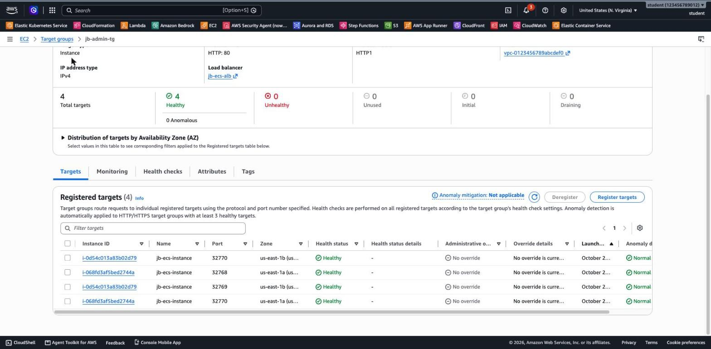

# 3.06 Containers – Lab 2 Solution

[⬅ Lab 2](jb-lab-2.md) | [⬅ Back to 3.06 Containers](README.md) | [Lab 3 ➡](jb-lab-3.md)

> Tested in `us-east-1` on the `ecs-ec2` cluster from Lab 1 (2 × t3.small).

**Jump to:** [Solution 1: Console](#solution-1-console-ui) · [Solution 2: AWS CLI](#solution-2-aws-cli) · [Answers](#answers) · [Solution 3: Terraform](#solution-3-terraform)

---

## Solution 1: Console (UI)

### Part A: Prepare

1. **ECS → ecs-ec2 → Services → whoami-svc → Delete service** (or update it to 0 tasks).
2. **EC2 → Security groups → Create**: `ecs-alb-sg`, inbound **HTTP 80** from **Anywhere-IPv4**.
3. Open `ecs-instances-sg` → **Edit inbound rules → Add rule**: **Custom TCP**, port range **32768-65535**, source **`ecs-alb-sg`** (start typing `sg-` and pick the group).

### Part B: Task definitions with dynamic ports

Create `admin`, then `store` (or create one and use **Create new revision → JSON**):

- Launch type **EC2**, network mode **bridge**, 0.25 vCPU and 0.5 GB.
- Container `whoami`, image `traefik/whoami`, **container port 80**, and **leave the host port empty**, which means dynamic.
- Environment variable `WHOAMI_NAME` = `admin` (or `store`).

### Part C: Load balancer

1. **EC2 → Target groups → Create**: *Instances*, name `admin-tg`, HTTP:80, the default VPC, health check path `/`. On *Register targets*, **don't select anything** and choose **Create**. Repeat for `store-tg`.
2. **EC2 → Load balancers → Create → Application Load Balancer**: name `ecs-alb`, internet-facing, **all** default subnets, security group `ecs-alb-sg`. Set the listener **HTTP:80** with default action **Return fixed response: 404, text/plain, `no route`**.
3. Open the ALB → **Listeners → HTTP:80 → Add rule**:
   - Priority **10**: condition **Path** `/admin*` → forward to `admin-tg`
   - Priority **20**: condition **Path** `/store*` → forward to `store-tg`

The listener rules after Part C:

```
10       /admin*    forward          admin-tg
20       /store*    forward          store-tg
default  (default)  fixed-response   no route
```

### Part D: Services

In the cluster → **Services → Create**, launch type **EC2**, family `admin`, name `admin-svc`, desired tasks **2**. Under **Load balancing**:
- Load balancer type **Application Load Balancer**, **Use an existing load balancer** → `ecs-alb`.
- Listener: **Use an existing listener** → `80:HTTP`.
- Target group: **Use an existing target group** → `admin-tg`.

Repeat for `store-svc` with `store` and `store-tg`.

### Part E: Test

```bash
for i in 1 2 3 4 5 6; do curl -s http://<alb-dns>/admin | grep -E "^(Name|Hostname)" | tr '\n' ' '; echo; done
```

```
Name: admin Hostname: 5daa82303bab
Name: admin Hostname: 5daa82303bab
Name: admin Hostname: 58b521ec0dcf
...
```

`/store` returns `Name: store` from two other containers. `/` returns **`no route` with HTTP 404**, because no rule matches, so the listener's **default action** answers.

A full response shows that the ALB adds the `X-Forwarded-*` headers and that each container is on the Docker bridge network:

```
Name: admin
Hostname: 277a7deb8d47
IP: 172.17.0.4
GET /admin HTTP/1.1
Host: ecs-alb-2072728589.us-east-1.elb.amazonaws.com
X-Forwarded-For: 203.0.113.10
X-Forwarded-Port: 80
X-Forwarded-Proto: http
```

**11. Dynamic ports:** the target group registers *instance + random port*. After scaling `admin-svc` to **4** tasks, each instance runs **two** admin tasks on different host ports, which was impossible in Lab 1:



```
i-068fd3af5bed2744a   32768   healthy
i-068fd3af5bed2744a   32770   healthy
i-0d54c013a83b02d79   32769   healthy
i-0d54c013a83b02d79   32770   healthy
```

Each instance now runs **3 tasks** (2 admin + 1 store). With 0.5 GB per task, they use 1,536 of the 1,913 MiB that a t3.small gives ECS, so **377 MiB** are still free on each instance.

### Part F: Clean up or continue

Continuing to Lab 3? Delete the services `admin-svc` and `store-svc`, the cluster `ecs-ec2`, the listener rules, the target groups `admin-tg` and `store-tg`, and `ecs-instances-sg`, but **keep `ecs-alb`** (with its listener) and **`ecs-alb-sg`**. Otherwise delete those too.

---

## Solution 2: AWS CLI

Continue in the terminal from Lab 1 (`$VPC_ID`, `$INST_SG`).

```bash
export AWS_PAGER="" AWS_REGION=us-east-1

# Part A
aws ecs delete-service --cluster ecs-ec2 --service whoami-svc --force
ALB_SG=$(aws ec2 create-security-group --group-name ecs-alb-sg \
  --description "ECS ALB - HTTP from anywhere" --vpc-id $VPC_ID --query GroupId --output text)
aws ec2 authorize-security-group-ingress --group-id $ALB_SG --protocol tcp --port 80 --cidr 0.0.0.0/0
aws ec2 authorize-security-group-ingress --group-id $INST_SG --protocol tcp --port 32768-65535 --source-group $ALB_SG

# Part B: hostPort 0 = dynamic
for SVC in admin store; do
cat > td-$SVC.json <<JSON
{
  "family": "$SVC",
  "networkMode": "bridge",
  "requiresCompatibilities": ["EC2"],
  "cpu": "256",
  "memory": "512",
  "containerDefinitions": [{
    "name": "whoami",
    "image": "traefik/whoami",
    "essential": true,
    "portMappings": [{ "containerPort": 80, "hostPort": 0, "protocol": "tcp" }],
    "environment": [{ "name": "WHOAMI_NAME", "value": "$SVC" }]
  }]
}
JSON
aws ecs register-task-definition --cli-input-json file://td-$SVC.json
done

# Part C: target groups, ALB, listener with a fixed 404, path rules
ADMIN_TG=$(aws elbv2 create-target-group --name admin-tg --protocol HTTP --port 80 --vpc-id $VPC_ID \
  --target-type instance --health-check-path / --query 'TargetGroups[0].TargetGroupArn' --output text)
STORE_TG=$(aws elbv2 create-target-group --name store-tg --protocol HTTP --port 80 --vpc-id $VPC_ID \
  --target-type instance --health-check-path / --query 'TargetGroups[0].TargetGroupArn' --output text)
SUBNETS=$(aws ec2 describe-subnets --filters Name=default-for-az,Values=true --query 'Subnets[].SubnetId' --output text)
ALB_ARN=$(aws elbv2 create-load-balancer --name ecs-alb --type application --scheme internet-facing \
  --subnets $SUBNETS --security-groups $ALB_SG --query 'LoadBalancers[0].LoadBalancerArn' --output text)
LISTENER_ARN=$(aws elbv2 create-listener --load-balancer-arn $ALB_ARN --protocol HTTP --port 80 \
  --default-actions 'Type=fixed-response,FixedResponseConfig={StatusCode=404,ContentType=text/plain,MessageBody=no route}' \
  --query 'Listeners[0].ListenerArn' --output text)
aws elbv2 create-rule --listener-arn $LISTENER_ARN --priority 10 \
  --conditions Field=path-pattern,Values='/admin*' --actions Type=forward,TargetGroupArn=$ADMIN_TG
aws elbv2 create-rule --listener-arn $LISTENER_ARN --priority 20 \
  --conditions Field=path-pattern,Values='/store*' --actions Type=forward,TargetGroupArn=$STORE_TG
aws elbv2 wait load-balancer-available --load-balancer-arns $ALB_ARN
ALB_DNS=$(aws elbv2 describe-load-balancers --load-balancer-arns $ALB_ARN --query 'LoadBalancers[0].DNSName' --output text)

# Part D: services that register their tasks in the target groups
aws ecs create-service --cluster ecs-ec2 --service-name admin-svc --task-definition admin \
  --desired-count 2 --launch-type EC2 --load-balancers targetGroupArn=$ADMIN_TG,containerName=whoami,containerPort=80
aws ecs create-service --cluster ecs-ec2 --service-name store-svc --task-definition store \
  --desired-count 2 --launch-type EC2 --load-balancers targetGroupArn=$STORE_TG,containerName=whoami,containerPort=80
aws ecs wait services-stable --cluster ecs-ec2 --services admin-svc store-svc

# Part E
curl -s http://$ALB_DNS/admin; curl -s http://$ALB_DNS/store; curl -s -w " [%{http_code}]\n" http://$ALB_DNS/
aws elbv2 describe-target-health --target-group-arn $ADMIN_TG \
  --query 'TargetHealthDescriptions[].[Target.Id,Target.Port,TargetHealth.State]' --output text
```

**Part F: clean up the EC2 part and keep the ALB for Lab 3:**

```bash
for S in admin-svc store-svc; do aws ecs delete-service --cluster ecs-ec2 --service $S --force; done
aws ecs wait services-inactive --cluster ecs-ec2 --services admin-svc store-svc
for R in $(aws elbv2 describe-rules --listener-arn $LISTENER_ARN --query 'Rules[?IsDefault==`false`].RuleArn' --output text); do
  aws elbv2 delete-rule --rule-arn $R; done
aws elbv2 delete-target-group --target-group-arn $ADMIN_TG
aws elbv2 delete-target-group --target-group-arn $STORE_TG
# then delete the ASG, cluster, launch template, ecs-instances-sg and the task definitions as in Lab 1, Part G
```

---

## Answers

- **Ports 32768–65535 only from the ALB's SG:** the host ports are **random**, so you can't open one specific port. Opening the whole ephemeral range to the internet would expose every container directly. With the **ALB's security group** as the source, only the load balancer can reach them.
- **How the ALB knows each task's port:** it doesn't discover it. **ECS registers each task** in the target group as *instance ID + host port* when the task starts, and deregisters it when the task stops.
- **HTTPS:** request a certificate in **AWS Certificate Manager**, add an **HTTPS:443** listener with the same path rules, and change the HTTP:80 listener to **redirect to HTTPS**.
- **A task that fails its health check:** the ALB marks it **unhealthy** and stops sending it traffic. The ECS service then **stops it and starts a replacement**, until the desired count of healthy tasks is reached.

---

[⬅ Lab 2](jb-lab-2.md) | [⬅ Back to 3.06 Containers](README.md) | [Lab 3 ➡](jb-lab-3.md)

---

## Solution 3: Terraform

[`terraform/jb-lab-2/main.tf`](terraform/jb-lab-2/main.tf) is **standalone**. It builds the EC2 cluster from Lab 1 (without the static `whoami-svc`), the ALB with a default 404 and the `/admin*` and `/store*` rules, and the two services with dynamic host ports (`hostPort = 0`). It uses `for_each` to create both services from one block.

```bash
cd terraform/jb-lab-2
terraform init
terraform apply      # about 3 minutes; prints the /admin and /store URLs
URLS=$(terraform output -json urls | tr -d '[]"' | tr ',' ' ')
for U in $URLS; do for i in 1 2 3; do curl -s $U | grep -E '^(Name|Hostname)' | paste -sd' ' -; done; done
curl -s -w " [%{http_code}]\n" http://$(echo $URLS | cut -d/ -f3)/            # the default rule
terraform destroy    # about 9 minutes
```

The tested run (2 × t3.small): `apply` took 160 s, and the targets were healthy about 1 minute later. Each path reaches its own service, and both tasks of each service answer:

```
Name: admin Hostname: e5c1acfb0722
Name: admin Hostname: 65da06089915
Name: admin Hostname: e5c1acfb0722
Name: store Hostname: 07233c963939
Name: store Hostname: 07233c963939
Name: store Hostname: c9a4c23e766e
no route [404]
```

> `destroy` is slow because the services first drain their targets from the ALB. The target groups use the default **deregistration delay of 300 seconds**.

---

## Contact

For questions or feedback, feel free to reach out:

- **Email**: eyal@levys.co.il
- **GitHub**: [https://github.com/elevy99927](https://github.com/elevy99927)
