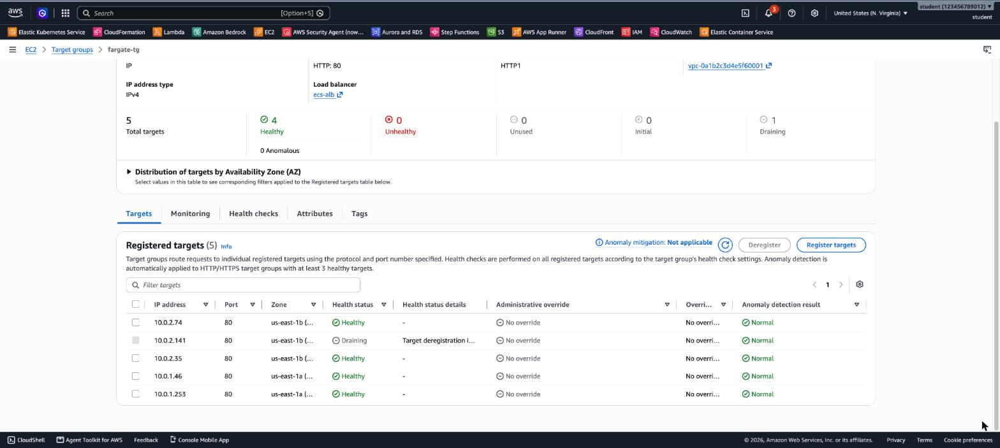
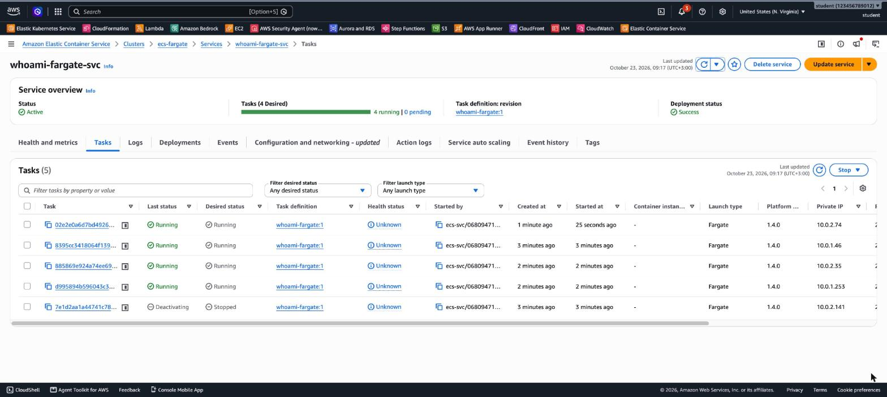

# 3.06 Containers – Lab 3 Solution

[⬅ Lab 3](jb-lab-3.md) | [⬅ Back to 3.06 Containers](README.md) | [Lab 4 ➡](jb-lab-4.md)

> Tested in `us-east-1` with the ALB `ecs-alb` from Lab 2. The service was healthy behind the ALB **81 seconds** after it was created.

**Jump to:** [Solution 1: Console](#solution-1-console-ui) · [Solution 2: AWS CLI](#solution-2-aws-cli) · [Answers](#answers) · [Solution 3: Terraform](#solution-3-terraform)

---

## Solution 1: Console (UI)

### Part A: A Fargate-only cluster

**ECS → Clusters → Create cluster**: name `ecs-fargate`, infrastructure **Fargate only** (the default), then **Create**. No instances, no Auto Scaling Group.

### Part B: A Fargate task definition

**Task definitions → Create new task definition**:

| Field | Value |
|-------|-------|
| Family | `whoami-fargate` |
| Launch type | **AWS Fargate** |
| OS / architecture | Linux/X86_64 |
| CPU / Memory | **0.25 vCPU / 0.5 GB** |
| Network mode | `awsvpc` (fixed for Fargate) |
| Task execution role | **`ecsTaskExecutionRole`**, or *Create new role* if it doesn't exist |
| Container | `whoami`, image `traefik/whoami`, container port **80** |
| Environment variable | `WHOAMI_NAME` = `fargate` |

There's **no host port** field: with `awsvpc`, each task has its own IP address, so the container port *is* the port.

### Part C: Networking for the tasks

1. **EC2 → Security groups → Create**: `fargate-tasks-sg`, inbound **HTTP 80** with source **`ecs-alb-sg`**.
2. **EC2 → Target groups → Create**: target type **IP addresses**, name `fargate-tg`, HTTP:80, the default VPC, health check `/`. On *Register targets*, remove the suggested IP and choose **Create**.
3. **ALB `ecs-alb` → Listeners → HTTP:80 → Add rule**: priority **30**, path **`/fargate*`** → `fargate-tg`.

### Part D: Service

`ecs-fargate` → **Services → Create**:
- Launch type **FARGATE**, family `whoami-fargate`, name `whoami-fargate-svc`, desired tasks **2**.
- **Networking**: the default VPC and its subnets, security group **`fargate-tasks-sg`** only (remove the default one), **Public IP: Turned on**.
- **Load balancing**: Application Load Balancer → existing `ecs-alb` → existing listener `80:HTTP` → existing target group `fargate-tg`.

### Part E: Test and explore

**7.** Call `/fargate` a few times:

```
Name: fargate Hostname: 8395cc3418064f139355c8897d818b13-3131618372 IP: 10.0.1.46
Name: fargate Hostname: 8395cc3418064f139355c8897d818b13-3131618372 IP: 10.0.1.46
Name: fargate Hostname: 7e1d2aa1a44741c7855157a984770a4c-3131618372 IP: 10.0.2.141
Name: fargate Hostname: 7e1d2aa1a44741c7855157a984770a4c-3131618372 IP: 10.0.2.141
```

Compare this with Lab 2. There, `IP:` was `172.17.0.x` (the Docker bridge on the instance). Here, **the task's IP is a real VPC address**, because each task has its own network interface.

**8.** The targets are **IP addresses**, one per task, in two AZs:



```
10.0.2.141   80   us-east-1b   healthy
10.0.1.46    80   us-east-1a   healthy
```

**9.** **Infrastructure → Container instances: 0.** The tasks run, but there are no servers for you to see or manage. In the task list, the **Container instance** column is empty (`-`).

**10.** **EC2 → Network interfaces**: one ENI per task, with the task's private IP. Its *Requester ID* / description shows that ECS created it (an `attachment/...` ARN):

```
eni-0b7e459a...   10.0.1.46    interface   arn:aws:ecs:us-east-1:...:attachment/b4f465da-...
eni-0aefabae...   10.0.2.141   interface   arn:aws:ecs:us-east-1:...:attachment/ef7178f4-...
```

### Part F: Scale without servers

**11.** **Update service → Desired tasks: 4**. All 4 tasks were *Running* and **healthy in the target group about 50 seconds** later:

```
10.0.1.46    us-east-1a   healthy
10.0.2.141   us-east-1b   healthy
10.0.2.35    us-east-1b   healthy
10.0.1.253   us-east-1a   healthy
```

There was no capacity to add: no instances, no ASG, and no "unable to place a task" error like in Lab 1.

**12.** **Tasks → select one → Stop**. The task goes to `Deactivating` (desired status *Stopped*), its target drains, and the service starts a replacement. The 4 running tasks below include the replacement, started 25 seconds ago:



The **Events** tab shows:

```
(service whoami-fargate-svc) has begun draining connections on 1 tasks.
(service whoami-fargate-svc) registered 1 targets in (target-group .../fargate-tg/...)
(service whoami-fargate-svc) has reached a steady state.
```

Then update the service back to **2** tasks.

### Part G: Clean up or continue

Continuing to Lab 4: keep everything. Stopping here: delete the service, the cluster, the `/fargate*` rule, `fargate-tg`, the ALB and both security groups.

---

## Solution 2: AWS CLI

Continue from Lab 2 (`$VPC_ID`, `$ALB_SG`, `$LISTENER_ARN`, `$ALB_DNS`).

```bash
export AWS_PAGER="" AWS_REGION=us-east-1

# Part A
aws ecs create-cluster --cluster-name ecs-fargate

# Part B: the task execution role (skip if ecsTaskExecutionRole already exists)
cat > ecs-tasks-trust.json <<'JSON'
{ "Version": "2012-10-17", "Statement": [{ "Effect": "Allow", "Principal": { "Service": "ecs-tasks.amazonaws.com" }, "Action": "sts:AssumeRole" }] }
JSON
aws iam create-role --role-name ecsTaskExecutionRole --assume-role-policy-document file://ecs-tasks-trust.json
aws iam attach-role-policy --role-name ecsTaskExecutionRole \
  --policy-arn arn:aws:iam::aws:policy/service-role/AmazonECSTaskExecutionRolePolicy
EXEC_ROLE_ARN=$(aws iam get-role --role-name ecsTaskExecutionRole --query Role.Arn --output text)

cat > td-fargate.json <<JSON
{
  "family": "whoami-fargate",
  "networkMode": "awsvpc",
  "requiresCompatibilities": ["FARGATE"],
  "runtimePlatform": { "operatingSystemFamily": "LINUX", "cpuArchitecture": "X86_64" },
  "cpu": "256",
  "memory": "512",
  "executionRoleArn": "$EXEC_ROLE_ARN",
  "containerDefinitions": [{
    "name": "whoami",
    "image": "traefik/whoami",
    "essential": true,
    "portMappings": [{ "containerPort": 80, "protocol": "tcp" }],
    "environment": [{ "name": "WHOAMI_NAME", "value": "fargate" }]
  }]
}
JSON
aws ecs register-task-definition --cli-input-json file://td-fargate.json

# Part C: tasks SG (only from the ALB), IP target group, /fargate* rule
TASK_SG=$(aws ec2 create-security-group --group-name fargate-tasks-sg \
  --description "Fargate tasks - HTTP only from the ALB" --vpc-id $VPC_ID --query GroupId --output text)
aws ec2 authorize-security-group-ingress --group-id $TASK_SG --protocol tcp --port 80 --source-group $ALB_SG
FARGATE_TG=$(aws elbv2 create-target-group --name fargate-tg --protocol HTTP --port 80 --vpc-id $VPC_ID \
  --target-type ip --health-check-path / --health-check-interval-seconds 10 --healthy-threshold-count 2 \
  --query 'TargetGroups[0].TargetGroupArn' --output text)
aws elbv2 create-rule --listener-arn $LISTENER_ARN --priority 30 \
  --conditions Field=path-pattern,Values='/fargate*' --actions Type=forward,TargetGroupArn=$FARGATE_TG

# Part D: two subnets (AZs) are enough for 2-4 tasks
SUBNETS_CSV=$(aws ec2 describe-subnets --filters Name=default-for-az,Values=true \
  Name=availability-zone,Values=us-east-1a,us-east-1b --query 'Subnets[].SubnetId' --output text | tr '\t' ',')
aws ecs create-service --cluster ecs-fargate --service-name whoami-fargate-svc \
  --task-definition whoami-fargate --desired-count 2 --launch-type FARGATE \
  --network-configuration "awsvpcConfiguration={subnets=[$SUBNETS_CSV],securityGroups=[$TASK_SG],assignPublicIp=ENABLED}" \
  --load-balancers targetGroupArn=$FARGATE_TG,containerName=whoami,containerPort=80
aws ecs wait services-stable --cluster ecs-fargate --services whoami-fargate-svc

# Part E
for i in 1 2 3 4; do curl -s http://$ALB_DNS/fargate | grep -E "^(Name|Hostname|IP: 172)" | tr '\n' ' '; echo; done
aws elbv2 describe-target-health --target-group-arn $FARGATE_TG \
  --query 'TargetHealthDescriptions[].[Target.Id,Target.Port,Target.AvailabilityZone,TargetHealth.State]' --output text
aws ecs list-container-instances --cluster ecs-fargate --query 'length(containerInstanceArns)'   # 0
aws ec2 describe-network-interfaces --filters Name=group-id,Values=$TASK_SG \
  --query 'NetworkInterfaces[].[NetworkInterfaceId,PrivateIpAddress,InterfaceType,Description]' --output text

# Part F
aws ecs update-service --cluster ecs-fargate --service whoami-fargate-svc --desired-count 4
aws ecs wait services-stable --cluster ecs-fargate --services whoami-fargate-svc
TASK=$(aws ecs list-tasks --cluster ecs-fargate --service-name whoami-fargate-svc --query 'taskArns[0]' --output text)
aws ecs stop-task --cluster ecs-fargate --task $TASK --reason "Lab 3 self-healing test"
aws ecs describe-services --cluster ecs-fargate --services whoami-fargate-svc --query 'services[0].events[:3].message'
aws ecs update-service --cluster ecs-fargate --service whoami-fargate-svc --desired-count 2
```

**Clean up** (only if you stop here):

```bash
aws ecs delete-service --cluster ecs-fargate --service whoami-fargate-svc --force
aws ecs wait services-inactive --cluster ecs-fargate --services whoami-fargate-svc
aws ecs delete-cluster --cluster ecs-fargate
aws elbv2 delete-load-balancer --load-balancer-arn $ALB_ARN      # also deletes its listener and rules
aws elbv2 wait load-balancers-deleted --load-balancer-arns $ALB_ARN
sleep 15   # the rules release the target group a few seconds later (otherwise: ResourceInUse)
aws elbv2 delete-target-group --target-group-arn $FARGATE_TG
sleep 60   # wait for the task ENIs to be released
aws ec2 delete-security-group --group-id $TASK_SG
aws ec2 delete-security-group --group-id $ALB_SG
```

---

## Answers

- **A security group per task:** with `awsvpc`, each task gets its **own ENI**, and a security group is attached to an ENI. In Lab 1 (bridge mode), all the containers shared the instance's ENI, and therefore its security group.
- **Target type IP:** a Fargate task isn't on an instance that you own, so there's no instance ID to register. ECS registers the **task's IP address**.
- **What you didn't have to do in Part F:** add instances, increase the ASG, or check whether there was enough CPU, memory or free host ports. You only changed the task count, and AWS found the capacity.
- **The public IP:** the tasks run in the default VPC's **public** subnets, which have no NAT gateway. Without a public IP, a task can't reach Docker Hub to pull `traefik/whoami`, so it fails to start. In a **private subnet**, use a **NAT gateway**, or **VPC endpoints** for ECR and S3 if the image is in ECR.

---

[⬅ Lab 3](jb-lab-3.md) | [⬅ Back to 3.06 Containers](README.md) | [Lab 4 ➡](jb-lab-4.md)

---

## Solution 3: Terraform

[`terraform/jb-lab-3/main.tf`](terraform/jb-lab-3/main.tf) is **standalone**. It creates the ALB with its default 404, both security groups, the Fargate-only cluster, its own task execution role `ecs-task-execution-role`, the IP target group with the `/fargate*` rule, and the service with 2 tasks.

```bash
cd terraform/jb-lab-3
terraform init
terraform apply      # about 3 minutes; prints the /fargate URL
for i in 1 2 3; do curl -s $(terraform output -raw url) | grep -E '^(Name|Hostname)' | paste -sd' ' -; done
terraform destroy    # about 9 minutes: the target group's 300-second deregistration delay
```

The tested run: `apply` took 157 s, and the targets were healthy about 80 s later. The two Fargate tasks answer from their own private IPs:

```
Name: fargate Hostname: ip-172-31-84-154.ec2.internal
Name: fargate Hostname: ip-172-31-24-230.ec2.internal
Name: fargate Hostname: ip-172-31-84-154.ec2.internal
```

---

## Contact

For questions or feedback, feel free to reach out:

- **Email**: eyal@levys.co.il
- **GitHub**: [https://github.com/elevy99927](https://github.com/elevy99927)
