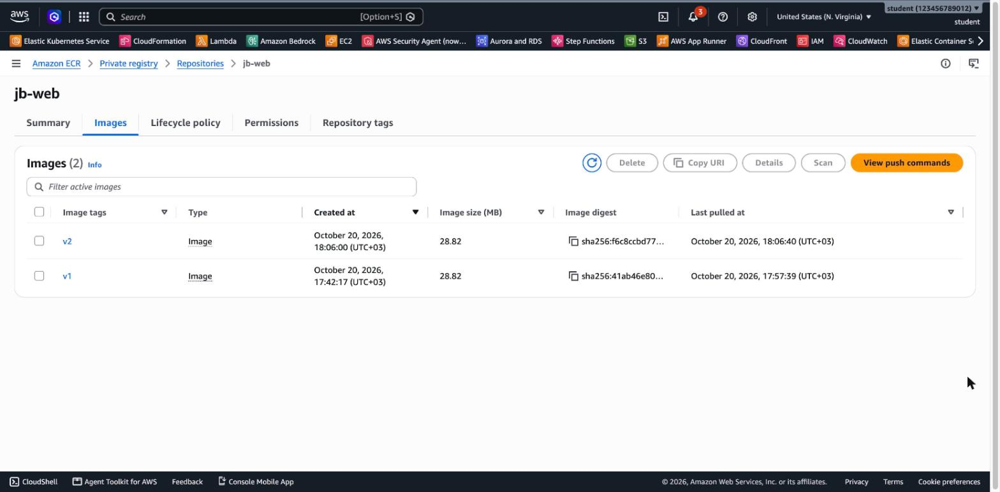
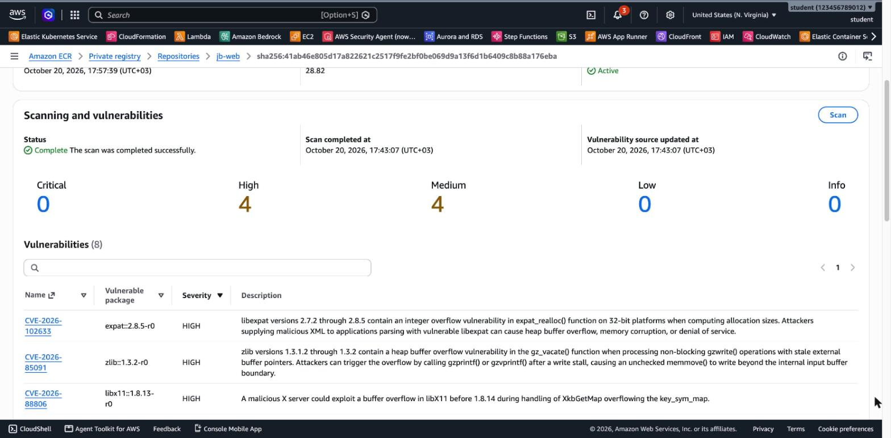
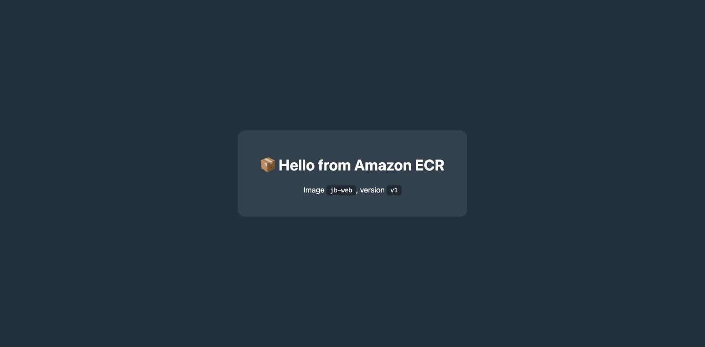
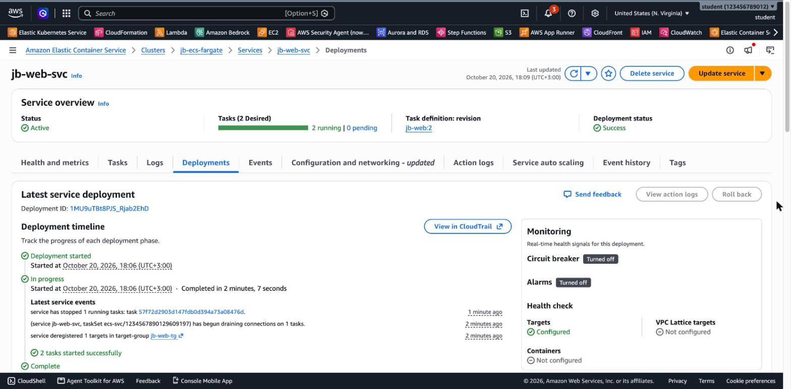

# 3.06 Containers – jb-lab-4 Solution

[⬅ jb-lab-4](jb-lab-4.md) | [⬅ Back to 3.06 Containers](README.md) | [jb-lab-5 ➡](jb-lab-5.md)

> Tested in `us-east-1` with Docker Desktop on an Apple Silicon Mac, on the `jb-ecs-fargate` cluster and the ALB from jb-lab-3. The image is 28.8 MB, and the v1 → v2 rollout took **188 seconds**.

**Jump to:** [Solution 1: Console](#solution-1-console-ui) · [Solution 2: AWS CLI](#solution-2-aws-cli) · [Answers](#answers) · [Solution 3: Terraform](#solution-3-terraform)

---

## Solution 1: Console (UI)

> Docker runs on your computer (or in CloudShell), so Parts B, C and E use the terminal even in the Console solution.

### Part A: Repository

**ECR → Private registry → Repositories → Create repository**: name `jb-web`, tag mutability **Mutable**, and under *Image scanning settings* turn on **Scan on push**. Then **Create**.

### Part B: Build and test locally

```bash
cd artifacts/jb-lab-4
docker build --platform linux/amd64 --provenance=false --build-arg VERSION=v1 -t jb-web:v1 .
docker run -d --rm --name jbweb-test -p 8081:80 jb-web:v1
curl -s localhost:8081/web/ | grep -o "version <code>[^<]*"     # version <code>v1
docker stop jbweb-test
```

> **`--provenance=false`:** newer Docker versions also push a build *attestation* by default. In ECR this shows up as **3 entries** for one image (an index, the image and the attestation, two of them without a tag). This flag pushes a single, simple image.

### Part C: Push to ECR

Open the repository and choose **View push commands**. The Console shows the four commands for your account (login, build, tag, push):

```bash
ACCOUNT_ID=$(aws sts get-caller-identity --query Account --output text)
REGISTRY=$ACCOUNT_ID.dkr.ecr.us-east-1.amazonaws.com
aws ecr get-login-password --region us-east-1 | docker login --username AWS --password-stdin $REGISTRY
docker tag jb-web:v1 $REGISTRY/jb-web:v1
docker push $REGISTRY/jb-web:v1
```

```
Login Succeeded
...
v1: digest: sha256:41ab46e805d17a822621c2517f9fe2bf0be069d9a13f6d1b6409c8b88a176eba size: 2261
```

**6.** In the repository, the image shows its **tag** (`v1`), **digest** (`sha256:41ab46e8…`) and **size** (28.82 MB). This screenshot was taken later, after v2 was also pushed in Part E:



Open the image → **Scanning and vulnerabilities**. *Scan on push* ran the **basic scan** about a minute after the push. It found **4 High and 4 Medium** CVEs, all in the **base image's OS packages** (expat, zlib, libx11), not in our page:



> The fix for base-image CVEs is to **rebuild on a newer base image** and push again. A manual **Scan** is limited to **once per image per day** (`LimitExceededException: The scan quota per image has been exceeded`).

### Part D: Run it on Fargate

1. **ECS → Task definitions → Create**: family `jb-web`, **AWS Fargate**, Linux/X86_64, **0.25 vCPU / 0.5 GB**, task execution role `ecsTaskExecutionRole`, container `web`, image URI **`<account-id>.dkr.ecr.us-east-1.amazonaws.com/jb-web:v1`** (use **Browse ECR images** to pick it), container port **80**.
2. **EC2 → Target groups → Create**: **IP addresses**, `jb-web-tg`, HTTP:80, health check `/`. In the ALB's HTTP:80 listener, add a rule with priority **40**: path **`/web*`** → `jb-web-tg`.
3. In `jb-ecs-fargate` → **Services → Create**: Fargate, family `jb-web`, name `jb-web-svc`, **2 tasks**, security group `jb-fargate-tasks-sg`, **public IP on**, load balancing to `jb-ecs-alb` → `80:HTTP` → `jb-web-tg`.
4. Open `http://<alb-dns>/web/`:



### Part E: Roll out version 2

```bash
docker build --platform linux/amd64 --provenance=false --build-arg VERSION=v2 -t $REGISTRY/jb-web:v2 .
docker push $REGISTRY/jb-web:v2
```

**Task definitions → `jb-web` → Create new revision**: change the image to `…/jb-web:v2` → **Create** (revision 2). Then **`jb-web-svc` → Update service** → revision **2** → **Update**.

**13.** While the deployment runs, refreshing `/web/` shows **v1 and v2 mixed**. The test polled every few seconds:

```
0s    v1      ← only v1 tasks
61s   v2      ← the first v2 task passed the health check
70s   v1
79s   v2
...   (v1 and v2 alternate)
135s  v2      ← from here on, only v2
deployment finished after 188s   (21 responses v1, 20 responses v2)
```

ECS's **rolling update** first starts new tasks (up to 200% of the desired count), waits for them to be **healthy** in the target group, then **drains** and stops the old ones. That's why the deployment continued after 135 seconds: the old tasks were still draining. The **Deployments** tab shows the timeline:



### Part F: Lifecycle policy

**`jb-web` → Lifecycle policy → Create rule**: priority **1**, description *Keep only the 2 most recent images*, image status **Any**, match criteria **Image count more than 2**, action **expire**. Push a v3, and within about a day ECR removes the oldest image.

### Part G: Clean up or continue

Continuing to jb-lab-5: keep everything. Stopping here: delete `jb-web-svc`, deregister the `jb-web` revisions, delete the `/web*` rule, `jb-web-tg` and the repository (**Delete** removes its images too), then the jb-lab-3 resources.

---

## Solution 2: AWS CLI

Continue from jb-lab-3 (`$VPC_ID`, `$LISTENER_ARN`, `$ALB_DNS`, `$TASK_SG`, `$SUBNETS_CSV`, `$EXEC_ROLE_ARN`).

```bash
export AWS_PAGER="" AWS_REGION=us-east-1
ACCOUNT_ID=$(aws sts get-caller-identity --query Account --output text)
REGISTRY=$ACCOUNT_ID.dkr.ecr.us-east-1.amazonaws.com

# Part A
aws ecr create-repository --repository-name jb-web --image-scanning-configuration scanOnPush=true

# Parts B + C: build for x86_64 and push
cd artifacts/jb-lab-4
aws ecr get-login-password | docker login --username AWS --password-stdin $REGISTRY
docker build --platform linux/amd64 --provenance=false --build-arg VERSION=v1 -t $REGISTRY/jb-web:v1 .
docker push $REGISTRY/jb-web:v1
cd -

aws ecr describe-images --repository-name jb-web \
  --query 'imageDetails[].[imageTags[0],imageDigest,imageSizeInBytes]' --output text
aws ecr describe-image-scan-findings --repository-name jb-web --image-id imageTag=v1 \
  --query '{status:imageScanStatus.status,counts:imageScanFindings.findingSeverityCounts}'
```

```
v1   sha256:41ab46e805d1...   28815901
{
    "status": "COMPLETE",
    "counts": { "HIGH": 4, "MEDIUM": 4 }
}
```

> Use `describe-image-scan-findings` for the scan result. In this account, `describe-images` showed the scan status as `None`, even though the scan was complete.

```bash
# Part D: task definition, IP target group, /web* rule, service
cat > td-web.json <<JSON
{
  "family": "jb-web",
  "networkMode": "awsvpc",
  "requiresCompatibilities": ["FARGATE"],
  "runtimePlatform": { "operatingSystemFamily": "LINUX", "cpuArchitecture": "X86_64" },
  "cpu": "256",
  "memory": "512",
  "executionRoleArn": "$EXEC_ROLE_ARN",
  "containerDefinitions": [{
    "name": "web",
    "image": "$REGISTRY/jb-web:v1",
    "essential": true,
    "portMappings": [{ "containerPort": 80, "protocol": "tcp" }]
  }]
}
JSON
aws ecs register-task-definition --cli-input-json file://td-web.json
WEB_TG=$(aws elbv2 create-target-group --name jb-web-tg --protocol HTTP --port 80 --vpc-id $VPC_ID \
  --target-type ip --health-check-path / --health-check-interval-seconds 10 --healthy-threshold-count 2 \
  --query 'TargetGroups[0].TargetGroupArn' --output text)
aws elbv2 create-rule --listener-arn $LISTENER_ARN --priority 40 \
  --conditions Field=path-pattern,Values='/web*' --actions Type=forward,TargetGroupArn=$WEB_TG
aws ecs create-service --cluster jb-ecs-fargate --service-name jb-web-svc --task-definition jb-web \
  --desired-count 2 --launch-type FARGATE \
  --network-configuration "awsvpcConfiguration={subnets=[$SUBNETS_CSV],securityGroups=[$TASK_SG],assignPublicIp=ENABLED}" \
  --load-balancers targetGroupArn=$WEB_TG,containerName=web,containerPort=80
aws ecs wait services-stable --cluster jb-ecs-fargate --services jb-web-svc
curl -s http://$ALB_DNS/web/ | grep -o "version <code>[^<]*"      # version <code>v1

# Part E: v2 as a new task definition revision, then a rolling update
cd artifacts/jb-lab-4
docker build --platform linux/amd64 --provenance=false --build-arg VERSION=v2 -t $REGISTRY/jb-web:v2 .
docker push $REGISTRY/jb-web:v2
cd -
sed 's#jb-web:v1#jb-web:v2#' td-web.json > td-web-v2.json
aws ecs register-task-definition --cli-input-json file://td-web-v2.json     # revision 2
aws ecs update-service --cluster jb-ecs-fargate --service jb-web-svc --task-definition jb-web:2
while true; do
  echo "$(date +%T) $(curl -s http://$ALB_DNS/web/ | grep -o 'version <code>v[0-9]' | grep -o 'v[0-9]')"
  [ "$(aws ecs describe-services --cluster jb-ecs-fargate --services jb-web-svc \
        --query 'length(services[0].deployments)')" = "1" ] && break
  sleep 3
done

# Part F: keep only the 2 most recent images
cat > lifecycle.json <<'JSON'
{
  "rules": [{
    "rulePriority": 1,
    "description": "Keep only the 2 most recent images",
    "selection": { "tagStatus": "any", "countType": "imageCountMoreThan", "countNumber": 2 },
    "action": { "type": "expire" }
  }]
}
JSON
aws ecr put-lifecycle-policy --repository-name jb-web --lifecycle-policy-text file://lifecycle.json
```

**Clean up** (only if you stop here):

```bash
aws ecs delete-service --cluster jb-ecs-fargate --service jb-web-svc --force
aws ecs wait services-inactive --cluster jb-ecs-fargate --services jb-web-svc
for R in jb-web:1 jb-web:2; do aws ecs deregister-task-definition --task-definition $R >/dev/null; done
aws ecs delete-task-definitions --task-definitions jb-web:1 jb-web:2
RULE=$(aws elbv2 describe-rules --listener-arn $LISTENER_ARN --query "Rules[?Priority=='40'].RuleArn" --output text)
aws elbv2 delete-rule --rule-arn $RULE
aws elbv2 delete-target-group --target-group-arn $WEB_TG
aws ecr delete-repository --repository-name jb-web --force     # --force deletes the images too
# then the jb-lab-3 resources (see jb-lab-3 Solution)
```

---

## Answers

- **The role that pulled the private image:** the **task execution role** (`ecsTaskExecutionRole`) with the AWS managed policy **`AmazonECSTaskExecutionRolePolicy`**. It allows `ecr:GetAuthorizationToken`, `ecr:BatchGetImage` and `ecr:GetDownloadUrlForLayer` (and writing to CloudWatch Logs). The ECS agent uses this role, not your application.
- **Tag vs. digest:** a **tag** (`v1`) is a name that can be **moved** to another image (the repository is *mutable*). A **digest** (`sha256:41ab46e8…`) is the **hash of the content**, so it always points to exactly the same image. Deploying by digest (`jb-web@sha256:…`) guarantees that every task runs the same bits, even if someone pushes a new `v1`. Alternatively, set the repository's tags to **immutable**.
- **Building on an ARM Mac without `--platform linux/amd64`:** the image is built for **arm64**, but the task definition runs on **X86_64**. The task stops right away with `exec format error` (*CannotStartContainerError*). The other option is to set the task definition's `cpuArchitecture` to **ARM64**, since Fargate supports Graviton too.
- **v1 and v2 during the rollout:** a **rolling update** runs both versions side by side. New tasks join the target group as soon as they're healthy, and the old tasks keep serving until they're drained. The ALB load-balances across all healthy targets, so each request can land on either version.

---

[⬅ jb-lab-4](jb-lab-4.md) | [⬅ Back to 3.06 Containers](README.md) | [jb-lab-5 ➡](jb-lab-5.md)

---

## Solution 3: Terraform

[`terraform/jb-lab-4/main.tf`](terraform/jb-lab-4/main.tf) is **standalone**. It creates the base from jb-lab-3 (ALB, security groups, Fargate cluster, execution role) plus the ECR repository with *scan on push* and the *keep 2* lifecycle policy, the `jb-web` task definition, `jb-web-tg` with the `/web*` rule, and `jb-web-svc`.

The service needs an image in the repository, so it takes **two applies**:

```bash
cd terraform/jb-lab-4
terraform init
terraform apply -target=aws_ecr_repository.web      # 1. only the repository

# 2. push v1 (Parts B + C above), then create everything else
terraform apply                                     # about 3 minutes
curl -s $(terraform output -raw url) | grep -o 'version <code>[^<]*'

# Roll out v2: push the v2 image, then
terraform apply -var image_tag=v2
for i in $(seq 1 10); do curl -s $(terraform output -raw url) | grep -o 'v[12]</code>'; done | sort | uniq -c

terraform destroy      # about 9 minutes; force_delete = true also deletes the images
```

The tested run: `/web/` answered `version <code>v1`. `terraform apply -var image_tag=v2` took 11 s (`1 added, 1 changed, 1 destroyed`: a new task definition revision, the service update, and the old revision deregistered). Then, 10 requests every ~18 s:

| Time after the apply | v1 | v2 |
|---|---|---|
| 15–52 s | 10 | 0 |
| 70–89 s | 6 | 4 |
| 107 s | 5 | 5 |
| 126 s | 4 | 6 |
| 144 s | 0 | **10** |

As in the Console run, the **rolling update** serves both versions for about a minute and never drops a request.

---

## Contact

For questions or feedback, feel free to reach out:

- **Email**: eyal@levys.co.il
- **GitHub**: [https://github.com/elevy99927](https://github.com/elevy99927)
