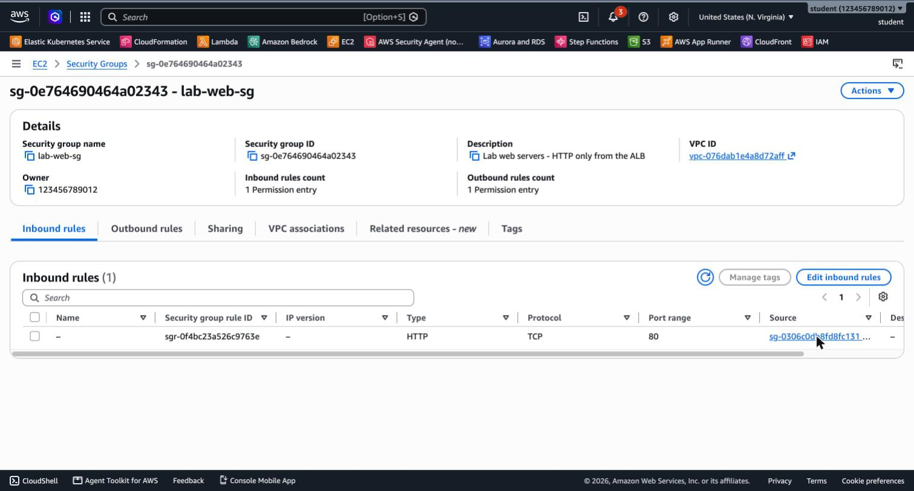
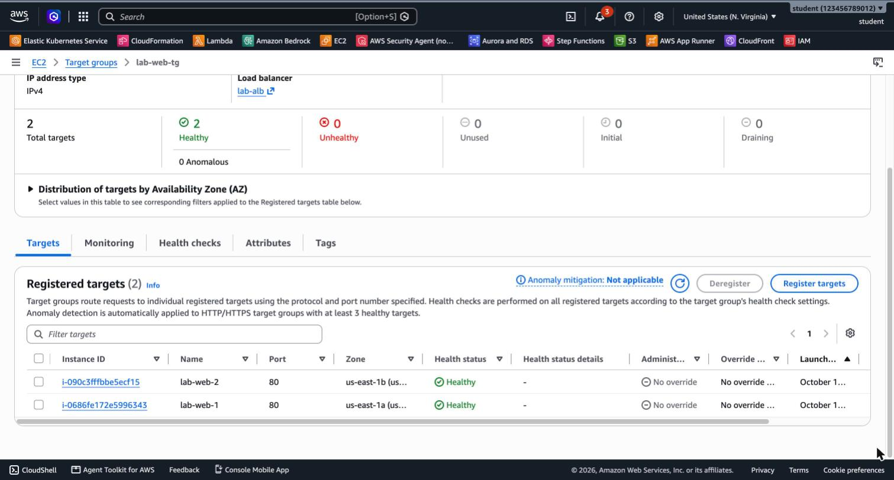
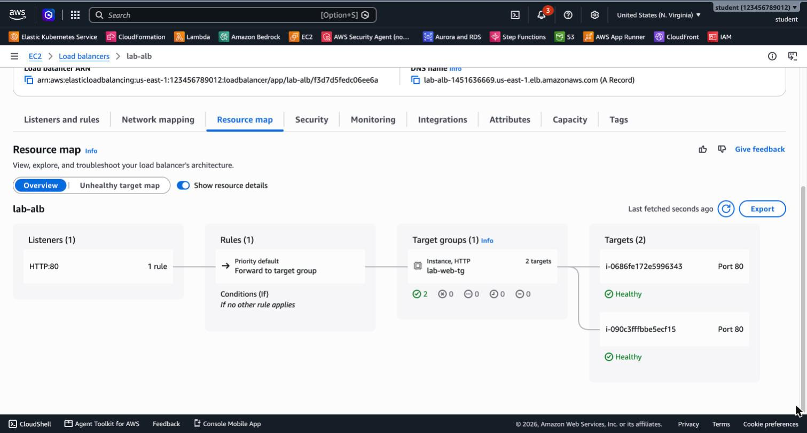
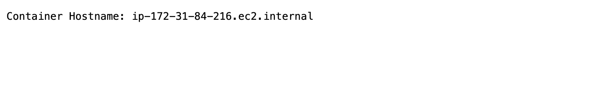

# 3.08 Load Balancing & Auto Scaling – Lab 1 Solution

[⬅ Back to 3.08 Load Balancing & Auto Scaling](README.md) | [Lab 2 Solution ➡](SOLUTION-LAB2.md)

> Tested with AWS CLI v2 in `us-east-1`. Run the commands **from the module folder** (`3.08-load-balancing-auto-scaling/`), in one terminal session, because later steps use the shell variables.

---

## LAB 1 (Advanced): ALB in Front of Two Instances

> ⚠️ **Advanced lab:** this lab may not work in every AWS account because of SCPs (Service Control Policies) or other restrictions, for example in a classroom account. We recommend doing it in your own private AWS account.

> 💰 Up to 2 hours ≈ **$0.15**. If left running, it costs ≈ **$48/month**.

**Jump to:**
- [Setup: variables](#setup-variables)
- [Part A: Security groups](#part-a-security-groups)
- [Part B: Two web servers](#part-b-two-web-servers)
- [Part C: Target group](#part-c-target-group)
- [Part D: Load balancer](#part-d-load-balancer)
- [Part E: Test](#part-e-test)
- [Part F: Failure](#part-f-failure)
- [Part G: Clean up or continue](#part-g-clean-up-or-continue)
- [Answers](#answers)

### Setup: variables

```bash
export AWS_PAGER="" AWS_REGION=us-east-1

VPC_ID=$(aws ec2 describe-vpcs --filters Name=is-default,Values=true \
  --query 'Vpcs[0].VpcId' --output text)
SUBNET_A=$(aws ec2 describe-subnets --filters Name=default-for-az,Values=true \
  Name=availability-zone,Values=us-east-1a --query 'Subnets[0].SubnetId' --output text)
SUBNET_B=$(aws ec2 describe-subnets --filters Name=default-for-az,Values=true \
  Name=availability-zone,Values=us-east-1b --query 'Subnets[0].SubnetId' --output text)

# Latest Amazon Linux 2023 AMI, from the public SSM parameter
AMI_ID=$(aws ssm get-parameter \
  --name /aws/service/ami-amazon-linux-latest/al2023-ami-kernel-default-x86_64 \
  --query Parameter.Value --output text)
```

### Part A: Security groups

```bash
ALB_SG=$(aws ec2 create-security-group --group-name lab-alb-sg \
  --description "Lab ALB - HTTP from anywhere" --vpc-id $VPC_ID \
  --query GroupId --output text)
aws ec2 authorize-security-group-ingress --group-id $ALB_SG \
  --protocol tcp --port 80 --cidr 0.0.0.0/0

WEB_SG=$(aws ec2 create-security-group --group-name lab-web-sg \
  --description "Lab web servers - HTTP only from the ALB" --vpc-id $VPC_ID \
  --query GroupId --output text)
aws ec2 authorize-security-group-ingress --group-id $WEB_SG \
  --protocol tcp --port 80 --source-group $ALB_SG       # <-- the SG chain
```

**Console:** EC2 → Security Groups → Create security group. For `lab-web-sg`, add an inbound rule of type **HTTP** and, in **Source**, choose **Custom** and start typing `lab-alb-sg`. The result:



### Part B: Two web servers

```bash
I1=$(aws ec2 run-instances --image-id $AMI_ID --instance-type t3.micro \
  --subnet-id $SUBNET_A --security-group-ids $WEB_SG \
  --user-data file://artifacts/user-data.sh \
  --tag-specifications 'ResourceType=instance,Tags=[{Key=Name,Value=lab-web-1}]' \
  --query 'Instances[0].InstanceId' --output text)

I2=$(aws ec2 run-instances --image-id $AMI_ID --instance-type t3.micro \
  --subnet-id $SUBNET_B --security-group-ids $WEB_SG \
  --user-data file://artifacts/user-data.sh \
  --tag-specifications 'ResourceType=instance,Tags=[{Key=Name,Value=lab-web-2}]' \
  --query 'Instances[0].InstanceId' --output text)

aws ec2 wait instance-running --instance-ids $I1 $I2
```

### Part C: Target group

```bash
TG_ARN=$(aws elbv2 create-target-group --name lab-web-tg \
  --protocol HTTP --port 80 --vpc-id $VPC_ID --target-type instance \
  --health-check-path / --health-check-interval-seconds 10 --healthy-threshold-count 2 \
  --query 'TargetGroups[0].TargetGroupArn' --output text)

aws elbv2 register-targets --target-group-arn $TG_ARN --targets Id=$I1 Id=$I2
```

**Console:** EC2 → Target Groups → Create target group. Choose **Instances**, name `lab-web-tg`, HTTP:80 and the default VPC. On the next page, select both instances, choose **Include as pending below**, then **Create target group**.

### Part D: Load balancer

```bash
ALB_ARN=$(aws elbv2 create-load-balancer --name lab-alb --type application \
  --scheme internet-facing --subnets $SUBNET_A $SUBNET_B --security-groups $ALB_SG \
  --query 'LoadBalancers[0].LoadBalancerArn' --output text)

aws elbv2 create-listener --load-balancer-arn $ALB_ARN --protocol HTTP --port 80 \
  --default-actions Type=forward,TargetGroupArn=$TG_ARN

aws elbv2 wait load-balancer-available --load-balancer-arns $ALB_ARN
ALB_DNS=$(aws elbv2 describe-load-balancers --load-balancer-arns $ALB_ARN \
  --query 'LoadBalancers[0].DNSName' --output text)
echo $ALB_DNS
```

**Console:** EC2 → Load Balancers → Create load balancer → **Application Load Balancer**. Choose internet-facing and IPv4, select **us-east-1a** and **us-east-1b**, remove the `default` SG and select `lab-alb-sg`, then set the listener **HTTP:80 → Forward to `lab-web-tg`**.

Wait 2–3 minutes for the ALB to become **Active** and the targets **healthy**:

```bash
aws elbv2 describe-target-health --target-group-arn $TG_ARN \
  --query 'TargetHealthDescriptions[].[Target.Id,TargetHealth.State]' --output text
```

```
i-0686fe172e5996343   healthy
i-090c3fffbbe5ecf15   healthy
```



The ALB's **Resource map** tab shows the whole path: listener → rule → target group → targets:



### Part E: Test

**7. Browser:** open `http://<ALB_DNS>`:



**8. curl loop:**

```bash
for i in $(seq 10); do curl -s http://$ALB_DNS/; done | sort | uniq -c
```

```
   5 Container Hostname: ip-172-31-18-131.ec2.internal
   5 Container Hostname: ip-172-31-84-216.ec2.internal
```

**9. Direct access to an instance:**

```bash
IP1=$(aws ec2 describe-instances --instance-ids $I1 \
  --query 'Reservations[0].Instances[0].PublicIpAddress' --output text)
curl -m 5 http://$IP1/
```

```
curl: (28) Connection timed out after 5002 milliseconds
```

### Part F: Failure

```bash
aws ec2 stop-instances --instance-ids $I2
aws ec2 wait instance-stopped --instance-ids $I2

aws elbv2 describe-target-health --target-group-arn $TG_ARN \
  --query 'TargetHealthDescriptions[].[Target.Id,TargetHealth.State,TargetHealth.Reason]' --output text
for i in $(seq 10); do curl -s http://$ALB_DNS/; done | sort | uniq -c
```

```
i-090c3fffbbe5ecf15   unused    Target.InvalidState
i-0686fe172e5996343   healthy   None

  10 Container Hostname: ip-172-31-84-216.ec2.internal
```

```bash
aws ec2 start-instances --instance-ids $I2
aws ec2 wait instance-running --instance-ids $I2
# ~1 minute later both targets are healthy again, and traffic is split 5/5
```

Docker's `--restart always` brings the container back automatically after the reboot.

### Part G: Clean up or continue

**Continuing to Lab 2?** Keep everything, including the variables in your terminal.

**Stopping here?**

```bash
aws elbv2 delete-load-balancer --load-balancer-arn $ALB_ARN
aws elbv2 wait load-balancers-deleted --load-balancer-arns $ALB_ARN
until aws elbv2 delete-target-group --target-group-arn $TG_ARN 2>/dev/null; do sleep 10; done
aws ec2 terminate-instances --instance-ids $I1 $I2
aws ec2 wait instance-terminated --instance-ids $I1 $I2
for sg in $WEB_SG $ALB_SG; do
  until aws ec2 delete-security-group --group-id $sg 2>/dev/null; do sleep 10; done
done
```

> Deleting the target group can fail for a few seconds with `ResourceInUse` right after the ALB is deleted. The `until` loop simply retries. Security groups can be deleted only after the instances and the ALB's network interfaces are gone.

### Answers

- **Browser vs. curl:** the browser keeps one **keep-alive** connection open and reuses it, and in practice it often lands on the same target again. Each `curl` call opens a **new** connection, so the ALB's round robin is clearly visible.
- **Direct access times out:** `lab-web-sg` allows port 80 **only from `lab-alb-sg`**. Your laptop isn't a member of that SG, so the packets are dropped silently. Security groups don't send "rejected", which is why you get a **timeout**.
- **After stopping:** the target became **`unused` (`Target.InvalidState`)**, and the ALB immediately sent **all** traffic to the healthy instance. No request failed. That's the high availability that a load balancer gives you.

---

[⬅ Back to 3.08 Load Balancing & Auto Scaling](README.md) | [Lab 2 Solution ➡](SOLUTION-LAB2.md)
