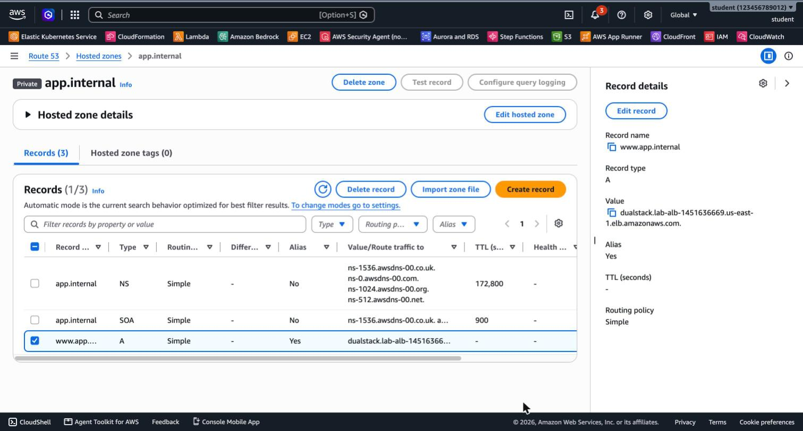
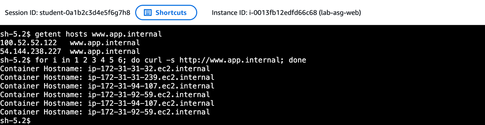

# 3.09 Amazon Route 53 – Lab 1 Solution

[⬅ 3.08 Lab 2 Solution](../3.08-load-balancing-auto-scaling/SOLUTION-LAB2.md) | [⬅ Back to 3.09 Amazon Route 53](README.md)

> Tested with AWS CLI v2 in `us-east-1`. Continue in the **same terminal session** as [3.08 Labs 1–2](../3.08-load-balancing-auto-scaling/README.md).

---

## LAB 1 (Advanced): Route 53 Private Hosted Zone

> 💰 Up to 2 hours ≈ **$0.15**. The hosted zone is free if you delete it within 12 hours. If left running, it costs ≈ **$48/month**.

**Jump to:**
- [Part A: Private hosted zone](#part-a-private-hosted-zone)
- [Part B: Alias record](#part-b-alias-record)
- [Part C: Test from outside the VPC](#part-c-test-from-outside-the-vpc)
- [Part D: Test from inside the VPC](#part-d-test-from-inside-the-vpc)
- [Part E: Theory – public domain and routing policies](#part-e-theory--public-domain-and-routing-policies)
- [Part F: Clean up](#part-f-clean-up)
- [Answers](#answers)

### Part A: Private hosted zone

```bash
ZONE_ID=$(aws route53 create-hosted-zone --name app.internal \
  --caller-reference lab-$(date +%s) \
  --vpc VPCRegion=us-east-1,VPCId=$VPC_ID \
  --hosted-zone-config Comment="Lab 3.09 private zone",PrivateZone=true \
  --query 'HostedZone.Id' --output text | sed 's#/hostedzone/##')
```

**Console:** Route 53 → Hosted zones → Create hosted zone. Enter the domain name `app.internal`, choose type **Private hosted zone**, and select Region **us-east-1** and the **default VPC**.

### Part B: Alias record

An Alias record needs the ALB's DNS name **and** the ALB's own *canonical hosted zone ID*, which is AWS's zone for load balancers in that Region:

```bash
ALB_ZONE=$(aws elbv2 describe-load-balancers --load-balancer-arns $ALB_ARN \
  --query 'LoadBalancers[0].CanonicalHostedZoneId' --output text)

cat > record.json <<JSON
{
  "Changes": [{
    "Action": "CREATE",
    "ResourceRecordSet": {
      "Name": "www.app.internal",
      "Type": "A",
      "AliasTarget": {
        "HostedZoneId": "$ALB_ZONE",
        "DNSName": "dualstack.$ALB_DNS",
        "EvaluateTargetHealth": true
      }
    }
  }]
}
JSON
CHANGE_ID=$(aws route53 change-resource-record-sets --hosted-zone-id $ZONE_ID \
  --change-batch file://record.json --query ChangeInfo.Id --output text)
aws route53 wait resource-record-sets-changed --id $CHANGE_ID
```

**Console:** open the zone and choose **Create record**. Set the record name to `www` and the type to **A**, turn on **Alias**, and set *Route traffic to* **Alias to Application and Classic Load Balancer** → **US East (N. Virginia)** → `dualstack.lab-alb-…`. Then choose **Create records**.



### Part C: Test from outside the VPC

```bash
nslookup www.app.internal
```

```
** server can't find www.app.internal: NXDOMAIN
```

### Part D: Test from inside the VPC

Open **EC2 → Instances**, select a `lab-asg-web` instance, choose **Connect → Session Manager → Connect**, and run:

```bash
getent hosts www.app.internal
for i in 1 2 3 4 5 6; do curl -s http://www.app.internal; done
```



> If the name doesn't resolve right after you create the record, wait about a minute. It takes a short time for the record to reach the VPC's DNS resolver.

<details>
<summary>CLI alternative: run the same test with SSM Run Command</summary>

```bash
IID=$(aws autoscaling describe-auto-scaling-groups --auto-scaling-group-names lab-web-asg \
  --query 'AutoScalingGroups[0].Instances[?LifecycleState==`InService`]|[0].InstanceId' --output text)

CMD_ID=$(aws ssm send-command --instance-ids $IID --document-name AWS-RunShellScript \
  --parameters 'commands=["getent hosts www.app.internal","for i in 1 2 3 4; do curl -s http://www.app.internal; done"]' \
  --query Command.CommandId --output text)

aws ssm get-command-invocation --command-id $CMD_ID --instance-id $IID \
  --query StandardOutputContent --output text
```

```
54.144.238.227  www.app.internal
100.52.52.122   www.app.internal
Container Hostname: ip-172-31-92-59.ec2.internal
Container Hostname: ip-172-31-92-59.ec2.internal
Container Hostname: ip-172-31-31-239.ec2.internal
Container Hostname: ip-172-31-31-32.ec2.internal
```

</details>

### Part E: Theory – public domain and routing policies

With a **public** hosted zone for a domain you own, for example `example.com`:

- Create an **Alias A record** `www.example.com` → `lab-alb`, exactly as in Part B. It works from anywhere on the internet.
- The apex `example.com` can also be an Alias to the ALB. A CNAME can't be used there.
- For HTTPS, request a free certificate from **AWS Certificate Manager (ACM)** for `www.example.com` and add an **HTTPS:443** listener to the ALB.

**Answer to Task 6, sending 10% of users to a new version:** use the **Weighted** routing policy. Create two records with the same name, `www.example.com`: one Alias to the current ALB with **weight 90**, and one Alias to the new ALB with **weight 10**.

### Part F: Clean up

> **Order matters.** Delete the **ASG before** anything else that it uses. If you terminate its instances first, the ASG simply launches new ones.

```bash
# 1. Route 53: delete the record, then the zone
sed 's/"CREATE"/"DELETE"/' record.json > record-delete.json
aws route53 change-resource-record-sets --hosted-zone-id $ZONE_ID --change-batch file://record-delete.json
aws route53 delete-hosted-zone --id $ZONE_ID

# 2. Auto Scaling Group (also terminates its instances)
aws autoscaling delete-auto-scaling-group --auto-scaling-group-name lab-web-asg --force-delete
until [ "$(aws autoscaling describe-auto-scaling-groups --auto-scaling-group-names lab-web-asg \
  --query 'length(AutoScalingGroups)' --output text)" = "0" ]; do sleep 10; done

# 3. ALB (its listeners are deleted with it), then the target group
aws elbv2 delete-load-balancer --load-balancer-arn $ALB_ARN
aws elbv2 wait load-balancers-deleted --load-balancer-arns $ALB_ARN
until aws elbv2 delete-target-group --target-group-arn $TG_ARN 2>/dev/null; do sleep 10; done

# 4. Launch Template
aws ec2 delete-launch-template --launch-template-name lab-web-lt

# 5. Security groups: web first, because it references the ALB SG. Retry until the ENIs are released.
for sg in $WEB_SG $ALB_SG; do
  until aws ec2 delete-security-group --group-id $sg 2>/dev/null; do sleep 10; done
done

# 6. IAM instance profile and role
aws iam remove-role-from-instance-profile --instance-profile-name lab-ec2-ssm-profile --role-name lab-ec2-ssm-role
aws iam delete-instance-profile --instance-profile-name lab-ec2-ssm-profile
aws iam detach-role-policy --role-name lab-ec2-ssm-role \
  --policy-arn arn:aws:iam::aws:policy/AmazonSSMManagedInstanceCore
aws iam delete-role --role-name lab-ec2-ssm-role
```

The whole cleanup takes about **6 minutes**, most of it waiting for the ASG instances to terminate. Verify that nothing is left:

```bash
aws ec2 describe-instances --filters Name=tag:Name,Values='lab-*' \
  Name=instance-state-name,Values=pending,running,stopping,stopped \
  --query 'length(Reservations)'                                          # 0
aws elbv2 describe-load-balancers --names lab-alb 2>&1 | grep -c NotFound   # 1
aws ec2 describe-security-groups --filters Name=group-name,Values='lab-*' \
  --query 'length(SecurityGroups)'                                        # 0
```

> The CloudWatch alarms created by the target tracking policy are deleted **automatically** together with the ASG.

### Answers

- **Resolves only inside the VPC:** a **private** hosted zone is associated with specific VPCs. Only the **VPC's DNS resolver** (`169.254.169.253`, or `.2` of the VPC CIDR) answers from it. Your laptop asks public DNS servers, which have never heard of `app.internal`, so the answer is `NXDOMAIN`.
- **Alias vs. CNAME:** an Alias record resolves **directly to the ALB's current IPs**, which change over time. It has **no query charge**, works at the **zone apex**, and can **evaluate target health**. A CNAME would add another DNS lookup, costs per query, and isn't allowed at the apex.
- **A shell without SSH:** **AWS Systems Manager Session Manager**. The SSM agent, which is pre-installed on Amazon Linux, connects **outbound** to the SSM service using the instance's IAM role (`AmazonSSMManagedInstanceCore`). There are no inbound ports, no SSH keys and no bastion host, and every session can be logged.

---

[⬅ 3.08 Lab 2 Solution](../3.08-load-balancing-auto-scaling/SOLUTION-LAB2.md) | [⬅ Back to 3.09 Amazon Route 53](README.md)
