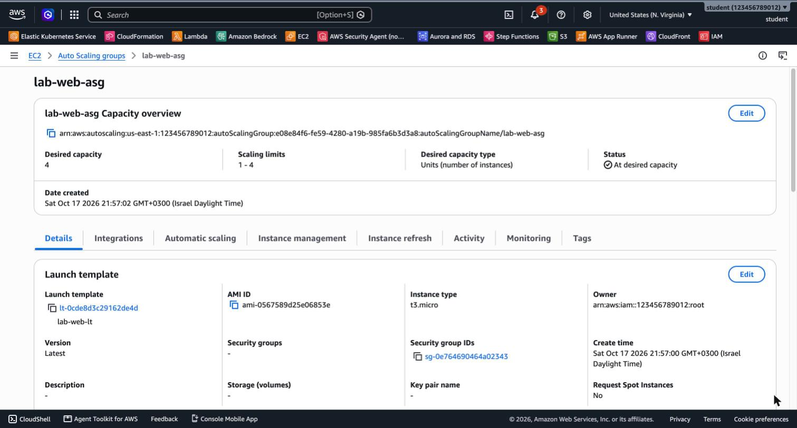
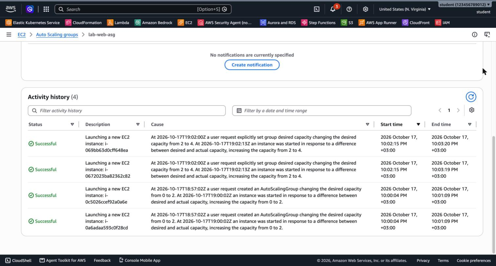
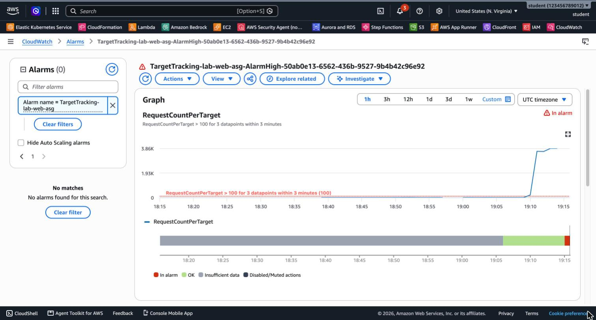
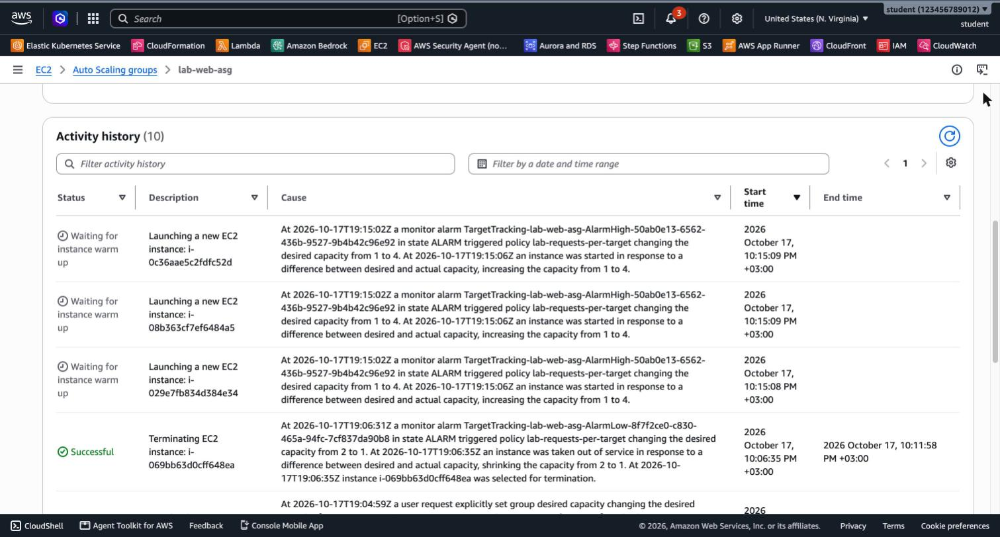

# 3.10 Advanced EC2 – Lab 2 Solution

[⬅ Lab 1 Solution](SOLUTION-LAB1.md) | [⬅ Back to 3.10 Advanced EC2](README.md) | [Lab 3 Solution ➡](SOLUTION-LAB3.md)

> Tested with AWS CLI v2 in `us-east-1`. Continue in the **same terminal session** as Lab 1 (`$VPC_ID`, `$SUBNET_A`, `$SUBNET_B`, `$AMI_ID`, `$WEB_SG`, `$TG_ARN`, `$ALB_ARN`, `$ALB_DNS`, `$I1`, `$I2`). In a new session, run the [Lab 1 setup](SOLUTION-LAB1.md#setup-variables) again and look up the existing IDs.

---

## LAB 2 (Advanced): Auto Scaling Behind the ALB

> 💰 Up to 2 hours ≈ **$0.15**. If left running, it costs ≈ **$48/month**.

**Jump to:**
- [Part A: IAM role for Session Manager](#part-a-iam-role-for-session-manager)
- [Part B: Launch Template](#part-b-launch-template)
- [Part C: Auto Scaling Group](#part-c-auto-scaling-group)
- [Part D: Manual scaling](#part-d-manual-scaling)
- [Part E: Automatic scaling under load](#part-e-automatic-scaling-under-load)
- [Part F: Clean up or continue](#part-f-clean-up-or-continue)
- [Answers](#answers)

### Part A: IAM role for Session Manager

```bash
cat > ec2-trust.json <<JSON
{
  "Version": "2012-10-17",
  "Statement": [{
    "Effect": "Allow",
    "Principal": { "Service": "ec2.amazonaws.com" },
    "Action": "sts:AssumeRole"
  }]
}
JSON
aws iam create-role --role-name lab-ec2-ssm-role --assume-role-policy-document file://ec2-trust.json
aws iam attach-role-policy --role-name lab-ec2-ssm-role \
  --policy-arn arn:aws:iam::aws:policy/AmazonSSMManagedInstanceCore
aws iam create-instance-profile --instance-profile-name lab-ec2-ssm-profile
aws iam add-role-to-instance-profile --instance-profile-name lab-ec2-ssm-profile \
  --role-name lab-ec2-ssm-role
```

> An EC2 instance can't use a role directly. It uses an **instance profile**, a container for one role. The Console creates the instance profile for you, with the same name as the role.

### Part B: Launch Template

```bash
UD=$(base64 < artifacts/user-data.sh | tr -d '\n')
cat > lt-data.json <<JSON
{
  "ImageId": "$AMI_ID",
  "InstanceType": "t3.micro",
  "SecurityGroupIds": ["$WEB_SG"],
  "IamInstanceProfile": { "Name": "lab-ec2-ssm-profile" },
  "UserData": "$UD",
  "TagSpecifications": [{ "ResourceType": "instance",
                          "Tags": [{ "Key": "Name", "Value": "lab-asg-web" }] }]
}
JSON
aws ec2 create-launch-template --launch-template-name lab-web-lt \
  --launch-template-data file://lt-data.json
```

**Console:** EC2 → Launch Templates → Create launch template. Choose Amazon Linux 2023, t3.micro and `lab-web-sg`. Under **Advanced details**, set the IAM instance profile to `lab-ec2-ssm-profile` and paste the user data.

### Part C: Auto Scaling Group

```bash
aws autoscaling create-auto-scaling-group --auto-scaling-group-name lab-web-asg \
  --launch-template LaunchTemplateName=lab-web-lt,Version='$Latest' \
  --min-size 1 --desired-capacity 2 --max-size 4 \
  --vpc-zone-identifier "$SUBNET_A,$SUBNET_B" \
  --target-group-arns $TG_ARN \
  --health-check-type ELB --health-check-grace-period 90 \
  --default-instance-warmup 60
```

> **First ASG in the account?** AWS first creates the service-linked role `AWSServiceRoleForAutoScaling`, and the first instances can take **2–3 extra minutes** to appear. That's normal.

Wait for 2 healthy targets, then remove the manual instances from Lab 1:

```bash
# 2 manual instances from Lab 1 + 2 new ASG instances = 4 healthy targets
until [ "$(aws elbv2 describe-target-health --target-group-arn $TG_ARN \
  --query 'length(TargetHealthDescriptions[?TargetHealth.State==`healthy`])' --output text)" -ge 4 ]; do sleep 10; done

aws elbv2 deregister-targets --target-group-arn $TG_ARN --targets Id=$I1 Id=$I2
aws ec2 terminate-instances --instance-ids $I1 $I2
```

The deregistered targets show **`draining`** for a while, and the site keeps working on the ASG instances:

```bash
for i in $(seq 10); do curl -s http://$ALB_DNS/; done | sort | uniq -c
```

```
   4 Container Hostname: ip-172-31-31-239.ec2.internal
   6 Container Hostname: ip-172-31-90-183.ec2.internal
```



### Part D: Manual scaling

```bash
aws autoscaling set-desired-capacity --auto-scaling-group-name lab-web-asg --desired-capacity 4

aws autoscaling describe-auto-scaling-groups --auto-scaling-group-names lab-web-asg \
  --query 'AutoScalingGroups[0].Instances[].[AvailabilityZone,LifecycleState,HealthStatus]' --output text
```

```
us-east-1b   InService   Healthy
us-east-1a   InService   Healthy
us-east-1a   InService   Healthy
us-east-1b   InService   Healthy
```

The ASG spreads the instances **evenly across the two AZs**. Traffic now goes to 4 servers:

```
   5 Container Hostname: ip-172-31-18-166.ec2.internal
   6 Container Hostname: ip-172-31-31-239.ec2.internal
   4 Container Hostname: ip-172-31-85-68.ec2.internal
   5 Container Hostname: ip-172-31-90-183.ec2.internal
```

The **Activity** tab records every change and its cause:



Back to 2:

```bash
aws autoscaling set-desired-capacity --auto-scaling-group-name lab-web-asg --desired-capacity 2
```

### Part E: Automatic scaling under load

**8. Target tracking policy.** The metric is identified by a *resource label*, in the form `app/<alb-name>/<id>/targetgroup/<tg-name>/<id>`:

```bash
RESOURCE_LABEL="${ALB_ARN#*loadbalancer/}/${TG_ARN##*:}"

cat > target-tracking.json <<JSON
{
  "TargetValue": 100,
  "PredefinedMetricSpecification": {
    "PredefinedMetricType": "ALBRequestCountPerTarget",
    "ResourceLabel": "$RESOURCE_LABEL"
  }
}
JSON
aws autoscaling put-scaling-policy --auto-scaling-group-name lab-web-asg \
  --policy-name lab-requests-per-target --policy-type TargetTrackingScaling \
  --target-tracking-configuration file://target-tracking.json
```

**Console:** ASG → **Automatic scaling** → Create dynamic scaling policy → **Target tracking** → metric **Application Load Balancer request count per target**, target group `lab-web-tg`, target value `100`.

AWS creates two CloudWatch alarms for the policy: `TargetTracking-lab-web-asg-AlarmHigh-…` and `…-AlarmLow-…`.

**9. Without traffic**, within a few minutes (up to ~15), **AlarmLow** fires and the ASG scales in to the **minimum (1)**:

```
... alarm TargetTracking-lab-web-asg-AlarmLow-... in state ALARM triggered policy lab-requests-per-target
changing the desired capacity from 2 to 1.
```

**10. Generate load** for 8 minutes:

```bash
ab -k -c 10 -t 480 -n 10000000 http://$ALB_DNS/
```

```
Complete requests:      29465
Failed requests:        5333
   (Connect: 0, Receive: 0, Length: 5333, Exceptions: 0)
Requests per second:    61.37 [#/sec] (mean)
```

**11. Watch the scale-out.** After about 4 minutes, the request count per target is far above 100 and **AlarmHigh** goes **In alarm**:



The ASG adds instances up to the **max of 4**:

```
At 2026-10-17T19:15:02Z a monitor alarm TargetTracking-lab-web-asg-AlarmHigh-... in state ALARM
triggered policy lab-requests-per-target changing the desired capacity from 1 to 4.
```



**12. Scale-in:** about 15 minutes after the load stops, AlarmLow fires again and the ASG returns to 1–2 instances.

### Part F: Clean up or continue

**Continuing to Lab 3?** Keep everything.

**Stopping here?** Follow [Lab 3 – Part F: Clean up](SOLUTION-LAB3.md#part-f-clean-up). Skip the Route 53 steps.

### Answers

- **Scale-in to 1 before the load:** target tracking works in **both directions**. With no traffic, the request count per target was far **below** 100, so AlarmLow fired and the ASG scaled in to the **minimum**. Target tracking always keeps the metric near the target, and never goes below *min* or above *max*.
- **Fast scale-out, slow scale-in:** AlarmHigh needs **3** one-minute data points, and AlarmLow needs **15**. Adding capacity quickly protects users. Removing it slowly avoids *flapping*, where instances are added and removed again and again.
- **ab's "Failed requests":** all of them are `Length` failures. `ab` expects every response to be the same length as the first one, but each server returns a **different hostname**, so the lengths differ. There are no `Non-2xx` responses, so every request returned **200**.
- **Terminating an ASG instance manually:** the ASG notices that it's below *desired* and **launches a replacement**. That's **self-healing**. It's also why you must **delete the ASG first** when cleaning up: if you terminate its instances while the ASG exists, it brings them right back.

---

[⬅ Lab 1 Solution](SOLUTION-LAB1.md) | [⬅ Back to 3.10 Advanced EC2](README.md) | [Lab 3 Solution ➡](SOLUTION-LAB3.md)
