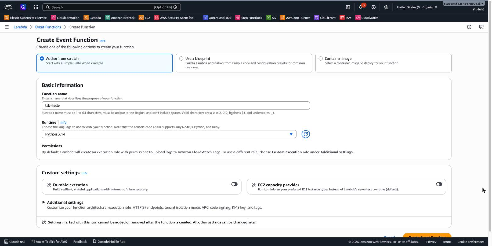
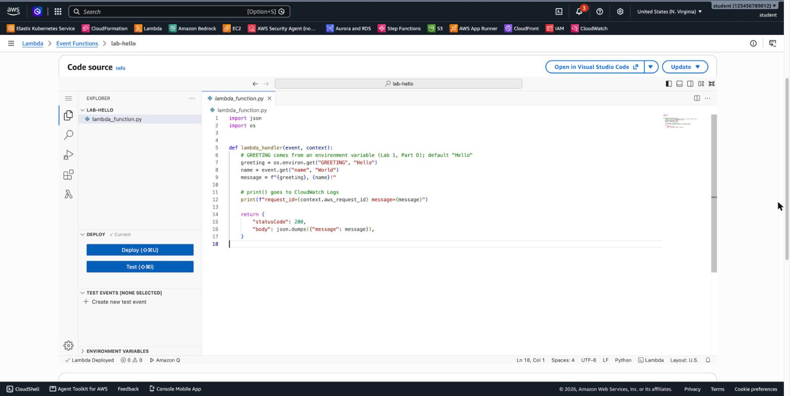
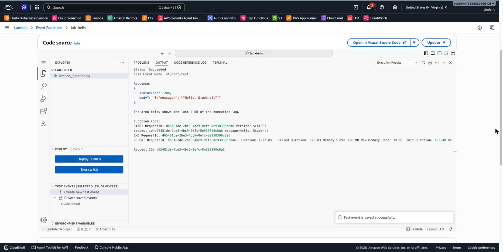
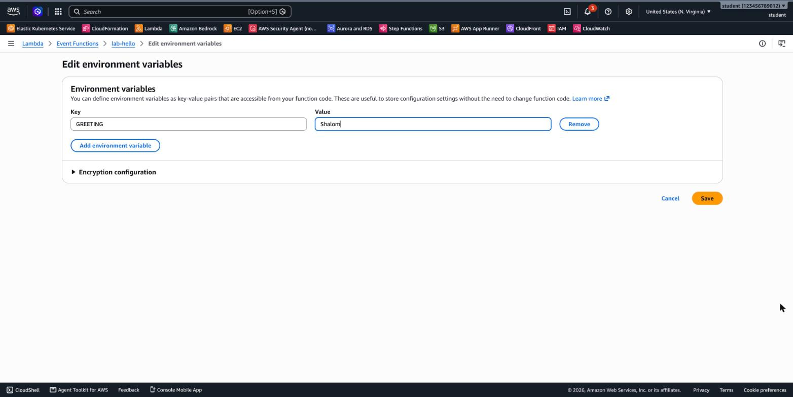
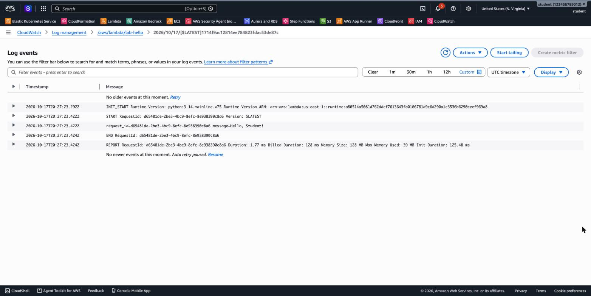

# 3.11 Serverless: AWS Lambda – Lab 1 Solution

[⬅ Back to 3.11 AWS Lambda](README.md) | [Lab 2 ➡](LAB2.md)

> Tested in `us-east-1` with the **Python 3.14** runtime.

---

## LAB 1 (Basic): Your First Lambda Function

**Jump to:**
- [Part A: Create the function](#part-a-create-the-function)
- [Part B: Deploy the code](#part-b-deploy-the-code)
- [Part C: Test](#part-c-test)
- [Part D: Environment variable](#part-d-environment-variable)
- [Part E: CloudWatch Logs](#part-e-cloudwatch-logs)
- [Part F: Invoke from the CLI](#part-f-invoke-from-the-cli)
- [Part G: Clean up](#part-g-clean-up)
- [Answers](#answers)

### Part A: Create the function

**Lambda → Create function → Author from scratch**. Set the function name to `lab-hello` and the runtime to **Python 3.14**, then choose **Create function**.



> Notice the other two options at the top. **Use a blueprint** starts from sample code. **Container image** deploys an image from ECR (see [ZIP vs. container image](README.md#zip-code-vs-container-image)). Under *Permissions*, Lambda creates a new execution role, `lab-hello-role-xxxxxxxx`, with permission to write to CloudWatch Logs.

### Part B: Deploy the code

Paste the code into `lambda_function.py` and choose **Deploy**. The status bar shows *Lambda Deployed*:



### Part C: Test

In the **TEST EVENTS** section, choose **Create new test event**. Name it `student-test`, set the Event JSON to `{"name": "Student"}`, choose **Save**, then **Test**:



```
Status: Succeeded
Response:
{
  "statusCode": 200,
  "body": "{\"message\": \"Hello, Student!\"}"
}

Function Logs:
START RequestId: d65481de-... Version: $LATEST
request_id=d65481de-... message=Hello, Student!
END RequestId: d65481de-...
REPORT RequestId: d65481de-...  Duration: 1.77 ms  Billed Duration: 128 ms  Memory Size: 128 MB
                                Max Memory Used: 39 MB  Init Duration: 125.48 ms
```

**8. Second test:** the `REPORT` line has **no `Init Duration`**, and *Billed Duration* is just a few milliseconds. The execution environment was reused (a **warm start**).

### Part D: Environment variable

**Configuration → Environment variables → Edit → Add environment variable**: `GREETING` = `Shalom` → **Save**:



| Test event | Response |
|------------|----------|
| `{"name": "Student"}` | `{"message": "Shalom, Student!"}` |
| `{}` | `{"message": "Shalom, World!"}` |

With `{}`, there's no `name` key, so `event.get("name", "World")` returns the default, `World`.

### Part E: CloudWatch Logs

**Monitor → View CloudWatch logs** opens the log group `/aws/lambda/lab-hello`. Each **log stream** belongs to one execution environment:



The stream starts with `INIT_START` (the cold start), then `START`, your `print()` output, `END` and `REPORT` for every invocation that the environment handled.

**13. Several log streams:** you see one stream per execution environment. A new environment was created on the first invocation, again after the **code was deployed**, and again after the **environment variable changed**, because configuration changes replace the environments.

### Part F: Invoke from the CLI

```bash
export AWS_PAGER="" AWS_REGION=us-east-1

aws lambda invoke --function-name lab-hello \
  --cli-binary-format raw-in-base64-out \
  --payload '{"name": "CLI"}' \
  --log-type Tail out.json \
  --query LogResult --output text | base64 --decode      # the last 4 KB of the log
cat out.json
```

The same commands are saved as a script: [`artifacts/cli/run.sh`](artifacts/cli/run.sh). Run it with `bash artifacts/cli/run.sh`. The expected response is in [`artifacts/cli/out.json`](artifacts/cli/out.json).

```
START RequestId: 982e0a2c-... Version: $LATEST
request_id=982e0a2c-... message=Shalom, CLI!
END RequestId: 982e0a2c-...
REPORT RequestId: 982e0a2c-...  Duration: 1.84 ms  Billed Duration: 105 ms  Memory Size: 128 MB
                                Max Memory Used: 39 MB  Init Duration: 102.81 ms

{"statusCode": 200, "body": "{\"message\": \"Shalom, CLI!\"}"}
```

This was a cold start, because the environment variable had just changed. Run the same command again and the `REPORT` line becomes a warm start:

```
REPORT RequestId: a3de3269-...  Duration: 1.51 ms  Billed Duration: 2 ms  Memory Size: 128 MB  Max Memory Used: 39 MB
```

> `--cli-binary-format raw-in-base64-out` tells AWS CLI v2 that the payload is plain JSON and not base64.

<details>
<summary>Create the whole lab with the CLI (instead of the Console)</summary>

```bash
# Execution role that Lambda can assume, with permission to write logs
cat > lambda-trust.json <<'JSON'
{ "Version": "2012-10-17",
  "Statement": [{ "Effect": "Allow",
                  "Principal": { "Service": "lambda.amazonaws.com" },
                  "Action": "sts:AssumeRole" }] }
JSON
ROLE_ARN=$(aws iam create-role --role-name lab-lambda-hello-role \
  --assume-role-policy-document file://lambda-trust.json --query Role.Arn --output text)
aws iam attach-role-policy --role-name lab-lambda-hello-role \
  --policy-arn arn:aws:iam::aws:policy/service-role/AWSLambdaBasicExecutionRole
sleep 10   # IAM roles take a few seconds to become usable

# Package and create the function (run from the module folder, 3.11-lambda/)
(cd artifacts/hello && zip -q ../../hello.zip lambda_function.py)
aws lambda create-function --function-name lab-hello \
  --runtime python3.14 --handler lambda_function.lambda_handler \
  --role $ROLE_ARN --zip-file fileb://hello.zip
aws lambda wait function-active-v2 --function-name lab-hello

# Test
aws lambda invoke --function-name lab-hello --cli-binary-format raw-in-base64-out \
  --payload file://artifacts/hello/test-event.json out.json && cat out.json

# Environment variable
aws lambda update-function-configuration --function-name lab-hello \
  --environment 'Variables={GREETING=Shalom}'
aws lambda wait function-updated-v2 --function-name lab-hello
```

</details>

### Part G: Clean up

**Console:** delete `lab-hello` (Actions → Delete). Then delete the log group `/aws/lambda/lab-hello` in CloudWatch, and the role `lab-hello-role-xxxxxxxx` in IAM.

**CLI:**

```bash
aws lambda delete-function --function-name lab-hello
aws logs delete-log-group --log-group-name /aws/lambda/lab-hello
# If you created the role with the CLI:
aws iam detach-role-policy --role-name lab-lambda-hello-role \
  --policy-arn arn:aws:iam::aws:policy/service-role/AWSLambdaBasicExecutionRole
aws iam delete-role --role-name lab-lambda-hello-role
```

> Deleting a function does **not** delete its log group or its execution role. Clean those up yourself.

### Answers

- **`lambda_function.lambda_handler`:** the **file** (module) `lambda_function.py`, and the **function** `lambda_handler` inside it. If you rename either one, update the *Handler* setting under *Runtime settings*.
- **Init Duration and billing:** the first call was a **cold start**. Lambda created a new execution environment and loaded the Python runtime and your module. Later calls reuse the environment (warm starts). Since August 2025 AWS also bills the INIT phase, so on a cold start *Billed Duration* ≈ *Duration* + *Init Duration* (1.77 + 125.48 → 128 ms).
- **Environment variables:** you change behavior or configuration (a greeting, a bucket name, a log level) **without changing or redeploying code**. The same code can run in dev and prod with different values.
- **Permission to write logs:** the **execution role** that Lambda created includes the AWS managed policy **`AWSLambdaBasicExecutionRole`** (`logs:CreateLogGroup`, `logs:CreateLogStream`, `logs:PutLogEvents`). Lambda assumes this role every time the function runs.

---

[⬅ Back to 3.11 AWS Lambda](README.md) | [Lab 2 ➡](LAB2.md)
