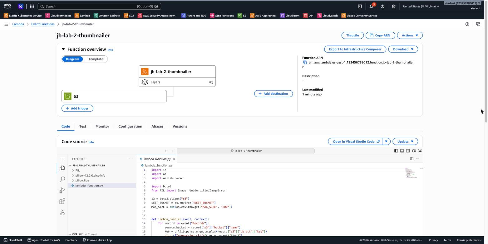
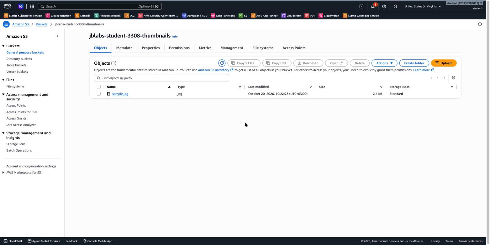

# 3.11 AWS Lambda – jb-lab-2 Solution

[⬅ jb-lab-2](jb-lab-2.md) | [⬅ Back to 3.11 AWS Lambda](README.md) | [jb-lab-3 ➡](jb-lab-3.md)

> Tested in `us-east-1` with Python 3.14 and Pillow 12.2.0. The thumbnail was in the destination bucket **about 4 seconds** after the upload.

**Jump to:** [Part A](#part-a-two-buckets) · [Part B](#part-b-execution-role) · [Part C](#part-c-build-the-deployment-package) · [Part D](#part-d-the-function) · [Part E](#part-e-the-trigger) · [Part F](#part-f-test) · [Part G](#part-g-clean-up) · [Answers](#answers) · [Terraform Code](#terraform-code)

In the commands below, replace `<your-name>` with your own name (lowercase, no spaces). Bucket names are global, so they must be unique.

---

## Part A: Two buckets

**Console:** **S3 → Create bucket** → `jblabs-<your-name>-images`, keep the defaults (Block all public access **on**) → **Create**. Repeat for `jblabs-<your-name>-thumbnails`.

**CLI:**

```bash
export AWS_PAGER="" AWS_REGION=us-east-1
SRC=jblabs-<your-name>-images
DST=jblabs-<your-name>-thumbnails
aws s3 mb s3://$SRC
aws s3 mb s3://$DST
```

---

## Part B: Execution role

**Console:**

1. **IAM → Roles → Create role** → *AWS service* → **Lambda** → `AWSLambdaBasicExecutionRole` → name **`lab-jb2-role`** → **Create role**.
2. Open the role → **Add permissions → Create inline policy → JSON**, paste the policy below (with your bucket names) → name `jb2-s3-access` → **Create policy**.

```json
{
  "Version": "2012-10-17",
  "Statement": [
    { "Effect": "Allow", "Action": "s3:GetObject", "Resource": "arn:aws:s3:::jblabs-<your-name>-images/*" },
    { "Effect": "Allow", "Action": "s3:PutObject", "Resource": "arn:aws:s3:::jblabs-<your-name>-thumbnails/*" }
  ]
}
```

The function can **read** only from the images bucket and **write** only to the thumbnails bucket. It can't even read its own thumbnails, and that's **least privilege**.

**CLI:**

```bash
cat > trust.json <<'JSON'
{ "Version": "2012-10-17", "Statement": [{ "Effect": "Allow", "Principal": { "Service": "lambda.amazonaws.com" }, "Action": "sts:AssumeRole" }] }
JSON
ROLE_ARN=$(aws iam create-role --role-name lab-jb2-role --assume-role-policy-document file://trust.json \
  --query Role.Arn --output text)
aws iam attach-role-policy --role-name lab-jb2-role \
  --policy-arn arn:aws:iam::aws:policy/service-role/AWSLambdaBasicExecutionRole
cat > s3-policy.json <<JSON
{
  "Version": "2012-10-17",
  "Statement": [
    { "Effect": "Allow", "Action": "s3:GetObject", "Resource": "arn:aws:s3:::$SRC/*" },
    { "Effect": "Allow", "Action": "s3:PutObject", "Resource": "arn:aws:s3:::$DST/*" }
  ]
}
JSON
aws iam put-role-policy --role-name lab-jb2-role --policy-name jb2-s3-access --policy-document file://s3-policy.json
```

---

## Part C: Build the deployment package

```bash
cd artifacts/jb-lab-2
bash build.sh
```

```
built function.zip (8.1M)
```

**5.** What's inside:

```bash
unzip -l function.zip | awk 'NR>3{print $4}' | cut -d/ -f1 | sort -u
unzip -l function.zip | tail -1
```

```
PIL                          ← the Pillow library itself
lambda_function.py           ← our handler
pillow-12.2.0.dist-info      ← package metadata
pillow.libs                  ← compiled C libraries Pillow needs (libjpeg, libpng, zlib…)
 23425998                     245 files
```

Our code is **1.3 KB**. The package is **8.1 MB zipped / 23.4 MB unzipped**, almost all of it Pillow. Lambda's limits are **50 MB** for a zipped upload and **250 MB** unzipped. A bigger package needs a **container image** (up to 10 GB).

---

## Part D: The function

**Console:**

1. **Lambda → Create function** → name `jb-lab-2-thumbnailer`, **Python 3.14**, **Use an existing role → `lab-jb2-role`** → **Create function**.
2. **Code → Upload from → .zip file** → `function.zip` → **Save**. The Code tab now shows `lambda_function.py` **and** the `PIL`, `pillow-12.2.0.dist-info` and `pillow.libs` folders from the package.
3. **Configuration → General configuration → Edit**: Memory **512 MB**, Timeout **0 min 30 sec** → **Save**.
4. **Configuration → Environment variables → Edit**: `DEST_BUCKET` = `jblabs-<your-name>-thumbnails`, `MAX_SIZE` = `200` → **Save**.

**CLI:**

```bash
aws lambda create-function --function-name jb-lab-2-thumbnailer --runtime python3.14 --role $ROLE_ARN \
  --handler lambda_function.lambda_handler --zip-file fileb://function.zip \
  --memory-size 512 --timeout 30 --environment "Variables={DEST_BUCKET=$DST,MAX_SIZE=200}" \
  --query '[FunctionName,CodeSize,MemorySize,Timeout]' --output text
aws lambda wait function-active-v2 --function-name jb-lab-2-thumbnailer
```

```
jb-lab-2-thumbnailer	8527765	512	30
```

---

## Part E: The trigger

**Console:** **Function overview → Add trigger** → **S3** → bucket `jblabs-<your-name>-images` → event types **All object create events** → check the box that acknowledges the **recursive invocation** warning (we write to a *different* bucket) → **Add**.

The Console does two things for you: it adds a **resource-based policy** to the function (*S3 may invoke it*), and it adds an **event notification** to the bucket. With the CLI, you do both yourself:

```bash
ACCOUNT_ID=$(aws sts get-caller-identity --query Account --output text)
# 1. Allow S3 (only from this bucket, in this account) to invoke the function
aws lambda add-permission --function-name jb-lab-2-thumbnailer --statement-id s3-invoke \
  --action lambda:InvokeFunction --principal s3.amazonaws.com \
  --source-arn arn:aws:s3:::$SRC --source-account $ACCOUNT_ID
# 2. Tell the bucket to send "object created" events to the function
FN_ARN=$(aws lambda get-function --function-name jb-lab-2-thumbnailer --query Configuration.FunctionArn --output text)
aws s3api put-bucket-notification-configuration --bucket $SRC --notification-configuration \
  "{\"LambdaFunctionConfigurations\":[{\"LambdaFunctionArn\":\"$FN_ARN\",\"Events\":[\"s3:ObjectCreated:*\"]}]}"
```

The function diagram now shows **S3** as its trigger, and the Code tab shows the package with Pillow:



---

## Part F: Test

**10–11.** Upload the sample and check the thumbnail:

```bash
aws s3 cp sample.jpg s3://$SRC/
sleep 5
aws s3 ls s3://$DST/
aws s3 cp s3://$DST/sample.jpg thumb.jpg
sips -g pixelWidth -g pixelHeight thumb.jpg     # macOS. On Linux: file thumb.jpg
```

```
2026-10-20 19:22:23       2502 sample.jpg
  pixelWidth: 200
  pixelHeight: 125
```

| | Original (images) | Thumbnail (thumbnails) |
|---|---|---|
| Pixels | 1600 × 1000 | **200 × 125** |
| Size | 50.2 KB | **2.4 KB** |

`thumbnail((200, 200))` fits the image **inside** 200×200 and **keeps the aspect ratio** (16:10), so the result is 200×125, not 200×200.



**12.** Upload a text file:

```bash
echo "hello" > notes.txt && aws s3 cp notes.txt s3://$SRC/
```

The function runs (every new object is an event), but it **skips** the file and finishes without an error. Nothing is written to the thumbnails bucket.

**13.** The logs (`aws logs tail /aws/lambda/jb-lab-2-thumbnailer --since 10m --format short`):

```
INIT_START Runtime Version: python:3.14.mainline.v75 ...
START RequestId: 54fe59b3-8f71-456c-82cb-fc6eb4d61134 Version: $LATEST
processing s3://jblabs-<your-name>-images/sample.jpg
resized (1600, 1000) -> (200, 125), saved to s3://jblabs-<your-name>-thumbnails/sample.jpg
END RequestId: 54fe59b3-8f71-456c-82cb-fc6eb4d61134
REPORT RequestId: 54fe59b3-...  Duration: 558.39 ms  Billed Duration: 1082 ms  Memory Size: 512 MB  Max Memory Used: 111 MB  Init Duration: 522.91 ms
START RequestId: 296f8b1a-1dbe-4f0f-ae17-748ba5737d37 Version: $LATEST
processing s3://jblabs-<your-name>-images/notes.txt
skipping notes.txt: not an image
END RequestId: 296f8b1a-1dbe-4f0f-ae17-748ba5737d37
REPORT RequestId: 296f8b1a-...  Duration: 718.38 ms  Billed Duration: 719 ms  Memory Size: 512 MB  Max Memory Used: 117 MB
```

The first invocation was a **cold start**: `Init Duration: 522.91 ms`, mostly to load Pillow and boto3. With 512 MB, the function used only **111–117 MB**.

---

## Part G: Clean up

**Console:** **S3** → select each bucket → **Empty** → then **Delete**. **Lambda** → delete `jb-lab-2-thumbnailer`. **CloudWatch → Log groups** → delete `/aws/lambda/jb-lab-2-thumbnailer`. **IAM → Roles** → delete `lab-jb2-role`.

**CLI:**

```bash
aws s3 rb s3://$SRC --force        # --force deletes the objects first
aws s3 rb s3://$DST --force
aws lambda delete-function --function-name jb-lab-2-thumbnailer
aws logs delete-log-group --log-group-name /aws/lambda/jb-lab-2-thumbnailer
aws iam delete-role-policy --role-name lab-jb2-role --policy-name jb2-s3-access
aws iam detach-role-policy --role-name lab-jb2-role \
  --policy-arn arn:aws:iam::aws:policy/service-role/AWSLambdaBasicExecutionRole
aws iam delete-role --role-name lab-jb2-role
```

---

## Answers

- **AWS vs. you in the five steps:** **AWS handles** the mechanics: detecting the upload and evaluating the notification (2), delivering the event and invoking the function (3), and running it on servers it manages (5). **You configure** what connects them: the bucket's **event notification** and the function's **permission** for S3 (2–3), the **execution role** (4), and the **code and package** (5). Step 1 is the user.
- **Why a .zip with Pillow:** the Lambda Python runtime includes the standard library and **boto3**, but **not Pillow**. With only `lambda_function.py`, the function fails on its first line, `from PIL import Image`, with `Runtime.ImportModuleError: No module named 'PIL'`. Alternatively, you can put Pillow in a **Lambda layer** and share it between functions.
- **`--platform manylinux2014_x86_64 --python-version 3.14`:** Pillow includes **compiled C code**. A plain `pip install` on a Mac or on Windows downloads binaries **for your computer** (for example macOS arm64), which can't run on Lambda's **Amazon Linux x86_64**. These flags download the wheel that matches Lambda's OS, CPU and Python version.
- **Not failing on a text file:** S3 invokes Lambda **asynchronously**. If the function raises an error, Lambda **retries** the event (up to 2 more times), and each retry fails the same way, wasting time and money and filling the logs with errors. Handling bad input gracefully (*skip and log*) ends the invocation cleanly. For real failures, configure an **on-failure destination** or a DLQ so the event isn't lost.
- **Without Lambda:** you'd need at least one **EC2 instance** running all the time (more for high availability, behind an **Auto Scaling Group**), with an OS to patch and Python and Pillow to install. You'd also need a way to find new uploads: **poll** S3, or have S3 send notifications to an **SQS queue** that your server reads. And you'd pay for the server **even when no one uploads anything**. With Lambda, you pay only for the ~1 second of each upload.

---

[⬅ jb-lab-2](jb-lab-2.md) | [⬅ Back to 3.11 AWS Lambda](README.md) | [jb-lab-3 ➡](jb-lab-3.md)

---

## Terraform Code

[`terraform/jb-lab-2/main.tf`](terraform/jb-lab-2/main.tf) creates both buckets (`jblabs-images-…` and `jblabs-thumbnails-…`, with random suffixes and `force_destroy`), the role `lab-jb2-role` with the least-privilege S3 policy, the log group, the function from `function.zip`, S3's permission to invoke it, and the bucket notification. **Build the package first.**

```bash
bash artifacts/jb-lab-2/build.sh
cd terraform/jb-lab-2
terraform init
terraform apply       # 9 resources; prints the two bucket names
aws s3 cp ../../artifacts/jb-lab-2/sample.jpg s3://$(terraform output -raw images_bucket)/
sleep 5 && aws s3 ls s3://$(terraform output -raw thumbnails_bucket)/
# 2502 sample.jpg
terraform destroy     # force_destroy empties the buckets
```

---

## Contact

For questions or feedback, feel free to reach out:

- **Email**: eyal@levys.co.il
- **GitHub**: [https://github.com/elevy99927](https://github.com/elevy99927)
