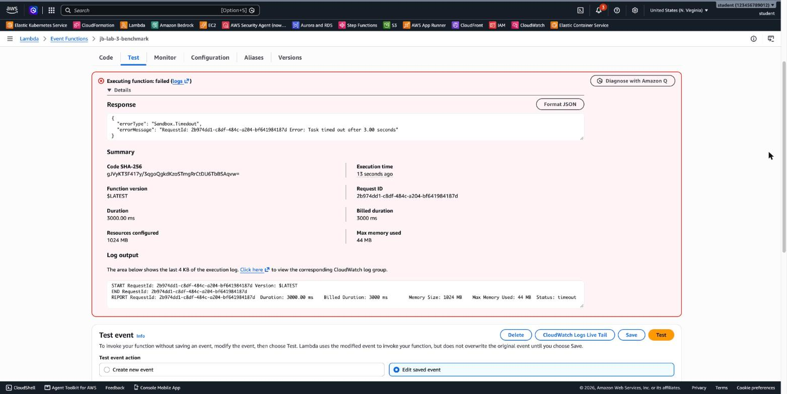

# 3.11 AWS Lambda – jb-lab-3 Solution

[⬅ jb-lab-3](jb-lab-3.md) | [⬅ Back to 3.11 AWS Lambda](README.md) | [jb-lab-4 ➡](jb-lab-4.md)

> Tested in `us-east-1` with Python 3.14 on x86_64. Your numbers will differ a little, but the ratios will be similar.

**Jump to:** [Part A](#part-a-create-the-function) · [Part B](#part-b-measure-at-128-mb) · [Part C](#part-c-measure-at-1024-mb) · [Part D](#part-d-hit-the-timeout) · [Part E](#part-e-monthly-cost) · [Part F](#part-f-clean-up) · [Answers](#answers) · [Terraform Code](#terraform-code)

---

## Part A: Create the function

**Console:** create the role `lab-jb3-role` as in [jb-lab-1](jb-lab-1-solution.md#part-a-create-the-function). Then **Lambda → Create function**: `jb-lab-3-benchmark`, **Python 3.14**, **Use an existing role → `lab-jb3-role`**. Paste the code → **Deploy**. Create the test events `cpu` and `slow` from the files.

**CLI:**

```bash
export AWS_PAGER="" AWS_REGION=us-east-1
cat > trust.json <<'JSON'
{ "Version": "2012-10-17", "Statement": [{ "Effect": "Allow", "Principal": { "Service": "lambda.amazonaws.com" }, "Action": "sts:AssumeRole" }] }
JSON
ROLE_ARN=$(aws iam create-role --role-name lab-jb3-role --assume-role-policy-document file://trust.json \
  --query Role.Arn --output text)
aws iam attach-role-policy --role-name lab-jb3-role \
  --policy-arn arn:aws:iam::aws:policy/service-role/AWSLambdaBasicExecutionRole
sleep 10

cd artifacts/jb-lab-3 && zip function.zip lambda_function.py
aws lambda create-function --function-name jb-lab-3-benchmark --runtime python3.14 --role $ROLE_ARN \
  --handler lambda_function.lambda_handler --zip-file fileb://function.zip
aws lambda wait function-active-v2 --function-name jb-lab-3-benchmark

# A helper: invoke with an event file and print the response and the REPORT line
run() {
  aws lambda invoke --function-name jb-lab-3-benchmark --cli-binary-format raw-in-base64-out \
    --payload file://events/$1.json --log-type Tail out.json --query LogResult --output text \
    | base64 --decode | grep REPORT
  cat out.json; echo
}
```

---

## Part B: Measure at 128 MB

**3.** Run `cpu` twice (Console **Test**, or `run cpu; run cpu`):

```
REPORT ... Duration: 1125.31 ms  Billed Duration: 1247 ms  Memory Size: 128 MB  Max Memory Used: 44 MB  Init Duration: 121.65 ms
{"rounds": 100000, "sleep": 0.0, "took_ms": 1104, "memory_mb": 128}
REPORT ... Duration: 1136.63 ms  Billed Duration: 1137 ms  Memory Size: 128 MB  Max Memory Used: 44 MB
{"rounds": 100000, "sleep": 0.0, "took_ms": 1115, "memory_mb": 128}
```

The first run was a **cold start** (`Init Duration`, which is also billed: 1247 ms). Use the **second** run: **1137 ms billed, 128 MB**.

**4.** One invocation at 128 MB:

| | Calculation | Result |
|---|---|---|
| GB-seconds | 0.125 GB × 1.137 s | **0.142 GB-s** |
| Duration cost | 0.142125 × $0.0000166667 | $0.00000237 |
| Request cost | $0.20 / 1,000,000 | $0.00000020 |
| **Total** | | **$0.00000257** (about $2.57 per million invocations) |

---

## Part C: Measure at 1024 MB

**5.** **Configuration → General configuration → Edit → Memory: 1024 MB → Save**, then run `cpu` twice:

```bash
aws lambda update-function-configuration --function-name jb-lab-3-benchmark --memory-size 1024
aws lambda wait function-updated-v2 --function-name jb-lab-3-benchmark
run cpu; run cpu
```

```
REPORT ... Duration: 137.35 ms  Billed Duration: 256 ms  Memory Size: 1024 MB  Max Memory Used: 44 MB  Init Duration: 118.28 ms
{"rounds": 100000, "sleep": 0.0, "took_ms": 135, "memory_mb": 1024}
REPORT ... Duration: 130.10 ms  Billed Duration: 131 ms  Memory Size: 1024 MB  Max Memory Used: 44 MB
{"rounds": 100000, "sleep": 0.0, "took_ms": 128, "memory_mb": 1024}
```

A configuration change creates a **new execution environment**, so the first run is a cold start again.

**6.** The comparison (warm runs):

| Memory | Billed duration | GB-seconds | Cost per invocation |
|--------|-----------------|------------|---------------------|
| 128 MB | 1137 ms | 0.142 | $0.00000257 |
| 1024 MB | **131 ms** | **0.131** | **$0.00000238** |

With **8× the memory**, the function ran **8.7× faster**, and it was **about 8% cheaper**, because the price per millisecond went up 8× while the time went down 8.7×. `Max Memory Used` stayed at **44 MB**: the function never needed the memory. It needed the **CPU** that comes with it.

> 💡 Try `{ "rounds": 300000 }`: at 128 MB it **doesn't finish within the 3-second timeout** at all, while 1024 MB needs about 400 ms.

---

## Part D: Hit the timeout

**7.** Run `slow` (5 seconds of waiting) with the default **3-second** timeout:

```
{"errorType": "Sandbox.Timedout", "errorMessage": "RequestId: ... Error: Task timed out after 3.00 seconds"}
REPORT ... Duration: 3000.00 ms  Billed Duration: 3000 ms  Memory Size: 1024 MB  Max Memory Used: 44 MB  Status: timeout
```

Lambda **stopped** the function after 3 seconds, before it could return. The invocation failed (`Sandbox.Timedout`), and you were still billed for the full **3000 ms**:



**8.** **Configuration → General configuration → Edit → Timeout: 10 sec → Save**, and run `slow` again:

```bash
aws lambda update-function-configuration --function-name jb-lab-3-benchmark --timeout 10
aws lambda wait function-updated-v2 --function-name jb-lab-3-benchmark
run slow
```

```
REPORT ... Duration: 5002.37 ms  Billed Duration: 5112 ms  Memory Size: 1024 MB  Max Memory Used: 44 MB  Init Duration: 108.77 ms
{"rounds": 0, "sleep": 5.0, "took_ms": 5000, "memory_mb": 1024}
```

**9.** `took_ms` is **5000**, and the billed duration is **5112 ms** (5002 ms + the 109 ms cold start after the configuration change). For 5 seconds the function did **nothing but wait**, and you paid for **1 GB × 5.1 s = 5.1 GB-s**. Lambda bills for the **time the environment is reserved for you**, not for the CPU you use. Here, more memory only makes the wait more expensive. For long waits (a slow API, a human approval), use asynchronous patterns such as **Step Functions**, instead of a function that sleeps.

---

## Part E: Monthly cost

3,000,000 invocations × 200 ms × 512 MB:

| | Without the Free Tier | With the Free Tier |
|---|---|---|
| Requests | 3M × $0.20 / 1M = **$0.60** | (3M − 1M free) × $0.20 / 1M = **$0.40** |
| GB-seconds | 3,000,000 × 0.2 s × 0.5 GB = **300,000 GB-s** | 300,000 − 400,000 free → **0** |
| Duration cost | 300,000 × $0.0000166667 = **$5.00** | **$0.00** |
| **Total per month** | **$5.60** | **$0.40** |

---

## Part F: Clean up

**Console:** delete the function `jb-lab-3-benchmark`, the log group `/aws/lambda/jb-lab-3-benchmark`, and the role `lab-jb3-role`.

**CLI:**

```bash
aws lambda delete-function --function-name jb-lab-3-benchmark
aws logs delete-log-group --log-group-name /aws/lambda/jb-lab-3-benchmark
aws iam detach-role-policy --role-name lab-jb3-role \
  --policy-arn arn:aws:iam::aws:policy/service-role/AWSLambdaBasicExecutionRole
aws iam delete-role --role-name lab-jb3-role
```

---

## Answers

- **Faster with more memory:** in Lambda, **memory is the only knob**. CPU is allocated **in proportion to memory**: at **1,769 MB** a function gets one full vCPU, and up to 6 vCPUs at 10,240 MB. 128 MB gets only a small slice of a vCPU. This function is **CPU-bound** (hashing), so 8× the memory gave it about 8× the CPU, even though it used only 44 MB.
- **Is more memory always more expensive?** No. The price **per millisecond** grows with memory, but you pay for **memory × time**. When a function is CPU-bound and runs proportionally faster, the cost stays the same or **drops**: in Part C, 1024 MB was 8.7× faster **and** 8% cheaper. When a function mostly **waits** (I/O, network, `sleep`), more memory doesn't make it faster, so it only costs more (Part D). Tools such as **AWS Lambda Power Tuning** find the best setting.
- **Running past the timeout:** Lambda **stops** the function and returns a **`Sandbox.Timedout`** error (`Status: timeout` in the `REPORT` line). Whatever the code hadn't finished is lost. The time **until the timeout is billed** (3000 ms in Part D). An asynchronous invocation that times out is **retried**, so set the timeout a bit above the longest normal run, not at the maximum.
- **The slides' limits vs. today:**

  | Limit | Slides (2020) | Today |
  |-------|---------------|-------|
  | Maximum timeout | 5 minutes | **15 minutes** (900 seconds) |
  | Memory | 128 MB – 1,536 MB | **128 MB – 10,240 MB** (10 GB), in 1 MB steps |
  | Billing granularity | Rounded up to 100 ms | **Per 1 ms** (since December 2020) |

- **Workloads not to run on Lambda:** anything that runs **longer than 15 minutes** (long video encoding, large batch/ETL jobs, ML training), workloads that need a **GPU**, **long-lived connections or state** (game servers, servers that keep sockets open), and **steady, high, round-the-clock traffic**, where always-on servers or containers are cheaper (see [jb-lab-4](jb-lab-4-solution.md)).

---

[⬅ jb-lab-3](jb-lab-3.md) | [⬅ Back to 3.11 AWS Lambda](README.md) | [jb-lab-4 ➡](jb-lab-4.md)

---

## Terraform Code

[`terraform/jb-lab-3/main.tf`](terraform/jb-lab-3/main.tf) creates the role `lab-jb3-role`, the log group and the function `jb-lab-3-benchmark`, with **`memory`** and **`timeout`** as variables, so each part of the lab is one `apply`:

```bash
cd terraform/jb-lab-3
terraform init
terraform apply                                 # Part B: 128 MB, 3 s
aws lambda invoke --function-name jb-lab-3-benchmark --cli-binary-format raw-in-base64-out \
  --payload file://../../artifacts/jb-lab-3/events/cpu.json out.json && cat out.json
# {"rounds": 100000, "sleep": 0.0, "took_ms": 1031, "memory_mb": 128}
terraform apply -var memory=1024                # Part C
terraform apply -var memory=1024 -var timeout=10   # Part D
terraform destroy
```

---

## Contact

For questions or feedback, feel free to reach out:

- **Email**: eyal@levys.co.il
- **GitHub**: [https://github.com/elevy99927](https://github.com/elevy99927)
