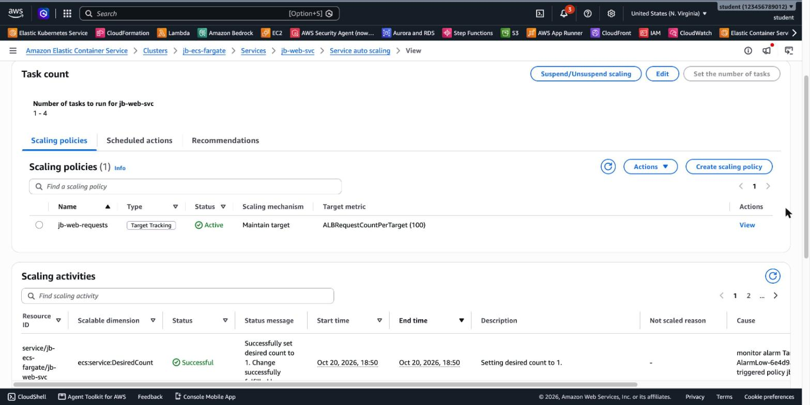
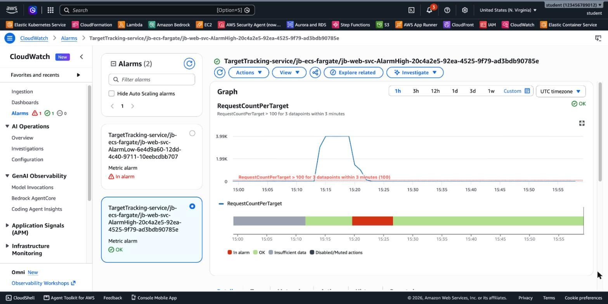

# 3.13 Containers – Lab 5 Solution

[⬅ Lab 5](jb-lab-5.md) | [⬅ Back to 3.13 Containers](README.md)

> Tested in `us-east-1` on `web-svc` from Lab 4. Under load, the service scaled **1 → 4 tasks** about 5½ minutes after the load started. After the load stopped, it scaled back **4 → 3 → 2 → 1** over the next 28 minutes.

**Jump to:** [Solution 1: Console](#solution-1-console-ui) · [Solution 2: AWS CLI](#solution-2-aws-cli) · [Answers](#answers) · [Solution 3: Terraform](#solution-3-terraform)

---

## Solution 1: Console (UI)

### Part A: Scalable target and policy

1. `ecs-fargate` → `web-svc` → **Service auto scaling** tab → **Set the number of tasks**: **minimum 1**, **maximum 4**. The desired count stays **2**. (You can also do it in **Update service → Service auto scaling**.)
2. **Create scaling policy**:
   - Policy type **Target tracking**, name **`web-requests`**
   - ECS service metric **ALBRequestCountPerTarget**, target group **`web-tg`**
   - Target value **100**
   - Scale-out cooldown **60** seconds, scale-in cooldown **120** seconds
3. **CloudWatch → Alarms**: the policy created two alarms that start with `TargetTracking-service/ecs-fargate/web-svc-`:

| Alarm | Condition | Action |
|-------|-----------|--------|
| `…-AlarmHigh-…` | RequestCountPerTarget **> 100** for **3 datapoints within 3 minutes** | scale out |
| `…-AlarmLow-…` | RequestCountPerTarget **< 90** for **15 datapoints within 15 minutes** | scale in |



### Part B: Scale in without traffic

**4.** Only **3½ minutes** after the policy was created, the service went from **2 to 1** task. Its **Events** tab shows:

```
Message: Successfully set desired count to 1. Change successfully fulfilled by ecs.
Cause: monitor alarm TargetTracking-service/ecs-fargate/web-svc-AlarmLow-... in state ALARM triggered policy web-requests
```

There was no traffic, so RequestCountPerTarget was 0, below the scale-in threshold. The policy scales in down to the **minimum (1)**. It happened faster than 15 minutes because the metric **already had 15 minutes of history** near 0 from before the policy existed.

### Part C: Scale out under load

**5.** Load from a laptop for 8 minutes:

```bash
ab -k -c 10 -t 480 -n 10000000 http://<alb-dns>/web/
```

```
Complete requests:      31849
Failed requests:        0
Requests per second:    66.35 [#/sec] (mean)
```

**6.** The timeline (UTC). Times are from the CLI loop in Solution 2:

```
15:14:07  load start (~3,980 requests per target per minute)   desired 1 / running 1
15:19:39  AlarmHigh → ALARM, "Setting desired count to 4."
15:20:13                                      desired 4 / running 2
15:20:29                                      desired 4 / running 4
15:22:08  load end
```

- **AlarmHigh** fired **5½ minutes** after the load started. The ALB publishes metrics once a minute with a delay of a few minutes, and the alarm needs **3** datapoints above 100.
- The policy jumped **straight from 1 to 4**. At ~3,980 requests per target and a target of 100, it calculated far more than 4 tasks, so it set the **maximum**.
- All 4 tasks were running about **50 seconds** later. On Fargate there's no instance to wait for.

The AlarmHigh graph shows the spike, and the **In alarm** period (red) from 15:19 to 15:26:



### Part D: Scale in after the load

**7.** After the load stopped (15:22), the service stayed at 4 tasks for **22 minutes**, then scaled in **one task at a time**:

```
15:44:00  Setting desired count to 3.
15:47:00  Setting desired count to 2.
15:50:00  Setting desired count to 1.
```

Back to **1 task**, the minimum. Each step waits for the 15-minute AlarmLow window and the 120-second scale-in cooldown, and every removed task is **drained** from the target group first.

### Part E: Clean up the whole chapter

Delete, in this order (Console):

1. **ECS → `ecs-fargate` → Services**: delete `web-svc` and `whoami-fargate-svc` (*Force delete*). This also removes the scalable target, the `web-requests` policy and its two alarms. Delete any services left in `ecs-ec2`.
2. **Delete cluster**: `ecs-fargate` and `ecs-ec2`. For `ecs-ec2`, also check that its Auto Scaling Group and instances are gone.
3. **EC2 → Load balancers**: delete `ecs-alb`, then **Target groups**: delete `fargate-tg`, `web-tg` and any `admin-tg`/`store-tg` that are left.
4. **EC2 → Security groups**: delete `fargate-tasks-sg`, `ecs-instances-sg`, then `ecs-alb-sg`. If a group is "in use", wait a minute for the task ENIs to be released.
5. **ECR → `web` → Delete**. The repository is deleted with its images.
6. **ECS → Task definitions**: for each task definition family from this chapter (`whoami`, `admin`, `store`, `whoami-fargate`, `web`), select all revisions → **Deregister**, then **Delete**.

---

## Solution 2: AWS CLI

Continue from Lab 4 (`$ALB_ARN`, `$WEB_TG`, `$ALB_DNS`).

```bash
export AWS_PAGER="" AWS_REGION=us-east-1

# Part A: min 1 / max 4, and a target tracking policy on requests per target
aws application-autoscaling register-scalable-target --service-namespace ecs \
  --scalable-dimension ecs:service:DesiredCount --resource-id service/ecs-fargate/web-svc \
  --min-capacity 1 --max-capacity 4

# ResourceLabel = app/<alb-name>/<id>/targetgroup/<tg-name>/<id>
RESOURCE_LABEL="${ALB_ARN#*loadbalancer/}/${WEB_TG##*:}"
cat > ecs-tt.json <<JSON
{
  "TargetValue": 100,
  "PredefinedMetricSpecification": {
    "PredefinedMetricType": "ALBRequestCountPerTarget",
    "ResourceLabel": "$RESOURCE_LABEL"
  },
  "ScaleOutCooldown": 60,
  "ScaleInCooldown": 120
}
JSON
aws application-autoscaling put-scaling-policy --service-namespace ecs \
  --scalable-dimension ecs:service:DesiredCount --resource-id service/ecs-fargate/web-svc \
  --policy-name web-requests --policy-type TargetTrackingScaling \
  --target-tracking-scaling-policy-configuration file://ecs-tt.json --query 'Alarms[].AlarmName'
```

```
[
    "TargetTracking-service/ecs-fargate/web-svc-AlarmHigh-20c4a2e5-...",
    "TargetTracking-service/ecs-fargate/web-svc-AlarmLow-6e4d9a60-..."
]
```

```bash
# Parts B-D: watch desired/running while the load runs
DC() { aws ecs describe-services --cluster ecs-fargate --services web-svc \
         --query 'services[0].[desiredCount,runningCount]' --output text; }
ab -k -c 10 -t 480 -n 10000000 http://$ALB_DNS/web/ > ab.txt 2>&1 &
for i in $(seq 1 40); do echo "$(date -u +%T) desired/running: $(DC)"; sleep 15; done

# The metric the policy follows (Sum per minute)
aws cloudwatch get-metric-statistics --namespace AWS/ApplicationELB --metric-name RequestCountPerTarget \
  --dimensions Name=TargetGroup,Value=${WEB_TG##*:} Name=LoadBalancer,Value=${ALB_ARN#*loadbalancer/} \
  --start-time $(date -u -v-15M +%FT%TZ) --end-time $(date -u +%FT%TZ) --period 60 --statistics Sum \
  --query 'sort_by(Datapoints,&Timestamp)[].[Timestamp,Sum]' --output text
# Linux: date -u -d '-15 min' +%FT%TZ

# What Application Auto Scaling did, and why
aws application-autoscaling describe-scaling-activities --service-namespace ecs \
  --resource-id service/ecs-fargate/web-svc --query 'ScalingActivities[].[StartTime,Description]' --output text
```

```
2026-10-20T15:50:00  Setting desired count to 1.
2026-10-20T15:47:00  Setting desired count to 2.
2026-10-20T15:44:00  Setting desired count to 3.
2026-10-20T15:19:39  Setting desired count to 4.
2026-10-20T15:14:00  Setting desired count to 1.
```

**Part E: clean up the whole chapter** (as run after this test):

```bash
for S in web-svc whoami-fargate-svc; do
  aws ecs delete-service --cluster ecs-fargate --service $S --force; done
aws ecs wait services-inactive --cluster ecs-fargate --services web-svc whoami-fargate-svc
aws application-autoscaling describe-scalable-targets --service-namespace ecs   # empty: removed with the service
aws ecs delete-cluster --cluster ecs-fargate
# ecs-ec2, if it still exists: see Lab 1 Solution, Part G

aws elbv2 delete-load-balancer --load-balancer-arn $ALB_ARN
aws elbv2 wait load-balancers-deleted --load-balancer-arns $ALB_ARN
sleep 15   # the listener rules release the target groups a few seconds later (otherwise: ResourceInUse)
for TG in $FARGATE_TG $WEB_TG; do aws elbv2 delete-target-group --target-group-arn $TG; done

aws ecr delete-repository --repository-name web --force

for TD in web:1 web:2 whoami-fargate:1; do aws ecs deregister-task-definition --task-definition $TD >/dev/null; done
aws ecs delete-task-definitions --task-definitions web:1 web:2 whoami-fargate:1

# security groups: wait until the task ENIs are gone
until [ "$(aws ec2 describe-network-interfaces --filters Name=group-id,Values=$TASK_SG \
          --query 'length(NetworkInterfaces)' --output text)" = "0" ]; do sleep 10; done
aws ec2 delete-security-group --group-id $TASK_SG
aws ec2 delete-security-group --group-id $ALB_SG

# Optional: the execution role, if you created it in Lab 3 and nothing else uses it
aws iam detach-role-policy --role-name ecsTaskExecutionRole \
  --policy-arn arn:aws:iam::aws:policy/service-role/AmazonECSTaskExecutionRolePolicy
aws iam delete-role --role-name ecsTaskExecutionRole
```

---

## Answers

- **Service auto scaling vs. cluster capacity scaling:** service auto scaling changes the **number of tasks** (Application Auto Scaling sets the service's desired count). Cluster capacity scaling changes the **number of EC2 instances** the tasks run on (a capacity provider with managed scaling drives the ASG). On EC2 you need both. **Fargate made cluster capacity scaling unnecessary**: in Part C, 3 new tasks were running within 50 seconds without any instance.
- **Why it scaled in to 1 before the load:** with no traffic, requests per target were **0**, below the scale-in threshold (90% of the target), so the policy reduced the service to its **minimum**. The desired count of 2 that you set is only a starting point. Once a policy exists, the policy decides.
- **Fast scale-out, slow scale-in:** too few tasks hurts users right away (slow responses, errors), and too many only costs a little. So AlarmHigh needs only **3** minutes above the target, and AlarmLow needs **15** minutes below it. Scale-in also goes **one step at a time** with a cooldown, so a short pause in traffic doesn't remove capacity that's needed a minute later (*flapping*). In this test: out after 5½ minutes, in after 22–28 minutes.
- **A CPU-heavy service:** use **`ECSServiceAverageCPUUtilization`** with a target of about **50–70%**. For image processing, CPU tracks the real load better than the number of requests, because one request can take a lot of work. Queue-based workers often scale on **queue depth** (for example SQS `ApproximateNumberOfMessagesVisible`) with a custom metric.

---

[⬅ Lab 5](jb-lab-5.md) | [⬅ Back to 3.13 Containers](README.md)

---

## Solution 3: Terraform

[`terraform/jb-lab-5/main.tf`](terraform/jb-lab-5/main.tf) is **standalone** and needs no ECR image. It creates the Lab 3 base and scales the **`whoami-fargate-svc`** service behind `/fargate*` (instead of `web-svc`), with:

- `aws_appautoscaling_target`: min 1, max 4 on `ecs:service:DesiredCount`
- `aws_appautoscaling_policy` `web-requests`: target tracking, `ALBRequestCountPerTarget` = 100, cooldowns 60/120
- `lifecycle { ignore_changes = [desired_count] }` on the service, so the next `terraform apply` doesn't reset the count that auto scaling changed

```bash
cd terraform/jb-lab-5
terraform init
terraform apply      # about 3 minutes; prints the /fargate URL
aws application-autoscaling describe-scalable-targets --service-namespace ecs \
  --query 'ScalableTargets[].[ResourceId,MinCapacity,MaxCapacity]' --output text
aws application-autoscaling describe-scaling-policies --service-namespace ecs \
  --query 'ScalingPolicies[].[PolicyName,PolicyType,TargetTrackingScalingPolicyConfiguration.TargetValue]' --output text
ab -k -c 10 -t 480 -n 10000000 "$(terraform output -raw url)"
terraform destroy    # about 9 minutes: the target group's 300-second deregistration delay
```

The tested run: `apply` took 169 s, and the scalable target and the policy were in place:

```
service/ecs-fargate/whoami-fargate-svc	1	4
web-requests	TargetTrackingScaling	100.0
```

The load test and the scale-out behave as in [Part C](#part-c-scale-out-under-load).

---

## Contact

For questions or feedback, feel free to reach out:

- **Email**: eyal@levys.co.il
- **GitHub**: [https://github.com/elevy99927](https://github.com/elevy99927)
