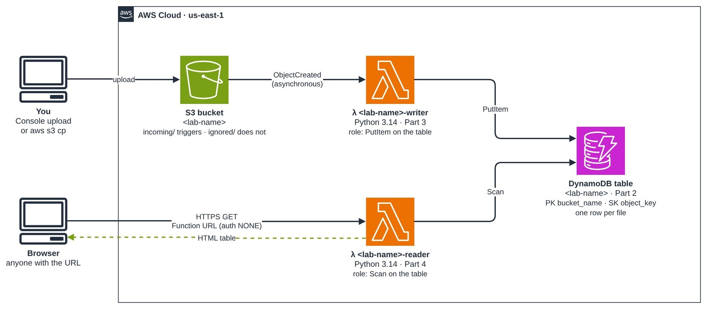

# Part 1: Introduction

*Advanced DynamoDB Lab: A Serverless File Catalog*, Part 1 of 6. [⬅ Lab overview](README.md) | [Part 2 ➡](PART2.md)

<!-- video: add the embed when Part 1 is uploaded -->

## The task

Your operations team receives files in an S3 bucket. They want a web page that lists every file that arrived: the bucket, the object key and the time S3 recorded the upload. Build a catalog that records each upload automatically and shows the report on demand.



<sub>Diagram source: [images/file-catalog.drawio](images/file-catalog.drawio) (open it in [draw.io](https://app.diagrams.net) to edit)</sub>

| Piece | What it does | Part |
|---|---|---|
| **DynamoDB table** | The catalog. One row per bucket + object key | [2](PART2.md) |
| **S3 bucket** | Receives the files. Only `incoming/` is catalogued | [3](PART3.md) |
| **Writer Lambda** | Runs on every new object under `incoming/` and writes a row with `PutItem` | [3](PART3.md) |
| **Reader Lambda + Function URL** | A public HTTPS address. Reads the table with `Scan` and returns an HTML page | [4](PART4.md) |
| **Terraformer** | Turns what you built in the Console into Terraform code | [6](PART6.md) |

Each function has its **own IAM role**: the writer may only `PutItem`, the reader may only `Scan`, and only on this one table.

## How the catalog behaves

- **One row per bucket and object key.** Uploading again to the same key overwrites that row with the new time. It doesn't add a row.
- S3 delivers events **asynchronously** and **at least once**. A duplicate delivery writes the same row again, so the count doesn't change.
- Events aren't guaranteed to arrive in order. The writer keeps the last event it processes, which is usually, but not always, the newest upload. That's fine for this lab.
- The report lists **uploads**. Deleting an object from S3 doesn't remove its row.
- Names appear exactly as uploaded, including spaces: `incoming/daily report.txt`.

## The acceptance test

On a fresh deployment:

1. Upload three files under `incoming/`, one of them with a space in its name, and one more under `ignored/`.
2. Open the report. It shows **exactly 3 rows**, and the name with the space appears as uploaded.
3. Upload again to one of the same keys. The report still shows **3 rows**, with a newer time on that row.

## Try it yourself first

**Stop the video here and build the lab on your own.** Everything you need is on this page and the AWS documentation linked below. Come back to the video (and the next parts) for the solution.

You'll use:

- The handlers in [`lambda-code/`](lambda-code/): the [writer](lambda-code/writer/lambda_function.py) and the [reader](lambda-code/reader/lambda_function.py). You don't need to write Python. The writer is 25 lines and the reader 34, and the parts explain them in a sentence or two.
- **Python 3.14** for both functions.
- One unique lowercase name for the bucket and the table, for example `file-catalog-<your-name>-<random>`. The bucket name must be unique across all of S3; the table name only in your account and Region.

There's also a **complete Terraform solution** in this repo: [`terraform/`](terraform/). It builds everything in Parts 2–4 with one `terraform apply`. [Part 6](PART6.md) uses it at the end.

## Before you start

- A private AWS account, and the AWS Console in **`us-east-1`** (N. Virginia). Keep S3, DynamoDB and Lambda in the same Region.
- For Parts 3, 5 and 6: the AWS CLI v2, signed in (`aws login` or `aws configure`). Check it:

  ```bash
  aws sts get-caller-identity
  ```

- For Part 6: Terraform 1.5 or later.
- Set your names once in the terminal. The later parts use these variables:

  ```bash
  export AWS_REGION=us-east-1
  export LAB_NAME=file-catalog-your-unique-suffix
  ```

## References

- [Tutorial: Using an Amazon S3 trigger to invoke a Lambda function](https://docs.aws.amazon.com/lambda/latest/dg/with-s3-example.html)
- [Event message structure](https://docs.aws.amazon.com/AmazonS3/latest/userguide/notification-content-structure.html): the object key arrives URL-encoded
- [Amazon S3 event notifications](https://docs.aws.amazon.com/AmazonS3/latest/userguide/EventNotifications.html): delivery is at least once, and order isn't guaranteed
- [Lambda function URLs](https://docs.aws.amazon.com/lambda/latest/dg/urls-configuration.html)
- [Scanning tables in DynamoDB](https://docs.aws.amazon.com/amazondynamodb/latest/developerguide/Scan.html): pagination with `LastEvaluatedKey`

[⬅ Lab overview](README.md) | [Part 2: The DynamoDB table ➡](PART2.md)
