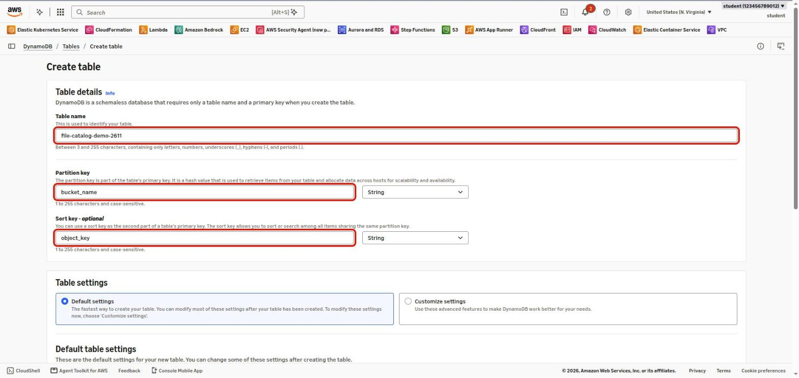
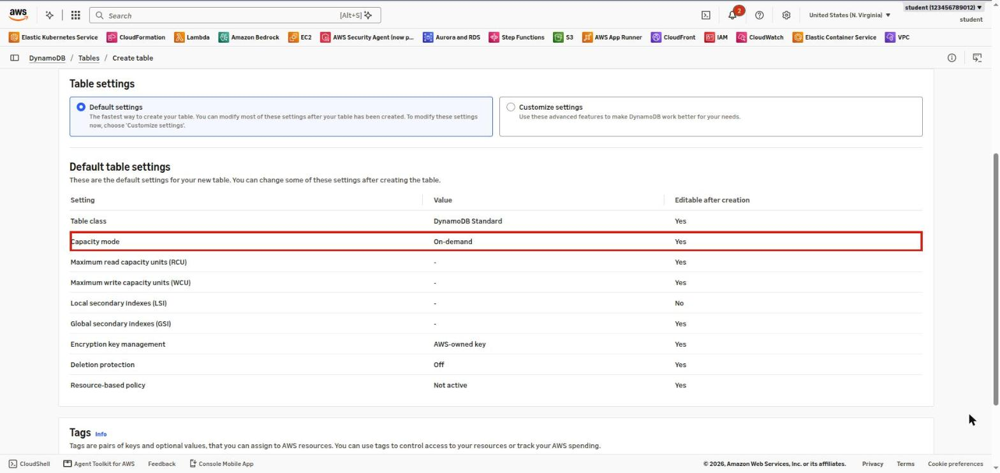
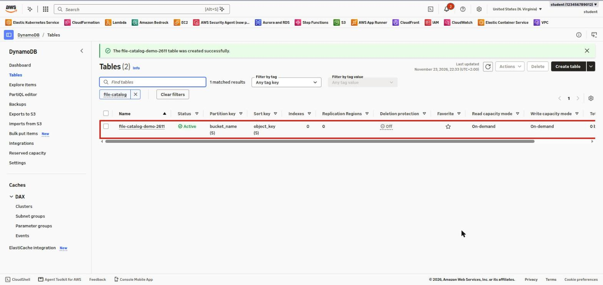
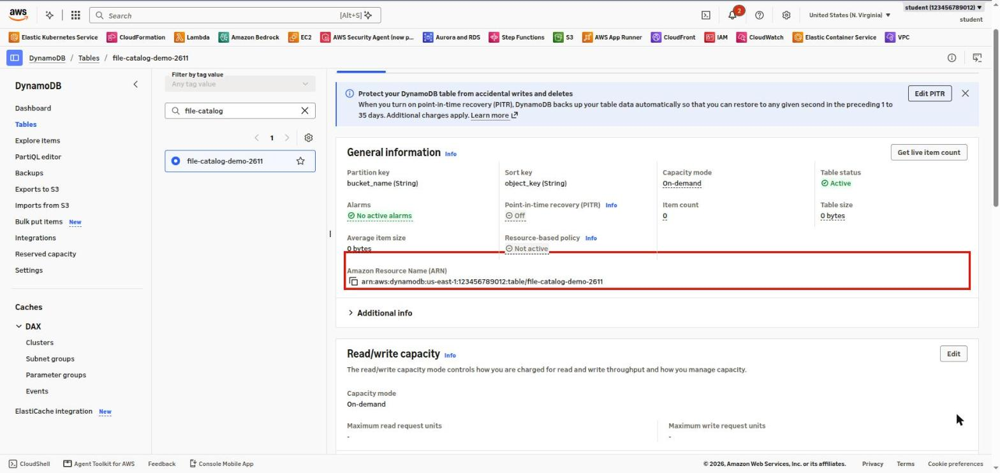

# Part 2: The DynamoDB Table

*Advanced DynamoDB Lab: A Serverless File Catalog*, Part 2 of 5. [⬅ Part 1](PART1.md) | [Lab overview](README.md) | [Part 3 ➡](PART3.md)

<!-- video: add the embed when Part 2 is uploaded -->

## What is DynamoDB?

Amazon DynamoDB is a **serverless NoSQL database**: key-value and document. There's no server or cluster to size, patch or back up by hand. You create a **table**, and you read and write **items** in it through an API.

| Term | Meaning in this lab |
|---|---|
| **Table** | The catalog: `file-catalog-…` |
| **Item** | One row: one uploaded file |
| **Attribute** | A field of an item: `bucket_name`, `object_key`, `event_time` |
| **Partition key** | Required. DynamoDB hashes it to decide where the item is stored. Here: `bucket_name` |
| **Sort key** | Optional. Orders items that share a partition key. Here: `object_key` |
| **Primary key** | Partition key + sort key. **It's unique.** Writing an item with an existing key replaces that item |

Only the key attributes are defined when you create the table. Any other attribute, like `event_time`, is added per item, with no schema change.

**Why this key?** The pair `bucket_name` + `object_key` identifies a file. Because the primary key is unique, a second upload to the same key, or a duplicate S3 event, **overwrites** the row instead of adding a new one. That's how the catalog stays at one row per file without any extra code.

**Capacity mode.** *On-demand* bills per request and scales by itself, and it's the default. *Provisioned* means you set read and write capacity in advance. On-demand fits a lab and spiky traffic.

**Scan vs. Query.** `Query` reads the items of one partition key, using the key. `Scan` reads the **whole table**. In Part 4 the reader uses `Scan`: fine for a small catalog, expensive for a large one.

## Create the table

1. Open **DynamoDB → Tables → Create table**.
2. **Table name:** your lab name (`$LAB_NAME`, for example `file-catalog-demo-2611`).
3. **Partition key:** `bucket_name`, type **String**.
4. **Sort key:** `object_key`, type **String**.

   

5. Keep **Table settings → Default settings**. Scroll down and check that **Capacity mode** is **On-demand**.

   

6. Choose **Create table** and wait for the status **Active** (a few seconds).

   

7. Open the table. Under **General information**, find the **Amazon Resource Name (ARN)** and copy it with the copy icon. You'll paste it into both IAM policies in Parts 3 and 4.

   

## The same from the terminal

```bash
aws dynamodb create-table \
  --table-name "$LAB_NAME" \
  --attribute-definitions AttributeName=bucket_name,AttributeType=S AttributeName=object_key,AttributeType=S \
  --key-schema AttributeName=bucket_name,KeyType=HASH AttributeName=object_key,KeyType=RANGE \
  --billing-mode PAY_PER_REQUEST

aws dynamodb wait table-exists --table-name "$LAB_NAME"
aws dynamodb describe-table --table-name "$LAB_NAME" --query Table.TableArn --output text
```

`HASH` is the partition key and `RANGE` is the sort key. `PAY_PER_REQUEST` is on-demand.

## Check yourself

- Why does a second upload to `incoming/one.txt` not add a row?
- What would change if the partition key were `object_key` alone, with no sort key?
- Which read is cheaper for "all files in one bucket": `Scan` or `Query`?

[⬅ Part 1](PART1.md) | [Part 3: S3 → writer Lambda → DynamoDB ➡](PART3.md)
