# Part 3: S3 → Writer Lambda → DynamoDB

*Advanced DynamoDB Lab: A Serverless File Catalog*, Part 3 of 5. [⬅ Part 2](PART2.md) | [Lab overview](README.md) | [Part 4 ➡](PART4.md)

<!-- video: add the embed when Part 3 is uploaded -->

In this part: the S3 bucket, the writer's IAM role, the writer Lambda function and its S3 trigger. Then you upload files in two ways, from the browser and with `aws s3 cp`, and watch the rows appear in the table.

**Jump to:** [A. Bucket](#a-the-s3-bucket) · [B. Writer role](#b-the-writers-iam-role) · [C. Writer function](#c-the-writer-function) · [D. S3 trigger](#d-the-s3-trigger) · [E. Upload and check](#e-upload-files-and-check)

---

## A. The S3 bucket

1. Open **S3 → Buckets → Create bucket**.
2. **Bucket type:** General purpose. **Bucket namespace:** keep **Global namespace**.
3. **Bucket name:** your lab name, the same as the table.
4. Keep the defaults below: **Block all public access** on, versioning off, default encryption. Choose **Create bucket**.

   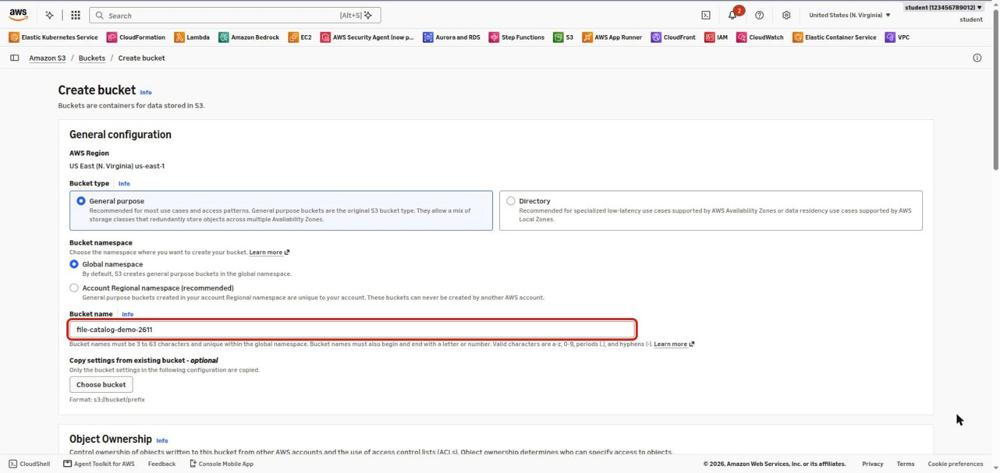

## B. The writer's IAM role

The writer runs with its own role. It needs two things: writing logs to CloudWatch, and `PutItem` on this one table.

1. Open **IAM → Roles → Create role**. **Trusted entity type:** AWS service. **Use case:** Lambda. Choose **Next**.

   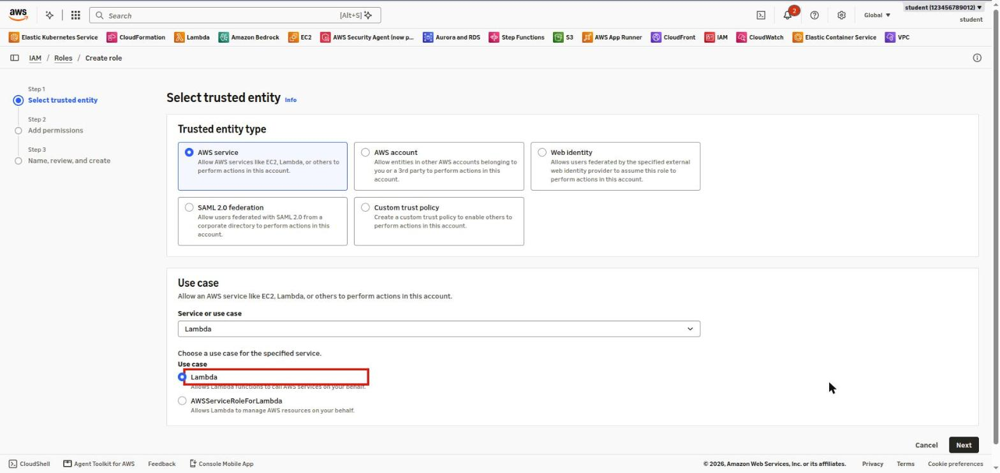

2. Search for **`AWSLambdaBasicExecutionRole`**, set **Filter by Type** to *AWS managed*, select it and choose **Next**. This policy lets the function write its logs.

   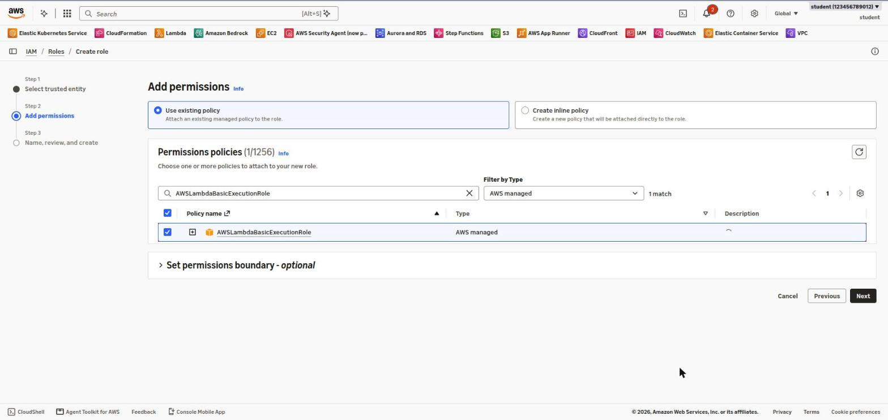

3. **Role name:** `<lab-name>-writer`. Choose **Create role**.

   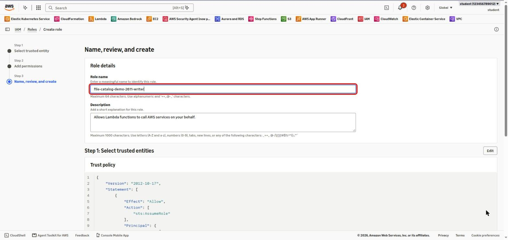

4. Open the new role. Choose **Add permissions → Create inline policy**.

   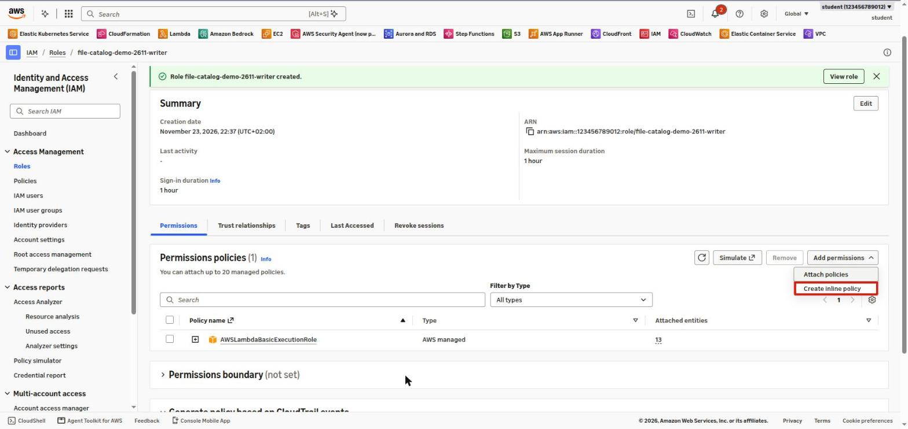

5. Switch the editor to **JSON** and paste this policy. Replace the whole `Resource` value with **your table ARN** from Part 2 (copy it from the table's *General information*):

   ```json
   {
     "Version": "2012-10-17",
     "Statement": [
       {
         "Effect": "Allow",
         "Action": "dynamodb:PutItem",
         "Resource": "arn:aws:dynamodb:us-east-1:<your-account-id>:table/<lab-name>"
       }
     ]
   }
   ```

   > ⚠️ **Paste your own ARN.** It holds your 12-digit account ID and your table name. If the account ID or the table name in the policy doesn't match your table, every `PutItem` fails with `AccessDeniedException` ("no identity-based policy allows the dynamodb:PutItem action").

   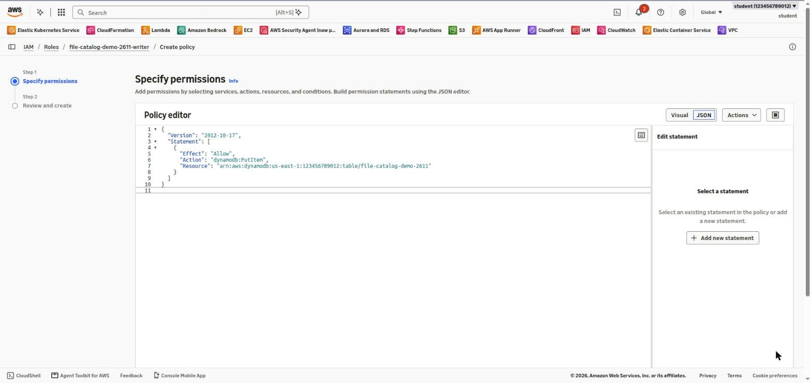

6. Choose **Next**. **Policy name:** `catalog-write`. Choose **Create policy**.

   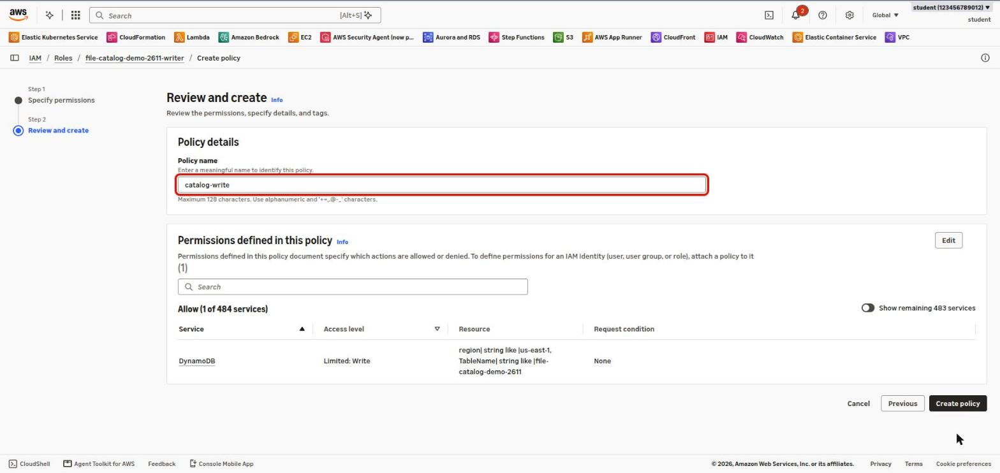

The role now has two policies: the AWS managed one for logs, and your inline one for the table.

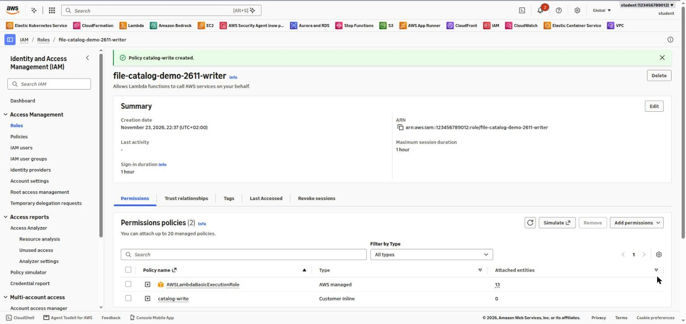

## C. The writer function

1. Open **Lambda → Create function**. The Console calls it **Create Event Function**. Keep **Author from scratch**.
2. **Function name:** `<lab-name>-writer`. **Runtime:** **Python 3.14**.

   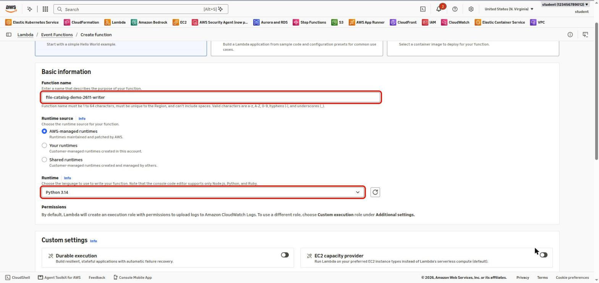

3. Expand **Additional settings** and turn on **Custom execution role**. In the panel, choose your role `<lab-name>-writer` and **Save**. Then choose **Create Event Function**.

   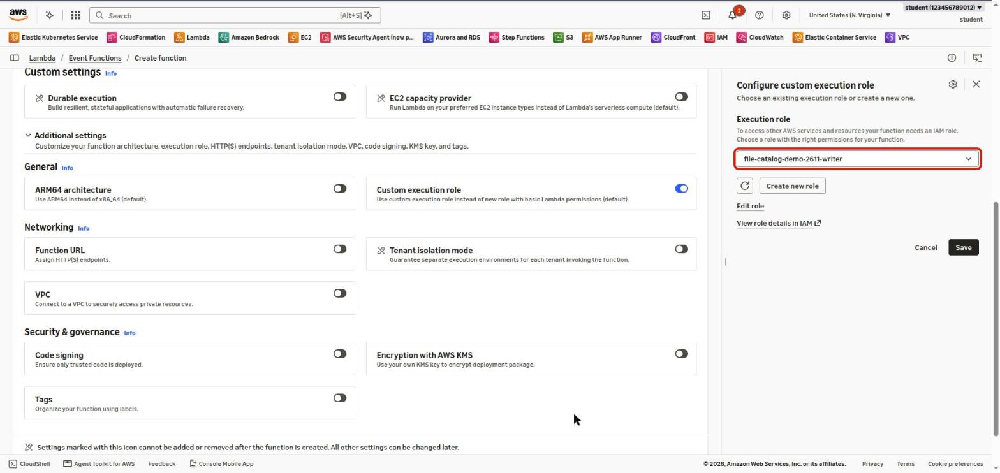

4. On the **Code** tab, replace all of `lambda_function.py` with the [writer code](lambda-code/writer/lambda_function.py) and choose **Deploy**. The handler stays `lambda_function.lambda_handler`, the default.

   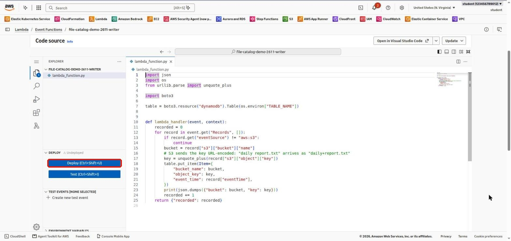

   **The code in a few words:** for each record in the S3 event, it takes the bucket name and the object key, decodes the key (S3 sends `daily report.txt` as `daily+report.txt`), and calls `put_item` with the bucket, the key and the event time. It prints one log line per file.

   <details><summary>The writer code</summary>

   ```python
   import json
   import os
   from urllib.parse import unquote_plus

   import boto3

   table = boto3.resource("dynamodb").Table(os.environ["TABLE_NAME"])


   def lambda_handler(event, context):
       recorded = 0
       for record in event.get("Records", []):
           if record.get("eventSource") != "aws:s3":
               continue
           bucket = record["s3"]["bucket"]["name"]
           # S3 sends the key URL-encoded: "daily report.txt" arrives as "daily+report.txt"
           key = unquote_plus(record["s3"]["object"]["key"])
           table.put_item(Item={
               "bucket_name": bucket,
               "object_key": key,
               "event_time": record["eventTime"],
           })
           print(json.dumps({"bucket": bucket, "key": key}))
           recorded += 1
       return {"recorded": recorded}
   ```

   </details>

5. Open **Configuration → Environment variables → Edit → Add environment variable**. **Key:** `TABLE_NAME`, **Value:** your table name. **Save**. The code reads the table name from here.

   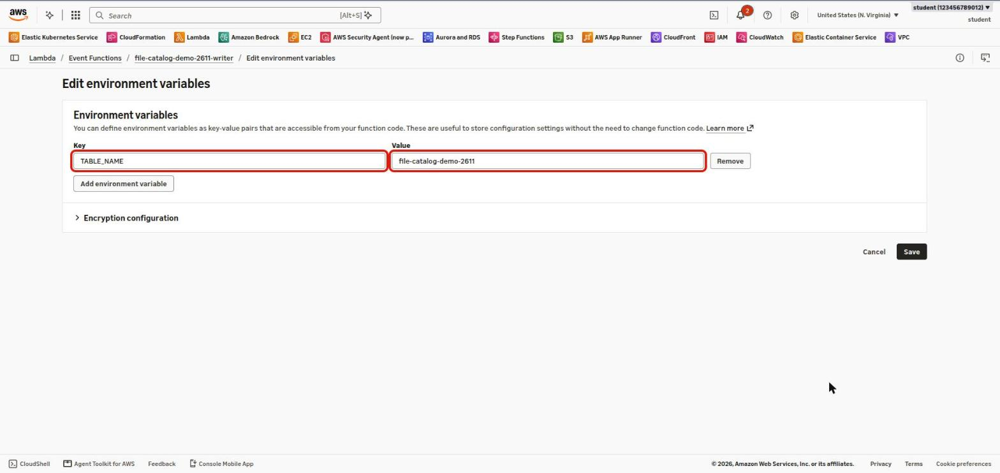

## D. The S3 trigger

1. In the function overview, choose **Add trigger**.

   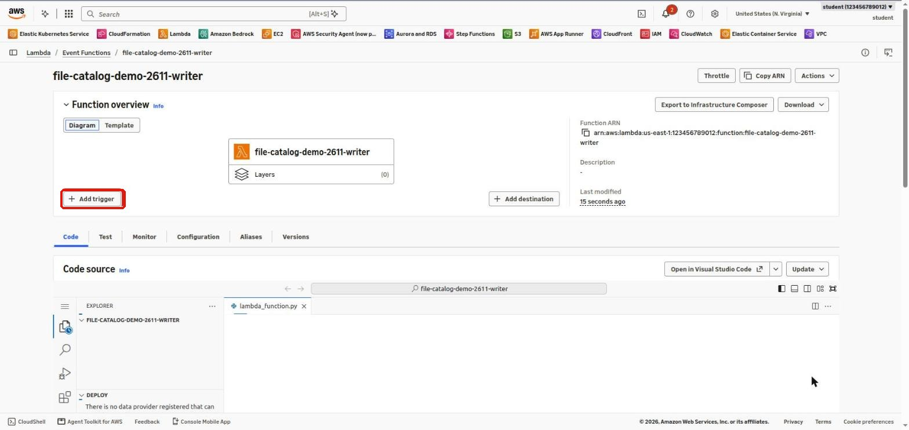

2. **Source:** S3. **Bucket:** your bucket. **Event types:** *All object create events*. **Prefix:** `incoming/`. Leave the suffix empty.
3. Tick the **Recursive invocation** acknowledgment. It warns about functions that write back to the same bucket. Our writer writes only to DynamoDB, so there's no loop. Choose **Add**.

   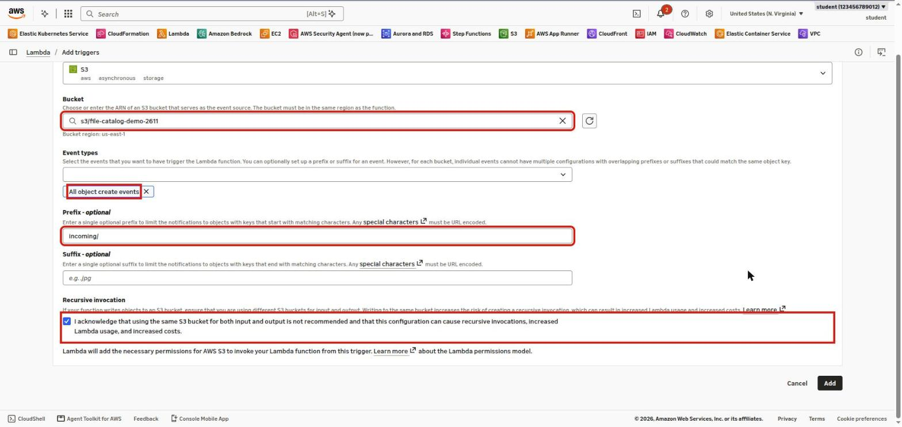

   The Console configures **both sides** for you: the event notification on the bucket, and a statement in the function's resource policy that lets S3 invoke it. In Terraform (Part 5) you write both yourself.

   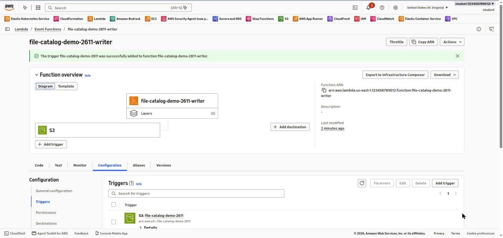

## E. Upload files and check

### From the browser

Open the bucket at the `incoming/` prefix directly:

```text
https://us-east-1.console.aws.amazon.com/s3/upload/<lab-name>?region=us-east-1&prefix=incoming/
```

Choose **Add files**, pick `one.txt` and `daily report.txt` (any small text files), and choose **Upload**. The destination is `s3://<lab-name>/incoming/`.

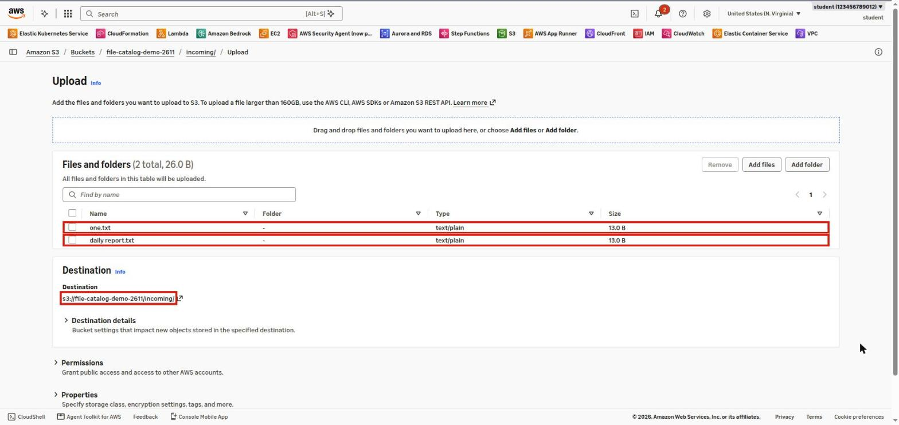

> ⚠️ **Don't use *Create folder* here.** In S3 a "folder" is an empty object named `incoming/`. Creating it fires the trigger, and the writer records a row for `incoming/` itself. Uploading straight to the prefix, as above, doesn't create that object.

### With `aws s3 cp`

```bash
export BUCKET_NAME="$LAB_NAME"
printf 'Catalog test\n' > sample.txt
aws s3 cp sample.txt "s3://${BUCKET_NAME}/incoming/three.txt"
aws s3 cp sample.txt "s3://${BUCKET_NAME}/ignored/skip.txt"
aws s3 ls "s3://${BUCKET_NAME}" --recursive
```

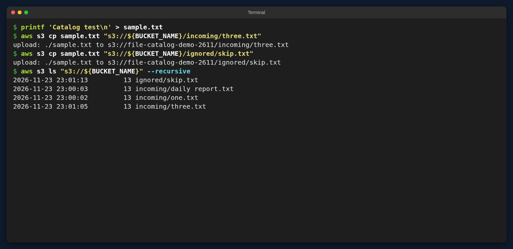

### The rows in DynamoDB

Open **DynamoDB → Explore items**, choose your table and **Run**. There are **3 items**. `ignored/skip.txt` isn't there, because it's outside the prefix. The name with the space is stored as uploaded.

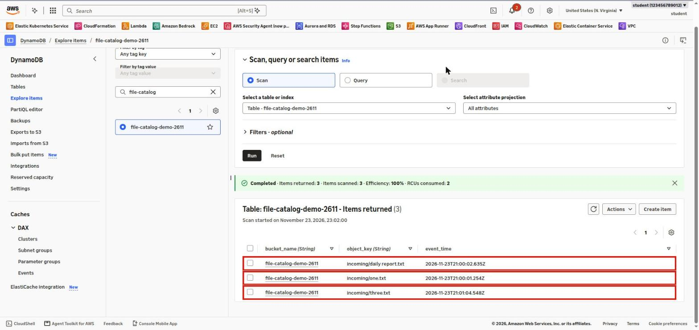

### The writer's logs

Open **CloudWatch → Log groups → `/aws/lambda/<lab-name>-writer` → Search all log streams**. Each upload produced one invocation and one log line with the bucket and the key.

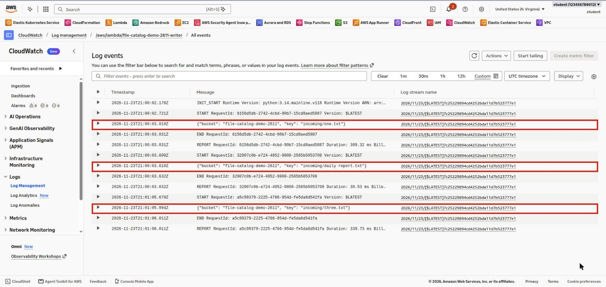

S3 events are asynchronous: in this run each row appeared within seconds, but delivery can sometimes take a minute or longer. If one is missing, check the logs first.

## Troubleshooting

| Symptom | Check |
|---|---|
| No log after an upload | The trigger's bucket and prefix (`incoming/`, with the slash), and the Region. Upload a new file after adding the trigger |
| `KeyError: 'TABLE_NAME'` | The environment variable is missing, or misspelled |
| `AccessDeniedException` on `PutItem` ("no identity-based policy allows the dynamodb:PutItem action") | The policy's `Resource` isn't your table's ARN: check the account ID and the table name (**IAM → Roles → your writer role → the inline policy → JSON**). Or the function uses a different role (**Configuration → Permissions**). New roles can take a few seconds to work |
| A row for `incoming/` | You used *Create folder*. Delete that row in **Explore items** |

[⬅ Part 2](PART2.md) | [Part 4: The reader Lambda and its Function URL ➡](PART4.md)
