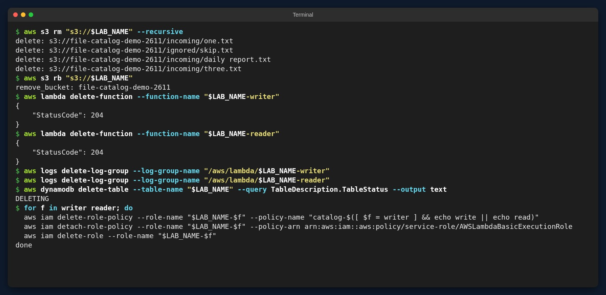

# Part 5: Clean Up

*Advanced DynamoDB Lab: A Serverless File Catalog*, Part 5 of 6. [⬅ Part 4](PART4.md) | [Lab overview](README.md) | [Part 6 ➡](PART6.md)

<!-- video: add the embed when Part 5 is uploaded -->

Delete everything you built in Parts 2–4: the bucket, the table, both functions, both roles and the log groups. The reader's URL is public, so don't leave it running.

> ℹ️ **Going on to [Part 6](PART6.md)?** Terraformer imports this running environment, so do Part 6 first and come back here to delete it.

**Jump to:** [From the terminal](#from-the-terminal) · [In the Console](#in-the-console) · [Different names](#if-your-names-are-different) · [Check](#check-that-nothing-is-left)

---

## Clean up

### From the terminal

Delete the **bucket** first: the trigger goes with it, so no more events reach the writer. `aws s3 rm --recursive` deletes your test files for good.

```bash
export LAB_NAME=file-catalog-your-unique-suffix   # the name you chose in Part 1

aws s3 rm "s3://$LAB_NAME" --recursive
aws s3 rb "s3://$LAB_NAME"
aws lambda delete-function --function-name "$LAB_NAME-writer"
aws lambda delete-function --function-name "$LAB_NAME-reader"   # the Function URL goes with it
aws logs delete-log-group --log-group-name "/aws/lambda/$LAB_NAME-writer"
aws logs delete-log-group --log-group-name "/aws/lambda/$LAB_NAME-reader"
aws dynamodb delete-table --table-name "$LAB_NAME" --query TableDescription.TableStatus --output text
for f in writer reader; do
  aws iam delete-role-policy --role-name "$LAB_NAME-$f" --policy-name "catalog-$([ $f = writer ] && echo write || echo read)"
  aws iam detach-role-policy --role-name "$LAB_NAME-$f" --policy-arn arn:aws:iam::aws:policy/service-role/AWSLambdaBasicExecutionRole
  aws iam delete-role --role-name "$LAB_NAME-$f"
done
```



### In the Console

The same order: **S3** (empty, then delete the bucket) → **Lambda** (both functions) → **CloudWatch** (both log groups) → **DynamoDB** (the table) → **IAM** (both roles).

### If your names are different

The commands above assume the names from Parts 2–4. If you named something differently, list what you have and use those names:

```bash
aws lambda list-functions --query "Functions[?contains(FunctionName,'catalog')].[FunctionName,Role]" --output table
aws iam list-roles --query "Roles[?contains(RoleName,'catalog')].RoleName" --output table
```

A role must be empty before IAM deletes it. List what it holds, then remove each policy:

```bash
ROLE=your-role-name
aws iam list-role-policies --role-name "$ROLE"            # inline policies
aws iam list-attached-role-policies --role-name "$ROLE"   # attached policies

aws iam delete-role-policy --role-name "$ROLE" --policy-name <inline-policy-name>
aws iam detach-role-policy --role-name "$ROLE" --policy-arn <attached-policy-arn>
aws iam delete-role --role-name "$ROLE"
```

**A role the Console created.** If you created a function without turning on **Custom execution role**, the Console made a role named `<function-name>-role-<random>`, with its own policy `AWSLambdaBasicExecutionRole-<id>`. Delete both:

```bash
ROLE=<function-name>-role-<random>
POLICY_ARN=$(aws iam list-attached-role-policies --role-name "$ROLE" --query 'AttachedPolicies[0].PolicyArn' --output text)
aws iam detach-role-policy --role-name "$ROLE" --policy-arn "$POLICY_ARN"
aws iam delete-role --role-name "$ROLE"
aws iam delete-policy --policy-arn "$POLICY_ARN"
```

Delete only the `AWSLambdaBasicExecutionRole-<id>` policy that was attached to your lab's role. Others with a similar name belong to other functions in your account.

## Check that nothing is left

Each command should print nothing:

```bash
aws s3api list-buckets --query "Buckets[?contains(Name,'catalog')].Name" --output text
aws dynamodb list-tables --query "TableNames[?contains(@,'catalog')]" --output text
aws lambda list-functions --query "Functions[?contains(FunctionName,'catalog')].FunctionName" --output text
aws iam list-roles --query "Roles[?contains(RoleName,'catalog')].RoleName" --output text
aws logs describe-log-groups --log-group-name-prefix /aws/lambda/file-catalog --query 'logGroups[].logGroupName' --output text
```

[⬅ Part 4](PART4.md) | [Part 6: From the Console to Terraform with Terraformer ➡](PART6.md)
