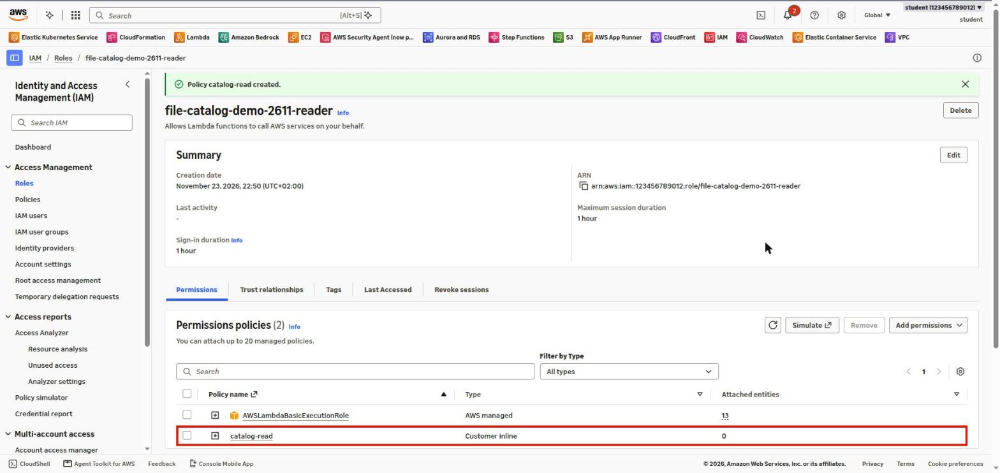
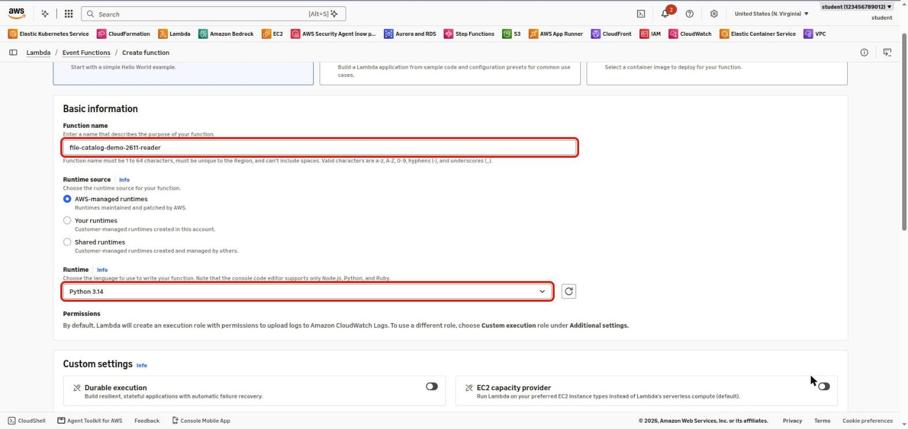
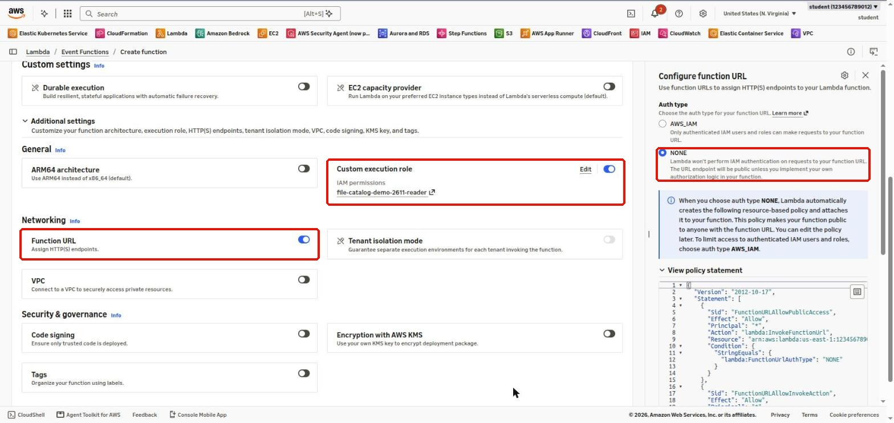
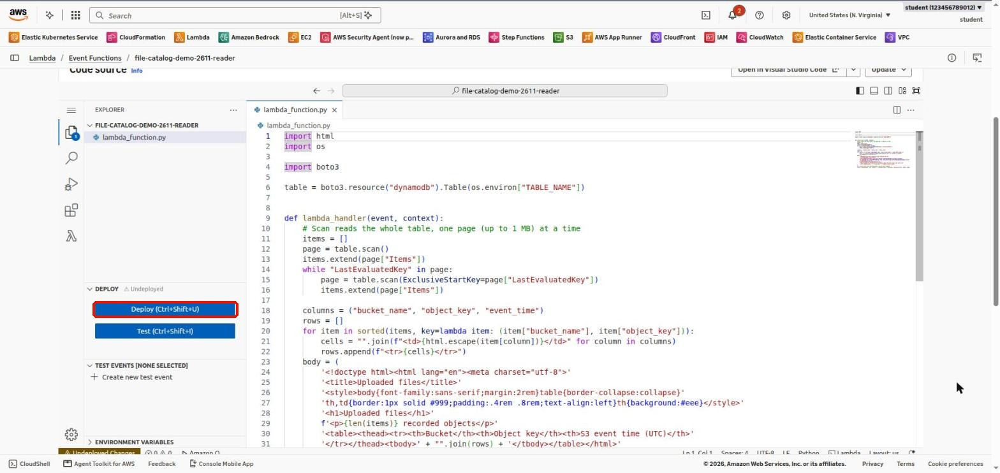
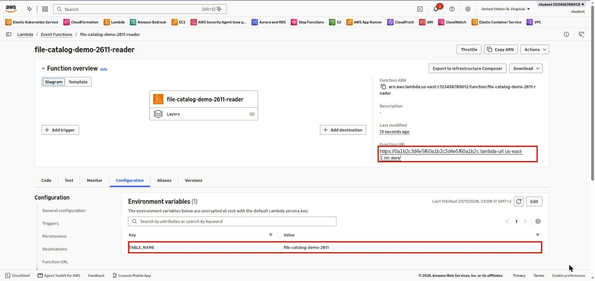
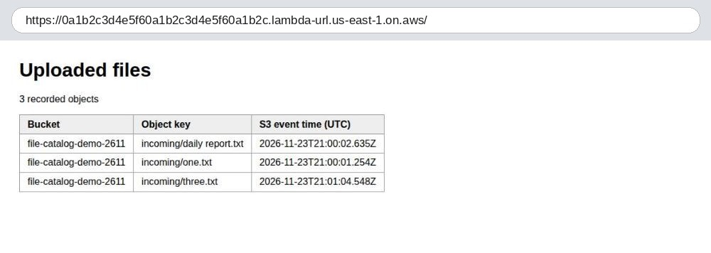
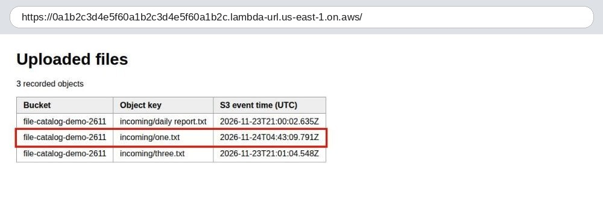

# Part 4: The Reader Lambda and Its Function URL

*Advanced DynamoDB Lab: A Serverless File Catalog*, Part 4 of 5. [⬅ Part 3](../part-3-s3-writer-lambda/README.md) | [Lab overview](../README.md) | [Part 5 ➡](../part-5-terraformer/README.md)

<!-- video: add the embed when Part 4 is uploaded -->

In this part: a second function that reads the table and returns the report as an HTML page, at a public **Function URL**: an HTTPS address that belongs to the function, with no API Gateway in front.

**Jump to:** [A. Reader role](#a-the-readers-iam-role) · [B. Reader function and URL](#b-the-reader-function-with-a-function-url) · [C. Open the report](#c-open-the-report) · [Security](#who-can-open-the-url)

---

## A. The reader's IAM role

Repeat [Part 3, step B](../part-3-s3-writer-lambda/README.md#b-the-writers-iam-role) with two changes:

| | Writer (Part 3) | Reader (this part) |
|---|---|---|
| Role name | `<lab-name>-writer` | `<lab-name>-reader` |
| Inline policy name | `catalog-write` | `catalog-read` |
| Action | `dynamodb:PutItem` | `dynamodb:Scan` |

```json
{
  "Version": "2012-10-17",
  "Statement": [
    {
      "Effect": "Allow",
      "Action": "dynamodb:Scan",
      "Resource": "arn:aws:dynamodb:us-east-1:123456789012:table/file-catalog-demo-2611"
    }
  ]
}
```



Two roles, each with only what its function does: the writer can't read the table, and the reader can't change it.

## B. The reader function, with a Function URL

1. **Lambda → Create function** (*Create Event Function*), **Author from scratch**. **Function name:** `<lab-name>-reader`. **Runtime:** **Python 3.14**.

   

2. Expand **Additional settings**:
   - Turn on **Custom execution role**, choose `<lab-name>-reader`, **Save**.
   - Turn on **Function URL**. In the panel, set **Auth type** to **NONE** and keep **Invoke mode** *BUFFERED*. **Save**.

   

   With **NONE**, the Console adds two statements to the function's resource policy, shown under *View policy statement*: `lambda:InvokeFunctionUrl` for everyone (`"Principal": "*"`), and `lambda:InvokeFunction` for calls that come through the URL. A public URL needs both.

3. Choose **Create Event Function**.
4. On the **Code** tab, replace `lambda_function.py` with the [reader code](../lambda-code/reader/lambda_function.py) and choose **Deploy**.

   

   **The code in a few words:** it calls `scan` until DynamoDB stops returning `LastEvaluatedKey` (a scan returns at most 1 MB per page), sorts the rows by bucket and key, escapes each value with `html.escape`, and returns a dictionary with `statusCode`, an HTML `Content-Type` header and the page as `body`. The Function URL turns that dictionary into the HTTP response.

   <details><summary>The reader code</summary>

   ```python
   import html
   import os

   import boto3

   table = boto3.resource("dynamodb").Table(os.environ["TABLE_NAME"])


   def lambda_handler(event, context):
       # Scan reads the whole table, one page (up to 1 MB) at a time
       items = []
       page = table.scan()
       items.extend(page["Items"])
       while "LastEvaluatedKey" in page:
           page = table.scan(ExclusiveStartKey=page["LastEvaluatedKey"])
           items.extend(page["Items"])

       columns = ("bucket_name", "object_key", "event_time")
       rows = []
       for item in sorted(items, key=lambda item: (item["bucket_name"], item["object_key"])):
           cells = "".join(f"<td>{html.escape(item[column])}</td>" for column in columns)
           rows.append(f"<tr>{cells}</tr>")
       body = (
           '<!doctype html><html lang="en"><meta charset="utf-8">'
           '<title>Uploaded files</title>'
           '<style>body{font-family:sans-serif;margin:2rem}table{border-collapse:collapse}'
           'th,td{border:1px solid #999;padding:.4rem .8rem;text-align:left}th{background:#eee}</style>'
           '<h1>Uploaded files</h1>'
           f'<p>{len(items)} recorded objects</p>'
           '<table><thead><tr><th>Bucket</th><th>Object key</th><th>S3 event time (UTC)</th>'
           '</tr></thead><tbody>' + "".join(rows) + '</tbody></table></html>'
       )
       # A function URL turns this dictionary into an HTTP response
       return {"statusCode": 200, "headers": {"Content-Type": "text/html; charset=utf-8"}, "body": body}
   ```

   </details>

5. Add the environment variable **`TABLE_NAME`** = your table name, as in Part 3 (**Configuration → Environment variables**). The function overview now shows the **Function URL**.

   

## C. Open the report

Open the Function URL in a browser. The three files from Part 3 are there, `ignored/skip.txt` isn't, and `daily report.txt` keeps its space.



Now upload again to a key that already exists, and reload the page:

```bash
aws s3 cp sample.txt "s3://${BUCKET_NAME}/incoming/one.txt"
```

Still **3 recorded objects**. Only the time on `incoming/one.txt` changed: the same primary key overwrote the row.



The same check from the terminal:

```bash
curl -s "https://<your-url-id>.lambda-url.us-east-1.on.aws/" | grep -o '<p>[^<]*</p>'
```

```text
<p>3 recorded objects</p>
```

That's the [acceptance test](../part-1-intro/README.md#the-acceptance-test) passed.

## Who can open the URL?

**Anyone who has the URL.** Auth type NONE means no IAM check. The address is long and random, but it isn't a secret: it shows up in browser history, logs and chat messages. That's fine for a lab report with test file names, but not for real data. In production:

- Use **Auth type AWS_IAM**, so callers must sign requests with AWS credentials; or
- Put **CloudFront** or **API Gateway** in front, with authentication, throttling and a WAF.

Every request runs the function and a `Scan`, and you pay for both. A public URL can be called by anyone, as often as they like.

## Check yourself

- Why does the reader have its own role instead of reusing the writer's?
- The report scans the whole table on every page load. How would you show only the files of one prefix, for a catalog of a million files? (Hint: a different key design and `Query`.)

[⬅ Part 3](../part-3-s3-writer-lambda/README.md) | [Part 5: From the Console to Terraform with Terraformer ➡](../part-5-terraformer/README.md)
