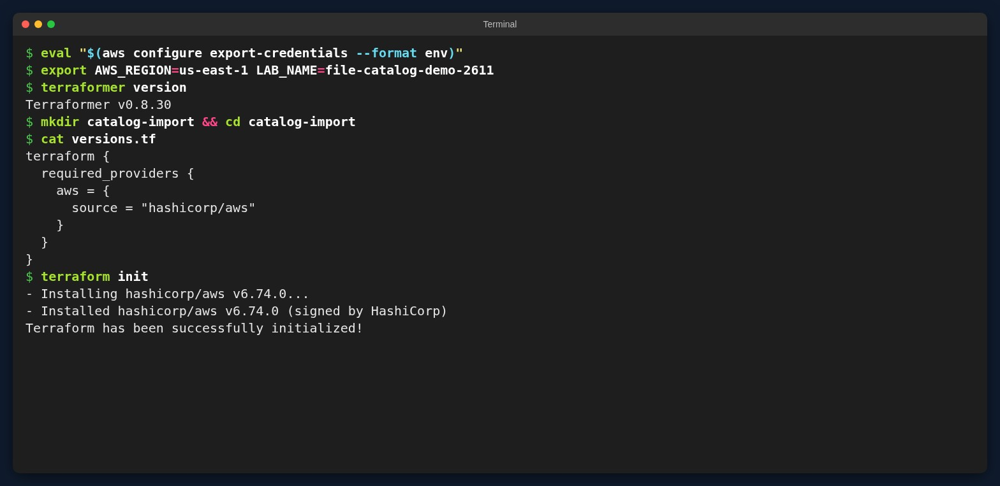
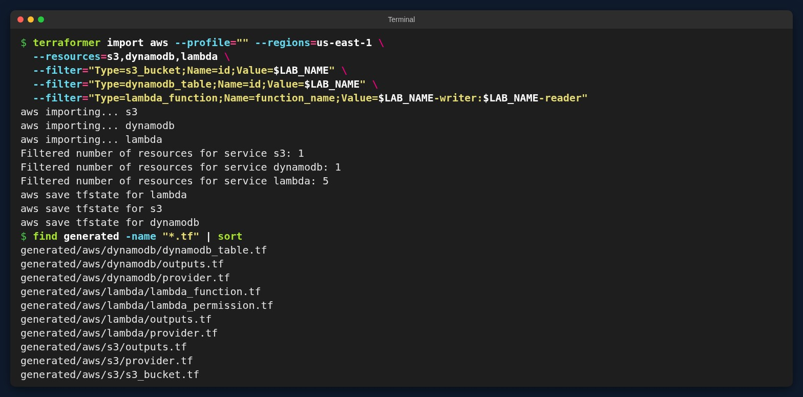
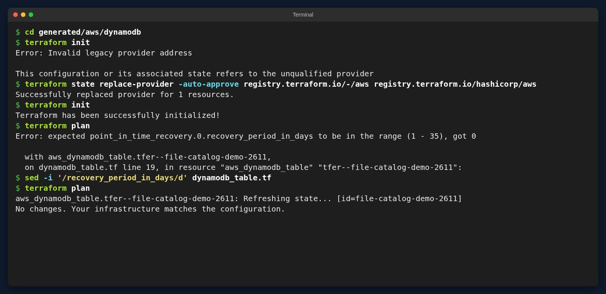
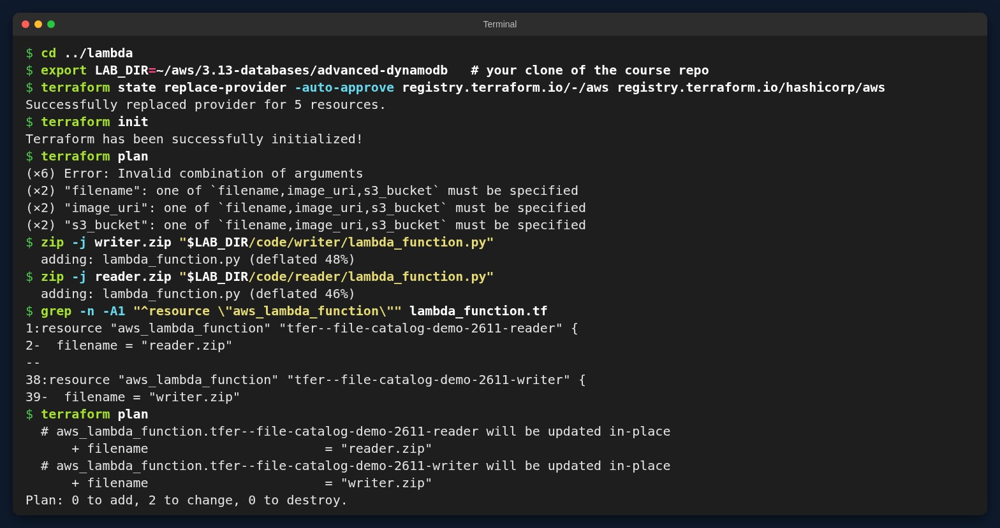
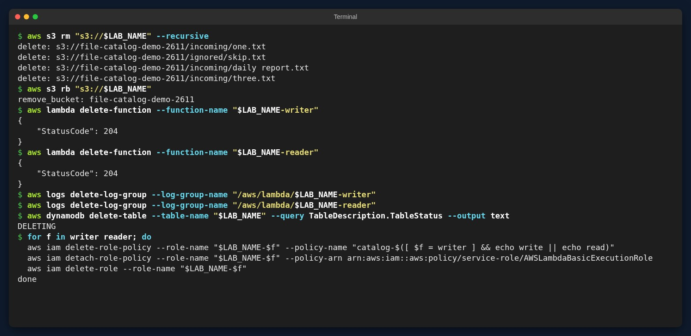

# Part 5: From the Console to Terraform with Terraformer

*Advanced DynamoDB Lab: A Serverless File Catalog*, Part 5 of 5. [⬅ Part 4](../part-4-reader-function-url/README.md) | [Lab overview](../README.md)

<!-- video: add the embed when Part 5 is uploaded -->

You built everything by hand. Now turn the running environment into Terraform code. **[Terraformer](https://github.com/GoogleCloudPlatform/terraformer)** is an open-source CLI tool from Google: it reads resources from your account and writes `.tf` files and a state file for them ("reverse Terraform").

You'll see that the result is a **draft**: useful, but not something you can apply as is. At the end you compare it with the full hand-written solution in [`terraform/`](../terraform/), and clean up.

**Jump to:** [A. Install and set up](#a-install-terraformer-and-set-up) · [B. Import](#b-import-the-lab) · [C. Fix the draft](#c-make-the-draft-plan-cleanly) · [D. What's missing](#d-what-terraformer-didnt-import) · [E. The full solution](#e-the-full-solution-terraform) · [Clean up](#clean-up)

> All commands in this part run **in a terminal on your computer**. The terminal images show the real output, with the account number masked.

---

## A. Install Terraformer and set up

Download the AWS build of the latest release (0.8.30) and put it on your `PATH`:

```bash
# Linux (x86_64)
curl -LO https://github.com/GoogleCloudPlatform/terraformer/releases/download/0.8.30/terraformer-aws-linux-amd64
chmod +x terraformer-aws-linux-amd64
mkdir -p ~/.local/bin && mv terraformer-aws-linux-amd64 ~/.local/bin/terraformer

# macOS
brew install terraformer
```

**Credentials.** Terraformer uses an older AWS SDK that can't read the session that `aws login` creates. Export the session as environment variables, and later pass `--profile=""` so Terraformer uses them instead of looking for a profile:

```bash
eval "$(aws configure export-credentials --format env)"
export AWS_REGION=us-east-1 LAB_NAME=file-catalog-your-unique-suffix
```

The session expires after a while. If Terraformer fails with `failed to refresh cached credentials`, run the `eval` line again.

**The AWS provider.** Terraformer needs the AWS provider plugin in its working folder. Create a folder with a minimal `versions.tf` and run `terraform init`:

```bash
mkdir catalog-import && cd catalog-import
cat > versions.tf <<'EOF'
terraform {
  required_providers {
    aws = {
      source = "hashicorp/aws"
    }
  }
}
EOF
terraform init
```



## B. Import the lab

Import three services, and filter each one to the lab's resources only. Without filters, Terraformer imports **every** bucket, table and function in the Region.

```bash
terraformer import aws --profile="" --regions=us-east-1 \
  --resources=s3,dynamodb,lambda \
  --filter="Type=s3_bucket;Name=id;Value=$LAB_NAME" \
  --filter="Type=dynamodb_table;Name=id;Value=$LAB_NAME" \
  --filter="Type=lambda_function;Name=function_name;Value=$LAB_NAME-writer:$LAB_NAME-reader"
```

| Filter | Keeps |
|---|---|
| `Type=s3_bucket;Name=id;Value=…` | The bucket whose ID is the lab name |
| `Type=dynamodb_table;Name=id;Value=…` | The table whose ID is the lab name |
| `Type=lambda_function;Name=function_name;Value=a:b` | The two functions. `:` separates values. A function's `id` is its ARN, so filter on `function_name` |



Lambda has **5** resources: the two functions and three `aws_lambda_permission` statements. These are the S3 invoke grant from Part 3 and the two Function URL statements from Part 4. Terraformer writes one folder per service, each with its own `.tf` files and its own `terraform.tfstate`:

```text
generated/aws/
├── dynamodb/  dynamodb_table.tf  outputs.tf  provider.tf  terraform.tfstate
├── lambda/    lambda_function.tf  lambda_permission.tf  outputs.tf  provider.tf  terraform.tfstate
└── s3/        s3_bucket.tf  outputs.tf  provider.tf  terraform.tfstate
```

Resource names start with `tfer--`, and the values are copied as they are in AWS, including your account ID in ARNs. **Don't push `generated/` to a public repository.**

## C. Make the draft plan cleanly

The goal: `terraform plan` in each folder shows **no changes**, which means the code matches what's running.

### DynamoDB

```bash
cd generated/aws/dynamodb
terraform state replace-provider -auto-approve registry.terraform.io/-/aws registry.terraform.io/hashicorp/aws
terraform init
terraform plan
sed -i '/recovery_period_in_days/d' dynamodb_table.tf   # macOS: sed -i '' …
terraform plan
```



Two fixes:

1. **The state is in the Terraform 0.12 format,** with the old provider address `-/aws`. `terraform init` refuses it until `replace-provider` points it at `hashicorp/aws`. Every folder needs this.
2. Terraformer wrote `recovery_period_in_days = "0"` (point-in-time recovery is off), which the provider rejects. Delete the line.

### S3

```bash
cd ../s3
terraform state replace-provider -auto-approve registry.terraform.io/-/aws registry.terraform.io/hashicorp/aws
terraform init
terraform plan
```

The plan shows `No changes`, with warnings: the generated bucket uses inline blocks (`versioning`, `server_side_encryption_configuration`) that the AWS provider now wants as separate resources. It works, but it's the old style.

### Lambda

```bash
cd ../lambda
export LAB_DIR=~/aws/3.13-databases/advanced-dynamodb   # your clone of the course repo
terraform state replace-provider -auto-approve registry.terraform.io/-/aws registry.terraform.io/hashicorp/aws
terraform init
terraform plan
zip -j writer.zip "$LAB_DIR/code/writer/lambda_function.py"
zip -j reader.zip "$LAB_DIR/code/reader/lambda_function.py"
```

Terraformer **doesn't export the function code.** The resource has no `filename`, so the plan fails. Zip the handlers from the repo, then add one line at the top of each function's block in `lambda_function.tf`:

```hcl
resource "aws_lambda_function" "tfer--file-catalog-demo-2611-reader" {
  filename = "reader.zip"
  ...
}

resource "aws_lambda_function" "tfer--file-catalog-demo-2611-writer" {
  filename = "writer.zip"
  ...
}
```



The plan now shows `0 to add, 2 to change, 0 to destroy`: Terraform only records the new `filename` attribute. Nothing is replaced. Applying it is safe, but you don't have to.

## D. What Terraformer didn't import

Compare the draft with what you built in Parts 2–4:

| Resource | In the draft? | Why |
|---|---|---|
| DynamoDB table | ✅ | |
| S3 bucket | ✅ | Old inline style |
| Lambda functions | ⚠️ | No code. You add the zip |
| Lambda permissions (S3, Function URL) | ✅ | With your account ID and random statement IDs |
| **IAM roles and their inline policies** | ❌ | The `iam` service has no working filter here: it imports **every** user, group, role, policy and access key in the account. Never run it on a real account to get two roles |
| **S3 event notification** (the trigger) | ❌ | Terraformer 0.8.30's `s3` service imported the bucket only |
| **Function URL** | ❌ | Terraformer 0.8.30's `lambda` service imported the functions and permissions only |
| **CloudWatch log groups** | ❌ | Not requested in this import |
| References between resources | ❌ | Everything is hard-coded: the role ARN, the table name in `TABLE_NAME`, the bucket ARN in the permission |

**The lesson:** Terraformer is a quick way to **discover** what exists and get a starting point. Production code still needs a person: variables instead of hard-coded names, references between resources (`aws_dynamodb_table.catalog.arn`), one state file, and the pieces the tool can't see. Terraform 1.5+ also has a built-in alternative: `import` blocks with `terraform plan -generate-config-out=generated.tf`.

## E. The full solution: `terraform/`

The repo's [`terraform/`](../terraform/) folder is the same lab written by hand: **16 resources**, one state, one variable for the name.

| File | What's in it |
|---|---|
| [`storage.tf`](../terraform/storage.tf) | The table and the bucket |
| [`iam.tf`](../terraform/iam.tf) | The two roles, the log policy attachments and the two inline policies, each scoped to `aws_dynamodb_table.catalog.arn` |
| [`lambda.tf`](../terraform/lambda.tf) | The code zipped from `../code` with `archive_file`, the log groups, both functions, the S3 invoke permission, the **bucket notification** (`depends_on` the permission, because S3 tests it when the notification is saved), the **Function URL** and its invoke permission |
| [`variables.tf`](../terraform/variables.tf), [`outputs.tf`](../terraform/outputs.tf) | `lab_name` and `region` in; `bucket_name`, `table_name` and `report_url` out |

Deploy it with a **new** name, so it can't collide with the Console stack:

```bash
cd ~/aws/3.13-databases/advanced-dynamodb/terraform
cp terraform.tfvars.example terraform.tfvars   # set lab_name to a new unique name
terraform init
terraform plan -out=lab.tfplan
terraform apply lab.tfplan
```

```text
Plan: 16 to add, 0 to change, 0 to destroy.
...
Apply complete! Resources: 16 added, 0 changed, 0 destroyed.

Outputs:

bucket_name = "file-catalog-tf-2611"
report_url = "https://….lambda-url.us-east-1.on.aws/"
table_name = "file-catalog-tf-2611"
```

Run the [acceptance test](../part-1-intro/README.md#the-acceptance-test) against it with `BUCKET_NAME="$(terraform output -raw bucket_name)"`, and open `terraform output -raw report_url`. In our run it took about 45 seconds to apply, and the report showed 3 recorded objects.

## Clean up

### The Console stack (Parts 2–4)

The Terraformer state files only cover part of the stack, so delete it by hand or with the CLI. Delete the **bucket** first: the trigger goes with it, so no more events reach the writer.

```bash
aws s3 rm "s3://$LAB_NAME" --recursive
aws s3 rb "s3://$LAB_NAME"
aws lambda delete-function --function-name "$LAB_NAME-writer"
aws lambda delete-function --function-name "$LAB_NAME-reader"   # the Function URL goes with it
aws logs delete-log-group --log-group-name "/aws/lambda/$LAB_NAME-writer"
aws logs delete-log-group --log-group-name "/aws/lambda/$LAB_NAME-reader"
aws dynamodb delete-table --table-name "$LAB_NAME" --query TableDescription.TableStatus --output text
for f in writer reader; do
  aws iam delete-role-policy --role-name "$LAB_NAME-$f" --policy-name "catalog-$([ $f = writer ] && echo write || echo read)"
  aws iam detach-role-policy --role-name "$LAB_NAME-$f" --policy-arn arn:aws:iam::aws:policy/service-role/AWSLambdaBasicExecutionRole
  aws iam delete-role --role-name "$LAB_NAME-$f"
done
```



In the Console it's the same order: **S3** (empty, then delete the bucket) → **Lambda** (both functions) → **CloudWatch** (both log groups) → **DynamoDB** (the table) → **IAM** (both roles).

### The Terraform stack (section E)

```bash
terraform destroy
```

```text
Destroy complete! Resources: 16 destroyed.
```

`force_destroy = true` on the bucket lets Terraform delete it with the test files inside.

### Local files

Delete the `catalog-import` folder. Its `generated/` state files hold your account ID and the details of the deleted resources.

[⬅ Part 4](../part-4-reader-function-url/README.md) | [Lab overview](../README.md)
