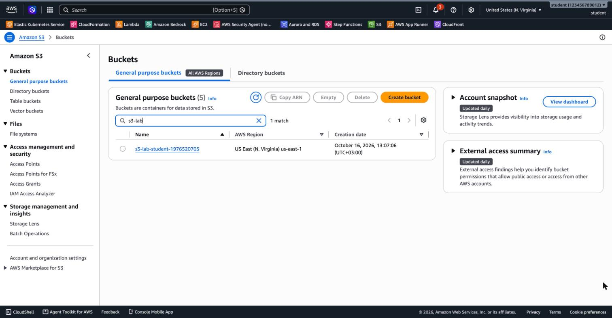
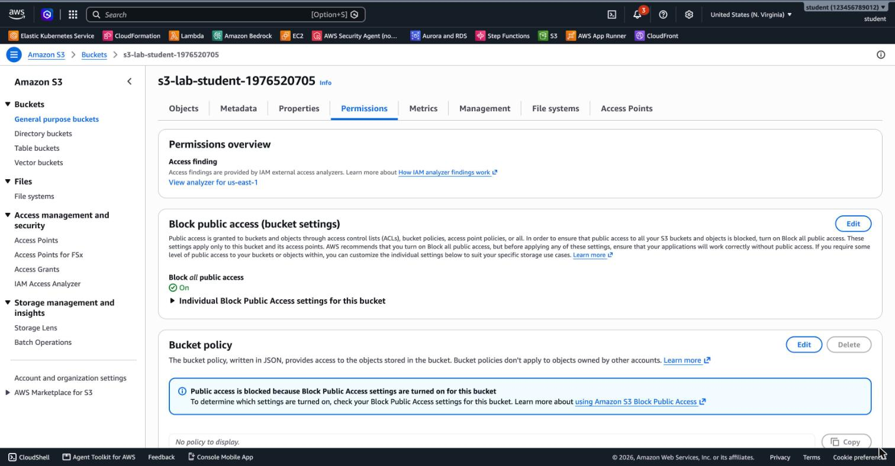
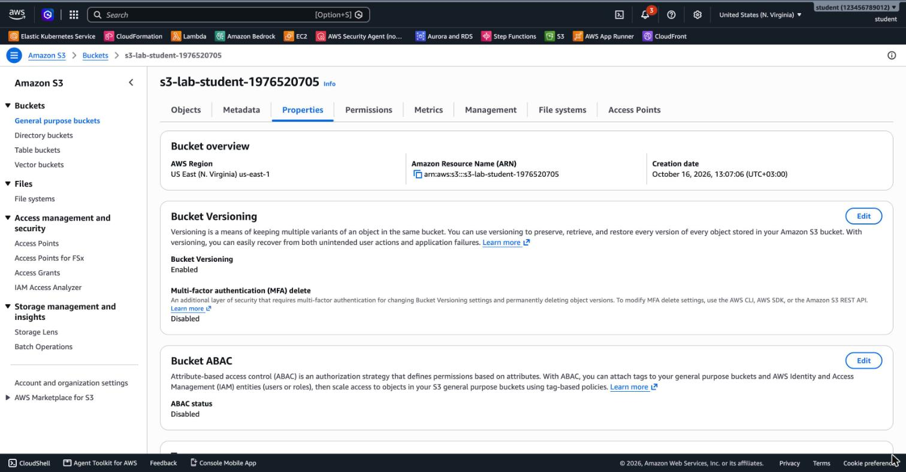
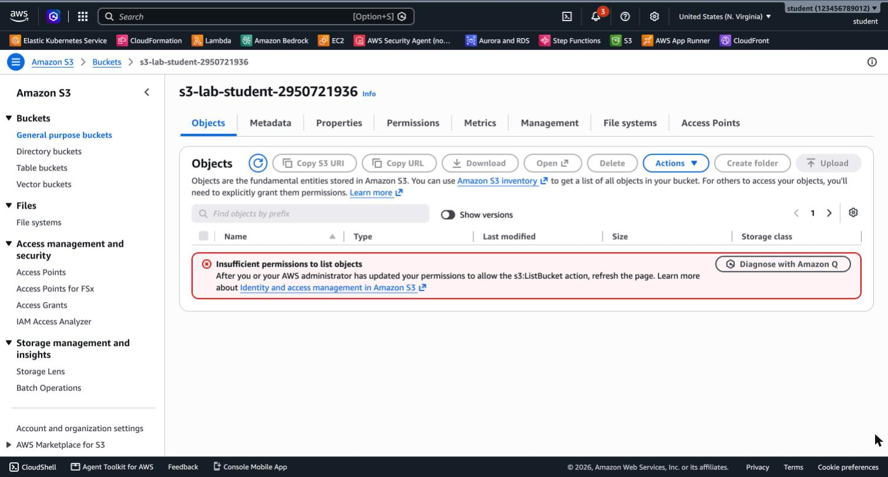
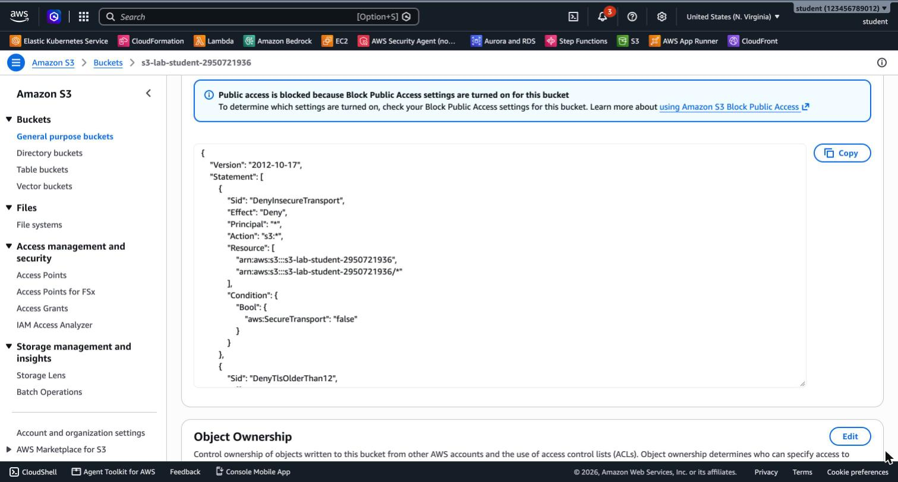

# 3.5 Amazon S3 – Lab 1 Solution

[⬅ Back to 3.5 Amazon S3](README.md) | [Lab 2 Solution ➡](SOLUTION-LAB2.md)

> Tested with AWS CLI v2 in `us-east-1`. Run the commands in one terminal session, because later steps use the shell variables.

---

## LAB 1 (Basic): Create an S3 Bucket with the CLI

### Part A: Create the S3 bucket

#### Steps 1–3: Create and list the bucket

`aws s3 help` lists the high-level commands. `mb` means *make bucket*.

```bash
export AWS_PAGER=""
REGION=us-east-1
BUCKET=s3-lab-<your-name>-$RANDOM      # must be globally unique, lowercase

aws s3 mb s3://$BUCKET --region $REGION
aws s3 ls | grep $BUCKET
```

Output:

```
make_bucket: s3-lab-student-1976520705
2026-10-16 13:07:06 s3-lab-student-1976520705
```

#### Step 4: View the bucket in the Console

Open **S3 → General purpose buckets** and type `s3-lab` in the search box:



Select the bucket:

- **Objects** tab: the bucket is empty.
- **Properties** tab: the Region is `us-east-1`, and **Bucket Versioning** is **Disabled** because you haven't enabled it yet. You'll enable it in Part B.
- **Permissions** tab: **Block all public access** is **On**, and there is no bucket policy.



You can check the same setting with the CLI:

```bash
aws s3api get-public-access-block --bucket $BUCKET
```

```json
{
    "PublicAccessBlockConfiguration": {
        "BlockPublicAcls": true,
        "IgnorePublicAcls": true,
        "BlockPublicPolicy": true,
        "RestrictPublicBuckets": true
    }
}
```

### Part B: Versioning

#### Step 5: Enable versioning

```bash
aws s3api put-bucket-versioning --bucket $BUCKET \
  --versioning-configuration Status=Enabled
aws s3api get-bucket-versioning --bucket $BUCKET
```

```json
{
    "Status": "Enabled"
}
```

Refresh the **Properties** tab. **Bucket Versioning** is now **Enabled**:



### Part C: Limit access to the bucket

Both restrictions use a **bucket policy with `"Effect": "Deny"`**. An explicit deny overrides any allow, including the admin's own IAM permissions.

> ⚠️ Apply **one policy at a time**: `put-bucket-policy` **replaces** the whole bucket policy. Remove both policies before you start [Lab 2](SOLUTION-LAB2.md).

Upload a test file first, so you have something to read:

```bash
echo hello > test.txt
aws s3 cp test.txt s3://$BUCKET/test.txt
```

#### Step 6: Allow access only from your default VPC

S3 knows that a request came from a VPC (the `aws:SourceVpc` condition key) **only if the request goes through a VPC endpoint**. Without an endpoint, the request reaches S3 over the internet, and the key is empty.

**6a. Create an S3 Gateway endpoint in the default VPC.** Gateway endpoints for S3 are **free**.

```bash
VPC_ID=$(aws ec2 describe-vpcs --filters Name=is-default,Values=true \
  --query 'Vpcs[0].VpcId' --output text)
RTB_ID=$(aws ec2 describe-route-tables \
  --filters Name=vpc-id,Values=$VPC_ID Name=association.main,Values=true \
  --query 'RouteTables[0].RouteTableId' --output text)

VPCE_ID=$(aws ec2 create-vpc-endpoint --vpc-id $VPC_ID \
  --service-name com.amazonaws.$REGION.s3 --vpc-endpoint-type Gateway \
  --route-table-ids $RTB_ID \
  --query VpcEndpoint.VpcEndpointId --output text)
```

**6b. Add a bucket policy that denies data access from anywhere outside the default VPC:**

```bash
cat > vpc-only.json <<JSON
{
  "Version": "2012-10-17",
  "Statement": [
    {
      "Sid": "DenyDataAccessOutsideDefaultVpc",
      "Effect": "Deny",
      "Principal": "*",
      "Action": ["s3:GetObject", "s3:PutObject", "s3:DeleteObject", "s3:ListBucket"],
      "Resource": ["arn:aws:s3:::$BUCKET", "arn:aws:s3:::$BUCKET/*"],
      "Condition": { "StringNotEquals": { "aws:SourceVpc": "$VPC_ID" } }
    }
  ]
}
JSON
aws s3api put-bucket-policy --bucket $BUCKET --policy file://vpc-only.json
```

> Why not `"Action": "s3:*"`? That would also deny `s3:DeleteBucketPolicy` and `s3:PutBucketPolicy` from your laptop. You'd lock yourself out of your own bucket, and only the account's **root user** could remove the policy. Denying only the **data** actions keeps the bucket manageable.

**6c. Test from your laptop, which is outside the VPC:**

```bash
aws s3 ls s3://$BUCKET
aws s3 cp s3://$BUCKET/test.txt -
```

```
An error occurred (AccessDenied) when calling the ListObjectsV2 operation: User: arn:aws:iam::<account-id>:user/<you>
is not authorized to perform: s3:ListBucket on resource: "arn:aws:s3:::s3-lab-student-2950721936"
with an explicit deny in a resource-based policy

download failed: s3://s3-lab-student-2950721936/test.txt to - An error occurred (403) when calling the HeadObject operation: Forbidden
```

The Console runs in your browser, which is also outside the VPC, so it's denied too:



**6d. Prove that access from inside the VPC is allowed.** From an EC2 instance in the default VPC (see [3.3 EC2](../3.3-ec2/README.md)), the same commands work. Without an instance, ask the **IAM Policy Simulator** to evaluate the request with and without the VPC:

```bash
ME=$(aws sts get-caller-identity --query Arn --output text)    # must be an IAM user or role
for SRC in $VPC_ID vpc-0000000000example; do
  aws iam simulate-custom-policy \
    --policy-input-list '{"Version":"2012-10-17","Statement":[{"Effect":"Allow","Action":"s3:*","Resource":"*"}]}' \
    --resource-policy file://vpc-only.json \
    --resource-arns arn:aws:s3:::$BUCKET/test.txt --action-names s3:GetObject \
    --caller-arn $ME --resource-owner arn:aws:iam::$(aws sts get-caller-identity --query Account --output text):root \
    --context-entries ContextKeyName=aws:SourceVpc,ContextKeyValues=$SRC,ContextKeyType=string \
    --query 'EvaluationResults[0].EvalDecision' --output text
done
```

```
allowed         ← request from the default VPC
explicitDeny    ← request from anywhere else
```

**6e. Remove the policy.** This works from your laptop because the policy doesn't deny `s3:DeleteBucketPolicy`.

```bash
aws s3api delete-bucket-policy --bucket $BUCKET
aws s3 ls s3://$BUCKET      # works again
```

#### Step 7: Allow access only with TLS 1.2 or higher

Two deny statements: one blocks plain **HTTP** (`aws:SecureTransport = false`), and the other blocks **TLS versions older than 1.2** (`s3:TlsVersion < 1.2`):

```bash
cat > tls-only.json <<JSON
{
  "Version": "2012-10-17",
  "Statement": [
    {
      "Sid": "DenyInsecureTransport",
      "Effect": "Deny",
      "Principal": "*",
      "Action": "s3:*",
      "Resource": ["arn:aws:s3:::$BUCKET", "arn:aws:s3:::$BUCKET/*"],
      "Condition": { "Bool": { "aws:SecureTransport": "false" } }
    },
    {
      "Sid": "DenyTlsOlderThan12",
      "Effect": "Deny",
      "Principal": "*",
      "Action": "s3:*",
      "Resource": ["arn:aws:s3:::$BUCKET", "arn:aws:s3:::$BUCKET/*"],
      "Condition": { "NumericLessThan": { "s3:TlsVersion": "1.2" } }
    }
  ]
}
JSON
aws s3api put-bucket-policy --bucket $BUCKET --policy file://tls-only.json
```



Here `"Action": "s3:*"` is safe. It only blocks insecure connections, and the AWS CLI always uses HTTPS with TLS 1.2 or higher.

**Test:**

```bash
# HTTPS (the CLI default): works
aws s3 ls s3://$BUCKET

# Plain HTTP: denied by the policy
aws s3 ls s3://$BUCKET --endpoint-url http://s3.$REGION.amazonaws.com

# TLS 1.1: the connection is refused before it reaches the bucket
curl --tlsv1.1 --tls-max 1.1 https://$BUCKET.s3.$REGION.amazonaws.com/test.txt
```

```
2026-10-16 13:35:26          6 test.txt

An error occurred (AccessDenied) when calling the ListObjectsV2 operation: User: ... is not authorized
to perform: s3:ListBucket on resource: "arn:aws:s3:::s3-lab-student-2950721936" with an explicit deny
in a resource-based policy

curl: (35) ... (the TLS handshake fails)
```

> AWS already requires **TLS 1.2 or higher** on all its API endpoints, so a TLS 1.1 client can't even connect. The `s3:TlsVersion` statement is **defense in depth**: it documents the requirement in the policy, and it keeps protecting the bucket if endpoint defaults ever change. Security auditors look for both statements.

**Clean up Part C** before Lab 2:

```bash
aws s3api delete-bucket-policy --bucket $BUCKET
aws ec2 delete-vpc-endpoints --vpc-endpoint-ids $VPCE_ID
aws s3 rm s3://$BUCKET/test.txt
```

### Answers

- **A name that's already taken:** bucket names are global across all AWS accounts, so the request fails:

  ```
  make_bucket failed: s3://test An error occurred (BucketAlreadyExists) when calling the
  CreateBucket operation: The requested bucket name is not available. The bucket namespace
  is shared by all users of the system. Please select a different name and try again.
  ```

- **Public or private?** **Private.** Block Public Access is on by default for every new bucket, and there is no bucket policy.
- **The same file uploaded twice:** because versioning is enabled, the second upload creates a **new version**, and the first version is kept. Turn on **Show versions** on the Objects tab to see both.

---

[⬅ Back to 3.5 Amazon S3](README.md) | [Lab 2 Solution ➡](SOLUTION-LAB2.md)
