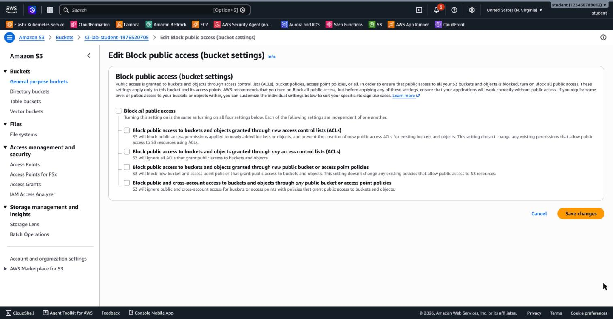
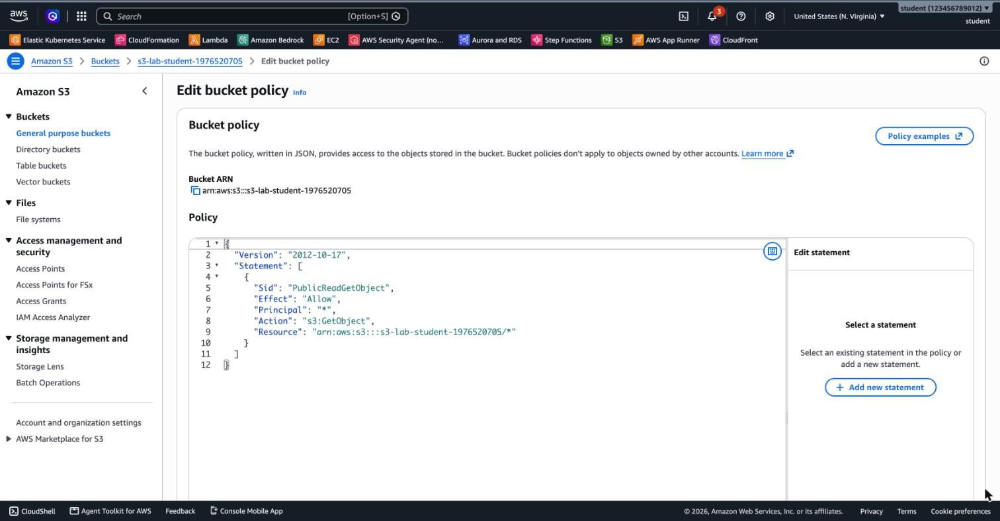
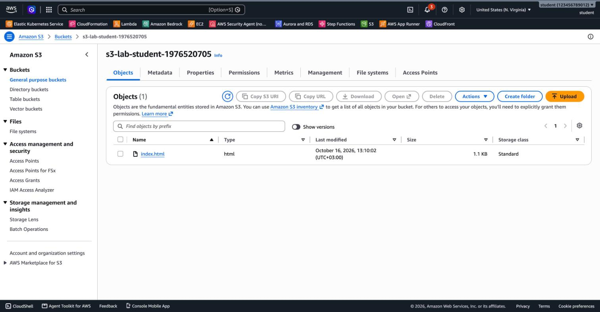
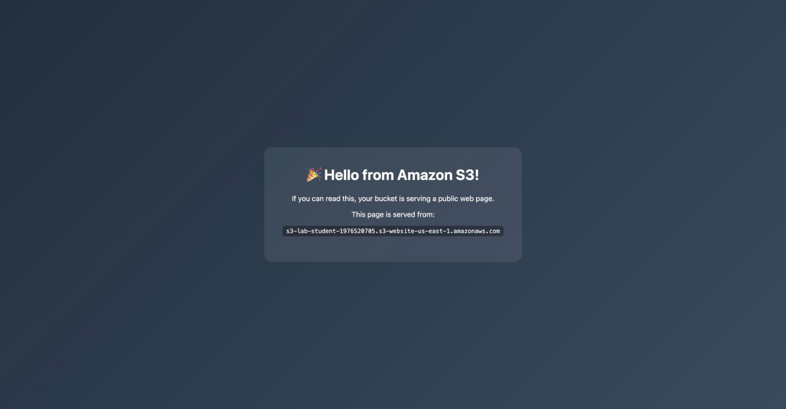

# 3.5 Amazon S3 – Lab Solutions

[⬅ Back to 3.5 Amazon S3](README.md)

> Tested with AWS CLI v2 in `us-east-1`. Run the commands in one terminal session, because later steps use the shell variables from Lab 1.

---

## LAB 1 (Basic): Create an S3 Bucket with the CLI

### Steps 1–3: Create and list the bucket

```bash
export AWS_PAGER=""
REGION=us-east-1
BUCKET=s3-lab-<your-name>-$RANDOM      # must be globally unique, lowercase

aws s3 mb s3://$BUCKET --region $REGION
aws s3 ls | grep $BUCKET
```

Output:

```
make_bucket: s3-lab-student-1976520705
2026-10-16 13:07:06 s3-lab-student-1976520705
```

### Step 4: Enable versioning

```bash
aws s3api put-bucket-versioning --bucket $BUCKET \
  --versioning-configuration Status=Enabled
aws s3api get-bucket-versioning --bucket $BUCKET
```

```json
{
    "Status": "Enabled"
}
```

### Step 5: View the bucket in the Console

Open **S3 → General purpose buckets** and type `s3-lab` in the search box:


Select the bucket:

- **Objects** tab: the bucket is empty.
- **Properties** tab: the Region is `us-east-1` and **Bucket Versioning** is **Enabled**.


- **Permissions** tab: **Block all public access** is **On**, and there is no bucket policy.


You can check the same setting with the CLI:

```bash
aws s3api get-public-access-block --bucket $BUCKET
```

```json
{
    "PublicAccessBlockConfiguration": {
        "BlockPublicAcls": true,
        "IgnorePublicAcls": true,
        "BlockPublicPolicy": true,
        "RestrictPublicBuckets": true
    }
}
```

### Answers

- **A name that's already taken:** bucket names are global across all AWS accounts, so the request fails:

  ```
  make_bucket failed: s3://test An error occurred (BucketAlreadyExists) when calling the
  CreateBucket operation: The requested bucket name is not available. The bucket namespace
  is shared by all users of the system. Please select a different name and try again.
  ```

- **Public or private?** **Private.** Block Public Access is on by default for every new bucket, and there is no bucket policy.
- **The same file uploaded twice:** because versioning is enabled, the second upload creates a **new version**, and the first version is kept. Turn on **Show versions** on the Objects tab to see both.

---

## LAB 2 (Basic): Host a Static Website on S3

### Part A: Allow public read access

1. Open the bucket's **Permissions** tab. Under **Block public access (bucket settings)**, choose **Edit**.
2. Clear **Block all public access**. All four sub-settings are cleared with it.



3. Choose **Save changes**, type `confirm` and choose **Confirm**. The Permissions tab now shows **Block all public access: Off**.
4. Under **Bucket policy**, choose **Edit** and paste the public read policy. Replace the bucket name with yours:

```json
{
  "Version": "2012-10-17",
  "Statement": [
    {
      "Sid": "PublicReadGetObject",
      "Effect": "Allow",
      "Principal": "*",
      "Action": "s3:GetObject",
      "Resource": "arn:aws:s3:::s3-lab-student-1976520705/*"
    }
  ]
}
```



5. Choose **Save changes**. The Console shows *"Successfully edited bucket policy."*

> If you try to save the policy while Block Public Access is still on, S3 rejects it with an *Access denied* error. That's Block Public Access doing its job.

<details>
<summary>CLI alternative for Part A</summary>

```bash
aws s3api put-public-access-block --bucket $BUCKET \
  --public-access-block-configuration \
  BlockPublicAcls=false,IgnorePublicAcls=false,BlockPublicPolicy=false,RestrictPublicBuckets=false

cat > public-read.json <<JSON
{
  "Version": "2012-10-17",
  "Statement": [{
    "Sid": "PublicReadGetObject",
    "Effect": "Allow",
    "Principal": "*",
    "Action": "s3:GetObject",
    "Resource": "arn:aws:s3:::$BUCKET/*"
  }]
}
JSON
aws s3api put-bucket-policy --bucket $BUCKET --policy file://public-read.json
```

</details>

### Part B: Upload the web page

Run this from the module folder (`3.5-s3/`):

```bash
aws s3 cp artifacts/index.html s3://$BUCKET/index.html
aws s3 ls s3://$BUCKET/
```

```
upload: artifacts/index.html to s3://s3-lab-student-1976520705/index.html
2026-10-16 13:10:02       1141 index.html
```

The CLI sets the content type from the file extension (`text/html`), so the browser renders the page instead of downloading it. Refresh the **Objects** tab:



### Part C: Browse to the website

7. Select `index.html`. The **Object URL** is on the right:


8. Open the Object URL, `https://<bucket>.s3.us-east-1.amazonaws.com/index.html`:


9. **Bonus: static website hosting.** On the **Properties** tab, under **Static website hosting**, choose **Edit**. Select **Enable**, keep **Host a static website**, set the **Index document** to `index.html` and save:


The **Bucket website endpoint** appears at the bottom of the Properties tab:


Open `http://<bucket>.s3-website-us-east-1.amazonaws.com`. There is no `/index.html` at the end, because the website endpoint serves the index document automatically:



| | Object URL | Website endpoint |
|---|---|---|
| Format | `https://<bucket>.s3.<region>.amazonaws.com/<key>` | `http://<bucket>.s3-website-<region>.amazonaws.com` |
| Protocol | HTTPS | **HTTP only** |
| `/` (root) | *Access Denied* (no list permission) | Serves `index.html` |
| Missing page | *Access Denied* | `404 Not Found` (or a custom error document) |

### Part D: Clean up

Because **versioning is enabled**, `aws s3 rb --force` is **not enough**. It only adds a **delete marker**, and then it fails:

```
delete: s3://s3-lab-student-1976520705/index.html
remove_bucket failed: s3://s3-lab-student-1976520705 An error occurred (BucketNotEmpty) when calling
the DeleteBucket operation: The bucket you tried to delete is not empty. You must delete all versions in the bucket.
```

Delete **all versions and delete markers**, then the bucket:

```bash
aws s3api delete-objects --bucket $BUCKET \
  --delete "$(aws s3api list-object-versions --bucket $BUCKET \
  --query '{Objects: [Versions, DeleteMarkers][][].{Key: Key, VersionId: VersionId}}' --output json)"

aws s3 rb s3://$BUCKET
```

**Console alternative:** select the bucket, choose **Empty** (this deletes all versions), type `permanently delete`, then choose **Delete** and type the bucket name.

### Answers

- **Why Block Public Access had to be off:** BPA overrides policies. With *Block public access … through new public bucket policies* turned on, S3 refuses to save any policy that grants access to `"Principal": "*"`.
- **Why `/` returns *Access Denied*:** opening the bucket root is a **list** request (`s3:ListBucket`), and the policy allows only `s3:GetObject`. That's intentional, because visitors shouldn't be able to list all your files.
- **HTTPS:** the S3 website endpoint supports HTTP only. Put **Amazon CloudFront** in front of the bucket. CloudFront serves the site over HTTPS with a certificate from AWS Certificate Manager, and the bucket can stay **private** with Origin Access Control (OAC).

---

## Terraform

The result of both labs as code: [`terraform/main.tf`](terraform/main.tf). Tested with Terraform 1.15 and AWS provider 6.x in `us-east-1`.

```bash
cd terraform
terraform init
terraform apply
```

```
Outputs:

bucket_name = "s3-lab-6491c66c50d3f0d691fe447a75"
object_url = "https://s3-lab-6491c66c50d3f0d691fe447a75.s3.us-east-1.amazonaws.com/index.html"
website_endpoint = "http://s3-lab-6491c66c50d3f0d691fe447a75.s3-website-us-east-1.amazonaws.com"
```

```bash
terraform destroy   # Destroy complete! Resources: 6 destroyed.
```

`force_destroy = true` lets Terraform delete the bucket even though it still contains objects and versions.

---

[⬅ Back to 3.5 Amazon S3](README.md)
