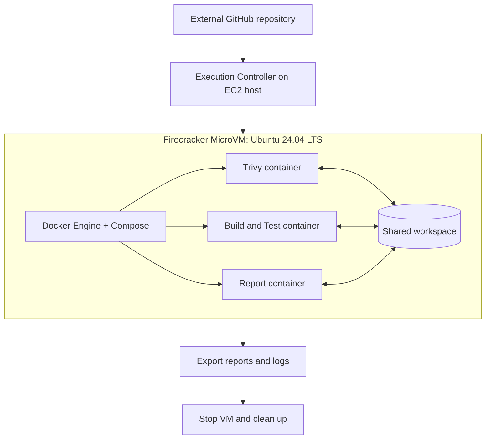

# Firecracker Security Sandbox — Lab Design (Draft v1)

**Status:** Planning artifact — decisions agreed so far; not yet an executable lab.  
**Related artifact:** `ai_agents_business_use_case.md` (business problem and requirements).

## 1. Goal and scenario

An organization's security team needs to evaluate source code received from GitHub or an external supplier before approving its use. Building and testing third-party code can execute untrusted scripts and dependencies. The lab demonstrates how to run this work inside an ephemeral, isolated execution environment and retain a security report after the environment is destroyed.

**Important distinction:** A MicroVM reduces the potential blast radius of executing untrusted code; it does **not** prove that the code is safe or free of malicious behavior.

## 2. Hypothesis

Firecracker MicroVMs can provide an effective isolation boundary for short-lived code-analysis and build workloads, with acceptable startup time, resource overhead, and operational complexity.

We will test this hypothesis rather than assume Firecracker is superior.

## 3. Alternatives and selection rationale

- **Hardened Linux containers:** simpler operational model, but normally share the host kernel.
- **Kata Containers:** VM-backed isolation for container workloads; depending on configuration, can use different hypervisors, including Firecracker.
- **Firecracker directly:** chosen for a focused AWS-based lab that exposes MicroVM lifecycle and isolation mechanisms without adding Kubernetes orchestration.

A future lab could implement the same workload using Kata Containers for comparison. This lab is **not** a comprehensive technology evaluation.

## 4. Reuse from the existing Firecracker lab

Retain the existing EC2/KVM host setup, Firecracker installation, and familiarity with its API and networking concepts.

The earlier lab used a minimal BusyBox guest. **Do not extend that guest image.** Prepare a new guest root filesystem using **Ubuntu 24.04 LTS** and a Firecracker-compatible guest kernel with Docker prerequisites.

The EC2 host OS is separate from the Ubuntu guest OS.

## 5. Target architecture

The diagram is conceptual: the controller provisions and controls the VM, and the repository is staged into its workspace. The VM does **not** mount or access the host's Docker socket.

## 6. Containers inside the MicroVM

| Container | Responsibility | Initial implementation |
|---|---|---|
| Trivy | Scan source/dependencies, secrets, and relevant misconfigurations | Official Trivy image; machine-readable report |
| Build & Test | Install dependencies, build, and run tests | Node.js image; `npm ci`, project build/test scripts |
| Report | Aggregate scanner output, build status, and test results | Lightweight script/image producing JSON summary |

All three run **inside the same MicroVM**, using a shared workspace. They are task-specific automation components, **not autonomous LLM agents** in v1.

Use **Docker Compose** to define the three one-shot services and their shared storage. Coordinate execution and exit status explicitly; a Compose service being started does not automatically mean the previous job completed successfully.

## 7. Lab structure — two equivalent paths to Part 1

**Teaching principle:** Part 1 offers two alternative ways to reach **the same verified end state**. The manual path explains every operation. The optional Terraform path automates the *entire* setup, including the Ubuntu guest and Docker inside it—not merely the EC2 instance. Students choose one path, then everyone continues to Part 2.

### Part 1A — Manual, step-by-step installation (primary teaching path)

1. Review prerequisites, AWS cost implications, and the EC2/KVM compatibility requirement; select and verify a suitable instance type and host OS.
2. Provision EC2 and the minimal network, access, storage, and IAM configuration needed for the lab.
3. Install and verify Firecracker on the EC2 host, reusing concepts from the earlier lab.
4. Download an official **Ubuntu 24.04 LTS Minimal Cloud Image** from Canonical and prepare a Firecracker-compatible `ext4` guest root filesystem.
5. Select or prepare a Firecracker-compatible Linux guest kernel with the features Docker needs (namespaces, cgroups, OverlayFS, networking).
6. Configure the MicroVM's vCPU, memory, kernel, root drive, boot arguments, and guest networking.
7. Boot Ubuntu inside Firecracker and validate the OS, kernel, filesystem, and essential services.
8. Install **Docker Engine** and the **Docker Compose plugin inside the Ubuntu guest**; do not share the host's Docker socket.
9. Run one test container inside the guest and verify its exit code and logs.
10. Verify the **Part 1 acceptance criteria** and document how to stop/restart the MicroVM safely.

### Part 1B — Optional automated alternative (Terraform)

1. Supply a Terraform project with versioned provider requirements, inputs, outputs, and documented AWS costs.
2. `terraform apply` provisions a compatible EC2 host, networking, storage, access, and minimal IAM permissions.
3. Idempotent bootstrap automation installs and verifies Firecracker, prepares the Ubuntu 24.04 guest rootfs and compatible kernel, configures/boots the MicroVM, and installs Docker Engine and Compose **inside the guest**.
4. A readiness/validation script confirms the **same Part 1 acceptance criteria** as the manual path. Terraform resource creation alone is not proof that asynchronous bootstrap has finished.
5. Provide troubleshooting/log locations and `terraform destroy` for teardown. Avoid storing secrets in Terraform state or bootstrap logs.

**Identical Part 1 outcome:** an EC2 host running a Firecracker MicroVM whose guest is **Ubuntu 24.04 LTS**, with **Docker Engine and Docker Compose available inside the guest**, and a test container that has completed successfully.

### Part 2 — Common path: security review workflow

1. Select a small Node.js GitHub repository with a lockfile and automated tests; pin a known commit.
2. Stage source code and required container images/dependencies into the guest workspace.
3. Define three one-shot Docker Compose services: **Trivy Agent**, **Build & Test Agent**, and **Report Agent**.
4. Execute scanning, dependency installation, build, tests, and reporting; collect structured results and exit codes.
5. Export reports and logs to durable storage **before** terminating the MicroVM.
6. Implement the execution controller and verify cleanup even after a failed job.
7. Run independent jobs in separate MicroVMs and validate workload separation.
8. Measure startup time, execution time, resource consumption, cleanup, and operational complexity; assess the hypothesis and document limitations.

## 8. First milestone and acceptance criteria

**Milestone 1:** Download the official Ubuntu 24.04 LTS Minimal Cloud Image, prepare an `ext4` root drive and compatible kernel, boot Ubuntu inside Firecracker, and successfully run one Docker container inside the guest.

Validate:
- Ubuntu image provenance and architecture (`amd64`) are recorded, and the resulting `ext4` root drive is readable.
- Guest boots; Docker daemon and Docker Compose plugin are available inside Ubuntu 24.04.
- A container completes with exit code `0`.
- No host Docker socket is shared with the guest.
- Guest can be shut down and host-side resources cleaned up.

**Milestone 2:** Run the three-service Compose workflow, export a JSON report, and destroy the MicroVM without losing the report.

## 9. Scope and safety boundaries

- No Kubernetes in the first version.
- No LLM orchestration required in the first version.
- No claim that Trivy or dynamic execution can certify that code is non-malicious.
- Do not deliberately run real malware; use controlled, harmless failure/isolation tests.
- Network policy and credential management remain necessary production controls, but extensive credential/egress testing is outside this initial POC.
- Avoid broad claims of guaranteed VM escape prevention; isolation boundaries depend on configuration and vulnerabilities.

## 10. Known technical risks and troubleshooting

| Symptom | Likely cause | Next check |
|---|---|---|
| Docker daemon fails to start | Guest kernel lacks required namespaces/cgroups/storage features | Inspect guest kernel configuration and Docker daemon logs |
| Containers cannot download images/dependencies | Guest network, DNS, or outbound routing not configured | Check guest interface, routes, DNS; alternatively pre-stage artifacts |
| Report missing after VM shutdown | Results existed only on guest ephemeral disk | Export report and verify persistence **before** terminating VM |

## 11. Open implementation decisions

- Exact Ubuntu rootfs construction method and kernel build/configuration.
- How to stage source code and images into the guest (preload versus network access).
- Controller-to-guest command channel and report export mechanism.
- Sample Node.js repository and pinned commit.
- Resource sizing and performance thresholds, to be established through measurement.
