# Part 2: An Ubuntu microVM

*Firecracker Lab: Run AI Agents in Isolated MicroVMs*, Part 2 of 5. Hands-on: an Ubuntu 24.04 guest boots in Firecracker on the host from the Firecracker lab, with SSH in, the internet out, and Docker running inside. The disk is saved as the **base image** that every job in Part 3 starts from. Step by step, or with Terraform.

<!-- video: add the embed when Part 2 is uploaded -->

**Before you start:** [Part 1](../part-1-define-the-problem/README.md) (the problem and the plan), and the earlier Firecracker lab, [Run Your Own MicroVM](../../../3.01-ec2/firecracker-lab-walkthrough.md) ([video](https://youtu.be/65BVRBkMyGU)): the host, KVM, TAP networking and the API are explained there and not repeated here.

![Part 2: your computer connects with SSH to the EC2 host fc-agents-host (m7i-flex.large, Ubuntu 24.04, nested virtualization, 30 GiB). On the host: ~/fc with firecracker v1.17.0, the guest kernel vmlinux-6.18.54, the Ubuntu root archive and ubuntu.ext4; terminal 1 runs Firecracker from vm.json and shows the serial console; terminal 2 runs ssh root@172.16.0.2; tap0 172.16.0.1/30 with NAT layer 1; the base image ubuntu-docker-base.ext4 saved after the shutdown. The Firecracker process runs one microVM with 2 vCPUs and 2 GiB: guest kernel 6.18.54, Ubuntu 24.04 minimal with systemd, systemd-networkd on eth0 172.16.0.2/30 and sshd, Docker Engine with Compose and NAT layer 2, and an alpine container that writes to a volume and reaches the internet.](images/part-2-ubuntu-microvm.jpg)

<sub>Diagram source: [images/part-2-ubuntu-microvm.drawio](images/part-2-ubuntu-microvm.drawio) (open it in [draw.io](https://app.diagrams.net) to edit)</sub>

> 💰 **Cost:** `m7i-flex.large` is Free Tier eligible; outside the Free Tier it costs about **$0.096 an hour** in `us-east-1`, plus **$0.005 an hour** for the public IPv4 address, plus the 30 GiB gp3 disk (about **$2.40 a month**). The manual path takes about an hour; the Terraform path about 15 minutes. The host costs money while it runs, even idle: **stop or terminate it between sessions** ([clean up](#clean-up)).

> Tested in `us-east-1` on 8 November 2026: `m7i-flex.large` with nested virtualization, Ubuntu 24.04 on the host, Firecracker v1.17.0, guest kernel 6.18.54, Ubuntu 24.04.5 minimal in the guest, Docker Engine 29.9.3 and Compose v5.7.0 inside it, Terraform 1.15 with the AWS provider 6.x. IDs, the account number and IP addresses in the screenshots are masked. The expected outputs below are from this run; long output is trimmed (`…`).

**Jump to:** [Where to run](#where-you-run-the-commands) · [Decisions](#the-decisions-in-this-part) · [A. The root filesystem](#part-a-the-root-filesystem) · [B. The kernel](#part-b-the-kernel) · [C. Boot and connect](#part-c-boot-and-connect) · [D. Docker inside the guest](#part-d-docker-inside-the-guest) · [Terraform](#the-terraform-path-the-same-result-one-apply) · [Check yourself](#check-yourself) · [Clean up](#clean-up) · [Terms](terms.md)

---

## Where you run the commands

| Where | What runs there |
|---|---|
| **The AWS Console** | Step A1: launch the host (or Terraform does it) |
| **Your computer** | The `ssh` command that connects to the host |
| **The host** (`fc-agents-host`, over SSH) | Everything else, in the folder **`~/fc`**, as the user `ubuntu` |
| **Terminal 1** on the host | Step C2: Firecracker itself, and the microVM's serial console |
| **Terminal 2** on the host | Steps C3 to D3: `ssh root@172.16.0.2` into the guest |

Each step starts with a **Run on:** line. Open two terminals on your computer and SSH to the host from both.

---

## The decisions in this part

| Choice | What and why |
|---|---|
| Host | The same as the Firecracker lab: **`m7i-flex.large`** with **nested virtualization**, Ubuntu Server 24.04, Firecracker **v1.17.0**. New: a **30 GiB** disk, because the Ubuntu archive, two 4 GiB images and Docker images don't fit in 8 GiB |
| Guest OS | **Ubuntu 24.04 minimal**, from Canonical's **root archive** (`…-root.tar.xz`), not the `.img`. The `.img` is a QCow2 disk with partitions and a UEFI boot loader; Firecracker boots the kernel itself and wants a plain ext4 root. A Dockerfile-built rootfs was rejected: Docker on the host next to Docker in the guest would confuse the story |
| Guest disk | A **4 GiB sparse ext4 file** you create (`truncate`, `mkfs.ext4`), filled from the archive with `tar`, configured with `chroot` |
| Guest kernel | **6.18.54** from Firecracker's CI, the one from the Firecracker lab, after checking its config with Docker's `check-config.sh` |
| Guest size | **2 vCPUs, 2048 MiB.** Enough for Docker and the scanners of Part 3 (Semgrep is the memory hog); measured in Part 3 |
| Network | **TAP and NAT** as in the Firecracker lab, plus a rule that blocks the guest from the instance metadata (`169.254.169.254`). Inside the guest, Docker adds its own NAT: **two layers** |
| Boot | A **config file** (`vm.json`) instead of API calls: the same settings, one command. `reboot=k` in the boot arguments makes a reboot inside the guest end the Firecracker process, which is how you shut down cleanly |
| Access | **SSH** from the host into the guest as `root`, with a key you generate on the host. The serial console only shows the boot |
| Docker | **Docker Engine and the Compose plugin** from Docker's install script, inside the guest |
| The result | **`ubuntu-docker-base.ext4`**, a copy of the guest disk after a clean shutdown. The base is never booted again; jobs boot copies |

---

## Part A: The root filesystem

### A1. Launch the host

**Run on:** the AWS Console (or skip to [the Terraform path](#the-terraform-path-the-same-result-one-apply)).

Launch the host exactly as in the Firecracker lab, [step 1](../../../3.01-ec2/firecracker-lab-walkthrough.md#1-launch-the-host), with two changes: name it **`fc-agents-host`**, and set the storage to **30 GiB gp3**. Ubuntu Server 24.04, `m7i-flex.large`, nested virtualization enabled, a key pair, a security group with **SSH from My IP** only.

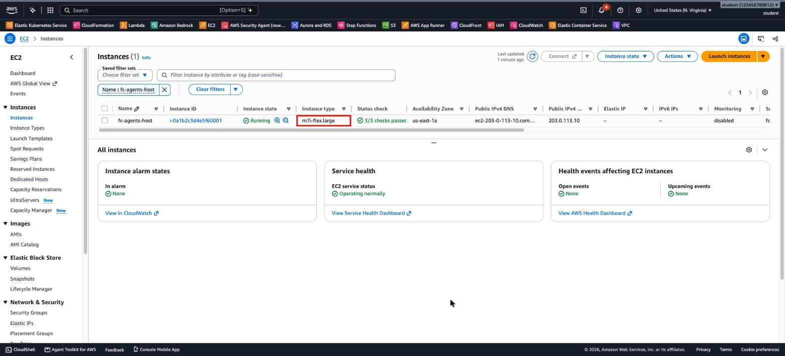

In the instance details, under *Host and placement group*, **Nested virtualization: Enabled**. Without it there is no `/dev/kvm` on the host, and Firecracker cannot start.

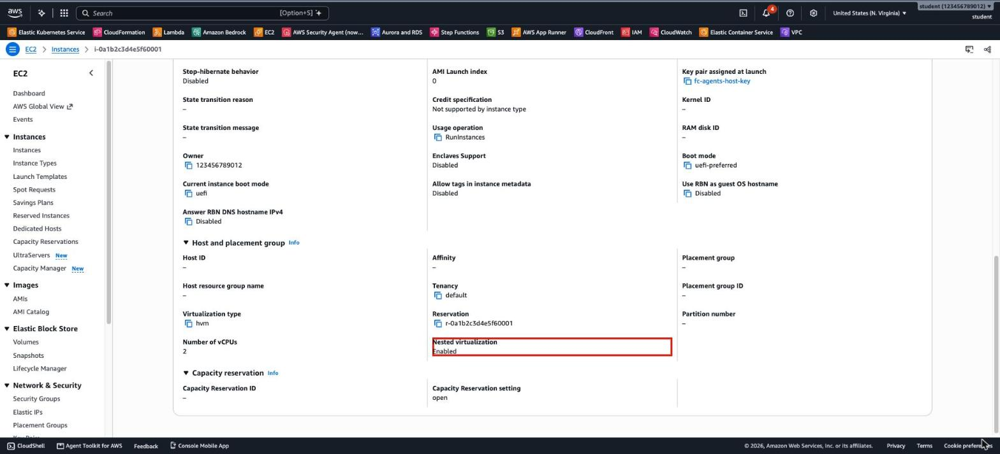

The security group has one inbound rule: SSH from your address.

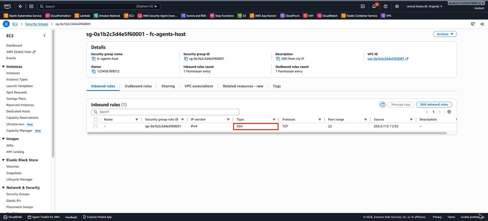

SSH to the host from your computer, as `ubuntu`, and work in `~/fc`:

```bash
ssh -i ~/.ssh/<your-key>.pem ubuntu@<host-ip>
mkdir -p ~/fc && cd ~/fc
```

### A2. Firecracker on the host

**Run on:** the host, in `~/fc`. The same as the Firecracker lab, steps 2 and 3: KVM access for `ubuntu`, and the release binary with its checksum.

```bash
sudo usermod -aG kvm ubuntu && newgrp kvm       # or log out and back in
ARCH=$(uname -m); VER=v1.17.0
URL=https://github.com/firecracker-microvm/firecracker/releases/download/$VER
curl -fsSLO $URL/firecracker-$VER-$ARCH.tgz && curl -fsSLO $URL/firecracker-$VER-$ARCH.tgz.sha256.txt
sha256sum -c firecracker-$VER-$ARCH.tgz.sha256.txt
tar -xzf firecracker-$VER-$ARCH.tgz && cp release-$VER-$ARCH/firecracker-$VER-$ARCH firecracker
./firecracker --version
```

```
firecracker-v1.17.0-x86_64.tgz: OK
Firecracker v1.17.0
```

### A3. Download the Ubuntu root archive

**Run on:** the host.

Canonical publishes several files for each release. The **root archive** is a tar file of the Ubuntu filesystem, nothing else: no partitions, no boot loader. That is what Firecracker wants, because it boots the kernel itself.

```bash
URL=https://cloud-images.ubuntu.com/minimal/releases/noble/release
curl -fsSLO $URL/ubuntu-24.04-minimal-cloudimg-amd64-root.tar.xz
curl -fsSLO $URL/SHA256SUMS
sha256sum -c SHA256SUMS --ignore-missing
ls -lh ubuntu-24.04-minimal-cloudimg-amd64-root.tar.xz
```

```
ubuntu-24.04-minimal-cloudimg-amd64-root.tar.xz: OK
-rw-r--r-- 1 ubuntu ubuntu 110M Nov  8 21:44 ubuntu-24.04-minimal-cloudimg-amd64-root.tar.xz
```

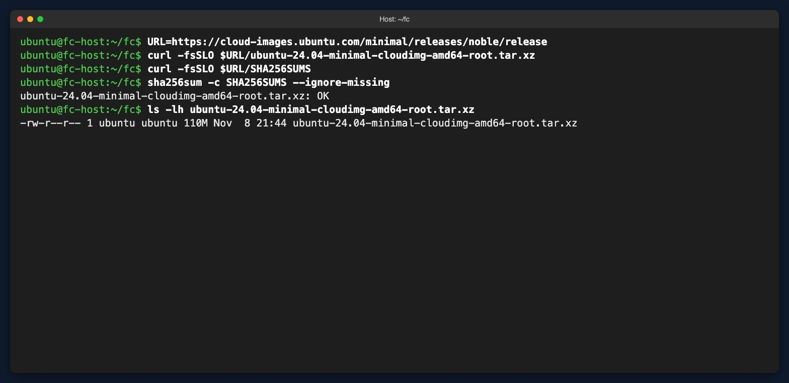

### A4. An empty ext4 image, filled from the archive

**Run on:** the host.

`truncate` makes a 4 GiB file that takes almost no real space (it is **sparse**); `mkfs.ext4` formats it; `mount -o loop` makes it show up as a folder on the host. Then `tar` unpacks the archive into that folder, as root. Two options matter: `p` keeps the file permissions, and `--numeric-owner` keeps owners as numbers, so the files belong to the guest's users, not to users on the host. If either is wrong, Ubuntu won't boot right.

```bash
truncate -s 4G ubuntu.ext4
sudo mkfs.ext4 -F -q ubuntu.ext4
sudo mkdir -p /mnt/rootfs && sudo mount -o loop ubuntu.ext4 /mnt/rootfs
sudo tar --numeric-owner -xJpf ubuntu-24.04-minimal-cloudimg-amd64-root.tar.xz -C /mnt/rootfs
ls /mnt/rootfs
head -2 /mnt/rootfs/etc/os-release
```

```
bin  bin.usr-is-merged  boot  dev  etc  home  lib  lib.usr-is-merged  lib64  lost+found  media  mnt  opt  proc  root  run  sbin  sbin.usr-is-merged  snap  srv  sys  tmp  usr  var
PRETTY_NAME="Ubuntu 24.04.5 LTS"
NAME="Ubuntu"
```

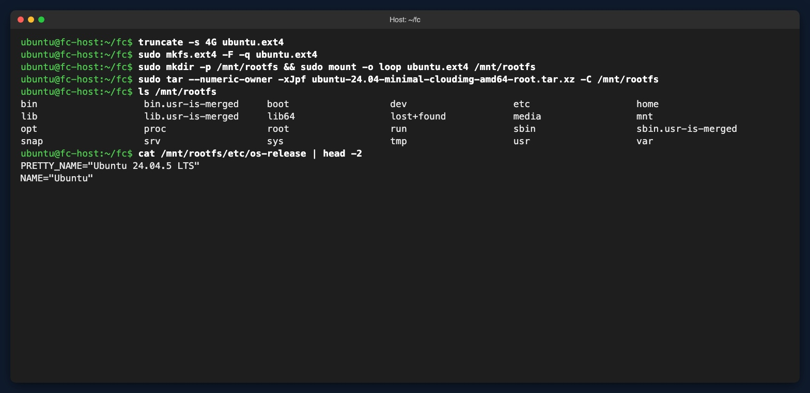

### A5. Make it bootable: cloud-init off, fstab, console, network, SSH

**Run on:** the host.

The archive is built to boot on a cloud, where **cloud-init** runs at first boot and asks the cloud for the network, the hostname and the SSH keys. There is no cloud inside a microVM, so we do that by hand, inside the image, with `chroot`: it runs a shell as if `/mnt/rootfs` were the root of the system.

First a key pair on the host for the guest, and an SSH config that skips host-key prompts for the guest address (its host keys change with every rebuilt image):

```bash
ssh-keygen -t ed25519 -N "" -q -f ~/.ssh/id_ed25519
printf "Host 172.16.0.2\n  StrictHostKeyChecking no\n  UserKnownHostsFile /dev/null\n  LogLevel ERROR\n" >> ~/.ssh/config
```

Then the settings inside the image. Copy the whole block: the network file is short, but the exact text matters.

```bash
sudo chroot /mnt/rootfs /bin/bash -ex <<'IN'
touch /etc/cloud/cloud-init.disabled
echo '/dev/vda / ext4 defaults 0 1' > /etc/fstab
echo fc-guest > /etc/hostname
printf '[Match]\nName=eth0\n\n[Network]\nAddress=172.16.0.2/30\nGateway=172.16.0.1\nDNS=1.1.1.1\nDHCP=no\n' > /etc/systemd/network/eth0.network
ln -sf /run/systemd/resolve/stub-resolv.conf /etc/resolv.conf
ssh-keygen -A
mkdir -p -m 700 /root/.ssh
systemctl enable serial-getty@ttyS0 systemd-networkd systemd-resolved ssh
IN
sudo install -m 600 ~/.ssh/id_ed25519.pub /mnt/rootfs/root/.ssh/authorized_keys
sudo umount /mnt/rootfs
```

Line by line:

| Line | Why |
|---|---|
| `cloud-init.disabled` | An empty file that switches cloud-init off, so it doesn't look for a cloud at boot |
| `/etc/fstab` | The root disk is `/dev/vda`, the first virtio disk |
| `/etc/hostname` | `fc-guest` |
| `eth0.network` | A static address for systemd-networkd: the guest is `172.16.0.2`, the host is its gateway at `172.16.0.1`, and a public DNS server for now |
| `resolv.conf` | Points at systemd-resolved's stub, the normal Ubuntu setup |
| `ssh-keygen -A` | The SSH server's **host keys**. They are missing from the archive because cloud-init normally creates them |
| `systemctl enable …` | A login prompt on the serial console (`ttyS0`), the network, DNS, and the SSH server |
| `authorized_keys` | Your public key for `root`, so you log in without a password |

```
root@chroot:/# ssh-keygen -A
ssh-keygen: generating new host keys: RSA ECDSA ED25519
root@chroot:/# systemctl enable serial-getty@ttyS0 systemd-networkd systemd-resolved ssh
Created symlink /etc/systemd/system/getty.target.wants/serial-getty@ttyS0.service → …
Created symlink /etc/systemd/system/multi-user.target.wants/ssh.service → …
```

`systemctl` warns that `/proc` is not mounted in the chroot; that's fine, it only creates symlinks.

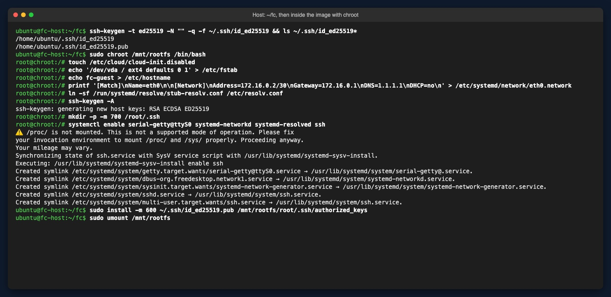

---

## Part B: The kernel

### B1. Can this kernel run Docker?

**Run on:** the host.

Not every Linux kernel can run Docker: it needs namespaces, cgroups, overlayfs, veth, bridge, netfilter and NAT. If one is missing, Docker may not start, or containers may fail later. So we check before booting, with the script Docker ships for exactly this, against the kernel's config file (the CI kernel from the Firecracker lab publishes it next to the binary).

```bash
S3=https://s3.amazonaws.com/spec.ccfc.min; KEY=firecracker-ci/20261023-dd7c24b0d165-0/x86_64/vmlinux-6.18.54
curl -fsSLO $S3/$KEY && curl -fsSLO $S3/$KEY.config
curl -fsSLO https://raw.githubusercontent.com/moby/moby/master/contrib/check-config.sh && chmod +x check-config.sh
./check-config.sh vmlinux-6.18.54.config | sed 's/\x1b\[[0-9;]*m//g' > kernel-check.txt
grep -c 'CONFIG_.*enabled' kernel-check.txt
grep 'CONFIG_.*missing' kernel-check.txt
```

```
58
- CONFIG_NETFILTER_XT_MATCH_IPVS: missing
- CONFIG_IP_NF_RAW: missing
- CONFIG_IP6_NF_RAW: missing
- CONFIG_NET_CLS_CGROUP: missing
…
    - CONFIG_BTRFS_FS: missing
```

Under *Generally Necessary* everything Docker needs is **enabled**: the namespaces, cgroup v2 with all its controllers, veth, bridge, netfilter, NAT, overlayfs. What's missing is optional: IPVS (for Swarm), btrfs, macvlan, SCTP, a few nftables modules. One thing to know: the script also reads the machine it runs on, so a few of its lines (cgroup hierarchy, the apparmor tools) refer to the EC2 host, not to the guest.

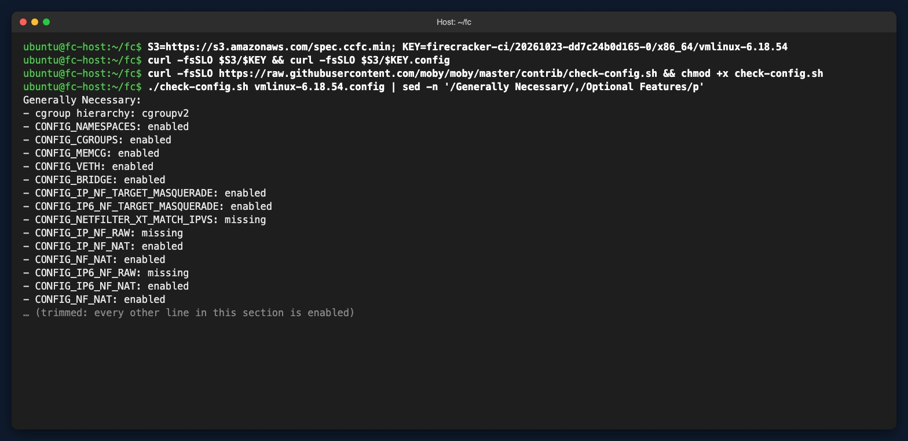

If your kernel lacks something under *Generally Necessary*, don't boot it; use the one above.

---

## Part C: Boot and connect

### C1. TAP and NAT on the host

**Run on:** the host.

The guest has to reach the internet, so the host becomes its router. The first three lines are the TAP device from the Firecracker lab. `ip_forward` lets the host pass packets between interfaces; the `MASQUERADE` rule is NAT (packets leaving for the internet get the host's address, and replies find their way back); the two `FORWARD` rules let that traffic through. The last rule is new: the guest must never reach the **instance metadata** at `169.254.169.254`, where the host's own credentials live.

```bash
sudo ip tuntap add dev tap0 mode tap user ubuntu
sudo ip addr add 172.16.0.1/30 dev tap0 && sudo ip link set dev tap0 up
sudo sysctl -w net.ipv4.ip_forward=1
OUT=$(ip route show default | awk '{print $5}'); echo $OUT
sudo iptables -t nat -A POSTROUTING -o $OUT -j MASQUERADE
sudo iptables -A FORWARD -i tap0 -o $OUT -j ACCEPT
sudo iptables -A FORWARD -i $OUT -o tap0 -m state --state RELATED,ESTABLISHED -j ACCEPT
sudo iptables -I FORWARD -i tap0 -d 169.254.169.254 -j DROP
```

```
net.ipv4.ip_forward = 1
enp39s0
```

Inside the guest, Docker will set up the same kind of NAT for its containers. So there are **two layers of NAT**: the host's for the guest, and Docker's for the containers. If a container can't reach the internet later, test the guest first, then the container.

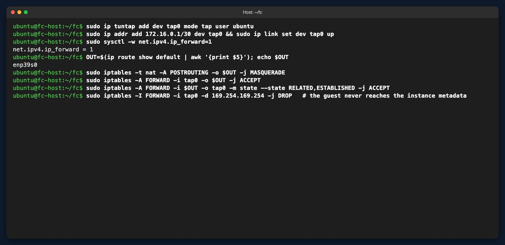

### C2. Boot Ubuntu with a config file

**Run on:** the host, **terminal 1**.

In the Firecracker lab we configured the microVM through the API, one call at a time. Firecracker can read the same settings from a JSON file and start the VM on its own. Two vCPUs and 2 GiB: enough for Docker and the scanners of Part 3. Look at the boot arguments: `console=ttyS0` as before; no `init=` any more, because the kernel finds Ubuntu's systemd on its own; `root=/dev/vda rw` says where the root filesystem is; `reboot=k` makes a reboot inside the guest end the Firecracker process, which is how we'll shut down.

```bash
cat > vm.json <<'J'
{
  "boot-source": {"kernel_image_path": "vmlinux-6.18.54", "boot_args": "console=ttyS0 reboot=k panic=1 root=/dev/vda rw"},
  "drives": [{"drive_id": "rootfs", "path_on_host": "ubuntu.ext4", "is_root_device": true, "is_read_only": false}],
  "machine-config": {"vcpu_count": 2, "mem_size_mib": 2048},
  "network-interfaces": [{"iface_id": "eth0", "host_dev_name": "tap0"}]
}
J
rm -f /tmp/firecracker.socket
./firecracker --api-sock /tmp/firecracker.socket --config-file vm.json
```

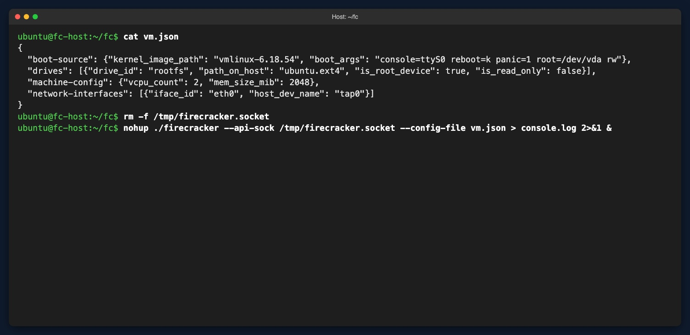

### C3. The serial console: Ubuntu is up

Terminal 1 now shows the guest's console. The kernel messages scroll by, then systemd takes over with its green `OK` lines, one service after another, and a few seconds later the login prompt appears:

```
[    0.000000] Linux version 6.18.54+ (root@2685db8dbf72) …
[  OK  ] Reached target network.target - Network.
[  OK  ] Started ssh.service - OpenBSD Secure Shell server.
…
Ubuntu 24.04.5 LTS fc-guest ttyS0

fc-guest login:
```

A full Ubuntu, booted in Firecracker. Don't log in here; we use SSH, as the real workflow will.

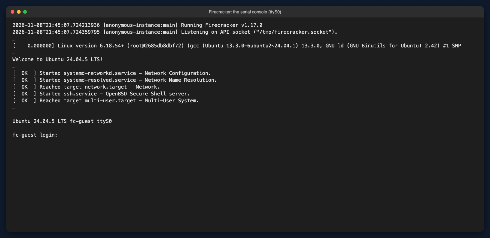

### C4. SSH in, DNS and HTTPS out

**Run on:** the host, **terminal 2**.

```bash
ssh root@172.16.0.2 'head -2 /etc/os-release; ip -br addr'
ssh root@172.16.0.2 'resolvectl query github.com'
ssh root@172.16.0.2 "curl -sS -o /dev/null -w '%{http_code}\n' https://github.com"
```

```
PRETTY_NAME="Ubuntu 24.04.5 LTS"
NAME="Ubuntu"
lo               UNKNOWN        127.0.0.1/8 ::1/128
eth0             UP             172.16.0.2/30 fe80::a815:6fff:fea6:c855/64
github.com: 140.82.114.4                                    -- link: eth0
…
200
```

Ubuntu 24.04 with the address from the network file; a DNS lookup that resolves; an HTTPS request that returns 200. Both go through the TAP, through the NAT on the host, and out. If either fails, stop here and fix it, before Docker adds its own layer on top.

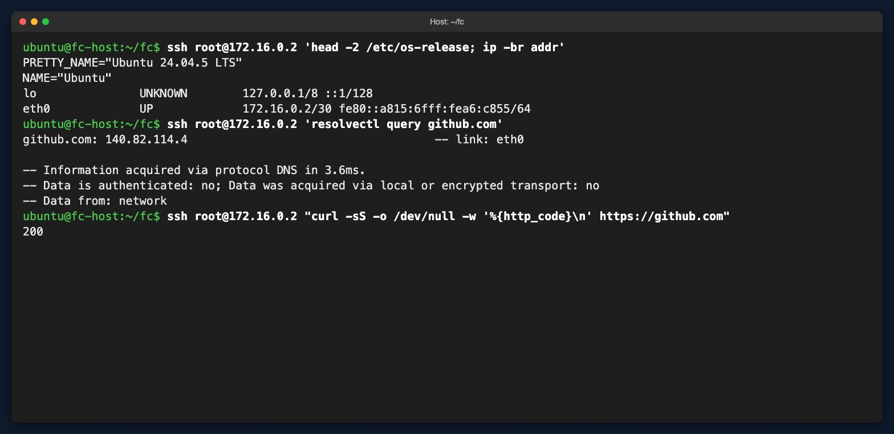

---

## Part D: Docker inside the guest

### D1. Install Docker Engine and Compose

**Run on:** terminal 2 (over SSH, inside the guest).

Docker's install script adds its repository and installs the engine and the Compose plugin in one go. It takes a minute or two, and it only works because the guest can now reach the internet.

```bash
ssh root@172.16.0.2 'curl -fsSL https://get.docker.com | sh > /root/docker-install.log 2>&1; tail -3 /root/docker-install.log'
ssh root@172.16.0.2 'systemctl is-active docker'
ssh root@172.16.0.2 "docker version --format '{{.Server.Version}}'"
ssh root@172.16.0.2 'docker compose version'
ssh root@172.16.0.2 "docker info --format 'cgroup v{{.CgroupVersion}}, storage {{.Driver}}'"
```

```
active
29.9.3
Docker Compose version v5.7.0
cgroup v2, storage overlayfs
```

The daemon is active, the engine and Compose report their versions, and Docker runs on cgroup v2 with overlayfs: the two things we checked the kernel for.

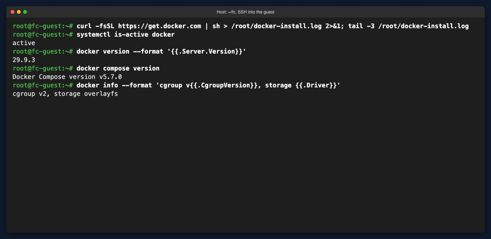

### D2. A container, a volume, and a way out

**Run on:** terminal 2.

Three small tests, the same things the agents will do in Part 3. The first container writes a file into a named volume and exits. The second is a fresh container that reads the file back: results can outlive the container that made them. The third goes to the internet from inside a container: a container behind Docker's NAT, inside the guest behind the host's NAT, and out.

```bash
ssh root@172.16.0.2 "docker run --rm -v jobdata:/data alpine sh -c 'echo hello from a container > /data/hello.txt'"
ssh root@172.16.0.2 'docker run --rm -v jobdata:/data alpine cat /data/hello.txt'
ssh root@172.16.0.2 'docker run --rm alpine wget -qO- https://api.github.com/zen'
```

```
Unable to find image 'alpine:latest' locally
latest: Pulling from library/alpine
…
hello from a container
Encourage flow.
```

(The last line is a random GitHub Zen quote; yours will differ.)

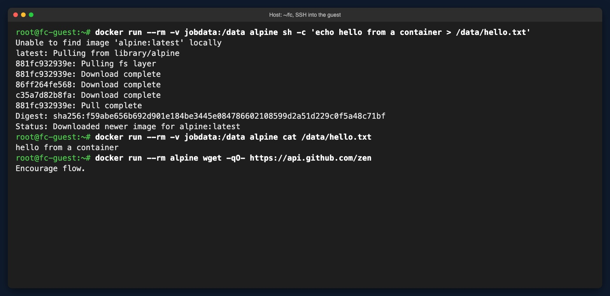

### D3. Shut down, and keep the base image

**Run on:** terminal 2, then terminal 1.

First remove the test volume, so the base image is clean. Then run `reboot` inside the guest: because of `reboot=k`, it ends the Firecracker process instead of starting over, and terminal 1 returns to the host prompt. **Wait for that prompt before you touch the disk.** Then copy the image: this copy is the base image. Every job in Part 3 starts from a copy of this file, runs, and throws its copy away; the base itself never changes.

```bash
ssh root@172.16.0.2 'docker volume rm jobdata'
ssh root@172.16.0.2 reboot
# terminal 1 prints "Firecracker exiting successfully. exit_code=0" and returns to the prompt
cp --sparse=always ubuntu.ext4 ubuntu-docker-base.ext4
ls -lsh ubuntu*.ext4
```

```
1.5G -rw-r--r-- 1 ubuntu ubuntu 4.0G Nov  8 21:45 ubuntu-docker-base.ext4
1.5G -rw-r--r-- 1 ubuntu ubuntu 4.0G Nov  8 21:45 ubuntu.ext4
```

Both files are 4 GiB, but the first column shows what they really use on disk, 1.5 GB, because they are sparse. `--sparse=always` keeps the copy that way.

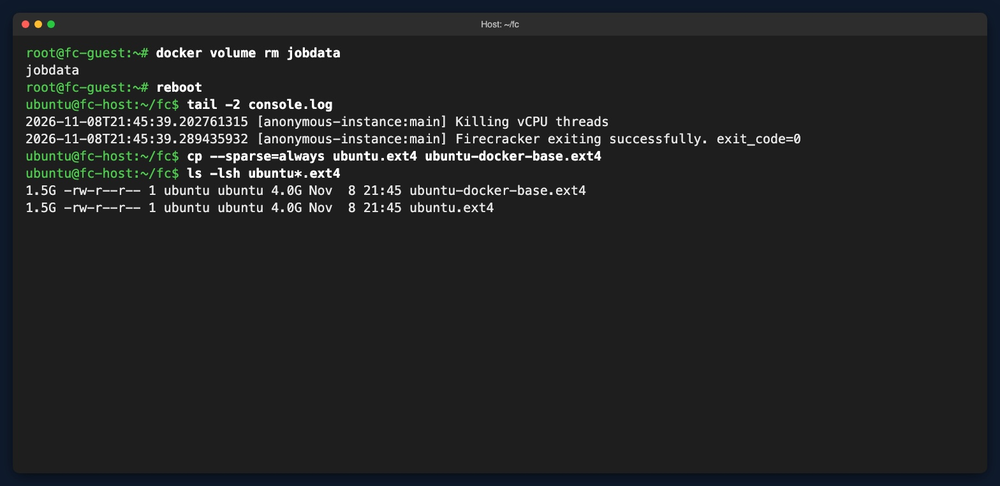

**The guest is the base image now.** Boot it again any time with the same `vm.json` (or a copy of the image: that's what Part 3 does).

---

## The Terraform path: the same result, one apply

The [`terraform/`](terraform/) folder builds the same end state without typing any of the above. One `terraform apply` creates a small VPC, the host with nested virtualization and a 30 GiB disk, a key pair, and a security group with SSH from your address. The host's **user data** writes the steps above as scripts to `~/fc` and runs them in order; then `check.sh` boots a fresh copy of the base image and proves the same checks.

| File | What it does |
|---|---|
| `network.tf`, `security.tf`, `key.tf` | A VPC `10.30.0.0/16` with one public subnet, SSH from `MY_IP` only, an ED25519 key pair saved to `ssh/terraform-key` |
| `instance.tf` | The host: Ubuntu 24.04, `m7i-flex.large`, `cpu_options { nested_virtualization = "enabled" }`, 30 GiB gp3, IMDSv2 with a hop limit of 1 (so the guest can't reach the metadata even without the iptables rule), and the user data |
| `user-data.sh.tftpl` | Writes the scripts and runs them as `ubuntu`, one log per script in `~/fc/logs`; `~/fc/lab.done` marks success, `~/fc/lab.failed` an error |
| `scripts/build-rootfs.sh` | Steps A2 to B1 |
| `scripts/boot-guest.sh` | Steps C1 and C2 |
| `scripts/install-docker.sh` | Steps C4 to D2 |
| `scripts/save-base.sh` | Step D3 |
| `scripts/check.sh` | Boots a copy of the base image and runs 8 checks, `PASS` or `FAIL` each |

**Run on:** your computer, in `terraform/`. You need Terraform and an AWS CLI session (`aws login`).

```bash
export TF_VAR_MY_IP="$(curl -s https://checkip.amazonaws.com)/32"
terraform init
terraform plan -out=tfplan
terraform apply tfplan
```

```
Apply complete! Resources: 12 added, 0 changed, 0 destroyed.

Outputs:

host_ip = "203.0.113.10"
progress = "on the host: tail -f ~/fc/logs/*.log   (done when ~/fc/lab.done exists; ~/fc/lab.failed on an error)"
ssh = "ssh -i ssh/terraform-key ubuntu@203.0.113.10"
```

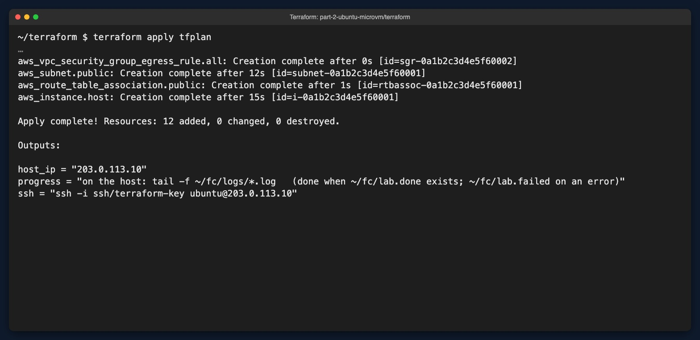

Terraform finishes in about a minute, but the scripts keep running on the host for a few more. Terraform doesn't prove anything by itself: that's what `check.sh` is for. SSH to the host with the `ssh` output, wait for `~/fc/lab.done`, then run the check yourself:

```bash
ssh -i ssh/terraform-key ubuntu@<host-ip>
ls ~/fc/lab.done && cat ~/fc/logs/check.log
cd ~/fc && ./check.sh
```

```
#### check.sh: a fresh copy of the base image
PASS  the guest boots and answers on SSH
PASS  Ubuntu 24.04 inside
PASS  DNS from the guest
PASS  HTTPS from the guest
PASS  Docker is running
PASS  a container runs
PASS  DNS and HTTPS from a container
PASS  no instance metadata from the guest

check.sh: 8 passed, 0 failed
```

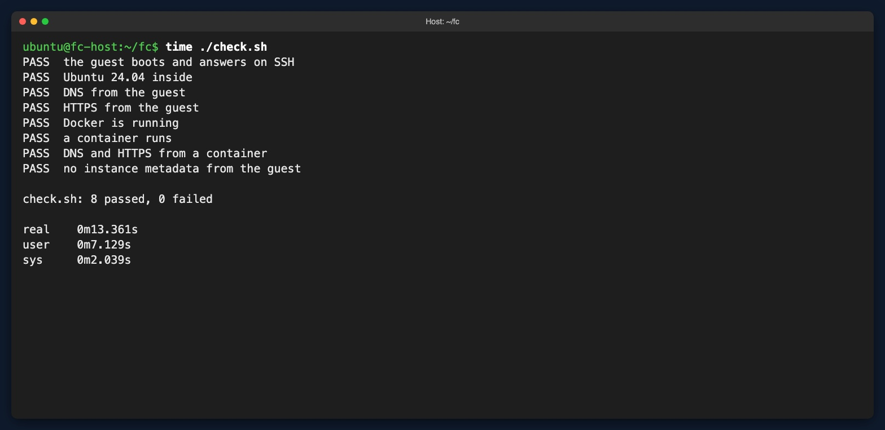

Once it passes, you have the same base image on the host as the manual path, in `~/fc/ubuntu-docker-base.ext4`, and the same `vm.json` to boot it. Whichever path you took, **the same `check.sh` must pass before Part 3.**

```bash
terraform destroy      # when you're done: 12 resources destroyed
```

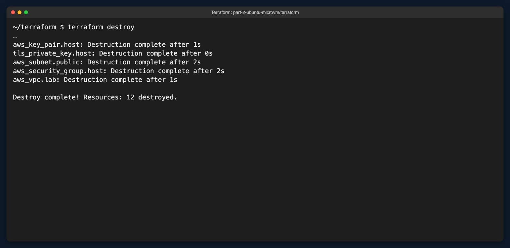

---

## Check yourself

1. Why the root archive and not the `.img` cloud image? *Firecracker boots the kernel itself and needs a plain ext4 root; the `.img` is a partitioned disk with a boot loader.*
2. What does `--numeric-owner` protect you from? *Files in the image getting the host's user IDs instead of the guest's.*
3. Why is cloud-init switched off? *There is no cloud inside a microVM to answer its questions; the network, hostname and keys are set by hand in the chroot.*
4. Why are there no SSH host keys in the archive? *cloud-init normally generates them at first boot; `ssh-keygen -A` does it in the chroot.*
5. What does `reboot=k` change? *A reboot inside the guest ends the Firecracker process instead of restarting the VM.*
6. Name the two layers of NAT. *The host's (tap0, MASQUERADE) for the guest, and Docker's (docker0) for the containers.*
7. Why block `169.254.169.254` from the guest? *That's the instance metadata, where the host's IAM credentials live. Untrusted code in the guest must never read it.*
8. Why does `check.sh` boot a copy and not the base image? *The base must stay clean; a job, or a check, runs on a copy and throws it away.*

---

## Clean up

- Manual path: terminate the instance in the Console (**Instance state → Terminate**). The key pair and the security group can stay; they cost nothing.
- Terraform path: `terraform destroy`.
- Keeping the host for Part 3? **Stop** it between sessions. The TAP device and the iptables rules don't survive a reboot; Part 3's scripts recreate them.

---

**Terms used in this part:** [terms.md](terms.md). **Next:** [Part 3: Three agents, one job](../part-3-three-agents/README.md), where the base image gets a job. The full plan: [chapters-plan.md](../chapters-plan.md).

---

Independent course, not affiliated with or endorsed by AWS. AWS and related names are trademarks of Amazon.com, Inc. or its affiliates.
