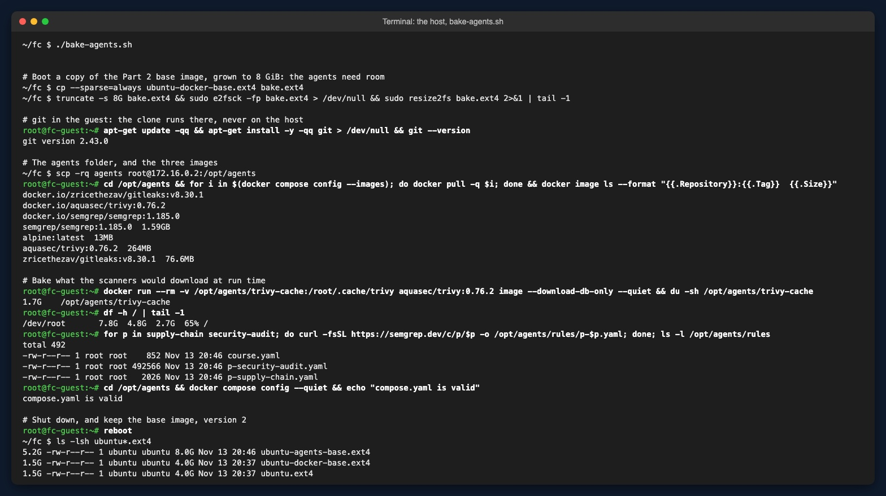
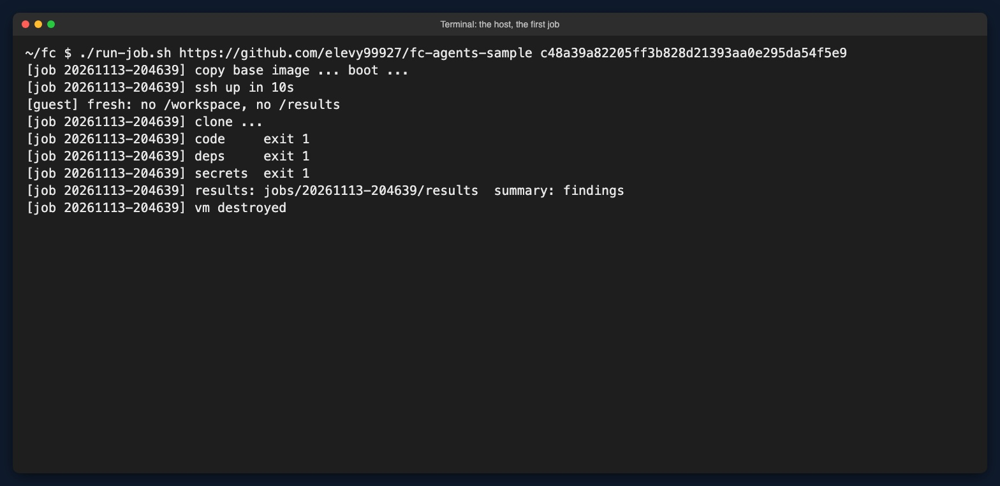
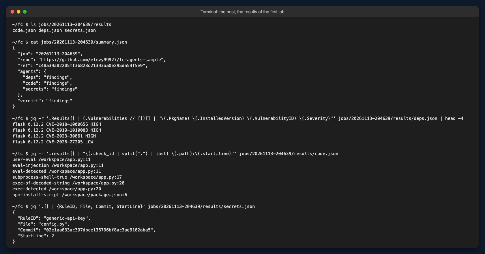
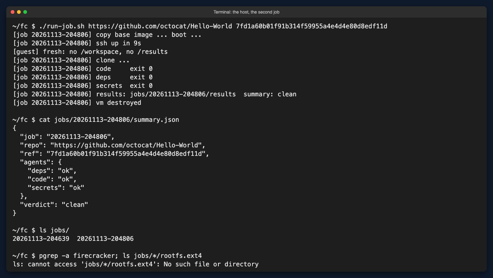
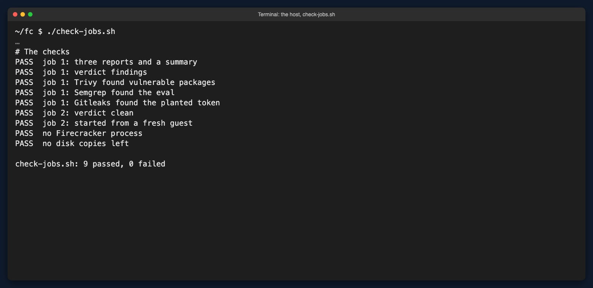
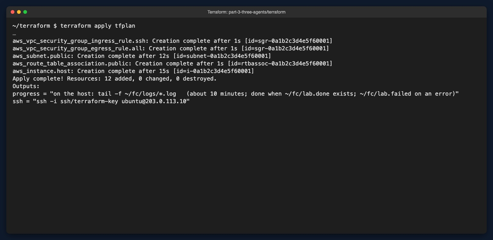
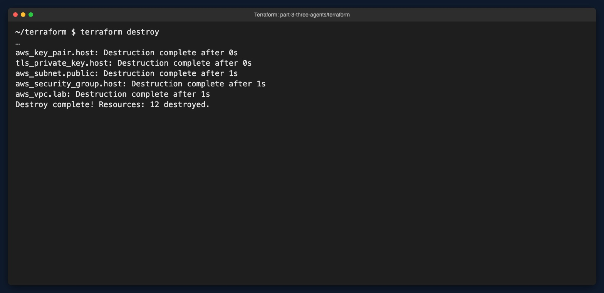

# Part 3: Three agents, one job

*Firecracker Lab: Run AI Agents in Isolated MicroVMs*, Part 3 of 5. Hands-on: the base image from Part 2 gets a job. A script on the host takes a git URL, boots a fresh copy of the image, clones the repository inside it, runs three scanners as containers, copies their JSON results out, and destroys the VM. No AI yet, on purpose: an *agent* here is a container with one job and a fixed **contract**, and in Part 5 an LLM gets the same contract.

<!-- video: add the embed when Part 3 is uploaded -->

**Before you start:** [Part 2](../part-2-ubuntu-microvm/README.md), with the base image `~/fc/ubuntu-docker-base.ext4` on the host and `check.sh` passing. If you took the Terraform path in Part 2, destroy it first: Part 3's Terraform builds a fresh host from scratch, Part 2's steps included, with the same resource names.

![Part 3: you (in Part 4, a Lambda) run run-job.sh on the EC2 host over SSH. Step 1 copies the base image ubuntu-agents-base.ext4 (Part 2's image plus git, the three scanner images, the Trivy database and the Semgrep rules) to jobs/<id>/rootfs.ext4 and starts Firecracker. Step 2, over SSH into the microVM: git clone into /workspace, the job's only network call through tap0 and the NAT, then docker compose up runs three one-shot services with network_mode none: deps (Trivy), code (Semgrep), secrets (Gitleaks), each writing /results/<agent>.json with exit code 0 ok, 1 findings, other failed. Step 3 copies the results to the host with scp, writes summary.json with one status per agent and a verdict, kills the VM and deletes the disk copy. The check: two jobs on two repositories, the first finds the planted problems, the second is clean and starts from a fresh guest, nothing survives.](images/part-3-three-agents.jpg)

<sub>Diagram source: [images/part-3-three-agents.drawio](images/part-3-three-agents.drawio) (open it in [draw.io](https://app.diagrams.net) to edit)</sub>

> 💰 **Cost:** the host from Part 2, about **$0.10 an hour** all in. The Terraform path builds everything and runs both jobs in about 10 minutes; by hand, count an hour. The scanners' images and databases are free. **Stop or terminate the host between sessions** ([clean up](#clean-up)).

> Tested in `us-east-1` on 13 November 2026: the Part 2 host and guest (Firecracker v1.17.0, guest kernel 6.18.54, Ubuntu 24.04.5, Docker 29.9.3, Compose v5.7.0), git 2.43.0 in the guest, Trivy 0.76.2, Semgrep 1.185.0, Gitleaks v8.30.1, Terraform 1.15 with the AWS provider 6.x. The two test repositories are pinned to one commit each. The terminal images show the real output of this run; IP addresses are masked.

**Jump to:** [Where to run](#where-you-run-the-commands) · [Decisions](#the-decisions-in-this-part) · [A. The contract](#part-a-the-contract) · [B. The agents](#part-b-the-agents-baked-into-the-base-image) · [C. The job script](#part-c-the-job-script) · [D. Run it](#part-d-run-it) · [Limits](#what-this-does-and-what-it-doesnt) · [Terraform](#the-terraform-path-the-same-result-one-apply) · [Check yourself](#check-yourself) · [Clean up](#clean-up) · [Terms](terms.md)

---

## Where you run the commands

| Where | What runs there |
|---|---|
| **Your computer** | `ssh` to the host; the Terraform path |
| **The host** (`fc-agents-host`, over SSH, in `~/fc`) | Everything else: the bake, `run-job.sh`, the checks |
| **The guest** (`ssh root@172.16.0.2`, from the host) | Only what the scripts type there: the clone and `docker compose up`. You never log in to a job's guest by hand |

---

## The decisions in this part

| Choice | What and why |
|---|---|
| The contract | Input: the repository at **`/workspace`**, mounted read-only, plus `GIT_URL` and `REF` as environment variables. Output: **`/results/<agent>.json`** and an **exit code** (0 clean, 1 findings, anything else failed). The host only ever reads those files |
| The agents | **Trivy** (`deps`): vulnerable dependencies, bad Dockerfiles and IaC. **Semgrep** (`code`): `p/supply-chain`, `p/security-audit`, plus two course rules (install-time scripts, decoded-and-executed strings). **Gitleaks** (`secrets`): keys and tokens in the tree and in the git history. All three write JSON natively and are deterministic. ClamAV would work in the third slot too (its database is about 300 MB) |
| Images at job time | **None pulled.** The images, Trivy's vulnerability database and Semgrep's rule sets are **baked** into the base image once (`bake-agents.sh`); the agents run with `network_mode: none` and `pull_policy: never`. The job's only network call is the git clone |
| The base image, version 2 | `ubuntu-agents-base.ext4`, **8 GiB** (sparse, 5.2 GB used): Part 2's 4 GiB didn't hold the Semgrep image (1.6 GB) and the Trivy database (1.7 GB). Grown with `truncate` and `resize2fs` on the copy; Part 2's base stays as it is |
| One job at a time | Every job uses **`tap0`** and the guest address `172.16.0.2`, the host plumbing from Part 2; `run-job.sh` takes a file lock and refuses to start while a Firecracker process is running. A TAP, an address and NAT rules per job, with a queue in front, is Part 4's problem |
| The clone | Runs **inside the guest**. The untrusted code never touches the host's disk, and nothing from it ever runs on the host |
| Exit codes | Plain `docker compose up`, then `docker compose ps -a --format '{{.Service}} {{.ExitCode}}'`. Not `--abort-on-container-exit`: that stops every service when the first one finishes, and the fast scanner would kill the slow ones |
| `summary.json` | Written on **every path**, success, a failed scanner, a timeout, a guest that never booted (a `trap` on exit): one status per agent and a verdict. A scanner that crashed is a status in the file, not a missing file. Part 4's Lambda reads this file |
| Test repositories | [`elevy99927/fc-agents-sample`](https://github.com/elevy99927/fc-agents-sample) at commit `c48a39a`, a small repository with planted problems (nothing real), and [`octocat/Hello-World`](https://github.com/octocat/Hello-World) at `7fd1a60`, a clean one. Pinned, so you get the same result |

---

## Part A: The contract

### A1. What a contract is

A **contract between AI agents** (an *agent contract*) is a formal definition of how two agents talk to each other, divide the responsibility, and pass results along. The goal: every agent knows what it gets, what it must return, what it is allowed to do, and what happens when it fails.


<sub>Diagram source: [images/agent-contract.drawio](images/agent-contract.drawio) (open it in [draw.io](https://app.diagrams.net) to edit)</sub>

A contract has six parts:

| Part | What it defines |
|---|---|
| 1. **Input contract** | What the agent receives, and in what format |
| 2. **Output contract** | What it must return, for example JSON that follows a defined schema |
| 3. **Responsibilities** | What the agent is accountable for |
| 4. **Permissions** | Which tools and actions it may use |
| 5. **Error handling** | How it reports a failure, and when it stops |
| 6. **Acceptance criteria** | How we know the task was done |

A DevOps example. Three agents: a **planner** writes the work plan (its contract: a JSON schema with the tasks, the permissions and the success conditions); an **executor** runs the plan and returns a structured result; a **reviewer** checks that result against the criteria. The contract can say that the executor must return:

```json
{
  "status": "success",
  "tests_passed": 12,
  "tests_failed": 0,
  "artifacts": ["report.json"]
}
```

### A2. Our contract

Start with the contract, because it is the part that stays stable while everything else changes. Our agents are scanners today and an AI reviewer in Part 5, and the six parts look like this:

| Part | In this lab |
|---|---|
| Input | The repository at `/workspace`, read-only; `GIT_URL` and `REF` as environment variables |
| Output | `/results/<agent>.json` in the scanner's native format, and an exit code |
| Responsibilities | One kind of risk each: `deps` vulnerable dependencies and bad Dockerfiles, `code` dangerous code patterns, `secrets` keys and tokens in the tree and the history |
| Permissions | Read `/workspace`, write `/results`, no network (`network_mode: none`), no image pulls. The host never runs the agent's code |
| Error handling | Exit code 0 clean, 1 findings, anything else failed; a missing report is failed too; a 15-minute timeout; `summary.json` written on every path |
| Acceptance | The report exists and the exit code is 0 or 1: status `ok` or `findings`. Three statuses give the job's verdict: `clean`, `findings` or `failed` |

In short:

| | |
|---|---|
| **An agent gets** | the repository at `/workspace`, mounted **read-only**, so no agent can change what another one scans; and two environment variables, `GIT_URL` and `REF`, in case it wants to write them into its report |
| **An agent owes** | one file, `/results/<agent>.json`, and an exit code: **0** nothing found, **1** findings, **anything else** the agent failed |
| **The host** | reads the files and the exit codes. It never runs anything from the repository |

That's the whole interface. When the AI reviewer arrives in Part 5, it gets the same inputs and owes the same kind of file.

---

## Part B: The agents, baked into the base image

### B1. The agents as Compose services

**Run on:** your computer, to read it. The file lives in [`terraform/scripts/agents/compose.yaml`](terraform/scripts/agents/compose.yaml); on the host it goes to `~/fc/agents/compose.yaml`, and the bake copies it into the guest as `/opt/agents/compose.yaml`.

```yaml
services:
  deps:
    image: aquasec/trivy:0.76.2
    network_mode: none
    pull_policy: never
    environment: [GIT_URL, REF]
    volumes:
      - /workspace:/workspace:ro
      - /results:/results
      - /opt/agents/trivy-cache:/root/.cache/trivy
    command: fs --scanners vuln,misconfig --skip-db-update --skip-check-update --offline-scan --exit-code 1 --format json --output /results/deps.json /workspace

  code:
    image: semgrep/semgrep:1.185.0
    network_mode: none
    pull_policy: never
    environment: [GIT_URL, REF]
    volumes:
      - /workspace:/workspace:ro
      - /results:/results
      - /opt/agents/rules:/rules:ro
    command: semgrep scan --config /rules --metrics=off --error --json --output /results/code.json /workspace

  secrets:
    image: zricethezav/gitleaks:v8.30.1
    network_mode: none
    pull_policy: never
    environment: [GIT_URL, REF]
    volumes:
      - /workspace:/workspace:ro
      - /results:/results
    command: git /workspace --report-format json --report-path /results/secrets.json --exit-code 1
```

Three services, one per agent, each mounting `/workspace` read-only and `/results` read-write, each writing its own file. The commands: Trivy scans the filesystem for vulnerabilities and misconfigurations, with its baked database and no updates; Semgrep gets the `/rules` folder (the two registry rule sets and ours); Gitleaks scans the git repository, so it sees the history too. `--exit-code 1` (Trivy) and `--error` (Semgrep) make findings an exit code of 1; Gitleaks does that by default. The versions are pinned: in a sandbox you want to know exactly what ran.

### B2. Two rules of our own

[`terraform/scripts/agents/rules/course.yaml`](terraform/scripts/agents/rules/course.yaml): a rule that flags `preinstall` and `postinstall` scripts in `package.json` (that's where a malicious package does its work, on `npm install`), and one that flags code decoded from base64 and passed to `exec` or `eval`. Semgrep loads every YAML file in `/rules`, so the registry sets and ours run together.

```yaml
rules:
  - id: course.npm-install-script
    languages: [generic]
    paths:
      include: ["package.json"]
    pattern-either:
      - pattern: '"preinstall"'
      - pattern: '"postinstall"'
    message: package.json runs a script at install time. That is where a malicious package does its work; read the script before you run npm install.
    severity: WARNING

  - id: course.exec-of-decoded-string
    languages: [python]
    pattern-either:
      - pattern: exec(base64.b64decode(...))
      - pattern: eval(base64.b64decode(...))
    message: Code decoded from a string and executed. Obfuscation is a red flag in an untrusted repository.
    severity: ERROR
```

### B3. Pull once, run forever: the base image, version 2

**Run on:** the host, in `~/fc`, with `agents/compose.yaml` and `agents/rules/course.yaml` in place and the scripts from [`terraform/scripts/`](terraform/scripts/) (`common.sh`, `host-net.sh`, `bake-agents.sh`, `run-job.sh`, `check-jobs.sh`) copied next to them.

`bake-agents.sh` boots a copy of Part 2's base image, grown to 8 GiB, installs git in the guest (the clone runs there), copies the agents folder in, pulls the three images, downloads what the scanners would otherwise fetch at run time (Trivy's database, Semgrep's rule sets), shuts down, and keeps the disk as `ubuntu-agents-base.ext4`.

```bash
sudo apt-get install -y jq        # the host needs jq for summary.json
./bake-agents.sh
```

```
#### Boot a copy of the Part 2 base image, grown to 8 GiB: the agents need room
$ cp --sparse=always ubuntu-docker-base.ext4 bake.ext4
$ truncate -s 8G bake.ext4 && sudo e2fsck -fp bake.ext4 > /dev/null && sudo resize2fs bake.ext4 2>&1 | tail -1
…
guest$ apt-get update -qq && apt-get install -y -qq git > /dev/null && git --version
git version 2.43.0
…
guest$ cd /opt/agents && for i in $(docker compose config --images); do docker pull -q $i; done && docker image ls …
semgrep/semgrep:1.185.0  1.59GB
aquasec/trivy:0.76.2  264MB
zricethezav/gitleaks:v8.30.1  76.6MB
…
guest$ docker run --rm -v /opt/agents/trivy-cache:/root/.cache/trivy aquasec/trivy:0.76.2 image --download-db-only --quiet && du -sh /opt/agents/trivy-cache
1.7G	/opt/agents/trivy-cache
guest$ df -h / | tail -1
/dev/root       7.8G  4.8G  2.7G  65% /
guest$ for p in supply-chain security-audit; do curl -fsSL https://semgrep.dev/c/p/$p -o /opt/agents/rules/p-$p.yaml; done; ls -l /opt/agents/rules
-rw-r--r-- 1 root root    852 Nov 13 20:46 course.yaml
-rw-r--r-- 1 root root 492566 Nov 13 20:46 p-security-audit.yaml
-rw-r--r-- 1 root root   2026 Nov 13 20:46 p-supply-chain.yaml
…
$ ls -lsh ubuntu*.ext4
5.2G -rw-r--r-- 1 ubuntu ubuntu 8.0G Nov 13 20:46 ubuntu-agents-base.ext4
1.5G -rw-r--r-- 1 ubuntu ubuntu 4.0G Nov 13 20:37 ubuntu-docker-base.ext4
```



Why bake now, and not at job time? Speed: a job starts in seconds instead of downloading a few hundred megabytes each time. And security: the only network a job needs is the clone, and the agents themselves have no network at all. If a job starts pulling images, something is wrong. Two notes: `docker compose pull` would **skip** these images because of `pull_policy: never`, so the bake pulls them one by one with `docker pull`; and the Trivy database and the Semgrep rules will age. Rebuilding this image is how you update them.

---

## Part C: The job script

[`terraform/scripts/run-job.sh`](terraform/scripts/run-job.sh) is one file. Here it is in three pieces; copy the whole file from the repo.

### C1. A fresh VM for this job

```bash
URL=${1:?usage: run-job.sh <git-url> [ref]}; REF=${2:-HEAD}
GUEST=172.16.0.2; BASE=ubuntu-agents-base.ext4; TIMEOUT=900
ID=$(date +%Y%m%d-%H%M%S); JOB=jobs/$ID
mkdir -p $JOB/results jobs

exec 9>jobs/.lock
flock -w 1 9 || { echo "another job is running"; exit 1; }
pgrep -x firecracker >/dev/null && { echo "a microVM is already running on this host"; exit 1; }

./host-net.sh                                   # tap0 and NAT, if the host rebooted
cp --sparse=always $BASE $JOB/rootfs.ext4
sed "s|\"ubuntu.ext4\"|\"$JOB/rootfs.ext4\"|" vm.json > $JOB/vm.json
./firecracker --api-sock $JOB/fc.sock --config-file $JOB/vm.json > $JOB/console.log 2>&1 &
FC=$!
trap finish EXIT
for _ in $(seq 1 60); do g true 2>/dev/null && break; sleep 1; done
```

The job gets its own world: an id from the clock, a folder, a **sparse copy** of the base image (fast, and it takes no real space until the job writes), its own Firecracker socket and console log. The config file is Part 2's `vm.json` with one substitution, the disk path. Then Firecracker starts and the script waits until SSH answers. The base image itself is never touched. Two guards first: a file lock, and a check that no microVM is already running, because every job uses `tap0` and the same guest address. `host-net.sh` recreates the TAP and the NAT rules if the host was rebooted since Part 2.

### C2. Clone and scan, inside the guest

```bash
g "git clone --quiet $URL /workspace && cd /workspace && git checkout --quiet $REF" || { log "clone failed"; exit 1; }
g "mkdir -p /results && cd /opt/agents && GIT_URL=$URL REF=$REF timeout $TIMEOUT docker compose up 2>&1" > $JOB/compose.log
g "cd /opt/agents && docker compose ps -a --format '{{.Service}} {{.ExitCode}}'" > $JOB/exit-codes.txt
```

(`g` is `ssh root@172.16.0.2`.) This is the only piece that touches the untrusted code, and all of it runs inside the guest. The clone into `/workspace` and the checkout of the ref: the one network call the job needs. Then `docker compose up`: the three agents start in parallel, each in its own container, and Compose waits for all of them to finish (with a 15-minute timeout around it). Last, Compose reports the exit code of each service, saved on the host. Notice what the host did: it typed commands over SSH. The repository never existed on the host's disk, and nothing from it ever ran there.

### C3. Collect, summarize, destroy

```bash
scp -q "root@$GUEST:/results/*.json" $JOB/results/ 2>/dev/null

finish() {                       # runs on every exit, success or failure
  v=$(summary)                   # jq: one status per agent, one verdict
  log "results: $JOB/results  summary: $v"
  kill $FC 2>/dev/null; wait $FC 2>/dev/null
  rm -f $JOB/rootfs.ext4 $JOB/fc.sock
  log "vm destroyed"
}
```

`scp` copies the three JSON files out of the guest. Then the `finish` function, which the `trap` runs however the script ends: `summary.json` first, then kill the Firecracker process and delete the disk copy and the socket. What stays is the job folder: three reports, a summary, the exit codes, the Compose log and the console log.

The summary gives each agent a status from its exit code and its file: `ok` (0), `findings` (1), `failed` (another code, or no file at all). The verdict is `failed` if any agent failed, else `findings` if any agent found something, else `clean`. It's written on every path, success, failure or timeout; in Part 4 the Lambda will read it, so it has to exist every time.

---

## Part D: Run it

### D1. The first job

**Run on:** the host, in `~/fc`. The sample repository, pinned to one commit, with a few planted problems: old `requests`, `pyyaml` and `flask` versions, a Dockerfile that runs as root, `eval` on user input, a shell command built from user input, code decoded from base64 and executed, a `postinstall` script, and a fake API token that was committed and then removed (so it only lives in the history).

```bash
./run-job.sh https://github.com/elevy99927/fc-agents-sample c48a39a82205ff3b828d21393aa0e295da54f5e9
```

```
[job 20261113-204639] copy base image ... boot ...
[job 20261113-204639] ssh up in 10s
[guest] fresh: no /workspace, no /results
[job 20261113-204639] clone ...
[job 20261113-204639] code     exit 1
[job 20261113-204639] deps     exit 1
[job 20261113-204639] secrets  exit 1
[job 20261113-204639] results: jobs/20261113-204639/results  summary: findings
[job 20261113-204639] vm destroyed
```



Watch the timeline: the boot takes about ten seconds, because the disk copy is sparse and the images are already there. Then the clone. Then the three agents run in parallel and each one reports its exit code: 1, findings, from all three. In this run the whole job took about a minute and a half, most of it Semgrep loading 228 rules. And the last line: the microVM is gone.

### D2. The results on the host

**Run on:** the host.

```bash
ls jobs/20261113-204639/results
cat jobs/20261113-204639/summary.json
jq -r '.Results[] | (.Vulnerabilities // [])[] | "\(.PkgName) \(.InstalledVersion) \(.VulnerabilityID) \(.Severity)"' jobs/20261113-204639/results/deps.json | head -4
jq -r '.results[] | "\(.check_id | split(".") | last) \(.path):\(.start.line)"' jobs/20261113-204639/results/code.json
jq '.[] | {RuleID, File, Commit, StartLine}' jobs/20261113-204639/results/secrets.json
```

```
code.json  deps.json  secrets.json
{
  "job": "20261113-204639",
  "repo": "https://github.com/elevy99927/fc-agents-sample",
  "ref": "c48a39a82205ff3b828d21393aa0e295da54f5e9",
  "agents": { "deps": "findings", "code": "findings", "secrets": "findings" },
  "verdict": "findings"
}
flask 0.12.2 CVE-2018-1000656 HIGH
flask 0.12.2 CVE-2019-1010083 HIGH
flask 0.12.2 CVE-2023-30861 HIGH
flask 0.12.2 CVE-2026-27205 LOW
user-eval /workspace/app.py:11
eval-injection /workspace/app.py:11
eval-detected /workspace/app.py:11
subprocess-shell-true /workspace/app.py:17
exec-of-decoded-string /workspace/app.py:20
exec-detected /workspace/app.py:20
npm-install-script /workspace/package.json:6
{
  "RuleID": "generic-api-key",
  "File": "config.py",
  "Commit": "02e1aa033ac397dbce136796bf8ac3ae9102aba5",
  "StartLine": 2
}
```



The summary is what the next part cares about: one status per agent and a verdict. The reports are the scanners' native output, so you can open them with `jq`. Trivy found 11 CVEs in `requirements.txt` and 2 misconfigurations in the Dockerfile (no `USER`, no `HEALTHCHECK`); Semgrep found the `eval`, the shell command, the decoded `exec` (twice: a registry rule and ours) and the `postinstall` script; Gitleaks found the token in commit `02e1aa0`, the first one, even though the current tree is clean. Nothing here was produced on the host. The host received files; it didn't run a scanner.

### D3. A second job: nothing from the first

**Run on:** the host. The check from the plan: a second job on a different, clean repository.

```bash
./run-job.sh https://github.com/octocat/Hello-World 7fd1a60b01f91b314f59955a4e4d4e80d8edf11d
cat jobs/20261113-204806/summary.json
ls jobs/
pgrep -a firecracker; ls jobs/*/rootfs.ext4
```

```
[job 20261113-204806] copy base image ... boot ...
[job 20261113-204806] ssh up in 9s
[guest] fresh: no /workspace, no /results
[job 20261113-204806] clone ...
[job 20261113-204806] code     exit 0
[job 20261113-204806] deps     exit 0
[job 20261113-204806] secrets  exit 0
[job 20261113-204806] results: jobs/20261113-204806/results  summary: clean
[job 20261113-204806] vm destroyed
{ …, "agents": { "deps": "ok", "code": "ok", "secrets": "ok" }, "verdict": "clean" }
20261113-204639  20261113-204806
ls: cannot access 'jobs/*/rootfs.ext4': No such file or directory
```



Two job folders, each with its own results. No Firecracker process. No disk copies. And the line `fresh: no /workspace, no /results`, which the script prints right after the guest answers: the second job started from the base image, not from the first job's disk. Nothing from the first repository was inside the VM when the second one ran. That's the property we wanted from a microVM per job: every job starts clean and ends with nothing left running. Skip the cleanup and you don't just leak disk space; you leak the previous job's code into the next one.

### D4. The check

**Run on:** the host. `check-jobs.sh` runs the two jobs above and nine checks.

```bash
./check-jobs.sh
```

```
#### The checks
PASS  job 1: three reports and a summary
PASS  job 1: verdict findings
PASS  job 1: Trivy found vulnerable packages
PASS  job 1: Semgrep found the eval
PASS  job 1: Gitleaks found the planted token
PASS  job 2: verdict clean
PASS  job 2: started from a fresh guest
PASS  no Firecracker process
PASS  no disk copies left

check-jobs.sh: 9 passed, 0 failed
```



---

## What this does, and what it doesn't

- **The microVM limits the damage untrusted code can do.** It doesn't make the code safe, and the scanners only catch what they have rules for. A clean summary means nothing known was found. That's all it means.
- **Memory.** The guest has 2 GiB and Semgrep is the hungry one. A job that fails with an exit code of 137 is usually the kernel's OOM killer ending a container; check `docker inspect` for `OOMKilled` in the guest before you blame the scanner, and give the guest more memory in `vm.json`.
- **One job at a time.** The lock and the Firecracker check make a second job wait or refuse. Two hosts, or a TAP and an address per job with a queue in front, is the upgrade, and Part 4 says where it goes.
- **The images and databases age.** Rebuild the base image (`bake-agents.sh`) to update them; pin new versions in `compose.yaml` on purpose.
- **The host costs money while it runs, even idle.** Stop it between sessions.

---

## The Terraform path: the same result, one apply

[`terraform/`](terraform/) is Part 2's configuration plus the Part 3 scripts. One `terraform apply` builds the host from scratch, runs Part 2's steps, then `bake-agents.sh`, then `check-jobs.sh` with both jobs. The user data grew past EC2's 16 KB limit, so it is sent gzipped (`base64gzip`), which cloud-init unpacks.

| File | What it does |
|---|---|
| `*.tf`, `scripts/build-rootfs.sh`, `boot-guest.sh`, `install-docker.sh`, `save-base.sh`, `check.sh` | [Part 2](../part-2-ubuntu-microvm/README.md#the-terraform-path-the-same-result-one-apply), unchanged |
| `scripts/agents/compose.yaml`, `scripts/agents/rules/course.yaml` | Part B |
| `scripts/host-net.sh` | `tap0` and the NAT rules, only if `tap0` is missing |
| `scripts/bake-agents.sh` | Part B3: the base image, version 2 |
| `scripts/run-job.sh` | Part C |
| `scripts/check-jobs.sh` | Part D4: two jobs, nine checks |

**Run on:** your computer, in `terraform/`, with an AWS CLI session (`aws login`).

```bash
export TF_VAR_MY_IP="$(curl -s https://checkip.amazonaws.com)/32"
terraform init
terraform plan -out=tfplan
terraform apply tfplan
```

```
Apply complete! Resources: 12 added, 0 changed, 0 destroyed.

Outputs:

host_ip = "203.0.113.10"
progress = "on the host: tail -f ~/fc/logs/*.log   (about 10 minutes; done when ~/fc/lab.done exists; ~/fc/lab.failed on an error)"
ssh = "ssh -i ssh/terraform-key ubuntu@203.0.113.10"
```



Then on the host, when `~/fc/lab.done` exists (about 6 minutes in this run):

```bash
ssh -i ssh/terraform-key ubuntu@<host-ip>
ls ~/fc/lab.done && tail -12 ~/fc/logs/check-jobs.log
ls ~/fc/jobs/
./run-job.sh https://github.com/<your-repo> <sha>       # your own job, from ~/fc
```

The two job folders and `check-jobs.log` with `9 passed, 0 failed` are the proof. If `~/fc/lab.failed` exists instead, it names the script that failed; its log is in `~/fc/logs/`.

```bash
terraform destroy      # when you're done: 12 resources destroyed
```



---

## Check yourself

1. What are the two inputs and the two outputs of the contract? *`/workspace` (read-only) and `GIT_URL`, `REF`; `/results/<agent>.json` and an exit code.*
2. Why do the agents run with `network_mode: none`? *Everything they need is baked in; a scanner that reaches out at job time is a sign something is wrong, and the untrusted code gets no network through them.*
3. What is the only network call a job makes? *The git clone, inside the guest.*
4. Why not `docker compose up --abort-on-container-exit`? *It stops every service when the first one exits; the fast scanner would kill the slow ones.*
5. Why does `summary.json` have to exist even when a scanner crashes? *Part 4's Lambda reads it every time; a failed scanner is a status (`failed`), not a missing file.*
6. How do you know the second job saw nothing from the first? *It started from a fresh copy of the base image: the script checks that `/workspace` and `/results` don't exist before the clone, and the first job's disk copy was deleted.*
7. Why is Gitleaks' finding in a commit that is no longer in the tree? *It scans the git history; the token was committed and then removed, and the history keeps it.*
8. Why one job at a time? *Every job uses `tap0` and the guest address `172.16.0.2`; a second VM on the same TAP would answer the first job's SSH.*

---

## Clean up

- `terraform destroy` for the Terraform path, or terminate the instance in the Console.
- Keeping the host for Part 4? **Stop** it between sessions. `host-net.sh` recreates the TAP and the NAT rules after a reboot; the job folders in `~/fc/jobs/` stay until you delete them.

---

**Terms used in this part:** [terms.md](terms.md). **Next:** [Part 4: Lambda and the webhook](../part-4-lambda-webhook/README.md), where a pull request runs the job on its own. The full plan: [chapters-plan.md](../chapters-plan.md).

---

Independent course, not affiliated with or endorsed by AWS. AWS and related names are trademarks of Amazon.com, Inc. or its affiliates.
