# Part 4: Lambda and the webhook

*Firecracker Lab: Run AI Agents in Isolated MicroVMs*, Part 4 of 5. Hands-on: a pull request runs the Part 3 job on its own. GitHub calls a webhook, a Lambda function checks that the call really came from GitHub and hands the job to the host through Systems Manager, and the host scans that exact commit in a fresh microVM, puts the results in S3, and posts a status on the pull request.

<!-- video: add the embed when Part 4 is uploaded -->
<!-- TODO: the Console screenshots of the walkthrough come from the next run (placeholders below). The diagram is still to draw. -->

**Before you start:** [Part 3](../part-3-three-agents/README.md), with the host running in `us-east-1` and `check-jobs.sh` passing; the AWS CLI on your computer (`aws login`); a GitHub account. **Fork [`elevy99927/fc-agents-sample`](https://github.com/elevy99927/fc-agents-sample)** to your account: the token, the webhook and the statuses all go on your copy (a webhook needs admin access to the repository, and a status needs write access). Below, `you/fc-agents-sample` stands for your fork.

## Where you run the commands

| Where | What runs there |
|---|---|
| **Your computer** | `terraform apply`, the two secrets, `curl`; every command in "The same checks from the terminal" and "Build it by hand" |
| **The AWS Console** (browser) | The walkthrough: Systems Manager, IAM, S3, Lambda, CloudWatch |
| **The host** (`fc-agents-host`, in `~/fc`) | Watching a job (`pgrep`, `docker ps` in the guest), the S3 test, `jobctl list` |
| **GitHub** (browser) | The token, the webhook, the pull request |

## The decisions in this part

| Choice | What and why |
|---|---|
| The trigger | A GitHub **webhook** on `pull_request`, acting only on `opened` (new pull requests; a push to an open one is ignored), JSON body, signed with a shared secret (`X-Hub-Signature-256`, HMAC-SHA256) |
| The door | A **Lambda Function URL** with auth type `NONE`: GitHub can't sign AWS requests. The URL is public, so the **signature check in the code is the gate**, compared in constant time (`hmac.compare_digest`) |
| Lambda → host | **SSM Run Command**: no inbound port, no SSH key, IAM only, and the output is kept. The Lambda never waits for the job: GitHub expects an answer within 10 seconds, the scan takes minutes. It answers **202** with the CommandId |
| No payload in a shell line | SSM runs commands as **root**. The Lambda doesn't build a command string; it calls our own SSM document, **`fc-run-pr-job`**: one fixed command, four parameters, each checked with an `allowedPattern` and passed as an **environment variable**. The Lambda also accepts only listed repositories, a 40-character SHA and a numeric PR |
| Who posts the status | **The host**, in `pr-job.sh`, after the scan. The Lambda has already answered by then and never sees `summary.json` (a change from Part 3, see below) |
| `run-job.sh` | **Unchanged from Part 3.** A wrapper, `pr-job.sh`, adds the pull request around it |
| Secrets | Two **SecureString** parameters in Parameter Store: `/fc/webhook-secret` (random, made here) and `/fc/github-token` (a fine-grained token: one repository, "Commit statuses" and "Pull requests": Read and write, short expiry). AWS recommends Secrets Manager for tokens, mainly for rotation; Parameter Store is free and enough for a lab |
| Credentials | The **host** gets a role (SSM core, S3 put on one bucket, read the GitHub token, and an explicit **deny** on the webhook secret: the SSM core policy can read every parameter). The **guest** gets nothing, and still can't reach the metadata address (Part 3's `host-net.sh` rule and the hop limit of 1) |
| Results | `s3://<bucket>/<owner>/<repo>/pr-<n>/<sha>/`: the three reports, `summary.json` and the agents' log `compose.log`, one prefix per commit |
| The status | Context `fc-agents/scan` on the head commit: clean → success, findings → failure, failed → error. Details links to the S3 prefix |
| Two PRs at once | Still **one job at a time** (Part 3's lock). A second commit gets `error: host busy, push again`; a redelivery of the commit already running is left alone. A queue (SQS and a host daemon) is the upgrade; it's noted, not built |

## What changed from Part 3, and why

Part 3 described how Part 4 would work. Building it, three things came out differently:

| Part 3 said | Part 4 does | Why |
|---|---|---|
| "Part 4's **Lambda reads** `summary.json`" | The **host** reads it, in `pr-job.sh`, and posts the status | GitHub waits at most 10 seconds for an answer, and a scan takes minutes. So the Lambda hands the job over and answers at once; when `summary.json` exists, the Lambda has already finished. Making a Lambda read the file would take a second trigger (an S3 upload event) and a second function holding the GitHub token. The host already has the file, so the token stays in one place |
| A Lambda runs `run-job.sh` on the host **over SSH** | The Lambda sends one **SSM Run Command** | SSH from Lambda needs port 22 open to Lambda and an SSH key the function can use. Run Command needs neither: the agent on the host calls out to AWS, no new inbound rule, access is an IAM permission on one instance and one document, and every run is logged |
| Two jobs at once, "with a **queue** in front, is Part 4's problem" | Still **one job at a time**; a second commit gets `error: host busy, push again` | A queue needs a daemon on the host that pulls jobs, and parallel jobs need a TAP, an address and NAT rules per job. That's a part of its own. This part builds the trigger path; the queue is noted, not built |

And one change from the course plan ([chapters-plan.md](../chapters-plan.md)): it called `run-job.sh <url> <sha> <pr>`. Part 3's `run-job.sh` takes `<git-url> [ref]`, and it stays that way: a new wrapper, `pr-job.sh`, adds the pull request around it, so Part 3's script and video stay true.

## What changed from Part 3's code

Part 4's [`terraform/`](terraform/) is Part 3's folder plus this part. Every change:

| File | Change | Why |
|---|---|---|
| `scripts/run-job.sh` | one comment (line 7) | Part 3 said the queue was Part 4's problem; Part 4 only reports "host busy" |
| `scripts/pr-job.sh`, `scripts/jobctl` | new | the wrapper; `jobctl list` |
| `ssm/fc-run-pr-job.yaml` | new | the SSM document (the CLI and Terraform use the same file) |
| `lambda/app.py` (+ `test_app.py`) | new | the webhook |
| `instance.tf` | `iam_instance_profile`; three more files into user data | the host's role; `pr-job.sh`, `jobctl`, `pr-job.env` |
| `user-data.sh.tftpl` | writes the new files, installs the AWS CLI (snap) | `pr-job.sh` uploads to S3 and reads the token |
| `iam-host.tf`, `s3.tf`, `lambda.tf`, `ssm-document.tf` | new | the Part 4 resources |
| `outputs.tf` | `function_url`, `bucket`, `instance_id` | the webhook needs the URL |
| `provider.tf` | the `archive` provider | zips `app.py` |
| `vars.tf` | `REPOS` | the repositories the webhook accepts |
| everything else | unchanged | no new inbound port; the guest-side rules already hold |

---

## The walkthrough

The lab in the order of the video: one `terraform apply` builds everything, then we look at each piece in the AWS Console (`us-east-1`) and on GitHub. Commands appear only where there's no page to look at. Every check has a terminal version at the bottom ([The same checks from the terminal](#the-same-checks-from-the-terminal)), and [Build it by hand](#build-it-by-hand-with-the-cli) creates the same resources one CLI command at a time.

## Part A: The host and Systems Manager

### A1. One apply

Part 4's [`terraform/`](terraform/) is Part 3's configuration plus this part (see "What changed from Part 3's code"). First destroy Part 3's stack (`terraform destroy` in its folder): Part 4 uses the same names. Then, on your computer:

```bash
cd part-4-lambda-webhook/terraform
export TF_VAR_MY_IP="$(curl -s https://checkip.amazonaws.com)/32"
export TF_VAR_REPOS=you/fc-agents-sample      # your fork; the webhook accepts only these repositories
terraform init && terraform apply
terraform output
```

Outputs: `bucket`, `function_url`, `host_ip`, `instance_id`, `progress`, `ssh`. The host builds itself from scratch: about 10 minutes, done when `~/fc/lab.done` exists on the host (`progress` shows how to follow it). The two secrets are the only thing Terraform doesn't create, so no secret lands in the state; they come in [D1](#d1-the-secrets).

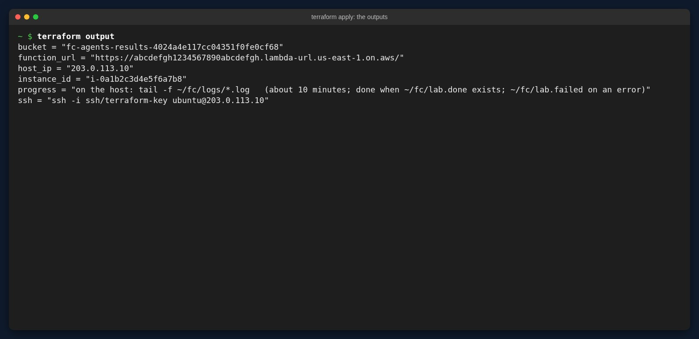

### A2. The host in Systems Manager

**Systems Manager → Fleet Manager** (under Node Tools): `fc-agents-host` is listed, ping status **Online**, Ubuntu 24.04.

<!-- screenshot: Fleet Manager, fc-agents-host Online -->

Nothing new was installed for this: the SSM Agent ships with the Ubuntu AMI. In Part 3 it was already running, but the host had no role, so it couldn't register. The agent calls out to Systems Manager, so the security group gets no new inbound rule. The agent must be **3.3.2746.0 or newer** (for the environment-variable parameters in [A5](#a5-the-ssm-document)).

### A3. The host's role

**IAM → Roles → `fc-agents-host` → Permissions:** the AWS managed policy `AmazonSSMManagedInstanceCore` (so the agent can register), and one inline policy, `results-and-token`, with three statements:

<!-- screenshot: IAM role fc-agents-host, the Permissions tab with the two policies -->

```hcl
# iam-host.tf
Statement = [
  { Effect = "Allow", Action = "s3:PutObject", Resource = "${aws_s3_bucket.results.arn}/*" },
  { Effect = "Allow", Action = "ssm:GetParameter", Resource = "arn:aws:ssm:${var.AWS_REGION}:${data.aws_caller_identity.me.account_id}:parameter/fc/github-token" },
  # AmazonSSMManagedInstanceCore allows ssm:GetParameter(s) on every parameter, and the default aws/ssm key
  # decrypts for the whole account. So the webhook secret, which only the Lambda needs, is denied explicitly.
  { Effect = "Deny", Action = "ssm:GetParameter*", Resource = "arn:aws:ssm:${var.AWS_REGION}:${data.aws_caller_identity.me.account_id}:parameter/fc/webhook-secret" },
]
```

- **Put objects** into the results bucket, nothing else: no list, no read, no delete.
- **Read the GitHub token**, so the host can post the status.
- **Deny the webhook secret.** `AmazonSSMManagedInstanceCore` itself allows `ssm:GetParameter` on every parameter, and the default `aws/ssm` key decrypts for anyone in the account. Only the Lambda needs that secret.

The credentials come from the instance metadata, rotate on their own, and are never written to disk. The guest can't reach that address: Part 3 dropped its traffic to `169.254.169.254` and set the hop limit to 1. Today that rule matters, because the host now holds something worth stealing ([B2](#b2-who-can-reach-it) tests it).

### A4. The wrapper: `pr-job.sh`

[`terraform/scripts/pr-job.sh`](terraform/scripts/pr-job.sh) wraps Part 3's `run-job.sh`:

1. Checks its four arguments again (they came from the internet).
2. Reads the token from Parameter Store, into a variable, for the length of the script.
3. If a job is already running: the same commit → does nothing (a redelivery); another commit → `error: host busy, push again`.
4. Posts `pending`, runs `./run-job.sh <url> <sha>`, and takes **its own** job id from `run-job.sh`'s `[job <id>]` lines.
5. Uploads the three reports, `summary.json` and `compose.log` to `s3://$BUCKET/<owner>/<repo>/pr-<n>/<sha>/` (the layout is in [B1](#b1-the-bucket)).
6. Posts the final status from the verdict on the commit, and the same verdict as a comment on the pull request, with the link to the reports (no comment for pull request 0). A failed post is a warning: an expired token doesn't stop the scan or the upload.

The heart of it:

```bash
# scripts/pr-job.sh
status pending "scanning ${SHA:0:7}"
LOG=$(mktemp)
./run-job.sh "$URL" "$SHA" 2>&1 | tee "$LOG"
# This job's id, from run-job.sh's own "[job <id>]" lines; never "the newest folder".
ID=$(grep -m1 -o '^\[job [0-9-]*\]' "$LOG" | tr -d '[]' | cut -d' ' -f2); rm -f "$LOG"
[ -n "$ID" ] && [ -s "jobs/$ID/summary.json" ] || { status error "the job did not start"; exit 1; }
echo "$REPO $PR $SHA" > "jobs/$ID/pr.txt"

up=0 all=0
for f in jobs/$ID/results/*.json jobs/$ID/summary.json jobs/$ID/compose.log; do
  [ -e "$f" ] || continue
  all=$((all+1)); aws s3 cp --only-show-errors "$f" "s3://$BUCKET/$KEY/$(basename "$f")" && up=$((up+1))
done
echo "uploaded $up of $all files to s3://$BUCKET/$KEY/"

DESC=$(jq -r '"\(.verdict): deps \(.agents.deps), code \(.agents.code), secrets \(.agents.secrets)"' "jobs/$ID/summary.json")
case $(jq -r .verdict "jobs/$ID/summary.json") in
  clean) state=success ;; findings) state=failure ;; *) state=error ;;
esac
status $state "$DESC"
comment "fc-agents scan of ${SHA:0:7}: $DESC"$'\n\n'"Reports: $TARGET"
```

Clean → **success**, findings → **failure**, anything else → **error**. Part 3 said the Lambda would read `summary.json`; it can't, because GitHub waits at most 10 seconds for an answer and a scan takes minutes (see "What changed from Part 3, and why").

### A5. The SSM document

**Systems Manager → Documents → Owned by me → `fc-run-pr-job` → Content.**

<!-- screenshot: the fc-run-pr-job document, the Content tab -->

[`terraform/ssm/fc-run-pr-job.yaml`](terraform/ssm/fc-run-pr-job.yaml): one fixed command, `runuser -u ubuntu -- /home/ubuntu/fc/pr-job.sh "$SSM_url" "$SSM_sha" "$SSM_pr" "$SSM_repo"`, a 1,500-second timeout (Part 3's 15-minute scan, plus boot and upload). With `interpolationType: ENV_VAR`, SSM puts each value into an environment variable instead of pasting it into the command, and `allowedPattern` rejects anything that isn't a GitHub URL, a SHA, a number or `owner/name` before the command is even sent.

```yaml
# ssm/fc-run-pr-job.yaml
parameters:
  url:
    type: String
    description: The head repository's clone URL
    allowedPattern: ^https://github\.com/[A-Za-z0-9_.-]+/[A-Za-z0-9_.-]+\.git$
    interpolationType: ENV_VAR
  # … sha, pr and repo: the same, each with its own allowedPattern
mainSteps:
  - action: aws:runShellScript
    name: prJob
    inputs:
      timeoutSeconds: 1500
      runCommand:
        - runuser -u ubuntu -- /home/ubuntu/fc/pr-job.sh "$SSM_url" "$SSM_sha" "$SSM_pr" "$SSM_repo"
```

The simple way would be one shell command built from the values. SSM runs it as **root**, and the shell reads the whole line before `runuser` drops privileges, so a crafted value would run as root. Here the values never become part of the command line.

### A6. Run it by hand

**Systems Manager → Run Command → Run command:**

1. Command document: search `fc-run-pr-job`, select it.
2. Command parameters, the four values:

   ```text
   url    https://github.com/you/fc-agents-sample.git
   sha    c48a39a82205ff3b828d21393aa0e295da54f5e9
   pr     0
   repo   you/fc-agents-sample
   ```

   Pull request number 0, because there's no pull request yet. The SHA is the sample repository's first commit, which your fork has too.
3. Targets: **Choose instances manually** → `fc-agents-host`.
4. Output options: clear **Enable an S3 bucket** (the output stays in the Console).
5. **Run.**

<!-- screenshot: Run Command, fc-run-pr-job with the four values -->

There's no GitHub token yet, so the wrapper prints `warning: no GitHub token, the scan runs without statuses` and runs anyway. While it runs, on the host (`ssh` from the Terraform output):

```bash
pgrep -a firecracker                                            # the job's microVM
ssh root@172.16.0.2 docker ps -a --format '{{.Names}}  {{.Status}}'   # the three agents, inside it
```

After a few minutes the command shows **Success**. **Output** on the instance's line shows the whole job log, ending with `uploaded 5 of 5 files` and `summary: findings`.

<!-- screenshot: Run Command, Success and the Output -->

---

## Part B: S3

### B1. The bucket

**S3 → `fc-agents-results-…`** (Terraform added the suffix; `terraform output bucket` prints the full name). The folders follow the repository, the pull request and the commit:

```text
s3://fc-agents-results-<suffix>/          # Terraform adds the suffix; the apply prints the full name
└── <owner>/<repo>/                        # your fork, e.g. elevy99927-demos/fc-agents-sample
    ├── pr-0/<sha>/                        # the run by hand in A6 (no pull request yet)
    └── pr-<n>/<sha>/                      # one folder per scanned commit (the full 40-character SHA)
        ├── deps.json                      # the deps agent's report
        ├── code.json                      # the code agent's report
        ├── secrets.json                   # the secrets agent's report
        ├── summary.json                   # the verdict and the count from each agent
        └── compose.log                    # the agents' log from inside the microVM
```

<!-- screenshot: S3, the pr-0/<sha>/ folder with five files -->

The upload ran on the **host**, after the microVM was already gone. The guest never had a way to reach S3.

### B2. Who can reach it

**On the host**, in `~/fc`:

```bash
source pr-job.env                               # BUCKET and AWS_REGION
echo test > /tmp/t.txt
aws s3 cp /tmp/t.txt s3://$BUCKET/test.txt      # works: the role allows s3:PutObject
aws s3 ls s3://$BUCKET/                         # AccessDenied: there's no s3:ListBucket
```

**Inside the microVM.** A guest exists only while a job runs, so start one first ([A6](#a6-run-it-by-hand) again), then from the host:

```bash
ssh root@172.16.0.2 curl -s -m 3 http://169.254.169.254/latest/meta-data/; echo "curl exit code: $?"   # 28: timed out
ssh root@172.16.0.2 curl -s https://$BUCKET.s3.amazonaws.com/                                            # AccessDenied
```

The metadata address doesn't answer, so there are no credentials to find, and the bucket refuses a request without them. The host can write, and nothing else can.

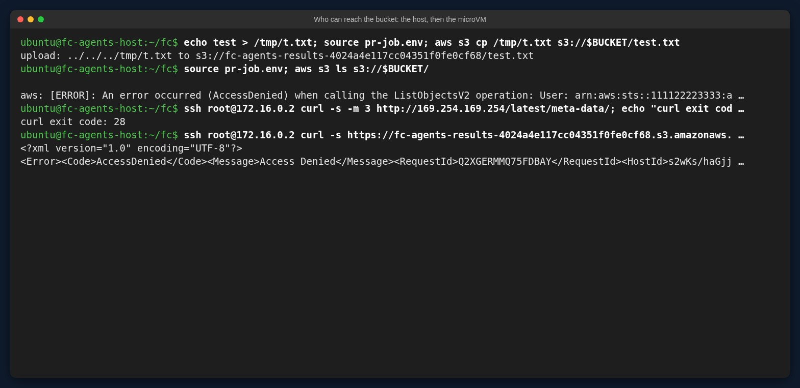

The host can't delete `test.txt`; delete it from your computer: `aws s3 rm s3://$(terraform output -raw bucket)/test.txt`.

---

## Part C: The Lambda

### C1. The function and its URL

**Lambda → Functions → `fc-agents-webhook` → Configuration → Function URL:** the URL, and **Auth type NONE**.

<!-- screenshot: Lambda, the Function URL with Auth type NONE -->

A function URL gives the Lambda its own HTTPS endpoint, without API Gateway: that's the address GitHub calls. GitHub can't sign AWS requests, so the auth type is `NONE`, and the URL is public:

```hcl
# lambda.tf
resource "aws_lambda_function_url" "webhook" {
  function_name      = aws_lambda_function.webhook.function_name
  authorization_type = "NONE"
}
```

With `NONE`, the function's resource-based policy must allow public calls, and since October 2025 that takes **two** permissions. This resource adds both itself, so there are no Terraform lines for them. **Configuration → Permissions → Resource-based policy statements** shows the two: `lambda:InvokeFunctionUrl` and `lambda:InvokeFunction`, both for `*`.

<!-- screenshot: Lambda, the two resource-based policy statements -->

So the signature check in the code is the only gate. A call without a signature, on your computer in the `terraform` folder:

```bash
curl -s -X POST $(terraform output -raw function_url) -w '  HTTP %{http_code}\n'    # "missing signature"  HTTP 401
```

### C2. The code

[`terraform/lambda/app.py`](terraform/lambda/app.py), in three pieces. Check it locally, no AWS: `python3 lambda/test_app.py`.

**1. The signature.** GitHub signs every delivery with HMAC SHA-256 and the shared secret. The function computes the same signature over the exact bytes it received and compares the two in constant time. No header or a wrong one → **401**.

```python
# 1. The signature, over the exact bytes received, before anything is parsed.
signature = headers.get("x-hub-signature-256")
if not signature:
    return reply(401, "missing signature", delivery=delivery)
if _secret is None:
    _secret = ssm.get_parameter(Name=os.environ["SECRET_PARAM"], WithDecryption=True)["Parameter"]["Value"].encode()
expected = "sha256=" + hmac.new(_secret, raw, hashlib.sha256).hexdigest()
if not hmac.compare_digest(expected, signature):
    return reply(401, "bad signature", delivery=delivery)
```

**2. Which events, which fields.** A `ping` → 200. Anything but a **new** pull request (`opened`), including a push to an open one (`synchronize`) → 200 "ignored". Then the four values the host needs; a repository outside `REPOS`, a bad SHA or URL → **400**.

```python
# 2. Which events, which fields.
kind = headers.get("x-github-event")
if kind == "ping":
    return reply(200, "pong", delivery=delivery)
payload = json.loads(raw)
action = payload.get("action")
if kind != "pull_request" or action != "opened":
    return reply(200, "ignored", delivery=delivery, event=kind, action=action)
pr = payload["pull_request"]
repo = payload["repository"]["full_name"]
number = payload["number"]
sha = pr["head"]["sha"]
url = (pr["head"].get("repo") or {}).get("clone_url", "")
if repo not in REPOS or not SHA.fullmatch(sha) or not isinstance(number, int) or not CLONE.fullmatch(url):
    return reply(400, "rejected", delivery=delivery, repo=repo)
```

**3. Hand it over.** One `send_command` with our document, and **202** with the command ID at once: GitHub waits 10 seconds, the scan takes minutes. The 202 only says the job was accepted.

```python
# 3. Hand the job to the host and answer now: GitHub waits 10 seconds, the scan takes minutes.
command = ssm.send_command(
    InstanceIds=[os.environ["HOST"]],
    DocumentName=os.environ["DOCUMENT"],
    Comment=f"pr-{number} {sha[:7]}",
    Parameters={"url": [url], "sha": [sha], "pr": [str(number)], "repo": [repo]},
)["Command"]["CommandId"]
return reply(202, {"command_id": command}, delivery=delivery, action=action, pr=number, sha=sha[:7])
```

### C3. The Lambda's role

**IAM → Roles → `fc-agents-webhook` → Permissions:** `AWSLambdaBasicExecutionRole` (its logs) and one inline policy, `send-one-command`:

<!-- screenshot: IAM role fc-agents-webhook, the Permissions tab -->

```hcl
# lambda.tf
# SendCommand on exactly this host and this document; the webhook secret, nothing else.
resource "aws_iam_role_policy" "lambda" {
  name = "send-one-command"
  role = aws_iam_role.lambda.id
  policy = jsonencode({
    Version = "2012-10-17"
    Statement = [
      { Effect = "Allow", Action = "ssm:SendCommand", Resource = [aws_instance.host.arn, aws_ssm_document.pr_job.arn] },
      { Effect = "Allow", Action = "ssm:GetParameter", Resource = "arn:aws:ssm:${var.AWS_REGION}:${data.aws_caller_identity.me.account_id}:parameter/fc/webhook-secret" },
    ]
  })
}
```

`ssm:SendCommand` needs both resources: this document **and** this instance. So the only thing the Lambda can ever run is the wrapper, on this one host. It can read the webhook secret, and not the GitHub token: that one stays with the host.

---

## Part D: End to end

### D1. The secrets

Two SecureString parameters, encrypted with KMS (the default `aws/ssm` key). They stay outside Terraform, so no secret lands in the state.

1. **The webhook secret**, a random string. GitHub signs every delivery with it, and the Lambda checks with it.
2. **A GitHub token** for the host. On GitHub: **Settings → Developer settings → Fine-grained tokens → Generate new token**: only your fork, permissions **Commit statuses** and **Pull requests**, both **Read and write** (the status and the comment), and a short expiry. To fix a webhook through the API ([D2](#d2-the-webhook)), add **Webhooks: Read and write**.

On your computer. `read -rs` shows nothing while you paste:

```bash
aws ssm put-parameter --name /fc/webhook-secret --type SecureString --value "$(openssl rand -hex 32)"
read -rs GH_TOKEN      # paste the token, press Enter; nothing is shown
aws ssm put-parameter --name /fc/github-token --type SecureString --value "$GH_TOKEN"; unset GH_TOKEN
```

**Systems Manager → Parameter Store:** `/fc/github-token` and `/fc/webhook-secret`, type **SecureString**.

<!-- screenshot: Parameter Store, the two SecureString parameters -->

AWS recommends Secrets Manager for tokens, mainly for rotation. Parameter Store is free and enough for a lab.

### D2. The webhook

In your fork: **Settings → Webhooks → Add webhook**:

In the repository: **Settings → Webhooks → Add webhook**:

- **Payload URL:** the Function URL.
- **Content type:** `application/json` (the other option wraps the JSON in a form field).
- **Secret:** the value of `/fc/webhook-secret` (`aws ssm get-parameter --name /fc/webhook-secret --with-decryption --query Parameter.Value --output text`).
- **Let me select individual events:** only **Pull requests**.

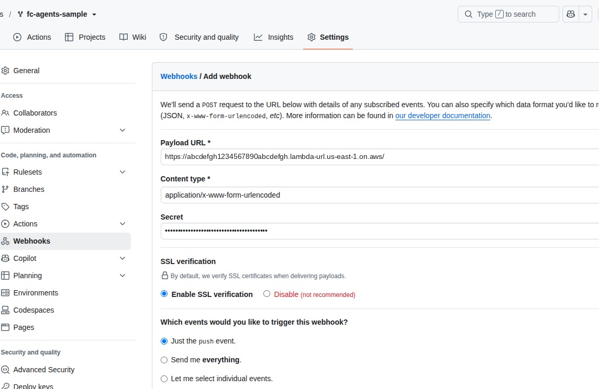

The form opens with **application/x-www-form-urlencoded** and **Just the push event** selected, as in the screenshot. Change both before you save: the Lambda reads JSON, and it acts only on pull requests.

GitHub sends a `ping` at once. **Recent Deliveries** shows it with response **200** and `"pong"`.

**Already saved it with the defaults?** In our run the webhook was saved with `form` and `push`. Edit it on the same page, or fix it with the GitHub API. The token needs **Webhooks: Read and write** for this. Keep the token and the secret in variables, never typed on the command line:

```bash
HOOKS=https://api.github.com/repos/<you>/fc-agents-sample/hooks
curl -s $HOOKS -H "Authorization: Bearer $GH_TOKEN" | jq -c '.[] | {id, events, content_type: .config.content_type}'
curl -s -X PATCH $HOOKS/<id> -H "Authorization: Bearer $GH_TOKEN" \
  -d "{\"events\": [\"pull_request\"], \"config\": {\"url\": \"$FUNCTION_URL\", \"content_type\": \"json\", \"secret\": \"$WEBHOOK_SECRET\"}}"
curl -s -X POST $HOOKS/<id>/pings -H "Authorization: Bearer $GH_TOKEN"      # a new ping: 204
```

The `config` object is replaced as a whole, so send the URL and the secret again with the new content type.

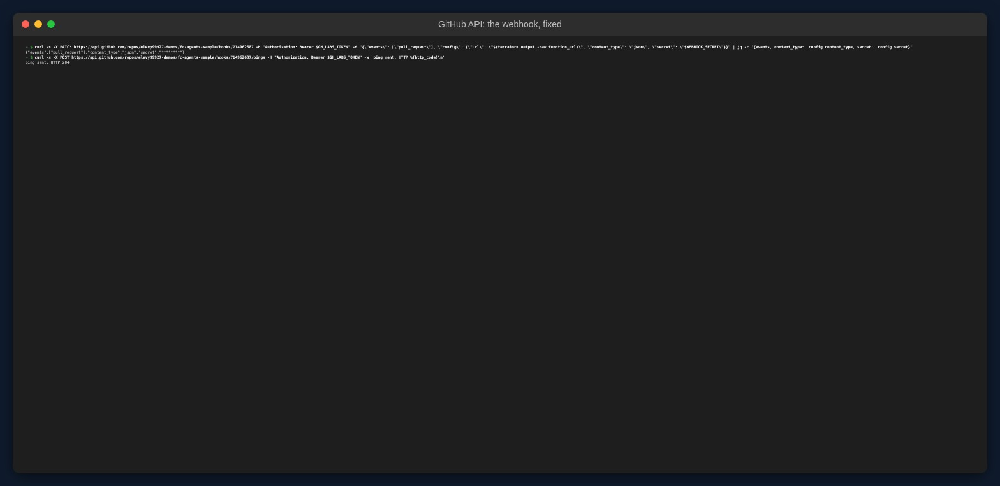

### D3. Open a pull request

On GitHub, in your fork: edit any file (`README.md` is fine) and choose **Create a new branch for this commit and start a pull request**, then **Create pull request**.

<!-- screenshot: the new pull request -->

**Settings → Webhooks → your webhook → Recent Deliveries:** `pull_request`, response **202**, body `{"command_id": "…"}`. Only a **new** pull request starts a scan. A push to a pull request that's already open (`synchronize`) gets 200 and is ignored.

<!-- screenshot: Recent Deliveries, the pull_request delivery with 202 -->

From here on, nobody types anything.

### D4. The Lambda log

**CloudWatch → Log groups → `/aws/lambda/fc-agents-webhook`** → the newest stream: one line per delivery, with what the function decided. First the ping, 200; then the pull request: `opened`, its number, the commit and the command ID. Never the body or the signature: we log what we decided, not what we received.

<!-- screenshot: CloudWatch, the Lambda's log lines -->

### D5. The job runs

**Systems Manager → Run Command → Command history:** Comment `pr-<n> <sha7>`, **In Progress**. On the host, `pgrep -a firecracker` and `./jobctl list` show the job. Then **Success**; the Output shows `pr-job.sh`'s lines: pending, the three agents, `uploaded 5 of 5 files`, the status and `comment posted`. No SSH anywhere.

<!-- screenshot: Run Command, the pr-<n> command: Success and the Output -->

### D6. The results in S3

**S3 → the bucket → `<owner>/<repo>/pr-<n>/<sha>/`:** five files again, the three reports, `summary.json` and `compose.log`. This is where **Details** on GitHub points.

<!-- screenshot: S3, the new pr-<n>/<sha>/ folder -->

### D7. The pull request

On the pull request: **`fc-agents/scan`**, a red X for the sample repository (it has planted problems), with the verdict and each agent's count. **Details** opens the S3 folder. Below it, the host's comment: the same verdict and the link to the reports.

<!-- screenshot: the pull request, the red status and the comment -->

Three results, three meanings: **202** = SSM accepted the request; **Success** = `pr-job.sh` finished and uploaded everything; a **red** status on GitHub can be a correct scan that found problems.

---

## When something doesn't work

| What you see | Where it comes from |
|---|---|
| `403 Forbidden` from the URL | The URL's resource-based policy ([C1](#c1-the-function-and-its-url)), not our code |
| `401` in Recent Deliveries | Our code: the secret in GitHub differs from `/fc/webhook-secret` |
| `202`, but the command stays **Pending** | The host is stopped, or the agent has no role yet ([A2](#a2-the-host-in-systems-manager)–[A3](#a3-the-hosts-role)) |
| SSM **Failed**, "usage: pr-job.sh …" | The SSM Agent is older than 3.3.2746.0 and left the variables empty ([A2](#a2-the-host-in-systems-manager)) |
| SSM **Success**, but no status on GitHub | The token: expired, wrong repository, or no "Commit statuses" permission (`warning: status … not posted` in the Output) |
| `error: host busy, push again` | A job was already running; push again when it's done |

## What this does, and what it doesn't

- **The URL is public; the signature is the gate.** Anyone can POST to it; each bad call is one short Lambda run, rejected.
- **The host is the main cost**, about $0.10 an hour for `m7i-flex.large`, even when idle. Stop it between sessions: that stops the compute charge, and the 30 GB disk is still charged while it's stopped. Lambda, S3 and the logs cost almost nothing at this volume. With the host stopped the webhook still fires and the Lambda still answers 202, but the command never runs.
- **One job at a time.** A queue is the upgrade.
- **Same-repository pull requests** are what this lab tested. A pull request from a fork clones the fork at that commit; it's untested here.

## Check yourself

1. Why can't the Lambda run the job itself? *Lambda has no KVM, so it can't run Firecracker; and GitHub expects an answer within 10 seconds.*
2. Why `AuthType NONE` on a URL that runs jobs? *GitHub can't sign AWS requests. The HMAC signature over the exact body is checked in the code, before anything else.*
3. Why not `AWS-RunShellScript` with the values in the command? *SSM runs it as root, and the shell reads the whole line before `runuser` drops privileges: a crafted value would run as root.*
4. Who reads `summary.json`? *The host, in `pr-job.sh`: it maps the verdict to the status. The Lambda has already answered.*
5. Why can the host hold a role, but not the guest? *The guest runs untrusted code. Its traffic to the metadata address is dropped, and the hop limit is 1.*

---

## The same checks from the terminal

Every look in the walkthrough, as a command. On your computer, in `part-4-lambda-webhook/terraform`, set these once:

```bash
export AWS_REGION=us-east-1
HOST=$(terraform output -raw instance_id)
BUCKET=$(terraform output -raw bucket)
REPO=you/fc-agents-sample                                    # your fork
HOOKS=https://api.github.com/repos/$REPO/hooks
```

The terminal images show the real output of our run. The account ID, the IP addresses, the instance ID and the function URL's ID are masked.

**A2. The host in Systems Manager**

```bash
aws ssm describe-instance-information \
  --query 'InstanceInformationList[].{Instance:InstanceId,Ping:PingStatus,Platform:PlatformName,Version:PlatformVersion,Agent:AgentVersion}' --output table
```

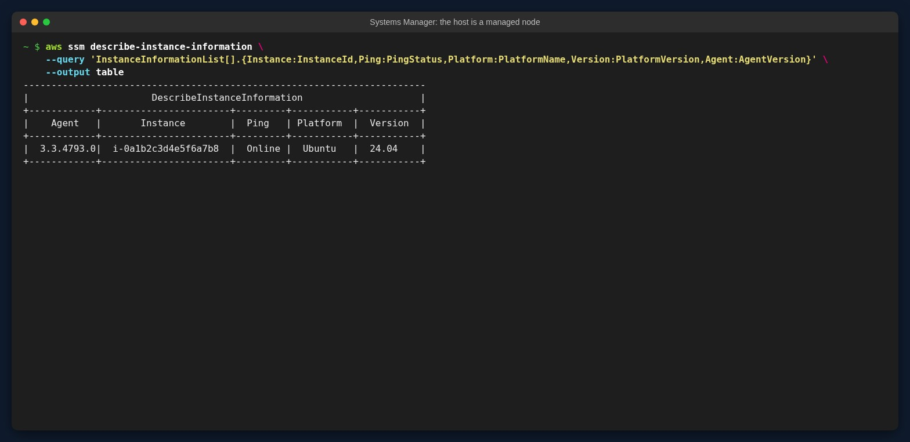

**A3. The host's role**

```bash
aws iam list-attached-role-policies --role-name fc-agents-host --output text
aws iam get-role-policy --role-name fc-agents-host --policy-name results-and-token --query PolicyDocument.Statement --output json |
  jq -c '.[] | {Effect, Action, Resource: (.Resource|split(":")|.[-1])}'
```

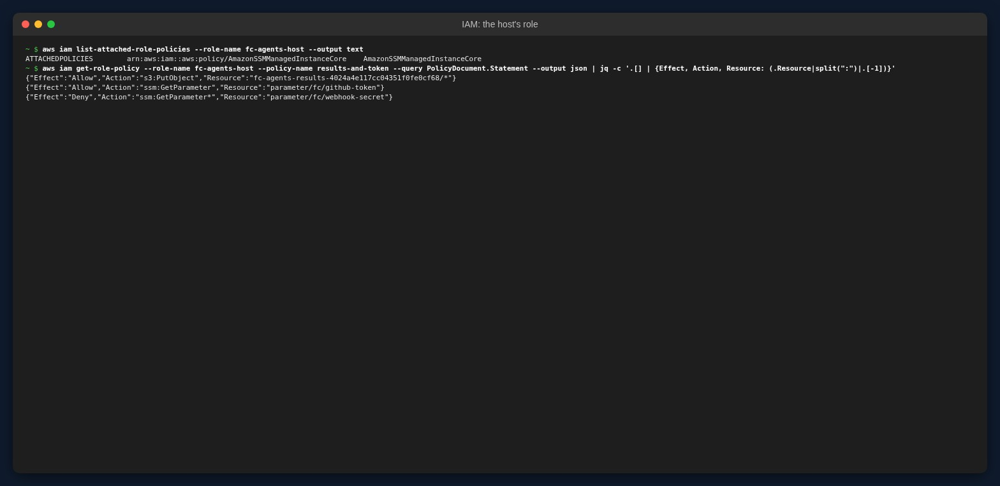

**A5. The SSM document**

```bash
aws ssm get-document --name fc-run-pr-job --query Content --output text
```

**A6. Run it by hand**

```bash
CMD=$(aws ssm send-command --document-name fc-run-pr-job --instance-ids $HOST --comment 'pr-0 by hand' \
  --parameters url=https://github.com/$REPO.git,sha=c48a39a82205ff3b828d21393aa0e295da54f5e9,pr=0,repo=$REPO \
  --query Command.CommandId --output text)
aws ssm list-commands --command-id $CMD --query 'Commands[0].[DocumentName,Comment,Status]' --output text
aws ssm get-command-invocation --command-id $CMD --instance-id $HOST --query StandardOutputContent --output text | tail -12
```

Run the last two lines again until the status is `Success`: `send-command` returns at once, and the job takes a few minutes.

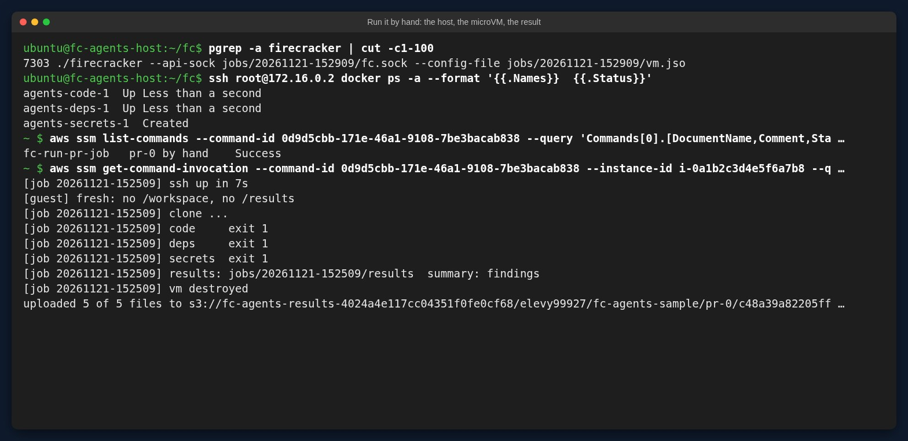

**B1. The bucket**

```bash
aws s3 ls --recursive s3://$BUCKET/$REPO/pr-0/
```

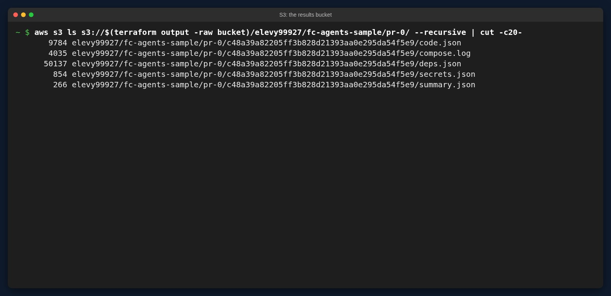

**C1. The function URL**

```bash
aws lambda get-function-url-config --function-name fc-agents-webhook --query AuthType
aws lambda get-policy --function-name fc-agents-webhook --query Policy --output text | jq -c '.Statement[] | {Action, Principal}'
curl -s -X POST $(terraform output -raw function_url) -w '  HTTP %{http_code}\n'
```

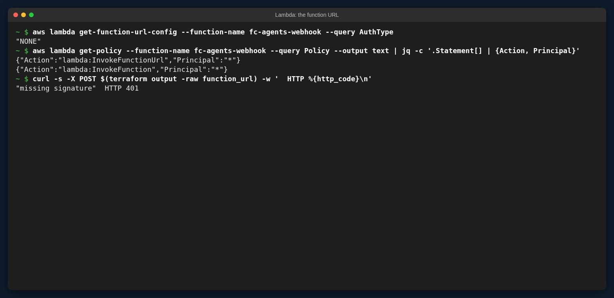

**C3. The Lambda's role**

```bash
aws iam list-attached-role-policies --role-name fc-agents-webhook --output text
aws iam get-role-policy --role-name fc-agents-webhook --policy-name send-one-command --query PolicyDocument.Statement --output json
```

**D1. The secrets**

```bash
aws ssm describe-parameters --query 'Parameters[].[Name,Type,KeyId]' --output table
```

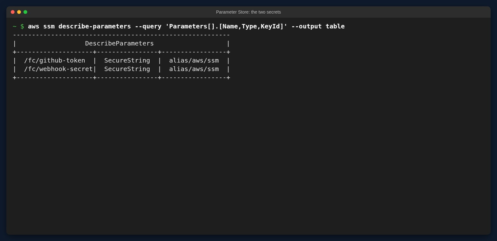

**D3. Open a pull request, and the deliveries.** Keep the token in a variable (`read -rs GH_TOKEN`), never on the command line. Opening a pull request needs **Pull requests: Read and write**; reading the deliveries needs **Webhooks: Read**.

```bash
git checkout -b part-4-test-pr && echo "test" >> README.md && git commit -am "Part 4 test" && git push -u origin part-4-test-pr
curl -s -X POST https://api.github.com/repos/$REPO/pulls -H "Authorization: Bearer $GH_TOKEN" \
  -d '{"title": "Part 4 test", "head": "part-4-test-pr", "base": "main"}' | jq -c '{number, head: .head.sha[0:7]}'
curl -s $HOOKS/<id>/deliveries -H "Authorization: Bearer $GH_TOKEN" | jq -r '.[] | [.delivered_at, .event, .action // "-", .status_code] | @tsv'
```

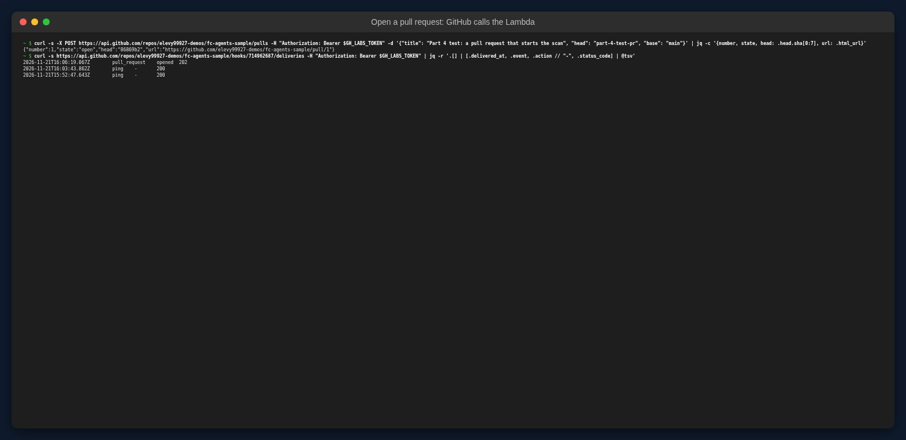

**D4. The Lambda log**

```bash
aws logs tail /aws/lambda/fc-agents-webhook --since 1h --format short
```

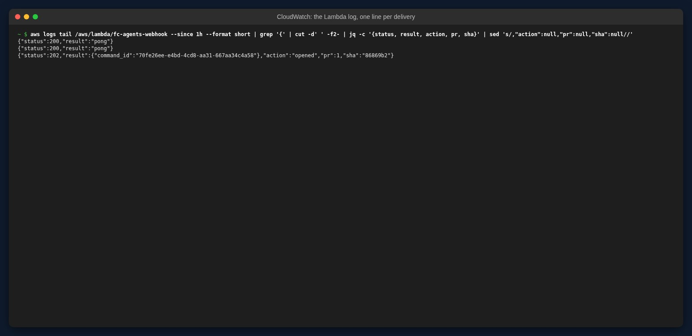

**D5. The job**

```bash
aws ssm list-commands --query 'Commands[0:2].[Comment,DocumentName,Status]' --output table
CMD=<the command ID from the delivery>
aws ssm get-command-invocation --command-id $CMD --instance-id $HOST --query StandardOutputContent --output text | tail -12
```

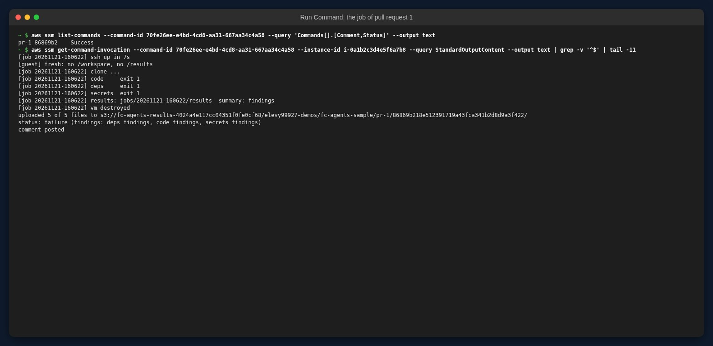

**D6. The results**

```bash
PR=1    # your pull request's number
aws s3 ls --recursive s3://$BUCKET/$REPO/pr-$PR/
aws s3 cp s3://$BUCKET/$REPO/pr-$PR/<sha>/summary.json - | jq .
```


**D7. The status and the comment.** A public fork needs no token to read them:

```bash
curl -s https://api.github.com/repos/$REPO/commits/<sha>/status | jq -c '.statuses[] | {context, state, description}'
curl -s https://api.github.com/repos/$REPO/issues/$PR/comments | jq -r '.[].body'
```

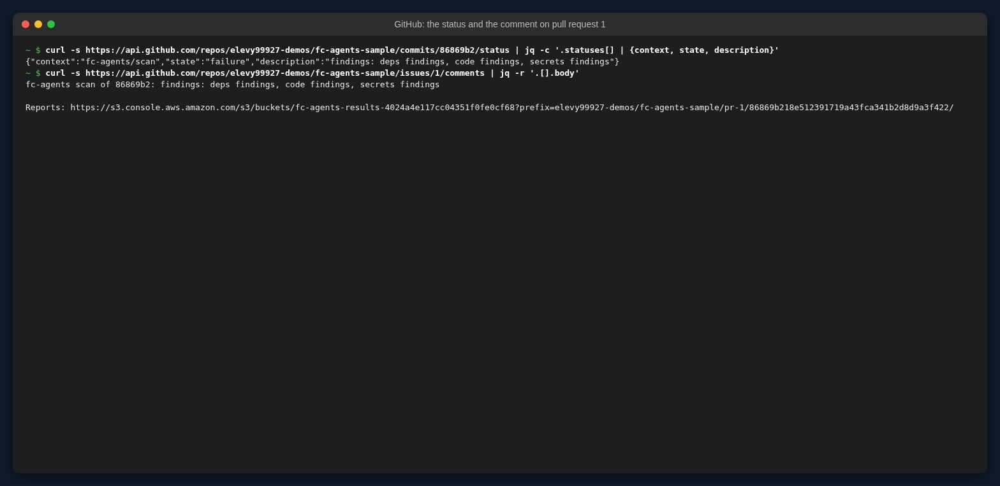

---

## Build it by hand, with the CLI

The same resources as the `terraform apply` in [A1](#a1-one-apply), one command at a time, on Part 3's running host (skip A1 if you take this path). The walkthrough's checks then work the same way.

### H1. Where we are

On the host (Part 3's `ssh` output):

```bash
ls ~/fc
pgrep -a firecracker || echo "no microVM running"
systemctl status snap.amazon-ssm-agent.amazon-ssm-agent.service --no-pager | head -3
snap list amazon-ssm-agent
```

The SSM Agent ships with the Ubuntu 24.04 AMI and is running, but the host has no role yet, so Systems Manager can't see it. The agent must be **3.3.2746.0 or newer** (for the environment-variable parameters in H7).

### H2. The bucket and the two secrets

**On your computer:**

```bash
export AWS_REGION=us-east-1
REPO=you/fc-agents-sample            # your fork
BUCKET=fc-agents-results-$(openssl rand -hex 4)
aws s3 mb s3://$BUCKET
aws ssm put-parameter --name /fc/webhook-secret --type SecureString --value "$(openssl rand -hex 32)"
```

Create the GitHub token: **Settings → Developer settings → Fine-grained tokens → Generate new token**: only your repository, permissions **Commit statuses** and **Pull requests**, both **Read and write**, a short expiry. Then store it without showing it:

```bash
read -rs GH_TOKEN      # paste the token, press Enter; nothing is shown
aws ssm put-parameter --name /fc/github-token --type SecureString --value "$GH_TOKEN"; unset GH_TOKEN
aws ssm describe-parameters --parameter-filters Key=Name,Option=BeginsWith,Values=/fc/ \
  --query 'Parameters[].[Name,Type]' --output table
```

### H3. A role for the host

```bash
ACCOUNT=$(aws sts get-caller-identity --query Account --output text)
HOST=$(aws ec2 describe-instances --filters Name=tag:Name,Values=fc-agents-host Name=instance-state-name,Values=running \
  --query 'Reservations[0].Instances[0].InstanceId' --output text)

aws iam create-role --role-name fc-agents-host --assume-role-policy-document \
  '{"Version":"2012-10-17","Statement":[{"Effect":"Allow","Principal":{"Service":"ec2.amazonaws.com"},"Action":"sts:AssumeRole"}]}'
aws iam attach-role-policy --role-name fc-agents-host --policy-arn arn:aws:iam::aws:policy/AmazonSSMManagedInstanceCore
aws iam put-role-policy --role-name fc-agents-host --policy-name results-and-token --policy-document "{
  \"Version\": \"2012-10-17\",
  \"Statement\": [
    {\"Effect\": \"Allow\", \"Action\": \"s3:PutObject\", \"Resource\": \"arn:aws:s3:::$BUCKET/*\"},
    {\"Effect\": \"Allow\", \"Action\": \"ssm:GetParameter\", \"Resource\": \"arn:aws:ssm:$AWS_REGION:$ACCOUNT:parameter/fc/github-token\"},
    {\"Effect\": \"Deny\", \"Action\": \"ssm:GetParameter*\", \"Resource\": \"arn:aws:ssm:$AWS_REGION:$ACCOUNT:parameter/fc/webhook-secret\"}
  ]}"
aws iam create-instance-profile --instance-profile-name fc-agents-host
aws iam add-role-to-instance-profile --instance-profile-name fc-agents-host --role-name fc-agents-host
aws ec2 associate-iam-instance-profile --instance-id $HOST --iam-instance-profile Name=fc-agents-host
```

**On the host:** install the AWS CLI and check who the host is now:

```bash
sudo snap install aws-cli --classic
aws sts get-caller-identity       # an assumed-role ARN: .../fc-agents-host/i-...
aws ssm get-parameter --name /fc/github-token --with-decryption --query Parameter.Name    # allowed
aws ssm get-parameter --name /fc/webhook-secret --with-decryption --query Parameter.Name  # AccessDenied
```

Why the **Deny**: `AmazonSSMManagedInstanceCore` itself allows `ssm:GetParameter` and `ssm:GetParameters` on every parameter, and the default `aws/ssm` key decrypts for anyone in the account. Without the deny, the host could read the webhook secret too. Only the Lambda needs it.

The credentials come from the instance metadata, rotate on their own, and are never written to disk. The guest can't reach that address: Part 3 dropped its traffic to `169.254.169.254` and set the hop limit to 1. Today that rule matters, because the host now holds something worth stealing.

### H4. The first command over SSM

**On your computer.** If the host isn't listed yet, wait a few minutes, or restart the agent on the host (`sudo snap restart amazon-ssm-agent`).

```bash
aws ssm describe-instance-information --query 'InstanceInformationList[].[InstanceId,PingStatus]' --output table
CMD=$(aws ssm send-command --instance-ids $HOST --document-name AWS-RunShellScript \
  --parameters 'commands=["runuser -u ubuntu -- ls /home/ubuntu/fc"]' --query Command.CommandId --output text)
aws ssm get-command-invocation --command-id $CMD --instance-id $HOST --query '[Status,StandardOutputContent]' --output text
```

Run the last line again until the status is `Success`: `send-command` returns at once, and the result shows up a moment later. The agent runs as **root**, so every command switches to `ubuntu` with `runuser`: `run-job.sh` uses ubuntu's home, SSH key and TAP. The security group didn't change: the agent calls out to Systems Manager, so there's no new inbound rule.

### H5. `pr-job.sh`: pending, run, upload, status

[`terraform/scripts/pr-job.sh`](terraform/scripts/pr-job.sh) wraps Part 3's `run-job.sh`:

1. Checks its four arguments again (they came from the internet).
2. Reads the token from Parameter Store, into a variable, for the length of the script.
3. If a job is already running: the same commit → does nothing (a redelivery); another commit → `error: host busy, push again`.
4. Posts `pending`, runs `./run-job.sh <url> <sha>`, and takes **its own** job id from `run-job.sh`'s `[job <id>]` lines.
5. Uploads the three reports, `summary.json` and `compose.log` to `s3://$BUCKET/<owner>/<repo>/pr-<n>/<sha>/` (the layout is in [B1](#b1-the-bucket)).
6. Posts the final status from the verdict on the commit, and the same verdict as a comment on the pull request, with the link to the reports (no comment for pull request 0). A failed post is a warning: an expired token doesn't stop the scan or the upload.

Copy it and [`jobctl`](terraform/scripts/jobctl) to the host (from Part 3's `terraform/` folder, where the key is), and tell it the bucket:

```bash
P4=../../part-4-lambda-webhook/terraform/scripts
IP=$(terraform output -raw host_ip)
scp -i ssh/terraform-key $P4/pr-job.sh $P4/jobctl ubuntu@$IP:fc/
ssh -i ssh/terraform-key ubuntu@$IP "printf 'BUCKET=%s\nexport AWS_REGION=us-east-1\n' $BUCKET > fc/pr-job.env && chmod +x fc/pr-job.sh fc/jobctl"
```

### H6. Test it by hand, from the host

```bash
cd ~/fc
./pr-job.sh https://github.com/you/fc-agents-sample.git c48a39a82205ff3b828d21393aa0e295da54f5e9 0 you/fc-agents-sample
```

Pull request number 0, because there's no pull request yet; the status still appears on the commit. Expected: `status: pending`, Part 3's job lines, `uploaded 5 of 5 files`, `status: failure (findings: …)`. On your computer (the host's role can only put objects, not list them):

```bash
aws s3 ls --recursive s3://$BUCKET/
```

### H7. The SSM document

[`terraform/ssm/fc-run-pr-job.yaml`](terraform/ssm/fc-run-pr-job.yaml): one fixed command, `runuser -u ubuntu -- /home/ubuntu/fc/pr-job.sh "$SSM_url" "$SSM_sha" "$SSM_pr" "$SSM_repo"`, a 1,500-second timeout (Part 3's 15-minute scan, plus boot and upload). With `interpolationType: ENV_VAR`, SSM puts each value into an environment variable instead of pasting it into the command, and `allowedPattern` rejects anything that isn't a GitHub URL, a SHA, a number or `owner/name` before the command is even sent.

```bash
cd part-4-lambda-webhook/terraform
aws ssm create-document --name fc-run-pr-job --document-type Command --document-format YAML \
  --content file://ssm/fc-run-pr-job.yaml --query DocumentDescription.Status --output text
```

### H8. The function

[`terraform/lambda/app.py`](terraform/lambda/app.py), in three pieces:

1. **The signature.** The raw body (decoded if base64), the `x-hub-signature-256` header, the secret from `/fc/webhook-secret` (read once per cold start), `hmac.new(secret, body, sha256)`, compared with `hmac.compare_digest`. No header or a wrong one → **401**. `ping` → 200.
2. **Which events, which fields.** Only `pull_request` with `opened`; anything else, including `synchronize`, → 200 "ignored". Four fields: `number`, `pull_request.head.sha`, `pull_request.head.repo.clone_url`, `repository.full_name`. A repository outside `REPOS`, a bad SHA or URL → 400.
3. **Hand it over.** `send_command` with `fc-run-pr-job` and a Comment `pr-<n> <sha7>`, then **202** with the CommandId.

Check it locally (no AWS): `python3 lambda/test_app.py`.

The role: logs, `ssm:SendCommand` on this host and this document only, and the webhook secret.

```bash
aws iam create-role --role-name fc-agents-webhook --assume-role-policy-document \
  '{"Version":"2012-10-17","Statement":[{"Effect":"Allow","Principal":{"Service":"lambda.amazonaws.com"},"Action":"sts:AssumeRole"}]}'
aws iam attach-role-policy --role-name fc-agents-webhook \
  --policy-arn arn:aws:iam::aws:policy/service-role/AWSLambdaBasicExecutionRole
aws iam put-role-policy --role-name fc-agents-webhook --policy-name send-one-command --policy-document "{
  \"Version\": \"2012-10-17\",
  \"Statement\": [
    {\"Effect\": \"Allow\", \"Action\": \"ssm:SendCommand\", \"Resource\": [
      \"arn:aws:ec2:$AWS_REGION:$ACCOUNT:instance/$HOST\",
      \"arn:aws:ssm:$AWS_REGION:$ACCOUNT:document/fc-run-pr-job\"]},
    {\"Effect\": \"Allow\", \"Action\": \"ssm:GetParameter\", \"Resource\": \"arn:aws:ssm:$AWS_REGION:$ACCOUNT:parameter/fc/webhook-secret\"}
  ]}"

(cd lambda && zip -q ../lambda.zip app.py)
sleep 10   # a new role takes a few seconds to be usable
aws lambda create-function --function-name fc-agents-webhook --runtime python3.14 --handler app.handler --timeout 30 \
  --role arn:aws:iam::$ACCOUNT:role/fc-agents-webhook --zip-file fileb://lambda.zip \
  --environment "Variables={HOST=$HOST,DOCUMENT=fc-run-pr-job,REPOS=$REPO,SECRET_PARAM=/fc/webhook-secret}"
```

### H9. Its URL

```bash
URL=$(aws lambda create-function-url-config --function-name fc-agents-webhook --auth-type NONE --query FunctionUrl --output text)
aws lambda add-permission --function-name fc-agents-webhook --statement-id url-public \
  --action lambda:InvokeFunctionUrl --principal '*' --function-url-auth-type NONE
aws lambda add-permission --function-name fc-agents-webhook --statement-id url-invoke \
  --action lambda:InvokeFunction --principal '*' --invoked-via-function-url
echo $URL
```

Auth type `NONE`: Lambda does no authentication, and the function's resource-based policy must allow public calls. Since October 2025 that takes **both** permissions; the Console adds them for you, the CLI doesn't.

### H10. Knock on the door without a key

```bash
curl -i -X POST $URL -d '{}'                                                  # 401 missing signature
curl -i -X POST $URL -d '{}' -H 'X-Hub-Signature-256: sha256=0000000000'      # 401 bad signature
aws logs tail /aws/lambda/fc-agents-webhook --since 5m
```

---

## Clean up

**After the walkthrough** (the Terraform path), in `part-4-lambda-webhook/terraform`:

```bash
terraform destroy
aws ssm delete-parameter --name /fc/webhook-secret
aws ssm delete-parameter --name /fc/github-token
```

`force_destroy` empties the results bucket first. The two parameters were never in Terraform, so they're deleted by hand.

**After the build by hand:**

```bash
aws lambda delete-function --function-name fc-agents-webhook
aws logs delete-log-group --log-group-name /aws/lambda/fc-agents-webhook
aws ssm delete-document --name fc-run-pr-job
aws iam delete-role-policy --role-name fc-agents-webhook --policy-name send-one-command
aws iam detach-role-policy --role-name fc-agents-webhook --policy-arn arn:aws:iam::aws:policy/service-role/AWSLambdaBasicExecutionRole
aws iam delete-role --role-name fc-agents-webhook
aws ec2 disassociate-iam-instance-profile --association-id $(aws ec2 describe-iam-instance-profile-associations \
  --filters Name=instance-id,Values=$HOST --query 'IamInstanceProfileAssociations[0].AssociationId' --output text)
aws iam remove-role-from-instance-profile --instance-profile-name fc-agents-host --role-name fc-agents-host
aws iam delete-instance-profile --instance-profile-name fc-agents-host
aws iam delete-role-policy --role-name fc-agents-host --policy-name results-and-token
aws iam detach-role-policy --role-name fc-agents-host --policy-arn arn:aws:iam::aws:policy/AmazonSSMManagedInstanceCore
aws iam delete-role --role-name fc-agents-host
aws s3 rb s3://$BUCKET --force
aws ssm delete-parameter --name /fc/webhook-secret
aws ssm delete-parameter --name /fc/github-token
```

Then the host (`terraform destroy` in Part 3's or Part 4's folder), and in GitHub the webhook and the token.

---

**Next:** Part 5: the full system, Terraform for everything, an AI reviewer with a short-lived token, and a Matrix room per pull request. The full plan: [chapters-plan.md](../chapters-plan.md).

---

Independent course, not affiliated with or endorsed by AWS. AWS and related names are trademarks of Amazon.com, Inc. or its affiliates.
