# Part 5: Two microVMs in parallel

*Firecracker Lab: Run AI Agents in Isolated MicroVMs*, Part 5 of 8. Hands-on: two pull requests, two scans at the same time on one EC2 host. Each job gets its own network slot, a TAP interface with its own guest address, and gives it back when its microVM is gone.

<!-- video: add the embed when Part 5 is uploaded -->

**Before you start:** [Part 4](../part-4-lambda-webhook/README.md), working end to end: your fork of `fc-agents-sample`, the two secrets in Parameter Store, the webhook. Below, `you/fc-agents-sample` stands for your fork.

**The roadmap changed.** Part 4 ended with "Part 5: the full system", and its roadmap had five parts. That was wrong: the lab grew to eight parts, and running jobs side by side comes before the AI agents.

## The problem, and the solution

While testing Part 4, two pull requests were open at once. Their jobs overlapped, and the second one only got `error: host busy, push again`. It was never scanned: the Lambda acts only on a **new** pull request, so a push doesn't start a scan.

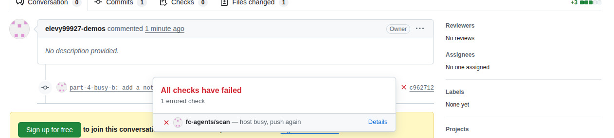

*Reproduced on the Part 5 host with Part 4's scripts, before the change: pull request #3 opened 5 seconds after #2.*

The reason was the network. Every job used **`tap0`**, and a TAP interface can be attached to **one microVM only**. Every guest also had the same address, `172.16.0.2`, baked into the base image. So Part 4 took one lock for the whole host and turned the second job away.

The solution in this part:

1. **Four TAPs, made in advance** (`tap0`-`tap3`), each with its own small subnet. One TAP = one running microVM.
2. **A lock per TAP.** A job takes the first free one. The kernel gives each lock to one process only, and drops it when the job's processes are gone, even after a crash.
3. **An address per job.** Before boot, the job writes its slot's address into its own copy of the disk.
4. **At most two at a time.** Each microVM takes 2 vCPUs and 2 GiB, and this host has 2 vCPUs and 8 GiB. Two is enough for a proof of concept; `tap2` and `tap3` are ready for a bigger host.

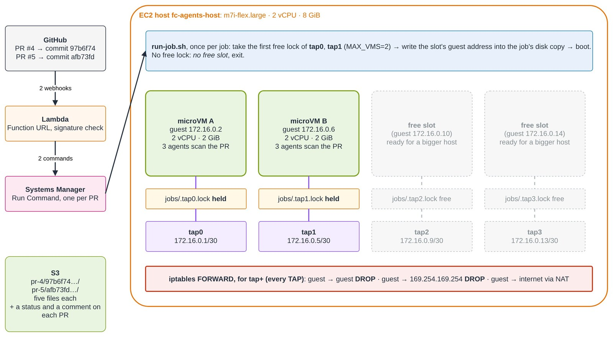
<sub>Diagram source: [images/part-5-parallel-microvms.drawio](images/part-5-parallel-microvms.drawio)</sub>

## What changed from Part 4, and why

| Part 4 | Part 5 | Why |
|---|---|---|
| One TAP, `tap0`, created when missing | Four TAPs, `tap0`-`tap3`, each with its own /30 | A TAP can be attached to one microVM only |
| Every guest at `172.16.0.2` | Slot N: host `172.16.0.(4N+1)`, guest `172.16.0.(4N+2)` | Two guests can't share an address |
| Firewall rules for `tap0` | Rules for `tap+` (every TAP), plus a drop between guests | The metadata drop must cover every guest, and one guest must not reach another |
| One global lock; a second job refused | One lock per TAP, at most two jobs | Two jobs at once |
| `error: host busy, push again` | Removed | A push never started a scan; a third job just stops (a queue comes much later) |
| The roadmap: 5 parts, Part 5 "the full system" | 8 parts | The lab grew; AI agents come after this part |

Unchanged: the Lambda, the SSM document, IAM, S3, the base image, and the Part 2-3 scripts.

## What changed in the code

| File | Change |
|---|---|
| [`scripts/host-net.sh`](terraform/scripts/host-net.sh) | Four TAPs; rules for `tap+`; guest-to-guest drop |
| [`scripts/run-job.sh`](terraform/scripts/run-job.sh) | A lock per TAP instead of the global lock; the guest address per job; log lines for the slot and the scan |
| [`scripts/pr-job.sh`](terraform/scripts/pr-job.sh) | The "host busy" check removed |
| [`scripts/jobctl`](terraform/scripts/jobctl) | A running job is one whose TAP lock is held |
| [`scripts/check-parallel.sh`](terraform/scripts/check-parallel.sh) | New: the parallel check, run by hand |

## Where you run the commands

| Where | What runs there |
|---|---|
| **Your computer** | `terraform apply`, opening the two pull requests |
| **The AWS Console** (browser) | Systems Manager, S3 |
| **The host** (`fc-agents-host`, in `~/fc`) | `ip`, `iptables`, `pgrep`, `jobctl list`, `check-parallel.sh` |
| **GitHub** (browser) | Recent Deliveries, the two pull requests |

## The walkthrough

## Part A: Four TAPs and a lock per TAP

### A1. One apply

Destroy Part 4's stack first (`terraform destroy` in its folder): Part 5 uses the same names. Then, on your computer:

```bash
cd part-5-parallel-microvms/terraform
export TF_VAR_MY_IP="$(curl -s https://checkip.amazonaws.com)/32"
export TF_VAR_REPOS=you/fc-agents-sample
terraform init && terraform apply
terraform output
```

The host builds itself again, about 10 minutes (`~/fc/lab.done`). The secrets stay in Parameter Store from Part 4. The **Function URL is new**, so point your webhook at it: **Settings → Webhooks → your webhook → Payload URL**, or the API call in [Part 4, D2](../part-4-lambda-webhook/README.md#d2-the-webhook).

### A2. Four TAPs, made in advance

The host prepares the network slots before any job arrives. A TAP is the virtual cable between the host and one microVM, and only one microVM can hold it, so the number of TAPs is the number of microVMs that can run at once.

```bash
# scripts/host-net.sh
SLOTS=4
for N in $(seq 0 $((SLOTS-1))); do
  ip link show tap$N >/dev/null 2>&1 && continue
  sudo ip tuntap add dev tap$N mode tap user ubuntu
  sudo ip addr add 172.16.0.$((4*N+1))/30 dev tap$N
  sudo ip link set dev tap$N up
done
```

Each TAP gets a /30: two usable addresses, the host's side and the guest's. `tap0` keeps Part 4's `172.16.0.1`/`.2`; `tap1` is `.5`/`.6`.

The rules now name `tap+`, which matches every interface whose name starts with `tap`:

```bash
# scripts/host-net.sh
add FORWARD -i tap+ -o $OUT -j ACCEPT
add FORWARD -i $OUT -o tap+ -m state --state RELATED,ESTABLISHED -j ACCEPT
top FORWARD -i tap+ -d 169.254.169.254 -j DROP   # no guest reaches the instance metadata
top FORWARD -i tap+ -o tap+ -j DROP              # no guest reaches another guest
```

The two drops go to the top of the chain, before any ACCEPT. On the host:

```bash
ip -br addr show | grep tap
sudo iptables -S FORWARD | grep 'tap+'
```

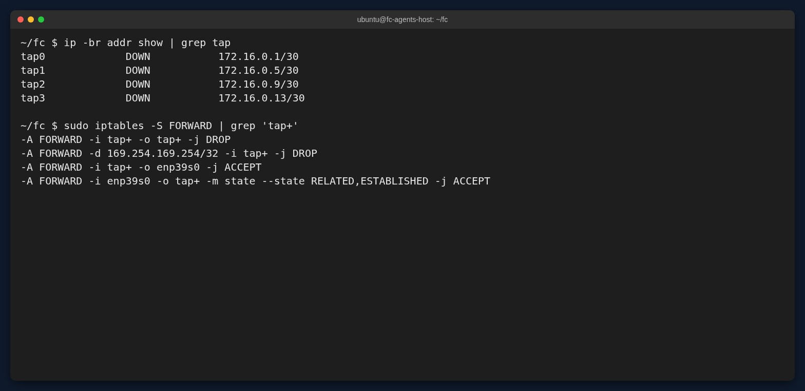

The TAPs show `DOWN` until a microVM attaches to them. The full `iptables -S FORWARD` also lists three `tap0` rules from Part 2's `boot-guest.sh` (the image build); the `tap+` rules already cover them.

### A3. A lock per TAP

```bash
# scripts/run-job.sh
SLOT=
for N in $(seq 0 $((MAX_VMS-1))); do
  exec 9>jobs/.tap$N.lock
  flock -n 9 && { SLOT=$N; break; }
  exec 9>&-
done
[ -n "$SLOT" ] || { echo "no free slot: $MAX_VMS microVMs are already running"; exit 1; }
TAP=tap$SLOT; GW=172.16.0.$((4*SLOT+1)); GUEST=172.16.0.$((4*SLOT+2))
```

- **Try, don't wait.** `flock -n` takes the lock or fails at once; a taken TAP sends the job to the next one.
- **No unlock step.** The lock belongs to the open file (descriptor 9). The script holds it, the Firecracker it starts inherits it, and the kernel drops it when both are gone, even after a crash.
- **The limit comes from the same locks.** The loop tries only the first `MAX_VMS=2` TAPs, so a third job finds both taken and stops. No counter, no race between two jobs.

### A4. An address per job

The base image has `172.16.0.2` baked in. Before boot, each job writes its own address into its own disk copy, which is still the clean base image: nothing from the repository is on it yet.

```bash
# scripts/run-job.sh
mkdir -p $JOB/mnt && sudo mount -o loop $JOB/rootfs.ext4 $JOB/mnt
printf '[Match]\nName=eth0\n\n[Network]\nAddress=%s/30\nGateway=%s\nDNS=1.1.1.1\nDHCP=no\n' $GUEST $GW |
  sudo tee $JOB/mnt/etc/systemd/network/eth0.network >/dev/null
sudo umount $JOB/mnt
sed -e "s|\"ubuntu.ext4\"|\"$JOB/rootfs.ext4\"|" -e "s|\"tap0\"|\"$TAP\"|" vm.json > $JOB/vm.json
```

The base image and the Part 2-3 scripts don't change. If anything fails, the cleanup unmounts the copy and deletes it.

## Part B: Two pull requests

### B1. Open two pull requests

Two branches with one small change each, then two API calls a few seconds apart. On your computer, in a clone of your fork. Keep the token in a variable, never typed on the command line:

```bash
for b in part-5-job-a part-5-job-b; do
  git switch -c $b main && echo "$b" > notes-$b.md && git add . && git commit -qm "$b: add a note" && git push -q origin $b
done
read -rs GH_TOKEN; export GH_TOKEN      # the token from Part 4 (Pull requests: Read and write)
R=https://api.github.com/repos/you/fc-agents-sample/pulls
curl -s -X POST $R -H "Authorization: Bearer $GH_TOKEN" \
  -d '{"title":"Part 5: change A","head":"part-5-job-a","base":"main"}' | jq -r '"#\(.number) \(.head.sha[0:7])"'
curl -s -X POST $R -H "Authorization: Bearer $GH_TOKEN" \
  -d '{"title":"Part 5: change B","head":"part-5-job-b","base":"main"}' | jq -r '"#\(.number) \(.head.sha[0:7])"'
```

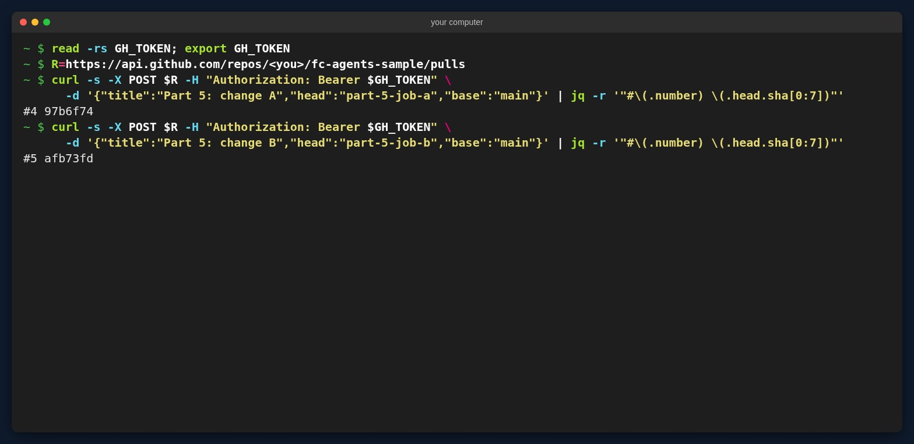

**Settings → Webhooks → your webhook → Recent Deliveries:** two `pull_request` deliveries, both **202**. The same from the terminal (`HOOK` is your webhook's API URL, as in Part 4):

```bash
curl -s $HOOK/deliveries -H "Authorization: Bearer $GH_TOKEN" | jq -r '.[] | [.delivered_at, .event, .action, .status_code] | @tsv' | head -2
unset GH_TOKEN
```

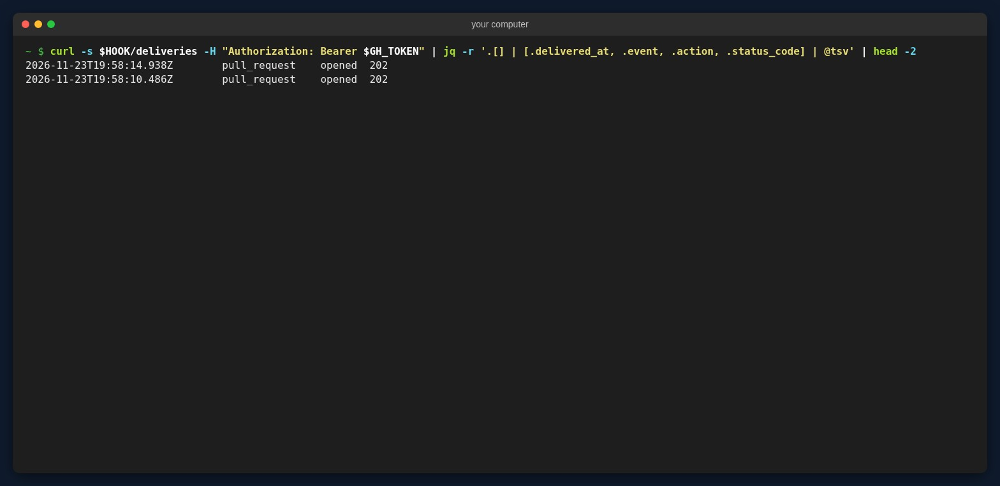

### B2. Each job got its own TAP

**Systems Manager → Run Command:** while the jobs run, both commands are under **Commands**, In Progress. Afterwards, **Command history** shows both, sent 4 seconds apart, both **Success**. Below them, Part 4's pair: `pr-3` **Failed**, the "host busy" job.

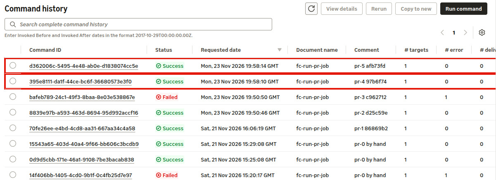

Open each command's **Output**: one job says `slot 0: tap0, guest 172.16.0.2`, the other `slot 1: tap1, guest 172.16.0.6`. The two outputs, the lines that matter, by time:

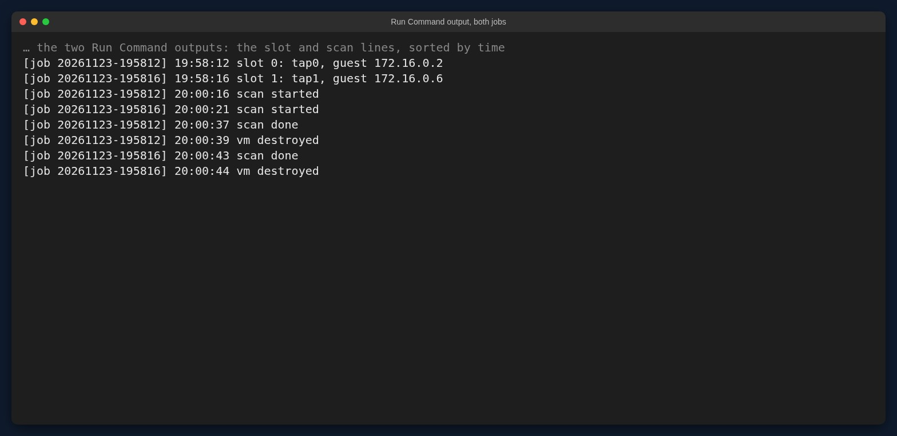

On the host:

```bash
pgrep -a firecracker
./jobctl list
```

Two Firecracker processes, two jobs `running on tap0` and `running on tap1`.

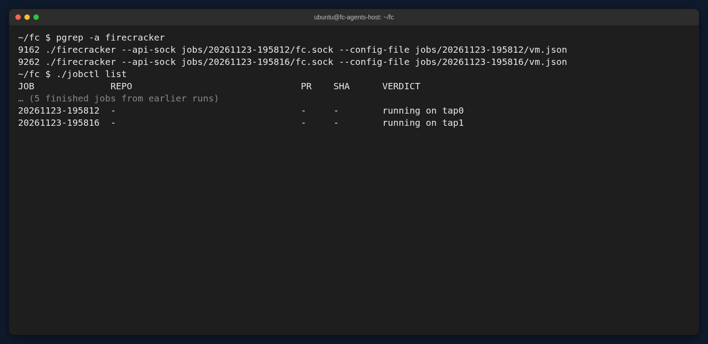

### B3. The scans overlapped

Each job logs when its scan starts and ends. The second job's `scan started` comes before the first job's `scan done`: the two scans ran at the same time.

| Job | Slot | Scan started | Scan done | microVM gone |
|---|---|---|---|---|
| PR #4 | `tap0`, `172.16.0.2` | 20:00:16 | 20:00:37 | 20:00:39 |
| PR #5 | `tap1`, `172.16.0.6` | 20:00:21 | 20:00:43 | 20:00:44 |

**Parallel isn't faster on this host.** In this run, one job alone (Part 4's PR #2) took about 1.5 minutes from "pending" to the result; the two together took about 2.5 minutes, both done. Two microVMs with 2 vCPUs each share the host's 2 vCPUs. What Part 5 fixes is that no job is turned away; more speed means more hosts (below).

### B4. Each result went back to its own commit

Each pull request has its own `fc-agents/scan` status and a comment that names its own commit. **S3 → the bucket → `<owner>/<repo>/`:** two folders, `pr-<a>/<sha-a>/` and `pr-<b>/<sha-b>/`, five files each. Each job has its own folder on the host, and `pr-job.sh` reads its job id from its own log, never "the newest folder".

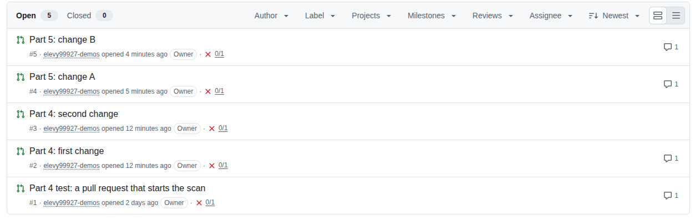

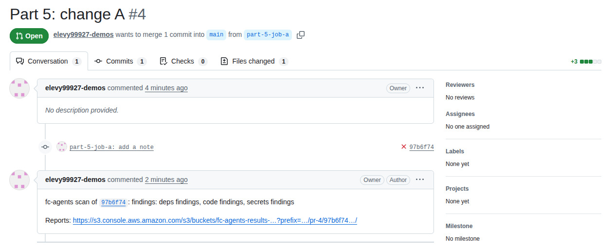

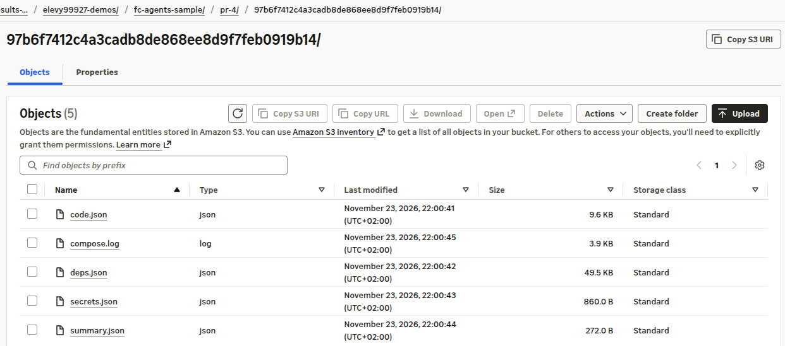

## The parallel check

On the host, `check-parallel.sh` runs the same test without GitHub: two jobs three seconds apart, a third one while they run, and the isolation and cleanup checks.

```bash
cd ~/fc && ./check-parallel.sh
```

| Check | Expected |
|---|---|
| Job 1 / job 2 | `tap0` + `172.16.0.2` / `tap1` + `172.16.0.6` |
| The scans | Job 2's `scan started` before job 1's `scan done` |
| A third job | `no free slot`, and no third microVM |
| From guest 1 | No ping to guest 2, no metadata, GitHub answers 200 |
| Afterwards | No Firecracker, no disk copies or mounts, both locks free |

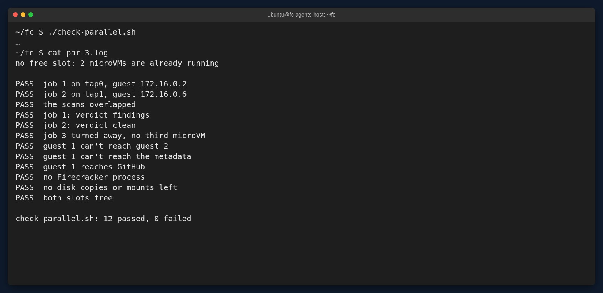

In this run all 12 checks passed. The third job got `no free slot: 2 microVMs are already running`.

## What this does, and what it doesn't

- **Two at a time, on one host.** A third job stops with "no free slot" and its pull request gets an error status. Nothing waits in line.
- **Two jobs in the same second** would get the same job folder (the id is the time to the second). Fine for a proof of concept.
- **More capacity later:** the Lambda can send jobs to an SQS queue, EC2 workers pull jobs when they have room, and an Auto Scaling group adds hosts as the backlog grows ([AWS: scaling based on SQS](https://docs.aws.amazon.com/autoscaling/ec2/userguide/as-using-sqs-queue.html)). Not built here.
- **The host is the main cost,** about $0.10 an hour for `m7i-flex.large`, even idle. Destroy the stack when you're done: `terraform destroy`.

## Check yourself

1. Why can't two microVMs share `tap0`? *A TAP is attached to one microVM only; and both guests would have the same address.*
2. What frees a TAP after a crash? *The kernel: the lock belongs to the open file, and it goes when the job's processes are gone.*
3. Where does the limit of two come from? *The lock loop tries only the first two TAPs; no counter.*
4. Why write the address into the disk copy, and not the base image? *Each job needs a different address, and the copy is still the clean base before boot.*
5. Why can't guest 1 reach guest 2? *The `tap+` to `tap+` drop at the top of FORWARD.*
